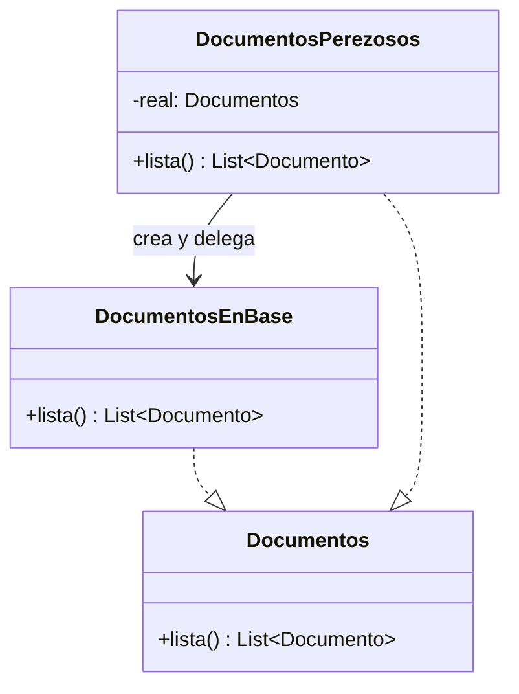
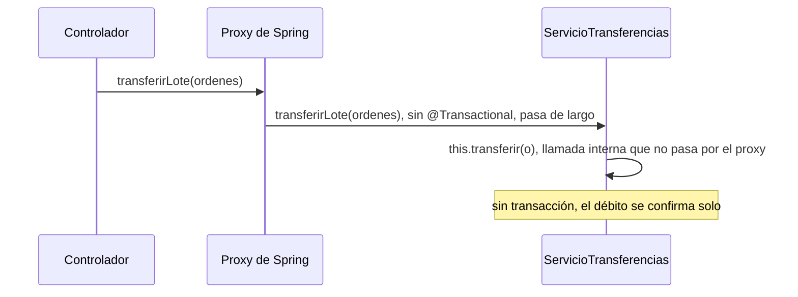
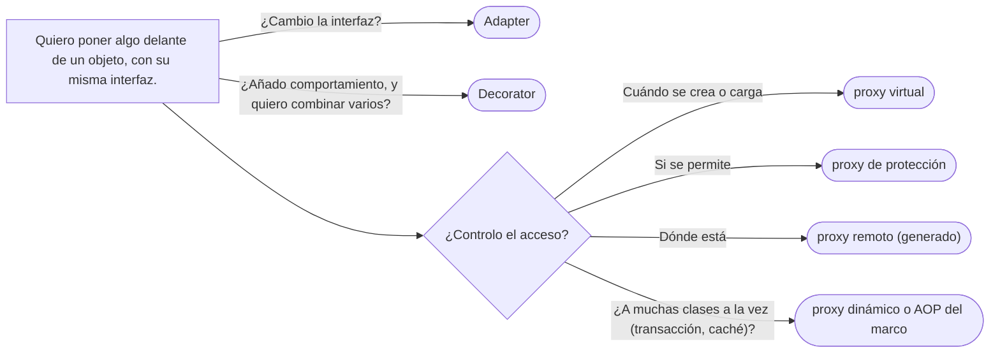

# 03 — Proxy, y los tres que se confunden

> Poner delante de un objeto otro con su misma interfaz que **controla el acceso** a él —lo crea tarde, lo
> protege, lo trae de lejos—; escribirlo a mano y con los proxies dinámicos del JDK; explicar por qué
> `@Transactional` no funciona en la llamada interna; y distinguir Proxy, Decorator y Adapter en una frase.
> **Nivel: A.** Es el dueño de la distinción de los tres. Se lee suelto; lo que asume, en el recordatorio de
> §1. Para profundizar: [`02` — Decorator](02-decorator.md) y [`01` — Adapter](01-adapter.md).
>
> **Vigencia:** 2026-10-03.
>
> **Versiones ejecutadas:** GCC 14.4 (C++23) · JDK 21.0.12, 17.0.20 y 25.0.4 · Spring Boot 4.1.1 (Spring Framework 7.0.9, Hibernate 7.4.5, H2 2.4.240) · mermaid-cli 11.17.0 (2026-10-04).

**Salto rápido:** [1](#1--el-problema) · [2](#2--la-estructura) · [5](#5--java) · [6](#6--autopsia-transactional-en-la-llamada-interna) · [7](#7-️-los-tres-que-se-confunden) · [9](#9-️-lo-que-cuesta-y-cuándo-no)

---

## 1. 🎯 El problema

**Recordatorio de lo que se asume.** Una **interfaz** fija qué operaciones ofrece un objeto; quien la usa no
sabe qué clase hay detrás. **Envolver** es que un objeto contenga a otro y le delegue las llamadas. En Spring,
un **bean** es un objeto que crea y conecta el contenedor, y un **aspecto** es comportamiento —transacciones,
seguridad— que el contenedor aplica alrededor de los métodos.

Dos problemas de `Persona` y sus documentos:

```java
// 1. La pantalla lista 500 personas; cada Persona carga sus documentos al construirse
List<Persona> personas = repositorio.todas();          // 1 consulta de personas + 500 de documentos
pantalla.mostrarNombres(personas);                     // ...y la pantalla ni mira los documentos

// 2. Solo la tutora puede ver los documentos de un menor; la comprobación está en cada servicio
if (luis.esMenor(hoy) && !usuario.equals(luis.tutor())) throw new AccesoDenegadoException();
List<Documento> docs = luis.documentos();
```

- El primero paga 500 consultas que nadie necesitaba. Cargar los documentos **cuando se pidan** exige que
  `Persona` sepa de la base de datos, o que alguien se ponga delante.
- El segundo repite la regla de acceso en cada servicio que toca documentos, y el día que uno la olvida, un
  usuario cualquiera ve el pasaporte de Luis.

En los dos casos el objeto real está bien; lo que hace falta es **alguien delante** que decida cuándo y si se
llega a él, sin que quien llama lo note. Ese alguien es el Proxy.

---

## 2. 📐 La estructura

**La intención, en una frase del GoF:** proporcionar un sustituto o representante de otro objeto para
controlar el acceso a él.



- **Subject** (`Documentos`): la interfaz común. Es una interfaz.
- **Real Subject** (`DocumentosEnBase`): el objeto que hace el trabajo.
- **Proxy** (`DocumentosPerezosos`): **la misma interfaz**, una referencia al real, y la lógica de acceso.

El GoF distingue cuatro clases de proxy según **qué controla**:

| Proxy | Controla | En el dominio |
|---|---|---|
| **Virtual** | **Cuándo** se crea o se carga el real | Los documentos se consultan la primera vez que se piden |
| **De protección** | **Si** se permite la llamada | Solo la tutora ve los documentos de Luis |
| **Remoto** | **Dónde** está: representa un objeto de otro proceso | El cliente generado de un servicio remoto de personas |
| **Referencia inteligente** | **Qué pasa** en cada acceso: contar referencias, bloquear | `std::shared_ptr` |

---

## 3. 🏛️ Cómo nació

En C++98 el GoF escribe el proxy virtual de una imagen que se carga al dibujarla, y el **operador `->`
sobrecargado** como forma de proxy que el lenguaje permite:

```cpp
class DocumentosPerezosos : public Documentos {
public:
    DocumentosPerezosos(PersonaId id, FuenteDatos& f) : id_(id), fuente_(f), real_(0) {}
    ~DocumentosPerezosos() { delete real_; }
    const std::vector<Documento>& lista() {
        if (real_ == 0) real_ = new DocumentosEnBase(id_, fuente_);   // la consulta, al primer uso
        return real_->lista();
    }
private:
    PersonaId id_;
    FuenteDatos& fuente_;
    DocumentosEnBase* real_;
};
```

- El cliente recibe un `Documentos` y no sabe si la consulta ya se hizo. El proxy guarda solo lo necesario
  para crear el real después: el identificador y la fuente.
- La versión con `operator->` es el antepasado de los *smart pointers*: un objeto que se usa con la sintaxis
  de un puntero y hace algo en cada acceso.

---

## 4. 💻 C++ moderno

Los ***smart pointers* son proxies de referencia inteligente**: `std::shared_ptr` cuenta referencias en cada
copia y destruye al llegar a cero; `std::unique_ptr` destruye al salir del ámbito. Un proxy de protección se
escribe como cualquier implementación de la interfaz:

```cpp
class DocumentosProtegidos final : public Documentos {
public:
    DocumentosProtegidos(std::unique_ptr<Documentos> real, const Persona& titular, const Usuario& usuario)
        : real_{std::move(real)}, titular_{titular}, usuario_{usuario} {}

    const std::vector<Documento>& lista() override {
        if (titular_.esMenor(hoy()) && !usuario_.es(titular_.tutor()))
            throw AccesoDenegado{"solo la tutora ve los documentos de un menor"};
        return real_->lista();
    }
private:
    std::unique_ptr<Documentos> real_;   // posee al real, o a otro proxy: se apilan
    const Persona& titular_;
    const Usuario& usuario_;
};
```

- La regla de acceso vive en **un** sitio. Y como el real también es un `Documentos`, un proxy de protección
  puede envolver a un proxy virtual: primero se comprueba el permiso, después se consulta la base.

---

## 5. 💻 Java

**A mano**, el proxy virtual es una implementación más de la interfaz:

```java
public final class DocumentosPerezosos implements Documentos {
    private final PersonaId id;
    private final RepositorioDocumentos repositorio;
    private List<Documento> cargados;                    // null hasta el primer uso

    public DocumentosPerezosos(PersonaId id, RepositorioDocumentos repositorio) {
        this.id = id;
        this.repositorio = repositorio;
    }
    @Override public List<Documento> lista() {
        if (cargados == null) cargados = List.copyOf(repositorio.dePersona(id));
        return cargados;
    }
}
```

- No es seguro entre hilos; para un objeto del dominio que vive en una petición no hace falta. Si se compartiera,
  la inicialización perezosa segura de [`04/07` §4](../04-creacionales/07-mas-alla-del-gof.md#4--lazy-initialization).

**Con un proxy dinámico del JDK**, el proxy se genera al ejecutar para **cualquier** interfaz, y la lógica va en
un `InvocationHandler` que recibe todas las llamadas:

```java
@SuppressWarnings("unchecked")
static <T> T auditado(T real, Class<T> interfaz, Auditoria auditoria) {
    InvocationHandler manejador = (proxy, metodo, args) -> {
        auditoria.registrar(interfaz.getSimpleName() + "." + metodo.getName());
        try {
            return metodo.invoke(real, args);
        } catch (InvocationTargetException e) {
            throw e.getCause();                          // la excepción real, no el envoltorio de reflexión
        }
    };
    return (T) Proxy.newProxyInstance(interfaz.getClassLoader(), new Class<?>[] { interfaz }, manejador);
}

RepositorioPersonas repo = auditado(new RepositorioPersonasJdbc(fuente), RepositorioPersonas.class, auditoria);
```

- Un manejador sirve para todas las interfaces y todos los métodos: es lo que usan los marcos para aplicar un
  comportamiento a cien clases sin escribir cien proxies.
- **Solo funciona con interfaces.** Para proxear una clase hace falta generar una **subclase** en tiempo de
  ejecución: es lo que hace CGLIB (o ByteBuddy). Por eso un proxy de subclase **no puede interceptar métodos
  `final` ni `private`**, ni existir para una clase `final`.

Spring usa los dos: proxy del JDK si el bean implementa alguna interfaz, y de subclase si no; Spring Boot
configura por defecto los de subclase (`spring.aop.proxy-target-class=true`).

---

## 6. 🩺 Autopsia: `@Transactional` en la llamada interna

**1. El código que escribe todo el mundo.**

```java
@Service
public class ServicioTransferencias {
    public void transferirLote(List<OrdenTransferencia> ordenes) {
        for (var o : ordenes) transferir(o);           // llamada interna
    }

    @Transactional
    public void transferir(OrdenTransferencia o) {
        cuentas.debitar(o.origen(), o.monto());
        cuentas.acreditar(o.destino(), o.monto());    // si lanza, ¿se deshace el débito?
    }
}
```

**2. Por qué parece correcto.** `transferir` tiene la anotación, y cuando un controlador llama a `transferir`
directamente, la transacción funciona y los tests pasan.

**3. La secuencia que lo rompe.** El controlador llama a `transferirLote`. La transferencia de Ana a Luis falla
en `acreditar`, y el débito de Ana **queda confirmado**: no hubo transacción.



La transacción no la abre `ServicioTransferencias`: la abre **el proxy** que Spring puso delante del bean. Y
`this` dentro del servicio es el objeto real, no el proxy. La documentación de Spring lo dice así: en modo
proxy, solo se interceptan las llamadas externas que entran por el proxy; la autoinvocación no produce una
transacción aunque el método invocado esté anotado.

**4. El código correcto.** La salida más limpia es que la llamada **cruce un bean**:

```java
@Service
public class ProcesadorLotes {
    private final ServicioTransferencias servicio;               // el proxy, inyectado
    public ProcesadorLotes(ServicioTransferencias s) { this.servicio = s; }
    public void transferirLote(List<OrdenTransferencia> ordenes) {
        for (var o : ordenes) servicio.transferir(o);            // ← cambia: entra por el proxy
    }
}
```

**5. La generalización.** Todo comportamiento que aplica un proxy —`@Transactional`, `@Cacheable`, `@Async`,
`@PreAuthorize`, `@Retryable`— desaparece en la llamada por `this`, en los métodos `private` y en los `final`.
Es el precio de que el comportamiento viva **fuera** del objeto. AspectJ con tejido en compilación no tiene el
problema, porque modifica el código del objeto en lugar de ponerle algo delante.

---

## 7. ⚖️ Los tres que se confunden

| | **Proxy** | **Decorator** | **Adapter** |
|---|---|---|---|
| Interfaz | **La misma** que el real | **La misma** que el envuelto | **Otra**: la que el cliente espera |
| Intención | **Controlar el acceso**: cuándo, si, dónde | **Añadir** comportamiento | **Hacer encajar** lo que no encaja |
| Quién lo arma | A menudo el marco o una fábrica, y el cliente no lo sabe | Quien compone, a propósito y en capas | Quien integra algo ajeno |
| Cuántos se apilan | Normalmente uno | Varios, en un orden que importa | Uno |
| Ejemplo | Proxy de Spring con `@Transactional` | `BufferedInputStream` | `InputStreamReader` |

**La frase de una línea para cada uno:** el **Proxy** decide si y cuándo llegas al objeto; el **Decorator** le
añade algo en el camino; el **Adapter** te deja hablar con él aunque no hable tu idioma.

**La sobregeneralización.** "Proxy y Decorator son lo mismo" es cierto en el diagrama: los dos implementan la
interfaz y contienen al real. La diferencia es la intención, y se nota en quién lo crea: un decorador lo apila
quien compone, sabiendo lo que hace; un proxy suele aparecer sin que quien llama lo pida. Un proxy de AOP que
añade una transacción está en la frontera, y se le llama proxy porque lo genera el marco y controla si la
llamada se hace dentro de una transacción.

---

## 8. 🔭 Dónde aparece de verdad

- **Spring:** cada bean con `@Transactional`, `@Cacheable`, `@Async` o `@PreAuthorize` es un proxy; también los
  repositorios de Spring Data, que son proxies del JDK sobre interfaces que nadie implementa a mano.
- **JPA / Hibernate:** las asociaciones `LAZY` se cargan a través de proxies virtuales; recorrerlas fuera de la
  sesión da la `LazyInitializationException`. Es el tema de la carga perezosa de
  [`07/03`](../07-fowler-dominio-y-datos/03-comportamiento-objeto-relacional.md#4--lazy-load).
- **Remotos:** los *stubs* de RMI y los clientes generados de gRPC son proxies remotos: se llaman como un objeto
  local y por dentro serializan y envían.
- **C++:** `std::shared_ptr`, `std::unique_ptr` y `std::weak_ptr` (referencia inteligente); `std::vector<bool>::reference`,
  un proxy que representa un bit como si fuera un `bool&`.

---

## 9. 🏷️ Lo que cuesta, y cuándo no

**El precio**, en las cuatro monedas:

- **Indirección:** el comportamiento real ya no se ve leyendo la clase. En `ServicioTransferencias` no hay
  ningún `commit`; está en un objeto generado que no aparece en el código fuente.
- **Acoplamiento:** el objeto depende, sin saberlo, de **cómo** se le llama: por el proxy funciona, por `this`
  no. Esa dependencia invisible es la autopsia de §6.
- **Legibilidad e identidad:** el proxy no es `==` al real, `getClass()` devuelve una clase generada
  (`$Proxy42`, `ServicioTransferencias$$SpringCGLIB$$0`), y la pila de llamadas de un error incluye marcos del
  marco que nadie escribió.
- **Rendimiento:** una llamada por reflexión o por una subclase generada, más el trabajo del manejador. Poco por
  llamada; el proxy virtual de JPA puede costar mucho **más** que lo que ahorra si dispara una consulta por
  elemento en un bucle (el problema N+1).

**Cuándo no.**

- **Cuando el control de acceso es parte de la regla de negocio** y se entiende mejor dentro del objeto o del
  servicio: un `if` explícito se lee; un proxy invisible, no.
- **Cuando lo perezoso no ahorra**: si casi siempre se usan los documentos, un proxy virtual solo convierte una
  consulta en muchas.
- **Cuando la llamada interna es el caso normal.** Si la lógica transaccional se llama desde dentro de la propia
  clase, la transacción se maneja con `TransactionTemplate`, explícita, o la clase se parte.

> **Veredicto:** Proxy cuando hay que controlar cuándo, si o dónde se llega a un objeto sin que el cliente lo
> sepa. Con proxies generados, recuerda la regla: el comportamiento existe solo en la llamada que entra por el
> proxy, nunca en la que sale por `this`.

---

## 10. 🧭 Cómo se elige



**La frase en voz alta:** *"`@Transactional` lo aplica un proxy que Spring pone delante del bean. Si llamo al
método desde la misma clase, la llamada va por `this` y no por el proxy, y no hay transacción. Lo arreglo
moviendo el método a otro bean o con `TransactionTemplate`."*

---

## ⚠️ Errores frecuentes

| Se dice | Lo preciso |
|---|---|
| "Proxy y Decorator son lo mismo" | Misma estructura; el Proxy controla el acceso y suele crearlo el marco; el Decorator añade comportamiento y se apila a propósito |
| "`@Transactional` funciona en cualquier método" | Solo en llamadas que entran por el proxy: no en la autoinvocación, ni en métodos `private` o `final` |
| "`@Transactional` solo funciona en métodos públicos" | Con proxies de subclase, desde Spring 6 también en `protected` y de paquete; con proxies de interfaz, solo en los públicos de la interfaz |
| "Un proxy dinámico del JDK sirve para cualquier clase" | Solo para interfaces; para clases hace falta una subclase generada (CGLIB, ByteBuddy) |
| "Un proxy virtual siempre ahorra" | Si el dato casi siempre se usa, convierte una consulta en muchas (N+1) |
| "`shared_ptr` es solo memoria" | Es un proxy de referencia inteligente: cuenta referencias en cada copia |
| "El proxy es el mismo objeto" | Es otro: `==` y `getClass()` lo delatan |

---

## 📚 Para profundizar

- **Libro** — Gamma, Helm, Johnson y Vlissides, *Design Patterns* (Addison-Wesley, 1994), cap. 4,
  "Structural Patterns", sección "Proxy": los cuatro tipos y el `operator->`.
- **Libro** — Freeman y Robson, *Head First Design Patterns*, 2.ª ed. (O'Reilly, 2021), cap. 11, "The Proxy
  Pattern": proxy remoto, virtual y de protección con proxies dinámicos del JDK.
- [Spring Framework — Proxying Mechanisms](https://docs.spring.io/spring-framework/reference/core/aop/proxying.html):
  proxy del JDK contra CGLIB, sus límites y la autoinvocación. **El que destaca** para la entrevista.
- [Spring Framework — Using `@Transactional`](https://docs.spring.io/spring-framework/reference/data-access/transaction/declarative/annotations.html):
  "only external method calls coming in through the proxy are intercepted".
- [Java 21 API — `java.lang.reflect.Proxy`](https://docs.oracle.com/en/java/javase/21/docs/api/java.base/java/lang/reflect/Proxy.html):
  los proxies dinámicos y el `InvocationHandler`.
- [Spring Boot — AOP](https://docs.spring.io/spring-boot/reference/features/aop.html): CGLIB por defecto.
- **Tutorial** — [Refactoring Guru — Proxy](https://refactoring.guru/design-patterns/proxy).

---

## 🧠 Preguntas

Sin respuestas aquí. Todas, con enunciado literal y respuesta en tres capas, en
[`09` — Respuestas](09-respuestas.md#03--proxy-y-los-tres-que-se-confunden).

1. ¿Cuál es la intención del Proxy? 🟢
2. ¿Qué cuatro clases de proxy distingue el GoF, y qué controla cada una? 🟢
3. ¿Qué es un proxy dinámico del JDK? 🟢
4. ¿Por qué `std::shared_ptr` es un proxy? 🟢
5. ¿Qué diferencia hay entre Proxy y Decorator? 🟡
6. ¿Qué diferencia hay entre Proxy y Adapter? 🟡
7. ¿Qué diferencia hay entre un proxy del JDK y uno de CGLIB? 🟡
8. ¿Qué diferencia hay entre un proxy virtual y la inicialización perezosa dentro del objeto? 🟡
9. ¿Qué diferencia hay entre un proxy de Spring y AspectJ con tejido en compilación? 🟡
10. ¿Qué diferencia hay entre un proxy en C++ y en Java? 🟡
11. ¿Por qué `@Transactional` no funciona en la llamada interna? 🟠
12. ¿Por qué un proxy de subclase no intercepta métodos `final` ni `private`? 🟠
13. ¿Cuándo un proxy virtual empeora el rendimiento? 🟠
14. ¿Qué problemas de identidad trae un proxy? 🟠
15. ¿Cuándo pondrías el control de acceso en un proxy y cuándo dentro del servicio? 🟠
16. Escribe un proxy de protección en Java para `Documentos` con la regla de la tutora. 🔴
17. Escribe con `java.lang.reflect.Proxy` un proxy que registre el tiempo de cada llamada a cualquier
    interfaz. 🔴
18. Diagnostica: `@Transactional private void transferir(...)` llamado desde otro método público de la misma
    clase. Di qué pasa y cómo lo corriges. 🔴

---

**Anterior:** [`02` — Decorator](02-decorator.md) ·
**Siguiente:** [`04` — Facade](04-facade.md) ·
**Relacionado:** [`01` — Adapter](01-adapter.md)
