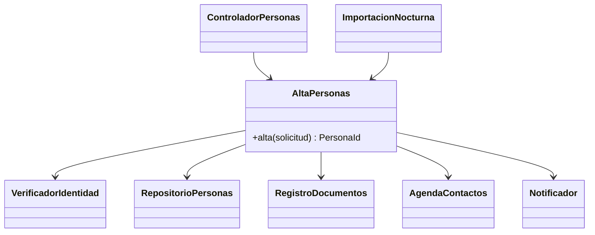
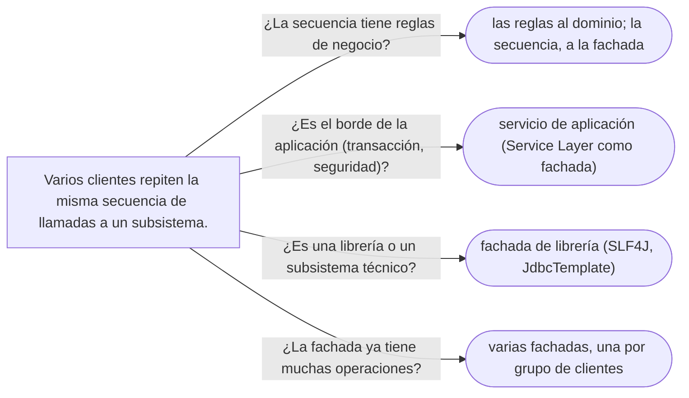

# 04 — Facade

> Dar a un subsistema de varias clases **un punto de entrada simple** para el caso común, sin esconderlo y
> sin convertir la fachada en una clase dios; distinguirla del Adapter y de la Service Layer de Fowler.
> **Nivel: A.** Asume leído [`01` — Adapter](01-adapter.md) y
> [`03/04` — Acoplamiento, cohesión y dependencias](../03-principios-de-diseno/04-acoplamiento-cohesion-y-dependencias.md).
>
> **Vigencia:** 2026-10-03.
>
> **Versiones ejecutadas:** GCC 14.4 (C++23) · JDK 21.0.12, 17.0.20 y 25.0.4 · Spring Boot 4.1.1 (Spring Framework 7.0.9, Hibernate 7.4.5, H2 2.4.240) · mermaid-cli 11.17.0 (2026-10-04).

---

## 1. 🎯 El problema

Dar de alta a una persona toca cinco piezas: validar sus documentos, guardarla, registrar sus documentos,
guardar sus contactos y avisarle por correo. El controlador REST lo hace así:

```java
@PostMapping("/personas")
public ResponseEntity<Void> alta(@RequestBody SolicitudAlta s) {
    Persona p = new Persona(s.nombre(), s.fechaNacimiento());
    for (var d : s.documentos()) {
        if (!validador.verificar(d).esAutentico()) return ResponseEntity.unprocessableEntity().build();
        p.agregarDocumento(d);
    }
    personas.guardar(p);
    registroDocumentos.indexar(p.documentos());
    contactos.guardar(p.id(), s.email(), s.telefono());
    notificador.avisar(p, plantillas.bienvenida());
    return ResponseEntity.status(201).build();
}
```

- El controlador conoce seis colaboradores y el **orden** en que hay que llamarlos. La importación nocturna, que
  también da altas, repite las mismas doce líneas, y ya difiere: no indexa los documentos.
- Cualquier cambio en el proceso de alta —añadir una verificación de listas restrictivas— hay que hacerlo en
  todos los sitios que lo copiaron.

El subsistema está bien; lo que falta es **una puerta** para el caso común. Esa puerta es la fachada.

---

## 2. 📐 La estructura

**La intención, en una frase del GoF:** proporcionar una interfaz unificada para un conjunto de interfaces de
un subsistema; la fachada define una interfaz de más alto nivel que hace el subsistema más fácil de usar.



- **Facade** (`AltaPersonas`): conoce qué piezas del subsistema intervienen y en qué orden, y ofrece **una**
  operación con nombre del negocio.
- **Subsistema**: las clases de siempre, que **no saben** que hay una fachada y siguen siendo accesibles.
- **Clientes**: el controlador y la importación, que ahora dependen de una sola clase.

La fachada **no añade funcionalidad**: coordina la que ya existe. Si empieza a decidir reglas de negocio
propias, ya no es una fachada.

---

## 3. 🏛️ Cómo nació

El GoF la presenta con un compilador: un `Compiler` que esconde el analizador léxico, el sintáctico y el
generador de código detrás de un `compile()`. En C++98, con el dominio, es una clase con referencias:

```cpp
class AltaPersonas {
public:
    AltaPersonas(VerificadorIdentidad& v, RepositorioPersonas& r, Notificador& n) : v_(v), r_(r), n_(n) {}
    PersonaId alta(const SolicitudAlta& s);
private:
    VerificadorIdentidad& v_;
    RepositorioPersonas& r_;
    Notificador& n_;
};
```

- Es de los pocos patrones cuyo C++98 apenas cambia: no hay propiedad nueva que decidir (la fachada no posee el
  subsistema) ni jerarquía que modernizar.

---

## 4. 💻 C++ moderno

Lo que C++ moderno aporta a una fachada es poco y concreto: referencias que dicen que no posee, y valores de
retorno que dicen qué salió.

```cpp
class AltaPersonas {
public:
    AltaPersonas(VerificadorIdentidad& v, RepositorioPersonas& r, RegistroDocumentos& d,
                 AgendaContactos& c, Notificador& n)
        : verificador_{v}, personas_{r}, documentos_{d}, contactos_{c}, notificador_{n} {}

    std::expected<PersonaId, ErrorAlta> alta(const SolicitudAlta& s) {
        Persona p{s.nombre, s.nacimiento};
        for (const auto& d : s.documentos) {
            if (!verificador_.verificar(d).autentico) return std::unexpected{ErrorAlta::DocumentoNoVerificado};
            p.agregarDocumento(d);
        }
        auto id = personas_.guardar(p);
        documentos_.indexar(id, p.documentos());
        contactos_.guardar(id, s.contactos);
        notificador_.bienvenida(p);
        return id;
    }
private:
    VerificadorIdentidad& verificador_;
    RepositorioPersonas& personas_;
    RegistroDocumentos& documentos_;
    AgendaContactos& contactos_;
    Notificador& notificador_;
};
```

- `std::expected` (C++23) dice en la firma que el alta puede fallar por una razón del negocio, sin excepción.
  Quien llama decide qué respuesta HTTP o qué línea del informe nocturno corresponde.
- Los cinco miembros son referencias: la fachada **usa** el subsistema, no lo posee. La raíz de composición
  crea todo y le pasa las piezas.

---

## 5. 💻 Java

```java
@Service
public class AltaPersonas {
    private final VerificadorIdentidad verificador;
    private final RepositorioPersonas personas;
    private final RegistroDocumentos documentos;
    private final AgendaContactos contactos;
    private final Notificador notificador;

    public AltaPersonas(VerificadorIdentidad v, RepositorioPersonas r, RegistroDocumentos d,
                        AgendaContactos c, Notificador n) {
        this.verificador = v; this.personas = r; this.documentos = d; this.contactos = c; this.notificador = n;
    }

    @Transactional
    public PersonaId alta(SolicitudAlta s) {
        Persona p = new Persona(s.nombre(), s.fechaNacimiento());
        for (var d : s.documentos()) {
            if (!verificador.verificar(d).esAutentico()) throw new DocumentoNoVerificadoException(d);
            p.agregarDocumento(d);
        }
        PersonaId id = personas.guardar(p);
        documentos.indexar(id, p.documentos());
        contactos.guardar(id, s.email(), s.telefono());
        notificador.bienvenida(p);
        return id;
    }
}

// el controlador, ya delgado
@PostMapping("/personas")
public ResponseEntity<PersonaId> alta(@RequestBody SolicitudAlta s) {
    return ResponseEntity.status(201).body(altaPersonas.alta(s));
}
```

- Las doce líneas viven en un sitio. La importación nocturna llama a `altaPersonas.alta(s)` y, por fin, indexa
  los documentos igual que el controlador.
- Cinco dependencias por constructor es el límite cómodo; si la fachada pide quince, está coordinando demasiado
  (§7).
- `@Transactional` aquí hace que el alta sea atómica: si la indexación falla, la persona no queda guardada a
  medias. Es el sitio natural para la transacción, y por eso la fachada se parece tanto a la Service Layer.

---

## 6. 🔀 Variantes

- **Varias fachadas para un subsistema**, una por grupo de clientes: `AltaPersonas` para el alta,
  `ConsultaPersonas` para las pantallas. Mejor que una sola fachada que lo hace todo.
- **Fachada de una librería**: SLF4J se define a sí mismo como una fachada simple para varios marcos de
  *logging* (Logback, Log4j, `java.util.logging`): el código usa `LoggerFactory.getLogger` y el marco real se
  elige al desplegar. Es fachada y adaptador a la vez, porque además unifica interfaces distintas.
- **Fachada remota**: la *Remote Facade* de Fowler agrupa operaciones finas en llamadas gruesas para que una
  llamada por red haga mucho trabajo. Es la versión distribuida del mismo patrón: ver
  [`08/02` — Distribución](../08-fowler-presentacion-distribucion-y-base/02-distribucion.md#4--remote-facade).

---

## 7. ⚖️ Con qué se confunde

| Se confunde con | La diferencia, en una frase |
|---|---|
| **Adapter** | El Adapter hace encajar una clase en una interfaz que **ya existe**; la Facade crea una interfaz **nueva** y más simple para varias clases (ver [`01`](01-adapter.md)) |
| **Service Layer** (Fowler) | La Service Layer define **el borde de la aplicación** —todas sus operaciones, con transacción y seguridad—; la Facade simplifica **un subsistema**. Una Service Layer se implementa a menudo como un conjunto de fachadas |
| **Mediator** | El Mediator coordina objetos **que se conocen a través de él** y le hablan; en la Facade la comunicación es en un sentido, y el subsistema no sabe que existe (ver [`06/08`](../06-comportamiento/08-iterator-y-mediator.md)) |
| **God Object** ([`12/03` §2](../12-antipatrones/03-antipatrones-de-diseno-oo.md#2-️-god-object)) | Una fachada que acumula operaciones de todos los casos de uso y empieza a tener reglas propias deja de simplificar y pasa a ser el centro de todo |

**La Service Layer** (con su capítulo en [`07/01`](../07-fowler-dominio-y-datos/01-logica-de-dominio.md#5--service-layer)), con más calma, porque es la confusión que el entrevistador busca. Fowler la define en
*PoEAA* como la capa que establece el conjunto de operaciones disponibles de la aplicación y coordina su
respuesta en cada una; y describe dos formas de implementarla: como **fachada de dominio** (métodos delgados
que delegan en un modelo de dominio rico) o como ***operation script*** (los métodos contienen la lógica). Una
`AltaPersonas` con `@Transactional` que coordina el dominio es una Service Layer implementada como fachada. La
diferencia práctica: si es **el** punto de entrada de la aplicación para un caso de uso, con transacción y
seguridad, llámala servicio de aplicación; si simplifica una librería o un subsistema técnico, fachada.

**La sobregeneralización.** "Una fachada esconde el subsistema" es la lectura que lleva a prohibir el acceso a
sus clases. El GoF dice lo contrario: la fachada **simplifica el caso común** y deja el subsistema accesible para
quien necesite más control. Si lo que se quiere es esconderlo, eso es encapsulación de módulo (paquetes no
exportados, visibilidad de paquete), no el patrón.

---

## 8. 🔭 Dónde aparece de verdad

- **SLF4J**, el ejemplo del propio nombre.
- **`JdbcTemplate`** es, entre otras cosas, una fachada sobre JDBC: abrir la conexión, preparar la sentencia,
  recorrer el `ResultSet`, traducir excepciones y cerrar, en una llamada.
- **`java.net.http.HttpClient`** simplifica sockets, TLS, HTTP/2 y redirecciones detrás de `send`.
- **Los servicios de aplicación** de casi cualquier aplicación Spring, que es donde la fachada y la Service
  Layer se confunden con razón.

---

## 9. 🏷️ Lo que cuesta, y cuándo no

**El precio**, en las cuatro monedas:

- **Indirección:** una clase más entre el cliente y el subsistema; poco, y es la indirección que se quiere.
- **Acoplamiento:** la fachada concentra el acoplamiento al subsistema. Bien, mientras sea **una** razón de
  cambio; mal, cuando cada caso de uso nuevo se añade a la misma fachada y todos los clientes dependen de una
  clase que cambia por todo.
- **Legibilidad:** mejora en los clientes; empeora cuando la fachada crece a cuarenta métodos y se convierte en el
  sitio donde "va todo lo de personas".
- **Rendimiento:** nada que contar.

**Cuándo no.**

- **Un solo cliente y un solo uso.** Si solo el controlador da altas, el método del controlador ya es la fachada;
  extraerla a una clase se justifica cuando aparece el segundo cliente o cuando el controlador hace demasiado.
- **Cuando se usa para prohibir.** Una fachada que es la única forma de llegar al subsistema y además expone todas
  sus operaciones no simplifica: duplica la interfaz.
- **Cuando acumula reglas.** Si la fachada decide cosas del negocio ("si es menor, pedir tutor"), esas reglas van
  en el dominio, y la fachada vuelve a coordinar.

> **Veredicto:** una fachada por caso de uso o por grupo de clientes, que coordina y no decide, con pocas
> dependencias. Cuando acumula operaciones de todo el sistema o reglas propias, ya es una clase dios: pártela por
> motivo de cambio.

---

## 10. 🧭 Cómo se elige



**La frase en voz alta:** *"Pondría `AltaPersonas` como fachada: una operación con nombre del negocio que coordina
validación, guardado, documentos, contactos y aviso, con la transacción alrededor. No decide reglas ni esconde el
subsistema; y si crece, la parto por caso de uso."*

---

## ⚠️ Errores frecuentes

| Se dice | Lo preciso |
|---|---|
| "Una fachada esconde el subsistema" | Lo simplifica para el caso común; el subsistema sigue accesible |
| "Facade y Adapter son lo mismo" | El Adapter convierte a una interfaz que ya existe; la Facade crea una nueva y simple sobre varias clases |
| "Facade y Service Layer son lo mismo" | La Service Layer es el borde de la aplicación con transacción y seguridad; a menudo se implementa como fachadas |
| "La fachada contiene la lógica del proceso" | Coordina la que ya existe; las reglas propias van al dominio |
| "Una fachada por subsistema" | Mejor una por grupo de clientes o por caso de uso; la fachada única tiende a clase dios |
| "Si hay fachada, nadie debe usar las clases del subsistema" | El GoF las deja accesibles; prohibir el acceso es otra decisión, de módulos |

---

## 📚 Para profundizar

- **Libro** — Gamma, Helm, Johnson y Vlissides, *Design Patterns* (Addison-Wesley, 1994), cap. 4,
  "Structural Patterns", sección "Facade": el compilador, y el subsistema que sigue accesible.
- **Libro** — Fowler, *Patterns of Enterprise Application Architecture* (Addison-Wesley, 2002), cap. 9, "Domain
  Logic Patterns", sección "Service Layer": fachada de dominio contra *operation script*. **El que destaca** para
  la confusión con la Service Layer.
- **Libro** — Freeman y Robson, *Head First Design Patterns*, 2.ª ed. (O'Reilly, 2021), cap. 7, "The Adapter and
  Facade Patterns", con el principio de "habla solo con tus amigos".
- [martinfowler.com — Service Layer](https://martinfowler.com/eaaCatalog/serviceLayer.html): la ficha del patrón.
- [SLF4J — User manual](https://www.slf4j.org/manual.html): una fachada de *logging*, con su enlace al marco real
  en el despliegue.
- **Tutorial** — [Refactoring Guru — Facade](https://refactoring.guru/design-patterns/facade).

---

## 🧠 Preguntas

Sin respuestas aquí. Todas, con enunciado literal y respuesta en tres capas, en
[`09` — Respuestas](09-respuestas.md#04--facade).

1. ¿Cuál es la intención de la Facade? 🟢
2. ¿Por qué SLF4J es una fachada? 🟢
3. ¿Qué participantes tiene la Facade, y cuál de ellos sabe que existe? 🟢
4. ¿Qué diferencia hay entre Facade y Adapter? 🟡
5. ¿Qué diferencia hay entre Facade y Service Layer? 🟡
6. ¿Qué diferencia hay entre Facade y Mediator? 🟡
7. ¿Qué cambia en una fachada entre C++ y Java? 🟡
8. ¿Por qué "una fachada esconde el subsistema" es impreciso? 🟠
9. ¿Cuándo una fachada se convierte en un God Object, y cómo lo evitas? 🟠
10. ¿Dónde va la transacción en un alta que toca cinco piezas, y por qué ahí? 🟠
11. ¿Cuándo extraer una fachada es prematuro? 🟠
12. ¿Qué hace una fachada si una de las piezas del subsistema tiene una regla de negocio? 🟠
13. Escribe la fachada `AltaPersonas` en Java a partir del controlador de §1. 🔴
14. Revisa esta clase y di qué falla: `class ServicioPersonas` con 42 métodos públicos —alta, baja, búsqueda,
    exportación, notificaciones, cálculo de edad— y 17 dependencias inyectadas. 🔴

---

**Anterior:** [`03` — Proxy, y los tres que se confunden](03-proxy.md) ·
**Siguiente:** [`05` — Composite](05-composite.md) ·
**Relacionado:** [`01` — Adapter](01-adapter.md)
