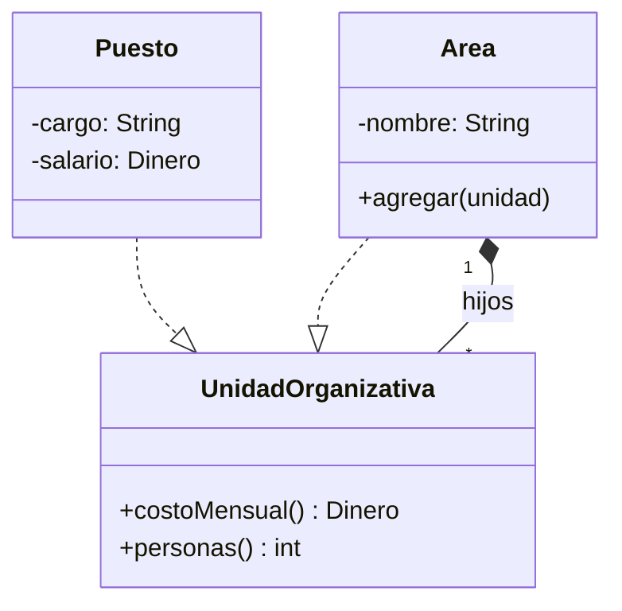
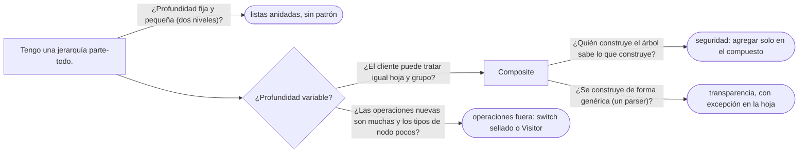

# 05 — Composite

> Tratar igual una hoja y un grupo de hojas —un puesto y un área entera de la organización—, decidir dónde van
> las operaciones de gestión de hijos (**transparencia contra seguridad**), y recorrer el árbol sin que el
> cliente pregunte qué tiene delante. **Nivel: A.** **Desviación declarada del dominio fijo:** para la
> estructura interna de `Organizacion`, el capítulo añade `UnidadOrganizativa`, `Area` y `Puesto`, con salarios de
> ejemplo. Asume leído
> [`02/04` — Agregación, composición y propiedad](../02-modelado-oo/04-agregacion-composicion-y-propiedad.md).
>
> **Vigencia:** 2026-10-03.
>
> **Versiones ejecutadas:** GCC 14.4 (C++23) · JDK 21.0.12, 17.0.20 y 25.0.4 · mermaid-cli 11.17.0 (2026-10-04).

---

## 1. 🎯 El problema

**Transportes Andinos S.A.S.** se organiza en áreas, y cada área tiene puestos o subáreas: Sistemas tiene el
puesto de Ana (*Jefa de sistemas*) y la subárea de Soporte con tres puestos; Operaciones tiene Flota y
Despacho. Recursos Humanos pide el costo mensual de nómina de cualquier área, y el código que lo calcula es
este:

```java
Dinero costo(Object nodo) {
    if (nodo instanceof Puesto p) return p.salario();
    if (nodo instanceof Area a) {
        Dinero total = Dinero.cero(COP);
        for (Puesto p : a.puestos()) total = total.mas(p.salario());
        for (Area sub : a.subareas()) total = total.mas(costo(sub));   // y el siguiente informe repite esto
        return total;
    }
    throw new IllegalArgumentException("nodo desconocido");
}
```

- Cada informe —costo, número de personas, lista de cargos vacantes— vuelve a escribir el recorrido y
  vuelve a preguntar qué es cada nodo.
- `Area` tiene dos listas, `puestos` y `subareas`, porque sus hijos son de dos tipos. Si mañana aparece un
  tercero (un contratista externo asignado al área), cambian `Area` y todos los recorridos.

Lo que RR. HH. quiere es preguntarle a **cualquier** nodo su costo y que el nodo se encargue: el puesto con su
salario, el área sumando a sus hijos, sin que nadie de fuera distinga. Eso es el Composite.

---

## 2. 📐 La estructura

**La intención, en una frase del GoF:** componer objetos en estructuras de árbol para representar jerarquías
parte-todo, y dejar que los clientes traten de manera uniforme los objetos individuales y las composiciones.



- **Component** (`UnidadOrganizativa`): la interfaz común, con las operaciones que tienen sentido para hojas y
  grupos. Es una interfaz.
- **Leaf** (`Puesto`): no tiene hijos; implementa las operaciones directamente.
- **Composite** (`Area`): tiene hijos **del tipo Component** —puestos o áreas, le da igual— e implementa cada
  operación delegando en ellos y combinando los resultados.

La línea que hace el patrón es la composición `Area *-- UnidadOrganizativa`: el área contiene **componentes**,
no puestos ni áreas. Por eso un área puede contener áreas, y el árbol tiene la profundidad que haga falta.

---

## 3. 🏛️ Cómo nació

El GoF lo presenta con un editor gráfico donde un dibujo contiene líneas, rectángulos y otros dibujos, y pone
la gestión de hijos **en la clase base**, con implementaciones por defecto que no hacen nada:

```cpp
class UnidadOrganizativa {
public:
    virtual ~UnidadOrganizativa() {}
    virtual Dinero costoMensual() const = 0;
    virtual void agregar(UnidadOrganizativa*) {}         // en la hoja, no hace nada: transparencia
};

class Area : public UnidadOrganizativa {
public:
    ~Area() { for (std::size_t i = 0; i < hijos_.size(); ++i) delete hijos_[i]; }
    Dinero costoMensual() const {
        Dinero total = Dinero::cero();
        for (std::size_t i = 0; i < hijos_.size(); ++i) total = total + hijos_[i]->costoMensual();
        return total;
    }
    void agregar(UnidadOrganizativa* u) { hijos_.push_back(u); }
private:
    std::vector<UnidadOrganizativa*> hijos_;
};
```

- `agregar` en la base es la decisión de **transparencia**: el cliente puede llamar a `agregar` en cualquier
  nodo sin saber qué es. El precio es que en un `Puesto` la llamada no tiene sentido y se ignora en silencio.
- El destructor borra a los hijos: el área es dueña de su subárbol. Con punteros crudos, eso depende de que nadie
  más los borre ni los comparta.

---

## 4. 💻 C++ moderno

La propiedad del subárbol pasa a los tipos, y la gestión de hijos sale de la base (seguridad, §6):

```cpp
class UnidadOrganizativa {
public:
    virtual ~UnidadOrganizativa() = default;
    virtual Dinero costoMensual() const = 0;
    virtual int personas() const = 0;
};

class Puesto final : public UnidadOrganizativa {
public:
    Puesto(std::string cargo, Dinero salario) : cargo_{std::move(cargo)}, salario_{salario} {}
    Dinero costoMensual() const override { return salario_; }
    int personas() const override { return 1; }
private:
    std::string cargo_;
    Dinero salario_;
};

class Area final : public UnidadOrganizativa {
public:
    explicit Area(std::string nombre) : nombre_{std::move(nombre)} {}
    void agregar(std::unique_ptr<UnidadOrganizativa> u) { hijos_.push_back(std::move(u)); }
    Dinero costoMensual() const override {
        return std::ranges::fold_left(hijos_, Dinero::cero(),
                   [](Dinero acc, const auto& h) { return acc + h->costoMensual(); });
    }
    int personas() const override {
        int n = 0;
        for (const auto& h : hijos_) n += h->personas();
        return n;
    }
private:
    std::string nombre_;
    std::vector<std::unique_ptr<UnidadOrganizativa>> hijos_;   // el área posee su subárbol
};
```

- `std::vector<std::unique_ptr<...>>` dice que el área es la única dueña de sus hijos; el destructor
  generado destruye el árbol entero sin escribir nada. Es la composición de `02/04` hecha código.
- `std::ranges::fold_left` es de C++23; el bucle de `personas()` hace lo mismo a la antigua.

---

## 5. 💻 Java

Con una interfaz sellada, Java 21 da la seguridad **y** permite recorrer el árbol con un `switch` exhaustivo
cuando la operación no pertenece a los nodos:

```java
public sealed interface UnidadOrganizativa permits Puesto, Area {
    Dinero costoMensual();
    int personas();
}

public record Puesto(String cargo, Dinero salario) implements UnidadOrganizativa {
    public Dinero costoMensual() { return salario; }
    public int personas() { return 1; }
}

public final class Area implements UnidadOrganizativa {
    private final String nombre;
    private final List<UnidadOrganizativa> hijos = new ArrayList<>();

    public Area(String nombre) { this.nombre = nombre; }
    public Area agregar(UnidadOrganizativa u) { hijos.add(u); return this; }

    public Dinero costoMensual() {
        return hijos.stream().map(UnidadOrganizativa::costoMensual).reduce(Dinero.cero(COP), Dinero::mas);
    }
    public int personas() { return hijos.stream().mapToInt(UnidadOrganizativa::personas).sum(); }
    public List<UnidadOrganizativa> hijos() { return Collections.unmodifiableList(hijos); }
}

var sistemas = new Area("Sistemas")
        .agregar(new Puesto("Jefa de sistemas", Dinero.cop("12000000.00")))
        .agregar(new Area("Soporte").agregar(new Puesto("Analista", Dinero.cop("4500000.00"))));
Dinero costo = sistemas.costoMensual();     // el cliente no pregunta qué es cada nodo
```

- RR. HH. llama a `costoMensual()` en cualquier unidad: un puesto, Sistemas o la organización entera. El
  `instanceof` de §1 desapareció.
- Un informe **nuevo** que no quiere ser un método de la interfaz —exportar el organigrama a CSV— se escribe
  fuera con un `switch` sobre los dos tipos sellados, y el compilador avisa si aparece un tercero.

> 📝 **En Java 17:** las interfaces selladas y los records existen, pero el `switch` con patrones de tipo no
> (es de Java 21). El recorrido externo se escribe con `if (u instanceof Puesto p) … else if (u instanceof Area
> a) …`, y la exhaustividad ya no la comprueba el compilador.

---

## 6. 🔀 Variantes: transparencia contra seguridad

La decisión que el GoF deja abierta, y la que pregunta el entrevistador: **¿dónde van `agregar`, `quitar` e
`hijos`?**

| | **Transparencia** | **Seguridad** |
|---|---|---|
| Dónde | En la interfaz común (`UnidadOrganizativa.agregar`) | Solo en el compuesto (`Area.agregar`) |
| El cliente | Trata todo igual, también al construir el árbol | Tiene que saber que tiene un `Area` para añadirle hijos |
| En la hoja | `agregar` no tiene sentido: no hace nada o lanza | No existe: el compilador impide llamarlo |
| El error | Se descubre al ejecutar | Se descubre al compilar |
| En el JDK | `org.w3c.dom.Node.appendChild`: en un nodo de texto lanza `HIERARCHY_REQUEST_ERR` | `java.awt.Container` tiene `add`; `Component` no |

- El GoF prefiere la transparencia y reconoce que sacrifica seguridad. Hoy, con tipos sellados y quien
  construye el árbol sabiendo lo que construye, la **seguridad** suele ganar: las operaciones de **negocio**
  (costo, personas) son uniformes, y las de **estructura** (agregar) viven en el compuesto.
- **Referencia al padre.** Si un nodo necesita subir (el área de un puesto), el compuesto fija el padre al
  agregar. Es una asociación bidireccional, con su coherencia de dos puntas (ver
  [`02/03` — Navegabilidad y coherencia](../02-modelado-oo/03-navegabilidad-y-coherencia.md)).
- **Recorridos externos.** Cuando las operaciones nuevas son muchas y los tipos de nodo pocos y estables, las
  operaciones salen de los nodos: un `switch` sobre tipos sellados, o el Visitor (ver
  [`06/07` — Visitor, y lo que lo reemplaza](../06-comportamiento/07-visitor.md)).

---

## 7. ⚖️ Con qué se confunde

| Se confunde con | La diferencia, en una frase |
|---|---|
| **Cualquier árbol** | Un `TreeMap` es un árbol y no es un Composite: el patrón exige que hoja y grupo compartan la interfaz y se traten igual |
| **Decorator** | El Decorator envuelve **un** objeto para añadirle algo; el Composite contiene **varios** y combina sus resultados (ver [`02`](02-decorator.md)) |
| **Visitor** | El Visitor lleva una operación **externa** por el árbol; el Composite pone las operaciones **en** los nodos. Se combinan a menudo |
| **Chain of Responsibility** | La cadena pasa una petición **hasta que alguien la atiende**; el Composite la pasa a **todos** los hijos y suma |

**La sobregeneralización.** "Composite es cualquier árbol" se queda con la forma y pierde el propósito: que el
cliente **no distinga** entre la hoja y el grupo. Un árbol donde el cliente siempre pregunta qué es cada nodo,
como el de §1, tiene estructura de árbol y no tiene Composite.

---

## 8. 🔭 Dónde aparece de verdad

- **AWT y Swing**: `Container` extiende `Component` y contiene `Component`s; pintar, redimensionar o validar un
  panel se propaga por el árbol. Es la forma segura: `add` está en `Container`.
- **DOM**: `Node` con `appendChild` y `getChildNodes` en la interfaz común: la forma transparente, con su
  excepción en las hojas.
- **Sistemas de archivos**: `Path` y `Files.walk` recorren directorios y archivos con la misma interfaz.
- **Spring**: `CompositePropertySource`, `CompositeCacheManager`, y los `Composite…` que combinan varios
  objetos del mismo tipo en uno.
- **Árboles de sintaxis y de expresiones**: un `Y(regla1, O(regla2, regla3))` de reglas de validación es un
  Composite de predicados.

---

## 9. 🏷️ Lo que cuesta, y cuándo no

**El precio**, en las cuatro monedas:

- **Indirección:** un recorrido recursivo detrás de una llamada simple. `costoMensual()` de la organización
  entera recorre todos los nodos, y desde fuera parece barato.
- **Acoplamiento:** la interfaz común tiende a crecer con operaciones que solo algunos nodos implementan bien;
  con transparencia, además, la hoja arrastra métodos de estructura que no usa.
- **Legibilidad:** el diseño es "demasiado general": el tipo no puede expresar restricciones como "un área de
  Soporte solo contiene puestos". Esas reglas se comprueban al ejecutar.
- **Rendimiento:** una llamada virtual por nodo y una recursión que en árboles muy profundos puede desbordar la
  pila. Para árboles grandes que se consultan mucho, se cachea el agregado en el compuesto (y se invalida al
  agregar).

**Cuándo no.**

- **Cuando la jerarquía tiene dos niveles fijos.** Una organización con áreas y puestos, sin subáreas, es una
  `List<Area>` con su `List<Puesto>`: dos bucles se leen mejor que un patrón.
- **Cuando el cliente necesita distinguir siempre.** Si cada operación trata distinto a hojas y grupos, la
  interfaz común no ahorra nada.
- **Cuando el árbol vive en la base de datos** y se consulta con SQL recursivo: el Composite en memoria obliga a
  cargarlo entero para sumar.

> **Veredicto:** Composite cuando la jerarquía tiene profundidad variable y las operaciones de negocio se
> aplican igual a la parte y al todo. Las operaciones de negocio, uniformes en la interfaz; las de estructura,
> en el compuesto.

---

## 10. 🧭 Cómo se elige



**La frase en voz alta:** *"Composite cuando quiero preguntarle a cualquier nodo lo mismo —el costo de un puesto o
de un área entera— sin saber qué es. Las operaciones de negocio van en la interfaz común; `agregar`, solo en el
compuesto, para que el compilador no me deje añadir hijos a un puesto."*

---

## ⚠️ Errores frecuentes

| Se dice | Lo preciso |
|---|---|
| "Composite es cualquier árbol" | Es un árbol donde hoja y grupo comparten interfaz y el cliente no los distingue |
| "La gestión de hijos va siempre en la interfaz común" | Esa es la transparencia del GoF; la seguridad la pone solo en el compuesto, y hoy suele ganar |
| "El compuesto tiene una lista por cada tipo de hijo" | Tiene una lista de componentes: por eso admite cualquier profundidad |
| "Composite y Decorator son lo mismo porque los dos contienen componentes" | El Decorator contiene uno y añade; el Composite contiene varios y combina |
| "Recorrer el árbol es gratis porque es una llamada" | Es un recorrido completo; en árboles grandes se cachea el agregado |
| "Con sealed types ya no hace falta Composite" | Los tipos sellados sirven para recorrer desde fuera; el Composite pone las operaciones uniformes dentro |

---

## 📚 Para profundizar

- **Libro** — Gamma, Helm, Johnson y Vlissides, *Design Patterns* (Addison-Wesley, 1994), cap. 4,
  "Structural Patterns", sección "Composite": la discusión de transparencia contra seguridad. **El que destaca.**
- **Libro** — Freeman y Robson, *Head First Design Patterns*, 2.ª ed. (O'Reilly, 2021), cap. 9, "The Iterator and
  Composite Patterns": el Composite con su recorrido.
- [Java 21 API — `org.w3c.dom.Node`](https://docs.oracle.com/en/java/javase/21/docs/api/java.xml/org/w3c/dom/Node.html):
  la forma transparente, con `HIERARCHY_REQUEST_ERR` en `appendChild`.
- [Java 21 API — `java.awt.Container`](https://docs.oracle.com/en/java/javase/21/docs/api/java.desktop/java/awt/Container.html):
  la forma segura: `add` en el contenedor.
- **Tutorial** — [Refactoring Guru — Composite](https://refactoring.guru/design-patterns/composite).

---

## 🧠 Preguntas

Sin respuestas aquí. Todas, con enunciado literal y respuesta en tres capas, en
[`09` — Respuestas](09-respuestas.md#05--composite).

1. ¿Cuál es la intención del Composite? 🟢
2. ¿Qué participantes tiene el Composite? 🟢
3. ¿Qué relación del diagrama hace posible la profundidad arbitraria? 🟢
4. ¿Dónde aparece el Composite en AWT y en el DOM? 🟢
5. ¿Qué diferencia hay entre transparencia y seguridad en el Composite? 🟡
6. ¿Qué diferencia hay entre Composite y Decorator? 🟡
7. ¿Qué diferencia hay entre poner una operación en los nodos y recorrer el árbol desde fuera? 🟡
8. ¿Qué cambia en un Composite entre C++ y Java? 🟡
9. ¿Por qué "Composite es cualquier árbol" es impreciso? 🟠
10. ¿Cuándo eliges seguridad y cuándo transparencia? 🟠
11. ¿Cuándo un Composite es ceremonia? 🟠
12. ¿Qué haces si el costo de la organización entera se pide mil veces por minuto? 🟠
13. ¿Qué haces si un nodo necesita conocer a su área padre? 🟠
14. Escribe en Java el Composite de `UnidadOrganizativa` con `personas()` y `costoMensual()`. 🔴
15. Refactoriza la función `costo(Object nodo)` de §1 a un Composite. 🔴
16. Escribe fuera del árbol, con un `switch` sobre los tipos sellados, una función que liste los cargos de una
    unidad. 🔴

---

**Anterior:** [`04` — Facade](04-facade.md) ·
**Siguiente:** [`06` — Bridge](06-bridge.md) ·
**Relacionado:** [`02/04` — Agregación, composición y propiedad](../02-modelado-oo/04-agregacion-composicion-y-propiedad.md)
