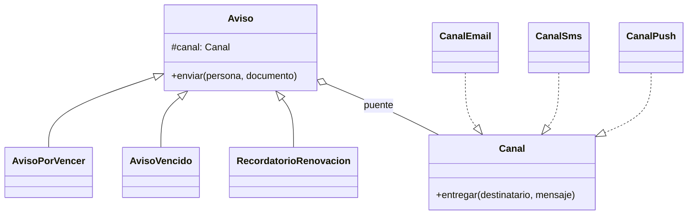
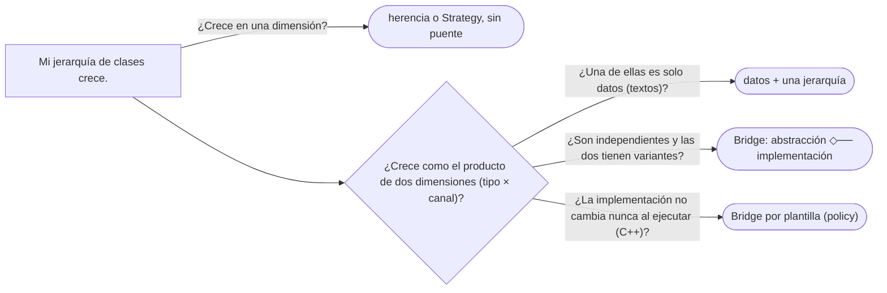

# 06 — Bridge

> Reconocer la **explosión de subclases en dos dimensiones** —tipo de aviso por canal de envío— y separarlas en
> dos jerarquías unidas por una referencia, para que cada una crezca sola. **Nivel: B.** Asume leído
> [`01` — Adapter](01-adapter.md) y [`02` — Decorator](02-decorator.md). **Desviación declarada del dominio fijo:**
> los avisos y los canales (`Aviso`, `Canal`) se añaden para este capítulo.
>
> **Vigencia:** 2026-10-03.
>
> **Versiones ejecutadas:** GCC 14.4 (C++23) · JDK 21.0.12, 17.0.20 y 25.0.4 · mermaid-cli 11.17.0 (2026-10-04).

---

## 1. 🎯 El problema

El sistema avisa a las personas sobre sus documentos: que el pasaporte de Ana **vence pronto**, que la tarjeta
de identidad de Luis **ya venció**, que conviene **renovar** con tiempo. Y cada aviso sale por **correo**,
**SMS** o **notificación *push***. La jerarquía que salió primero:

```java
abstract class Aviso { abstract void enviar(Persona p, Documento d); }
class AvisoPorVencerEmail   extends Aviso { /* texto largo, con asunto, por SMTP */ }
class AvisoPorVencerSms     extends Aviso { /* texto de 160 caracteres, por la pasarela */ }
class AvisoPorVencerPush    extends Aviso { /* título y cuerpo, por el servicio push */ }
class AvisoVencidoEmail     extends Aviso { /* ... */ }
class AvisoVencidoSms       extends Aviso { /* ... */ }
// ... nueve clases, y cada canal nuevo añade tres
```

- Tres tipos de aviso por tres canales son **nueve** clases. WhatsApp añade tres más; un cuarto tipo de aviso,
  cuatro más. El número de clases es el **producto** de las dos dimensiones.
- Y el código del canal (cómo se habla con SMTP) está copiado en las tres clases de correo; el del mensaje (qué
  se dice cuando un documento venció), en las tres de vencido.

Hay dos cosas que varían **por separado** —qué se dice y por dónde se envía— metidas en una sola jerarquía. El
Bridge las separa.

---

## 2. 🧱 El mecanismo

**La intención, en una frase del GoF:** desacoplar una abstracción de su implementación para que las dos puedan
variar de forma independiente.



- **Abstraction** (`Aviso`): lo que el cliente usa. Guarda una referencia a un `Canal` —ese es el **puente**— y
  define las operaciones de alto nivel en términos de las del canal.
- **Refined Abstraction** (`AvisoPorVencer`, `AvisoVencido`, `RecordatorioRenovacion`): cada tipo de aviso
  decide **qué** se dice.
- **Implementor** (`Canal`): la interfaz de bajo nivel, primitiva. Es una interfaz.
- **Concrete Implementor** (`CanalEmail`, `CanalSms`, `CanalPush`): cada canal decide **cómo** se entrega.

Tres más tres son seis clases, y cualquier aviso sale por cualquier canal. Un canal nuevo es **una** clase.

**El vocabulario engaña.** "Implementación" aquí no significa "la clase que implementa una interfaz": significa
**la otra dimensión**, la de bajo nivel, de la que la abstracción depende. En el ejemplo del GoF, ventanas
(abstracción) sobre sistemas de ventanas (implementación).

---

## 3. 💻 Código

**Java**, completo:

```java
public interface Canal {
    void entregar(Destinatario d, Mensaje m);
    int longitudMaxima();                              // lo que la abstracción necesita saber del canal
}

public abstract class Aviso {
    protected final Canal canal;
    protected Aviso(Canal canal) { this.canal = canal; }

    public final void enviar(Persona p, Documento d) {
        Mensaje m = componer(p, d);
        canal.entregar(Destinatario.de(p), m.recortado(canal.longitudMaxima()));
    }
    protected abstract Mensaje componer(Persona p, Documento d);
}

public final class AvisoVencido extends Aviso {
    public AvisoVencido(Canal canal) { super(canal); }
    @Override protected Mensaje componer(Persona p, Documento d) {
        return new Mensaje("Documento vencido",
                "Su " + d.tipo().nombre() + " " + d.numero() + " venció el " + d.vencimiento() + ".");
    }
}

public final class CanalSms implements Canal {
    private final PasarelaSms pasarela;
    public CanalSms(PasarelaSms pasarela) { this.pasarela = pasarela; }
    public void entregar(Destinatario d, Mensaje m) { pasarela.enviar(d.telefono(), m.cuerpo()); }
    public int longitudMaxima() { return 160; }
}

new AvisoVencido(new CanalSms(pasarela)).enviar(luis, tarjetaDeLuis);    // cualquier combinación, al ejecutar
```

- `enviar` vive en la abstracción y usa solo lo primitivo del canal (`entregar`, `longitudMaxima`): esa es la
  línea que separa las dos dimensiones. Si `Aviso` necesitara saber que el canal es SMTP, el puente se rompió.
- Dentro de cada dimensión hay herencia (o implementación); **entre** ellas, composición. Es "la composición
  antes que la herencia" aplicada a una dimensión entera.

**C++, como contraste**: el puente se puede fijar al compilar con un parámetro de plantilla.

```cpp
template <class Canal>                                  // el canal se elige al compilar
class AvisoVencido {
public:
    explicit AvisoVencido(Canal& canal) : canal_{canal} {}
    void enviar(const Persona& p, const Documento& d) {
        canal_.entregar(Destinatario::de(p), componer(p, d).recortado(canal_.longitudMaxima()));
    }
private:
    Canal& canal_;
    Mensaje componer(const Persona& p, const Documento& d) const;
};

AvisoVencido<CanalSms> aviso{sms};                     // sin llamada virtual; el canal no cambia al ejecutar
```

- Es la forma de *policy-based design* de Alexandrescu: sin herencia en el lado del canal, sin coste virtual, y
  el compilador comprueba que el canal tenga `entregar` y `longitudMaxima` (con un *concept*, además, con un
  buen mensaje de error). Se pierde elegir el canal según la preferencia de la persona al ejecutar.
- El **pimpl** (*pointer to implementation*) de C++, que esconde los miembros privados detrás de un puntero para
  no recompilar a los clientes, es la forma degenerada del Bridge que el GoF menciona: una abstracción y una
  sola implementación.

---

## 4. ⚖️ Con qué se confunde

| Se confunde con | La diferencia, en una frase |
|---|---|
| **Adapter** | El Adapter hace encajar **una** clase existente en una interfaz; el Bridge separa **dos jerarquías** que se diseñan para variar juntas (ver [`01`](01-adapter.md)) |
| **Strategy** | Estructura casi igual; el Strategy cambia **un algoritmo** de un contexto que no tiene jerarquía propia, y suele elegirse por llamada; en el Bridge las **dos** partes tienen jerarquía y el vínculo suele durar lo que el objeto (ver [`06/01`](../06-comportamiento/01-strategy.md)) |
| **Abstract Factory** | El Abstract Factory **crea** familias; a menudo es quien elige qué implementación concreta recibe la abstracción del Bridge |
| **Decorator** | El Decorator envuelve con la misma interfaz y añade; la abstracción del Bridge tiene otra interfaz, de más alto nivel |

**La sobregeneralización.** "Bridge es un Adapter diseñado de antemano" es una lectura que sale del propio GoF:
dice que el Adapter se aplica a sistemas ya diseñados y el Bridge al diseñar. Es cierto sobre el **cuándo**, y
pierde el **qué**: el Adapter traduce una interfaz a otra, sin jerarquía en el lado del cliente; el Bridge
existe porque **las dos** dimensiones tienen subclases y se quiere evitar su producto.

---

## 5. 🔭 Dónde aparece

- **JDBC** es el ejemplo que se cita en Java: el código usa las interfaces de `java.sql` (`Connection`,
  `PreparedStatement`) y cada base de datos aporta su *driver*; los dos lados evolucionan por separado. La
  jerarquía del lado de la aplicación es casi plana, así que es un Bridge con una abstracción muy delgada.
- **SLF4J y los *logging frameworks*** tienen la misma forma: la API por un lado, el marco por otro.
- **Las interfaces gráficas portables** del ejemplo del GoF —ventanas sobre sistemas de ventanas— son hoy el
  interior de los *toolkits* multiplataforma.
- **El pimpl de C++**, en su forma degenerada, en casi toda librería con ABI estable.

---

## 6. 🏷️ Cuándo sí y cuándo no

**El precio.** Dos jerarquías y una referencia entre ellas, más difíciles de leer que una sola: para saber qué
hace un `AvisoVencido` hay que saber qué canal se le pasó. Y la interfaz del implementador tiene que ser
**primitiva y común** a todos los canales: si un canal necesita algo que los otros no tienen (el asunto del
correo, los botones del *push*), o se añade a la interfaz para todos o se rompe el puente con un `instanceof`.

**Cuándo sí.**

- Cuando hay **dos dimensiones** que varían de verdad, con más de una variante cada una, y su producto ya duele o
  va a doler.
- Cuando la implementación se quiere elegir o cambiar al ejecutar (el canal preferido de cada persona).

**Cuándo no.**

- **Una sola dimensión variable.** Si los avisos son siempre por correo, `Canal` es una interfaz con una
  implementación: indirección sin producto que evitar.
- **Dimensiones que no son independientes.** Si cada tipo de aviso solo tiene sentido por un canal, no hay
  producto: hay pares, y una clase por par es honesta.
- **Cuando una de las dimensiones es un dato.** Si los avisos solo difieren en el texto, una plantilla por tipo
  (un dato) y una jerarquía de canales bastan: es una sola jerarquía con datos.

> **Veredicto:** Bridge cuando dos dimensiones con varias variantes cada una están multiplicando las clases;
> separa la de alto nivel (qué) de la primitiva (cómo) y únelas por composición. Con una dimensión, o con
> dimensiones que no son independientes, no hay puente que construir.

---

## 7. 🧭 Cómo se elige



**La frase en voz alta:** *"Tengo tipos de aviso por canales: nueve clases que serán doce con WhatsApp. Separo qué
se dice de por dónde se envía: el aviso tiene un canal y le pide entregar un mensaje. Tres más tres en lugar de
tres por tres."*

---

## ⚠️ Errores frecuentes

| Se dice | Lo preciso |
|---|---|
| "Bridge es un Adapter diseñado de antemano" | Es cierto sobre el cuándo; el Bridge separa dos jerarquías que varían juntas, el Adapter traduce una interfaz |
| "Bridge y Strategy son lo mismo" | Estructura casi igual; el Bridge tiene jerarquía en los dos lados y un vínculo duradero |
| "La implementación del Bridge es la clase que implementa la interfaz" | Es la otra dimensión, la primitiva, de la que la abstracción depende |
| "Bridge para todo lo que tenga una interfaz" | Solo cuando dos dimensiones con variantes multiplican las clases |
| "La interfaz del canal puede tener lo que cada canal necesite" | Tiene que ser primitiva y común; lo específico de un canal rompe el puente |

---

## 📚 Para profundizar

- **Libro** — Gamma, Helm, Johnson y Vlissides, *Design Patterns* (Addison-Wesley, 1994), cap. 4, "Structural
  Patterns", sección "Bridge", y la discusión final del capítulo sobre Adapter contra Bridge. **El que destaca.**
- **Libro** — Iglberger, *C++ Software Design* (O'Reilly, 2022), cap. 7, "The Bridge, Prototype, and External
  Polymorphism Design Patterns": el Bridge y el pimpl en C++ moderno.
- [Java 21 API — `java.sql.Driver`](https://docs.oracle.com/en/java/javase/21/docs/api/java.sql/java/sql/Driver.html):
  el lado de la implementación de JDBC.
- **Tutorial** — [Refactoring Guru — Bridge](https://refactoring.guru/design-patterns/bridge): la explosión de
  formas por colores, y su separación.

---

## 🧠 Preguntas

Sin respuestas aquí. Todas, con enunciado literal y respuesta en tres capas, en
[`09` — Respuestas](09-respuestas.md#06--bridge).

1. ¿Cuál es la intención del Bridge? 🟢
2. ¿Qué significa "implementación" en el Bridge? 🟢
3. ¿Por qué se cita JDBC como un Bridge? 🟢
4. ¿Qué diferencia hay entre Bridge y Adapter? 🟡
5. ¿Qué diferencia hay entre Bridge y Strategy? 🟡
6. ¿Qué diferencia hay entre un Bridge con interfaz en Java y uno con plantilla en C++? 🟡
7. ¿Qué relación hay entre el pimpl de C++ y el Bridge? 🟡
8. ¿Por qué la interfaz del implementador tiene que ser primitiva? 🟠
9. ¿Cuándo un Bridge es ceremonia? 🟠
10. ¿Por qué "Bridge es un Adapter diseñado de antemano" es una lectura incompleta? 🟠
11. Refactoriza la jerarquía de nueve avisos de §1 a un Bridge, y di cuántas clases quedan. 🔴
12. Un compañero añade a `Canal` un método `adjuntarBotones()` que solo usa el canal *push*. Revísalo. 🔴

---

**Anterior:** [`05` — Composite](05-composite.md) ·
**Siguiente:** [`07` — Flyweight](07-flyweight.md) ·
**Relacionado:** [`01` — Adapter](01-adapter.md)
