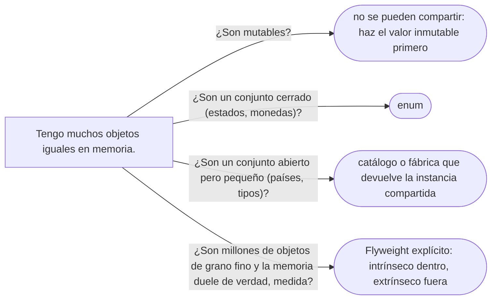

# 07 — Flyweight

> Reconocer el Flyweight que **ya usas** —la caché de `Integer`, los literales de `String`, los enums, el `Pais`
> compartido—, separar el estado **intrínseco** del **extrínseco**, y explicar por qué casi nunca lo escribes a
> mano. **Nivel: C**, con capítulo propio porque su anclaje en el JDK es extenso. Asume leído
> [`01/03` — Inmutabilidad y objetos especiales](../01-modelo-de-objetos/03-inmutabilidad-y-objetos-especiales.md).
>
> **Vigencia:** 2026-10-03.
>
> **Versiones ejecutadas:** JDK 21.0.12, 17.0.20 y 25.0.4 (2026-10-04).

---

## 1. 🎯 El problema

El informe nacional de documentos carga cinco millones de filas, y el mapeo de cada fila crea su propio país y
su propio tipo:

```java
Documento desdeFila(ResultSet rs) throws SQLException {
    Pais pais = new Pais(rs.getString("pais_iso"), rs.getString("pais_nombre"));          // uno por fila
    TipoDocumento tipo = new TipoDocumento(rs.getString("tipo_codigo"), pais,
            Pattern.compile(rs.getString("tipo_formato")), rs.getBoolean("tipo_vence"));  // otro por fila
    return new Documento(tipo, rs.getString("numero"), pais);
}
```

- Hay **cuatro** tipos de documento y **dos** países, y el informe crea diez millones de objetos para
  representarlos, más un `String` "Colombia" por fila. Todos iguales, todos distintos para `==`.
- La memoria se llena de duplicados que no aportan nada, y el recolector trabaja para limpiarlos.

Los países y los tipos son **inmutables** y **pocos**: no hay ninguna razón para tener más de uno de cada. El
Flyweight es compartirlos.

---

## 2. 🧱 Intención

**En una frase del GoF:** usar la compartición para soportar eficientemente grandes cantidades de objetos de
grano fino.

El patrón parte el estado de un objeto en dos:

| Estado | Qué es | Dónde vive | En el dominio |
|---|---|---|---|
| **Intrínseco** | Lo que es igual para todos los usos | **Dentro** del objeto compartido, inmutable | El código, el nombre y el formato de `TipoDocumento` |
| **Extrínseco** | Lo que cambia en cada uso | **Fuera**: lo pasa quien lo usa | El número del documento, el titular |

- Un objeto compartido **no puede** tener estado que cambie por uso: si `TipoDocumento` guardara el número del
  último documento validado, compartirlo sería un error. Por eso el Flyweight exige **inmutabilidad**.
- Una **fábrica** garantiza que se reutilice el existente en lugar de crear otro: es el único sitio donde se
  hace `new`.

---

## 3. 💻 Ejemplo mínimo

```java
public final class Paises {
    private static final Map<String, Pais> POR_ISO = new ConcurrentHashMap<>();

    public static Pais de(String iso, String nombre) {
        return POR_ISO.computeIfAbsent(iso, k -> new Pais(k, nombre));   // uno por código, compartido
    }
}

Documento desdeFila(ResultSet rs) throws SQLException {
    Pais pais = Paises.de(rs.getString("pais_iso"), rs.getString("pais_nombre"));
    TipoDocumento tipo = catalogo.deCodigo(rs.getString("tipo_codigo"));    // el catálogo ya los comparte
    return new Documento(tipo, rs.getString("numero"), pais);              // el número es extrínseco
}

boolean mismo = Paises.de("CO", "Colombia") == Paises.de("CO", "Colombia");   // → true
```

- Cinco millones de documentos apuntan a **dos** `Pais` y **cuatro** `TipoDocumento`. Lo que crece con las
  filas es solo el estado extrínseco: el número y la referencia.
- `Pais` y `TipoDocumento` son inmutables: es la condición para que compartirlos sea seguro, también entre hilos.

---

## 4. 🔭 Dónde aparece de verdad

Es el patrón del GoF con más presencia **invisible** en el JDK:

- **`Integer.valueOf`**: la Javadoc garantiza que cachea siempre de −128 a 127 y puede cachear más. El
  *autoboxing* usa `valueOf`, así que `Integer a = 100, b = 100;` comparte objeto y con 200 no. Es la trampa del
  `==` entre `Integer` (ver [`01/03` §4](../01-modelo-de-objetos/03-inmutabilidad-y-objetos-especiales.md#4--objetos-que-la-jvm-comparte-string-e-integer)).
  `Short`, `Long`, `Byte` y `Character` tienen cachés parecidas.
- **`Boolean.valueOf`**: devuelve `Boolean.TRUE` o `Boolean.FALSE`; su Javadoc recomienda usarlo en lugar del
  constructor por el ahorro de espacio y tiempo.
- **Los literales de `String` y `String.intern()`**: la Javadoc dice que todos los literales y las constantes de
  cadena se internan en un *pool*, y que `intern()` devuelve la instancia canónica de ese contenido. Es un
  Flyweight con la fábrica dentro de la JVM.
- **Los enums**: cada constante es una instancia única compartida; un `EstadoCuenta.ABIERTA` en un millón de
  cuentas es una referencia, no un millón de objetos.
- **`Collections.emptyList()`**, **`List.of()`** sin elementos, **`Optional.empty()`**: instancias inmutables que
  la implementación comparte. Ojo: la Javadoc de `Optional.empty()` advierte que no está garantizado que sea
  única, y que no se compare con `==`. El Flyweight es un detalle de implementación, no un contrato.
- **En el dominio**: el catálogo de `TipoDocumento` y los `Pais` compartidos de [`01/03` §9](../01-modelo-de-objetos/03-inmutabilidad-y-objetos-especiales.md#9--pais-enum-o-clase).

En C++ el caso típico es el mismo con otra forma: un `std::string_view` o un índice entero que apunta a una tabla
de cadenas compartida, en lugar de copiar la cadena en cada objeto.

---

## 5. 🪦 Por qué hoy es raro, y qué lo reemplazó

**Por qué es raro escribirlo.** El GoF lo presentó con un editor de texto que representaba cada carácter como un
objeto: compartir los objetos-letra era la diferencia entre caber en memoria o no. Hoy:

- **La inmutabilidad lo hace casi gratis.** Si los objetos de valor son inmutables y se obtienen por fábricas o
  catálogos, ya se comparten sin haber pensado en el patrón. Lo difícil del Flyweight era separar el estado
  extrínseco; un objeto de valor bien diseñado ya no lo tiene.
- **El *runtime* lo hace por ti.** El *interning* de literales, la deduplicación de cadenas del recolector G1
  (JEP 192, desde 8u20), las cadenas compactas de Java 9 (JEP 254), y el análisis de escape del JIT, que puede
  eliminar asignaciones de objetos de vida corta.
- **La memoria dejó de ser el problema dominante** en la mayoría de los servicios, y el costo de una fábrica con un
  mapa concurrente no se justifica para objetos que viven una petición.

**Qué lo reemplazó.** Los **enums** para conjuntos cerrados; los **catálogos** inyectados (`CatalogoTipos`) para
conjuntos abiertos; las **fábricas estáticas** que devuelven instancias compartidas (`valueOf`, `of`); y, en
el raro caso de millones de objetos de grano fino, estructuras orientadas a datos —arreglos de primitivos en
lugar de objetos— que ahorran más que compartir.

---

## 6. ⚖️ Con qué se confunde

| Se confunde con | La diferencia, en una frase |
|---|---|
| **Una caché** | La caché guarda **resultados** caros para no recalcularlos y puede expulsarlos; el Flyweight comparte **objetos inmutables** para no duplicarlos, y su identidad compartida es parte del contrato |
| **Singleton / Multiton** | El Multiton promete **una instancia por clave** como regla; el Flyweight comparte **para ahorrar memoria**, y no le importa si en algún sitio existe otra igual |
| **Object Pool** | El pool **presta** objetos mutables en exclusiva y los recupera; el Flyweight **comparte** inmutables entre todos a la vez |
| **Prototype** | El Prototype **copia** un ejemplar para modificarlo; el Flyweight evita las copias |

**La sobregeneralización.** "Flyweight es una caché" se queda con el mapa de la fábrica y pierde las dos cosas que
lo definen: la separación de estado intrínseco y extrínseco, y la inmutabilidad que hace segura la
compartición. Una caché de resultados de una consulta, con expiración, no es un Flyweight; la caché de `Integer`,
que nunca expira y cuyos objetos son inmutables, sí lo es.

---

## 7. 🧭 Cómo se elige



**La frase en voz alta:** *"El Flyweight lo uso todos los días sin escribirlo: `Integer.valueOf`, los literales de
`String`, los enums. Si lo escribiera, sería para objetos inmutables y muchos; y antes mediría, porque la JVM ya
deduplica bastante sola."*

---

## ⚠️ Errores frecuentes

| Se dice | Lo preciso |
|---|---|
| "Flyweight es una caché" | Comparte objetos inmutables separando estado intrínseco y extrínseco; una caché de resultados con expiración no lo es |
| "`Integer a = 200, b = 200; a == b` es `true`" | Solo está garantizado de −128 a 127; fuera de ese rango, depende de la configuración de la JVM |
| "Se puede compartir cualquier objeto" | Solo los inmutables, o los que no cambian por uso; compartir un mutable es un bug |
| "`intern()` siempre ahorra memoria" | Ahorra si hay muchos duplicados; internar cadenas únicas solo añade trabajo al *pool* |
| "Hoy hay que aplicar Flyweight para optimizar" | Hoy lo hacen los enums, las fábricas, el *interning* y el recolector; se escribe a mano solo tras medir |
| "Flyweight y Singleton son lo mismo" | El Singleton promete unicidad como regla; el Flyweight comparte para ahorrar |

---

## 📚 Para profundizar

- **Libro** — Gamma, Helm, Johnson y Vlissides, *Design Patterns* (Addison-Wesley, 1994), cap. 4, "Structural
  Patterns", sección "Flyweight": el editor con un objeto por carácter, y los estados intrínseco y extrínseco.
- **Libro** — Nystrom, *Game Programming Patterns* (2014), cap. "Flyweight", libre en
  [su sitio](https://gameprogrammingpatterns.com/flyweight.html): el patrón con terrenos y árboles, y la mirada
  moderna. **El que destaca.**
- [Java 21 API — `Integer.valueOf`](https://docs.oracle.com/en/java/javase/21/docs/api/java.base/java/lang/Integer.html):
  la caché de −128 a 127.
- [Java 21 API — `String.intern`](https://docs.oracle.com/en/java/javase/21/docs/api/java.base/java/lang/String.html):
  el *pool* de cadenas y el *interning* de los literales.
- [JEP 192 — String Deduplication in G1](https://openjdk.org/jeps/192): la deduplicación que hace el recolector.
- **Tutorial** — [Refactoring Guru — Flyweight](https://refactoring.guru/design-patterns/flyweight).

---

## 🧠 Preguntas

Sin respuestas aquí. Todas, con enunciado literal y respuesta en tres capas, en
[`09` — Respuestas](09-respuestas.md#07--flyweight).

1. ¿Cuál es la intención del Flyweight? 🟢
2. ¿Qué es el estado intrínseco y qué el extrínseco? Da un ejemplo del dominio. 🟢
3. ¿Qué tienen de Flyweight `Integer.valueOf` y `String.intern`? 🟢
4. ¿Por qué un enum es un Flyweight? 🟢
5. ¿Qué diferencia hay entre Flyweight y una caché? 🟡
6. ¿Qué diferencia hay entre Flyweight y Object Pool? 🟡
7. ¿Cómo comparte cadenas C++ sin un `intern` como el de Java? 🟡
8. ¿Por qué el Flyweight exige inmutabilidad? 🟠
9. ¿Por qué hoy casi nunca se escribe un Flyweight a mano? 🟠
10. ¿Por qué `Integer a = 200, b = 200; a == b` puede dar `false`? 🟠
11. Escribe la fábrica `Paises.de` y el mapeo de filas del informe nacional con países compartidos. 🔴
12. Revisa esta clase y di por qué no se puede compartir: `class TipoDocumento { String codigo; Pattern
    formato; String ultimoNumeroValidado; }`. 🔴

---

**Anterior:** [`06` — Bridge](06-bridge.md) ·
**Siguiente:** [`08` — Simulación de entrevista](08-simulacion-de-entrevista.md) ·
**Relacionado:** [`01/03` — Inmutabilidad y objetos especiales](../01-modelo-de-objetos/03-inmutabilidad-y-objetos-especiales.md)
