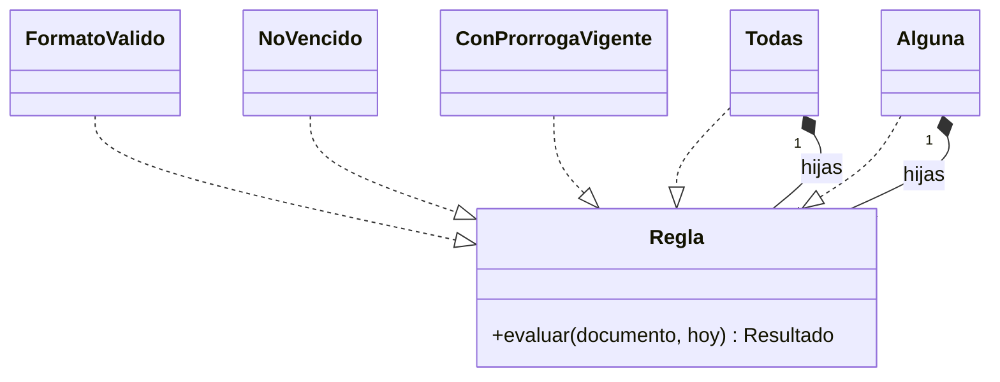

# 09 — Respuestas

> Solucionario del bloque `05-estructurales`: Estructurales. Cada respuesta en tres capas:
> **⏱️ 30 segundos** (lo que dices primero, sin que te lo pidan), **🗣️ 2 minutos** (lo que
> añades cuando dicen "cuéntame más") y **🔬 El detalle** (para estudiar, no para decir en voz
> alta). Los enunciados están copiados literalmente de su capítulo.
>
> **Vigencia:** 2026-10-03.
>
> **Versiones ejecutadas:** JDK 21.0.12, 17.0.20 y 25.0.4 · Spring Boot 4.1.1 (Spring Framework 7.0.9, Hibernate 7.4.5, H2 2.4.240) · mermaid-cli 11.17.0 (2026-10-04).

**Salto rápido:** [01](#01--adapter) · [02](#02--decorator) · [03](#03--proxy-y-los-tres-que-se-confunden) · [04](#04--facade) · [05](#05--composite) · [06](#06--bridge) · [07](#07--flyweight) · [08](#08--simulación-de-entrevista)

---

# 01 — Adapter

**01 → 1. ¿Cuál es la intención del Adapter? 🟢**

⏱️ Convertir la interfaz de una clase en otra que el cliente espera, para que colaboren dos piezas que no
encajan sin cambiar ninguna de las dos.
🗣️ El ejemplo del capítulo: el dominio pregunta "¿este documento es auténtico?" con `VerificadorIdentidad`, y
el adaptador `VerificadorIdCheck` traduce esa pregunta al SDK del proveedor, con sus códigos de tipo, su
entero de estado y su excepción.
🔬 La clave es que la clase adaptada **no se puede o no se quiere cambiar**: es de un tercero, o es estable y
compartida. Si las dos interfaces son tuyas, se cambia una y no hay patrón.

**01 → 2. ¿Cuáles son los participantes del Adapter, y cuál define el dominio? 🟢**

⏱️ Target (la interfaz que el cliente espera), Client, Adaptee (la clase ajena) y Adapter (la que implementa el
Target llamando al Adaptee). El Target lo define el dominio.
🗣️ `VerificadorIdentidad` vive con el dominio y habla su idioma; `VerificadorIdCheck` vive en la
infraestructura y es el único que conoce `IdCheckClient`. El cliente, `RegistroDocumentos`, solo ve el Target.
🔬 Es DIP: el módulo de política define la abstracción y el detalle volátil la implementa. Ver `03/02` §6.

**01 → 3. ¿Qué hace `Arrays.asList`, y por qué es un adaptador? 🟢**

⏱️ Devuelve una `List` de tamaño fijo respaldada por el arreglo: no copia, hace que el arreglo se vea como una
lista. Es un adaptador de objeto del arreglo a la interfaz `List`.
🗣️ Por eso los cambios con `set` se ven en el arreglo y al revés, y `add` o `remove` lanzan
`UnsupportedOperationException`: un arreglo no puede crecer, y el adaptador no lo oculta.
🔬 Si se quiere una lista propia y modificable, `new ArrayList<>(Arrays.asList(a))`; si se quiere una
inmutable, `List.of(a)`, que sí copia y además rechaza los `null`.

**01 → 4. ¿Qué es un *container adaptor* de la STL? 🟢**

⏱️ Un contenedor que da otra interfaz a uno existente: `std::stack`, `std::queue` y `std::priority_queue`
envuelven un `std::deque` o un `std::vector` y exponen solo las operaciones de pila o de cola.
🗣️ Es el Adapter de objeto en la librería estándar, con el contenedor de debajo como parámetro de plantilla:
`std::stack<Movimiento, std::vector<Movimiento>>`.
🔬 Al ser una plantilla, la adaptación se resuelve en compilación, sin llamadas virtuales: el adaptador no
cuesta nada en tiempo de ejecución.

**01 → 5. ¿Qué diferencia hay entre adaptador de objeto y adaptador de clase? 🟡**

⏱️ El de objeto contiene al Adaptee y le delega; el de clase hereda de él. El de objeto es el habitual: puede
adaptar cualquier instancia, incluidas subclases, y no expone nada del Adaptee.
🗣️ El de clase necesita herencia múltiple (C++) o que el Target sea una interfaz (Java), queda atado a una sola
clase y, en Java, expone los métodos públicos del Adaptee. Su única ventaja es poder sobrescribir métodos
virtuales del Adaptee.
🔬 En C++, la herencia privada del adaptador de clase evita la exposición; en Java no hay herencia privada, y por
eso el de clase casi no se usa.

**01 → 6. ¿Qué diferencia hay entre Adapter y Facade? 🟡**

⏱️ El Adapter hace encajar una clase en una interfaz que ya existe y el cliente espera; la Facade crea una
interfaz nueva y más simple para un subsistema de varias clases.
🗣️ El Adapter convierte; la Facade simplifica. El Adapter suele envolver un objeto; la Facade, varios. Y la
Facade no impide usar el subsistema directamente, mientras que el Adapter existe para que el cliente no vea al
Adaptee.
🔬 En la práctica se combinan: una fachada sobre un SDK complejo puede exponer la interfaz que el dominio espera,
y entonces hace las dos cosas. Ver `04 → 5`.

**01 → 7. ¿Qué diferencia hay entre Adapter y Decorator? 🟡**

⏱️ El Decorator conserva la interfaz del objeto que envuelve y le añade comportamiento; el Adapter cambia la
interfaz.
🗣️ `BufferedInputStream` envuelve un `InputStream` y sigue siendo un `InputStream`: es un Decorator.
`InputStreamReader` envuelve un `InputStream` y es un `Reader`: es un Adapter. Los dos están en `java.io`, y por
eso se confunden.
🔬 Un decorador se puede apilar sobre otro porque la interfaz no cambia; un adaptador no, porque cambia el tipo.
La tabla completa de los tres que se confunden está en `03` de este bloque.

**01 → 8. ¿Qué cambia en el adaptador de clase entre C++ y Java? 🟡**

⏱️ En C++ se escribe con herencia múltiple: pública del Target y privada del Adaptee. En Java solo es posible
si el Target es una interfaz, y la herencia del Adaptee es siempre pública.
🗣️ La herencia privada de C++ dice "lo uso para implementarme, no soy uno", y oculta los métodos del Adaptee.
En Java el adaptador de clase expone todo lo público del Adaptee a quien lo use como Adaptee, y por eso se
prefiere el de objeto.
🔬 En C++ moderno también se prefiere el de objeto, salvo cuando hace falta sobrescribir un método virtual del
Adaptee.

**01 → 9. ¿Por qué el Target lo define el dominio y no el proveedor? 🟠**

⏱️ Porque así la dependencia apunta del proveedor hacia el dominio, que es lo estable: el día que se cambia de
proveedor, se escribe otro adaptador y el dominio no se toca.
🗣️ Si el Target lo dicta el proveedor (sus nombres, sus parámetros, su entero de estado), cualquier cambio del
proveedor sube al dominio y el adaptador no protege nada. Un Target en el idioma del negocio también se lee y
se prueba mejor.
🔬 Es la inversión de dependencias aplicada a un borde del sistema, y es exactamente lo que la arquitectura
hexagonal llama un puerto.

**01 → 10. ¿Por qué un adaptador que deja pasar la excepción del proveedor no cumple su función? 🟠**

⏱️ Porque el dominio, para manejarla, tiene que conocer el tipo de la excepción del SDK: el acoplamiento que el
adaptador iba a cortar entra por el `catch`.
🗣️ El adaptador traduce **todo** lo que cruza: parámetros, resultados y errores. `IdCheckException` se convierte
en `ProveedorNoDisponibleException`, que es del dominio y dice lo que al negocio le importa.
🔬 Al traducir, la excepción original se conserva como causa (`new ProveedorNoDisponibleException(e)`): el
dominio no la conoce, pero el registro de errores sí la muestra.

**01 → 11. ¿Cuándo un adaptador es ceremonia? 🟠**

⏱️ Cuando adapta algo propio, algo estable con una buena interfaz, o cuando el Target copia la interfaz del
Adaptee con otros nombres.
🗣️ Envolver `java.time` o `std::vector` "por si cambian" no protege de ningún cambio probable. Y un Target que
repite los parámetros y el entero de estado del proveedor solo añade una capa: el dominio sigue acoplado.
🔬 La pregunta útil: ¿qué cambio concreto del proveedor queda contenido en el adaptador? Si la respuesta es
"ninguno", sobra.

**01 → 12. ¿Qué relación hay entre el Adapter y la arquitectura de puertos y adaptadores? 🟠**

⏱️ Cada adaptador de esa arquitectura es un Adapter del GoF: el puerto es el Target que define el dominio, y el
adaptador traduce a una tecnología concreta.
🗣️ El repositorio JDBC que implementa `RepositorioCuentas`, el cliente HTTP que implementa
`VerificadorIdentidad` y el controlador REST que llama a los casos de uso son adaptadores. La arquitectura
generaliza el patrón a todos los bordes.
🔬 Hay adaptadores "de entrada" (el controlador, que llama al dominio) y "de salida" (el repositorio, que el
dominio llama). Solo los de salida implementan una interfaz del dominio; los de entrada la usan.

**01 → 13. Escribe en Java el adaptador de `IdCheckClient` a `VerificadorIdentidad`, con la traducción de estados y de excepciones. 🔴**

⏱️ Una clase que implementa `VerificadorIdentidad`, recibe el cliente por constructor, traduce nuestros códigos
de tipo a los suyos, su entero de estado a un `ResultadoVerificacion` y su excepción a una del dominio.
🗣️

```java
public final class VerificadorIdCheck implements VerificadorIdentidad {
    private static final Map<String, String> TIPOS = Map.of(
            "CC", "NATIONAL_ID", "TI", "MINOR_ID", "PAS-CO", "PASSPORT", "PAS-MX", "PASSPORT");
    private final IdCheckClient cliente;

    public VerificadorIdCheck(IdCheckClient cliente) { this.cliente = cliente; }

    @Override
    public ResultadoVerificacion verificar(Documento d) {
        String tipo = TIPOS.get(d.tipo().codigo());
        if (tipo == null) return ResultadoVerificacion.rechazado("tipo no soportado por el proveedor");
        try {
            IdCheckResponse r = cliente.verify(d.emisor().codigoIso(), tipo, d.numero());
            return switch (r.getStatus()) {
                case 0  -> ResultadoVerificacion.autentico();
                case 2  -> ResultadoVerificacion.rechazado("documento revocado");
                case 1  -> ResultadoVerificacion.rechazado("documento no encontrado");
                default -> throw new ProveedorNoDisponibleException("estado " + r.getStatus());
            };
        } catch (IdCheckException e) {
            throw new ProveedorNoDisponibleException(e);
        }
    }
}
```

🔬 Lo que preguntará después: por qué el estado 9 es una excepción y no un rechazo (porque es un fallo del
proveedor, no una respuesta sobre el documento: el negocio debe reintentar, no rechazar a Ana); y cómo se prueba
el adaptador (con el SDK real contra su entorno de pruebas, o con un servidor falso; el dominio, en cambio, se
prueba con un `VerificadorIdentidad` falso).

**01 → 14. Revisa esta interfaz y di qué falla: `interface VerificadorIdentidad { IdCheckResponse verify(String iso2, String kind, String number) throws IdCheckException; }`. 🔴**

⏱️ Es un Target dictado por el proveedor: devuelve su tipo de respuesta, declara su excepción y recibe sus
códigos en `String`. El dominio sigue acoplado al SDK aunque haya una interfaz en medio.
🗣️ El arreglo es escribirla en el idioma del dominio: `ResultadoVerificacion verificar(Documento d)`, sin tipos ni
excepciones del SDK. La traducción de códigos, estados y errores se va al adaptador.
🔬 Lo que preguntará después: cómo se detecta esto en una revisión (buscar `import` del paquete del proveedor en
el código de dominio; un test de arquitectura lo puede prohibir); y si la interfaz debería devolver un
`boolean` (no: se pierde el motivo del rechazo, que el negocio necesita para avisar a Ana).

# 02 — Decorator

**02 → 1. ¿Cuál es la intención del Decorator? 🟢**

⏱️ Añadir responsabilidades a un objeto al ejecutar, envolviéndolo en otro con la misma interfaz, como
alternativa a crear subclases para cada combinación.
🗣️ Auditoría y reintentos sobre un repositorio de personas: en lugar de cuatro subclases para las
combinaciones, dos decoradores que se apilan en el orden que se quiera, sobre cualquier implementación del
repositorio.
🔬 El GoF lo presenta con una ventana a la que se añaden borde y barra de desplazamiento. En Java, el ejemplo
que todo el mundo usó sin saberlo es `java.io`.

**02 → 2. ¿Qué dos cosas hace a la vez un decorador, y por qué las dos? 🟢**

⏱️ Implementa la misma interfaz que el objeto que envuelve, y contiene un objeto de esa interfaz al que delega.
🗣️ Por implementarla, se puede usar donde se usaba el original sin que nadie lo note. Por contener otro de la
misma interfaz, puede envolver a otro decorador, y así se apilan: auditoría sobre reintentos sobre JDBC.
🔬 Si solo implementara la interfaz sin contener otro, sería una implementación más; si contuviera sin
implementar, sería un Adapter o una Facade.

**02 → 3. ¿Qué hace `BufferedInputStream` como decorador? 🟢**

⏱️ Envuelve otro `InputStream` y le añade un búfer en memoria y el soporte de `mark` y `reset`, sin dejar de ser
un `InputStream`.
🗣️ `new BufferedInputStream(new FileInputStream("documentos.csv"))` lee del archivo en bloques grandes y
entrega byte a byte desde el búfer. Se puede seguir apilando: un `GZIPInputStream` o un `DataInputStream`
encima.
🔬 En `java.io` la clase base de los decoradores es `FilterInputStream`: la clase de reenvío del GoF, que
delega todo en el flujo envuelto.

**02 → 4. ¿Qué es una clase de reenvío (*forwarding class*)? 🟢**

⏱️ Una clase que implementa una interfaz delegando cada método, sin añadir nada, en un objeto envuelto. Los
decoradores la extienden y sobrescriben solo lo que les interesa.
🗣️ Evita que cada decorador de una interfaz de diez métodos repita diez reenvíos. Bloch la usa en el ítem 18
(`ForwardingSet`) para escribir `InstrumentedSet`, un decorador que cuenta inserciones.
🔬 Es la clase `Decorator` abstracta del diagrama del GoF. Guava trae clases de reenvío para las colecciones
del JDK por esa razón.

**02 → 5. ¿Qué diferencia hay entre Decorator y herencia? 🟡**

⏱️ La herencia añade comportamiento a una clase, al compilar y en una sola dimensión; el Decorator, a un objeto,
al ejecutar, y combinando comportamientos.
🗣️ Con herencia, auditoría y reintentos son cuatro clases, atadas a JDBC. Con decoradores, dos clases que se
aplican a cualquier repositorio en cualquier orden. El decorador implementa la interfaz para ser
intercambiable, pero el comportamiento lo obtiene componiendo.
🔬 La herencia sigue ganando en algo: una subclase puede tocar el interior protegido de la base; un decorador
solo ve la interfaz pública. Ver `01/06`.

**02 → 6. ¿Qué diferencia hay entre Decorator y Proxy? 🟡**

⏱️ La estructura es la misma; la intención no. El Decorator añade comportamiento; el Proxy controla el acceso al
objeto: cuándo se crea, si se permite la llamada, dónde está.
🗣️ Un repositorio con auditoría es un Decorator; un repositorio que carga los documentos solo al pedirlos, o que
comprueba permisos antes de dejar pasar, es un Proxy. Los decoradores se apilan a gusto de quien arma; el
proxy suele ser uno, y a menudo lo crea el marco.
🔬 La tabla de los tres que se confunden está en `03` de este bloque, que es su dueño. Ver `03 → 5`.

**02 → 7. ¿Qué diferencia hay entre el Decorator del GoF y el `@decorator` de Python? 🟡**

⏱️ El del GoF es un objeto que envuelve a otro al ejecutar, con su misma interfaz. El `@decorator` de Python es
una función que recibe una función o una clase al definirla y devuelve otra.
🗣️ Un `@decorator` puede implementar el patrón (una función que envuelve a otra y añade un registro), pero
también puede registrar la función en un mapa, convertirla en propiedad o devolver un Singleton. Comparten el
nombre, no el mecanismo.
🔬 Se aplica una vez, al definir; el Decorator del GoF se elige al ejecutar y por objeto. Es un falso amigo
clásico de entrevista.

**02 → 8. ¿Qué diferencia hay entre `Collections.unmodifiableList` y `List.copyOf`? 🟡**

⏱️ `unmodifiableList` es un decorador: una vista sobre la lista original que lanza al escribir, pero que muestra
los cambios que otro haga en el original. `List.copyOf` copia y devuelve una lista inmutable que ya no cambia con el original.
🗣️ Con la vista, quien tenga la lista original puede seguir modificándola y quien tiene la vista lo ve. Con la
copia, el resultado no cambia nunca. Para devolver la colección interna de una clase, la vista es más barata y
la copia más segura.
🔬 `List.copyOf` además rechaza `null` y, si la entrada ya es una lista inmutable de `List.of`, puede devolverla
sin copiar. Ver `01/03` §6.

**02 → 9. ¿Qué cambia en un decorador entre C++98 y C++ moderno? 🟡**

⏱️ La propiedad: en C++98 el decorador guardaba un puntero crudo y nadie sabía quién destruía la pila; en C++
moderno cada decorador posee lo que envuelve con `std::unique_ptr`, y la pila se destruye en cadena.
🗣️ Además, `override` y `final` hacen comprobable la sobrescritura, y lo compartido (la auditoría) se pasa por
referencia para decir que no se posee.
🔬 Iglberger propone decoradores como valores con *type erasure*: sin herencia visible, copiables, y con la pila
como un objeto más. Compensa en librerías.

**02 → 10. ¿Por qué importa el orden de composición? Da un ejemplo con auditoría y reintentos. 🟠**

⏱️ Porque cada decorador envuelve a todo lo que tiene dentro. Con la auditoría fuera de los reintentos, una
escritura que necesitó tres intentos deja una entrada; con la auditoría dentro, deja tres.
🗣️ Ninguno es correcto en abstracto: si la auditoría registra "lo que pidió el usuario", va fuera; si registra
"lo que se intentó contra la base", dentro. Lo que es un error es no decidirlo, porque el orden queda escrito
en una línea de la raíz de composición que nadie relee.
🔬 Lo mismo pasa con una caché: fuera de la auditoría, las lecturas que se sirven de la caché no se auditan.
Conviene documentar el orden en la raíz o construir la pila en un método con nombre.

**02 → 11. ¿Qué problemas de identidad trae un decorador? 🟠**

⏱️ El decorado es otro objeto: no es `==` al original y, salvo que se programe, `equals` da `false`. Un `Set`
o un `Map` que tenga el original no reconoce al decorado.
🗣️ Además, quien tiene el decorado no puede preguntar por el tipo concreto (`instanceof
RepositorioPersonasJdbc` falla) sin desenvolverlo. Hacer que `equals` delegue en el envuelto rompe la simetría
con el original.
🔬 Por eso los decoradores no deben usarse como claves ni compararse; si hace falta identidad, se compara por el
identificador del dominio, no por el objeto.

**02 → 12. ¿Qué es el problema SELF, y cuándo impide usar un decorador? 🟠**

⏱️ Que el objeto envuelto no sabe que está envuelto: si se pasa a sí mismo (`this`) a otro objeto, las llamadas
que vuelvan por esa referencia van directo a él y saltan el decorador.
🗣️ Pasa en los *callbacks*: un repositorio que se registra como oyente de eventos con `this` recibirá los
eventos sin auditoría ni reintentos, aunque todo el resto del sistema lo use decorado. Bloch lo menciona en el
ítem 18 como la limitación de las clases envoltorio.
🔬 La salida, si se necesita, es que quien arma registre el decorado y no el objeto interno; o que el objeto
reciba por constructor la referencia "pública" que debe entregar.

**02 → 13. ¿Cuándo un decorador es ceremonia? 🟠**

⏱️ Cuando hay un solo comportamiento que siempre se aplica a una sola implementación: entonces puede ir dentro
de la clase o en el servicio, sin capa extra.
🗣️ El decorador se justifica por combinar comportamientos o por aplicarlo a varias implementaciones (también a
la de los tests). Si ninguna de las dos cosas pasa, solo añade una clase y un salto al depurar.
🔬 También es ceremonia escribir a mano el mismo decorador para cien clases: ese es el trabajo de un proxy
generado por AOP.

**02 → 14. Escribe en Java un decorador que mida el tiempo de `guardar` en un `RepositorioPersonas`. 🔴**

⏱️ Una clase que implementa `RepositorioPersonas`, recibe el envuelto y un registro de métricas, toma el tiempo
antes y después de delegar en `guardar`, y reenvía `buscar` sin tocarlo.
🗣️

```java
public final class RepositorioMedido implements RepositorioPersonas {
    private final RepositorioPersonas interno;
    private final Metricas metricas;
    private final Clock reloj;

    public RepositorioMedido(RepositorioPersonas interno, Metricas metricas, Clock reloj) {
        this.interno = interno; this.metricas = metricas; this.reloj = reloj;
    }
    @Override public void guardar(Persona p) {
        Instant inicio = reloj.instant();
        try {
            interno.guardar(p);
        } finally {
            metricas.registrar("personas.guardar", Duration.between(inicio, reloj.instant()));
        }
    }
    @Override public Optional<Persona> buscar(PersonaId id) { return interno.buscar(id); }
}
```

🔬 Lo que preguntará después: por qué `finally` (para medir también las escrituras que fallan); dónde va en la
pila respecto de los reintentos (fuera mide lo que vio el usuario; dentro, cada intento); y por qué un `Clock`
inyectado (para probarlo; en producción se usaría `System.nanoTime()`, que es monotónico y más preciso para
medir duraciones).

**02 → 15. Reemplaza esta jerarquía por decoradores: `RepositorioJdbc`, `RepositorioJdbcConCache`, `RepositorioJdbcConAuditoria`, `RepositorioJdbcConCacheYAuditoria`. 🔴**

⏱️ Queda `RepositorioJdbc` y dos decoradores, `RepositorioConCache` y `RepositorioAuditado`, que implementan la
interfaz y envuelven a cualquier repositorio. La cuarta clase desaparece: es una composición.
🗣️

```java
RepositorioPersonas soloJdbc   = new RepositorioJdbc(fuente);
RepositorioPersonas conCache   = new RepositorioConCache(new RepositorioJdbc(fuente));
RepositorioPersonas conAmbos   = new RepositorioConCache(
                                     new RepositorioAuditado(new RepositorioJdbc(fuente), auditoria));
```

Con la caché fuera, las lecturas cacheadas no llegan a la auditoría (que solo audita escrituras, así que da
igual); si auditara lecturas, habría que ponerla fuera.
🔬 Lo que preguntará después: cómo se invalida la caché al guardar (el decorador de caché intercepta `guardar` y
borra la entrada antes de delegar); y cómo se migra sin romper (crear los decoradores, cambiar la raíz de
composición, y borrar las subclases cuando nadie las use).

**02 → 16. Revisa este código y di qué falla: `Set<RepositorioPersonas> vistos = new HashSet<>(); vistos.add(jdbc); var repo = new RepositorioAuditado(jdbc, aud); boolean ya = vistos.contains(repo);`. 🔴**

⏱️ `ya` es `false`: el decorado es otro objeto, con su propio `hashCode` e igualdad por identidad, aunque envuelva
a `jdbc`. Quien escribió esto esperaba que el decorador "fuera" el original.
🗣️ El arreglo depende de la intención. Si se quiere saber si ese repositorio ya se registró, se registra
siempre el mismo objeto (el decorado) o se usa un identificador explícito. Hacer que `equals` del decorador
delegue en el envuelto rompe la simetría: `jdbc.equals(repo)` seguiría siendo `false`.
🔬 Lo que preguntará después: si esto pasa en Spring (sí: el bean inyectado es un proxy y no es `==` a la
instancia que creó la configuración, y la comparación por identidad entre ellos falla igual); y cómo lo
detectarías en una revisión (cualquier `==`, `equals` o colección con identidad sobre objetos que se decoran).

# 03 — Proxy, y los tres que se confunden

**03 → 1. ¿Cuál es la intención del Proxy? 🟢**

⏱️ Poner delante de un objeto un sustituto con su misma interfaz que controla el acceso a él: cuándo se crea,
si se permite la llamada o dónde está.
🗣️ Los documentos de una persona que se consultan solo cuando alguien los pide, o que solo la tutora puede ver
si el titular es menor. Quien llama recibe un `Documentos` y no sabe si delante hay un proxy.
🔬 La palabra clave es "controlar el acceso". Si el sustituto añade comportamiento sin controlar el acceso, en la
nomenclatura del corpus es un Decorator.

**03 → 2. ¿Qué cuatro clases de proxy distingue el GoF, y qué controla cada una? 🟢**

⏱️ Virtual (cuándo se crea o carga el real), de protección (si se permite la llamada), remoto (dónde está: en otro
proceso) y referencia inteligente (qué pasa en cada acceso: contar, bloquear).
🗣️ En el dominio: documentos cargados al primer uso; documentos de Luis visibles solo para su tutora; el cliente
generado de un servicio remoto de personas; y `std::shared_ptr`, que cuenta referencias.
🔬 Spring añade de hecho una quinta en la práctica: el proxy que aplica aspectos (transacción, caché). Es un proxy
porque controla si la llamada ocurre dentro de una transacción, y porque lo genera el marco.

**03 → 3. ¿Qué es un proxy dinámico del JDK? 🟢**

⏱️ Un objeto generado en tiempo de ejecución con `java.lang.reflect.Proxy` que implementa una o varias interfaces y
manda cada llamada a un `InvocationHandler`.
🗣️ Un solo manejador sirve para cualquier interfaz y cualquier método: recibe el método y los argumentos, hace lo
suyo (auditar, medir, comprobar permisos) y llama al real por reflexión. Es lo que usan los marcos para aplicar un
comportamiento a muchas clases.
🔬 Solo funciona con interfaces. Para clases hace falta generar una subclase (CGLIB, ByteBuddy).

**03 → 4. ¿Por qué `std::shared_ptr` es un proxy? 🟢**

⏱️ Porque se usa como un puntero al objeto —con `->` y `*`— y en cada copia y destrucción hace algo más: cuenta
referencias y destruye el objeto cuando llega a cero. Es un proxy de referencia inteligente.
🗣️ El GoF ya mencionaba el `operator->` sobrecargado de C++ como forma de proxy. Los *smart pointers* de C++11 son
la versión estándar: `unique_ptr` destruye al salir del ámbito, `shared_ptr` cuenta, `weak_ptr` observa sin
contar.
🔬 `std::vector<bool>::reference` es otro proxy de la STL, menos querido: representa un bit como si fuera un
`bool&`, y por eso `auto x = v[0]` no es un `bool`.

**03 → 5. ¿Qué diferencia hay entre Proxy y Decorator? 🟡**

⏱️ La estructura es la misma: misma interfaz y una referencia al real. La intención no: el Proxy controla el acceso
y el Decorator añade comportamiento.
🗣️ Se nota en quién lo crea y cuántos hay. Los decoradores los apila quien compone, a propósito y en un orden que
importa; el proxy suele ser uno, y a menudo lo crea el marco sin que el cliente lo pida.
🔬 El proxy de AOP de Spring está en la frontera: añade una transacción, como un decorador, pero lo genera el marco
y decide si la llamada ocurre dentro de ella. Se le llama proxy.

**03 → 6. ¿Qué diferencia hay entre Proxy y Adapter? 🟡**

⏱️ El Proxy tiene la misma interfaz que el objeto real; el Adapter tiene otra, la que el cliente espera.
🗣️ El proxy se pone delante de algo que ya encaja, para controlar el acceso; el adaptador se pone delante de algo
que no encaja, para traducir. `InputStreamReader` es un Adapter (de bytes a caracteres); el proxy de un
repositorio de Spring Data es un Proxy.
🔬 El proxy remoto se parece a un adaptador porque traduce a llamadas de red, pero conserva la interfaz del objeto
remoto: el cliente lo usa como si fuera local.

**03 → 7. ¿Qué diferencia hay entre un proxy del JDK y uno de CGLIB? 🟡**

⏱️ El del JDK implementa interfaces; el de CGLIB es una subclase generada de la clase real. El primero solo proxea
lo que está en las interfaces; el segundo, cualquier método que se pueda sobrescribir.
🗣️ Spring usa el del JDK si el bean implementa interfaces y CGLIB si no; Spring Boot configura CGLIB por defecto.
CGLIB no puede proxear clases `final` ni interceptar métodos `final` o `private`, porque no se pueden sobrescribir.
🔬 Con el proxy del JDK, inyectar el bean por su clase concreta falla, porque el proxy solo es de la interfaz. Esa es
una de las razones por las que Spring Boot prefiere CGLIB.

**03 → 8. ¿Qué diferencia hay entre un proxy virtual y la inicialización perezosa dentro del objeto? 🟡**

⏱️ En la perezosa, el propio objeto decide cargar tarde y sabe de dónde cargar; en el proxy virtual, el objeto real
no sabe nada y la carga tardía la pone otro delante.
🗣️ Con la perezosa dentro, `Persona` tendría que conocer el repositorio de documentos. Con el proxy, `Persona` tiene
un `Documentos` y quien la construye decide si es la lista cargada o un proxy que consulta al primer uso.
🔬 Las asociaciones `LAZY` de JPA son proxies virtuales: la entidad no sabe que su colección se cargará al
recorrerla.

**03 → 9. ¿Qué diferencia hay entre un proxy de Spring y AspectJ con tejido en compilación? 🟡**

⏱️ El proxy se pone delante del objeto, así que solo intercepta las llamadas que entran por él; AspectJ modifica el
código del propio objeto al compilar o al cargar la clase, así que intercepta también las llamadas por `this`.
🗣️ Con AspectJ no existe la trampa de la autoinvocación, ni la de los métodos `private`. A cambio, el proceso de
construcción se complica y el código que se ejecuta no es el que se ve.
🔬 La documentación de Spring lo dice al explicar el problema: los aspectos de AspectJ no tienen el problema de la
autoinvocación porque aplican el consejo en el *bytecode* y no por un proxy.

**03 → 10. ¿Qué diferencia hay entre un proxy en C++ y en Java? 🟡**

⏱️ En C++ el proxy por excelencia es la sintaxis de puntero sobrecargada (`operator->`): los *smart pointers*. En
Java no se pueden sobrecargar operadores, y el proxy es siempre un objeto con la misma interfaz, escrito a mano o
generado.
🗣️ Java tiene, a cambio, los proxies dinámicos: generar al ejecutar un proxy para cualquier interfaz. C++ no tiene
reflexión en tiempo de ejecución, y un proxy genérico se escribe con plantillas en compilación.
🔬 En C++ un proxy además decide la propiedad del real: `unique_ptr` si lo posee, referencia si no. En Java esa
pregunta no existe.

**03 → 11. ¿Por qué `@Transactional` no funciona en la llamada interna? 🟠**

⏱️ Porque la transacción la abre el proxy que Spring pone delante del bean, no el bean. Dentro del bean, `this` es
el objeto real, y una llamada por `this` no pasa por el proxy.
🗣️ `transferirLote` llama a `this.transferir(o)`: el proxy interceptó `transferirLote`, que no tiene la anotación,
y la llamada interna va directa al real. El débito queda confirmado aunque el crédito falle. La documentación de
Spring lo dice: solo se interceptan las llamadas externas que entran por el proxy.
🔬 Las salidas: mover el método a otro bean (la limpia), usar `TransactionTemplate` explícito, poner la anotación en
el método de entrada, o AspectJ. Inyectarse a sí mismo funciona y es un parche. Ver la autopsia de §6.

**03 → 12. ¿Por qué un proxy de subclase no intercepta métodos `final` ni `private`? 🟠**

⏱️ Porque un proxy de subclase funciona sobrescribiendo los métodos de la clase real, y un método `final` o
`private` no se puede sobrescribir: la llamada va directa a la implementación original.
🗣️ El resultado es silencioso: `@Transactional` en un método `final` no da error, simplemente no abre transacción.
Y una clase `final` no se puede proxear en absoluto, lo que en Kotlin obliga al plugin que abre las clases.
🔬 La documentación de Spring lo lista entre los límites de CGLIB: clases `final`, métodos `final`, métodos
`private`, y métodos no visibles desde la subclase.

**03 → 13. ¿Cuándo un proxy virtual empeora el rendimiento? 🟠**

⏱️ Cuando el dato casi siempre se usa: el proxy convierte una consulta conjunta en una consulta por elemento. Es el
problema N+1.
🗣️ Una pantalla que lista 500 personas **con** sus documentos dispara 1 consulta para las personas y 500 para los
documentos, una por proxy. Cargarlo todo en una consulta con un *join* habría sido una sola.
🔬 La salida en JPA es pedir lo que se va a usar (`JOIN FETCH`, grafos de entidad) en la consulta de ese caso de uso,
y dejar lo perezoso como valor por defecto para el resto.

**03 → 14. ¿Qué problemas de identidad trae un proxy? 🟠**

⏱️ El proxy no es `==` al real, `getClass()` devuelve una clase generada, y `equals` puede comportarse distinto si
la clase real compara clases.
🗣️ Con JPA es clásico: un `equals` que hace `getClass() != o.getClass()` da `false` entre una entidad y el proxy de
la misma entidad. Por eso las entidades comparan con `instanceof` y por identificador, y usan los *getters* (que el
proxy intercepta) y no los campos.
🔬 También en los registros de errores: la pila incluye marcos de clases generadas, y los nombres
(`$Proxy42`, `$$SpringCGLIB$$0`) despistan a quien no los conoce.

**03 → 15. ¿Cuándo pondrías el control de acceso en un proxy y cuándo dentro del servicio? 🟠**

⏱️ En un proxy cuando la regla es transversal y no depende del caso de uso (la misma para todos los accesos a
documentos); dentro del servicio cuando es parte de la lógica de negocio y quien lee el caso de uso tiene que verla.
🗣️ "Solo la tutora ve los documentos de un menor" puede ser un proxy de protección, porque se aplica igual en todos
los sitios. "Solo se puede transferir si el titular firmó el consentimiento" es negocio del caso de uso, y un `if`
explícito se lee mejor que un proxy invisible.
🔬 En Spring, `@PreAuthorize` es el proxy de protección; abusar de él con expresiones largas mete reglas de negocio
en anotaciones que no se prueban como el resto del código.

**03 → 16. Escribe un proxy de protección en Java para `Documentos` con la regla de la tutora. 🔴**

⏱️ Una clase que implementa `Documentos`, recibe el real, el titular, el usuario y el reloj, y en `lista()` comprueba
la regla antes de delegar.
🗣️

```java
public final class DocumentosProtegidos implements Documentos {
    private final Documentos real;
    private final Persona titular;
    private final Usuario usuario;
    private final Clock reloj;

    public DocumentosProtegidos(Documentos real, Persona titular, Usuario usuario, Clock reloj) {
        this.real = real; this.titular = titular; this.usuario = usuario; this.reloj = reloj;
    }
    @Override public List<Documento> lista() {
        boolean menor = titular.esMenor(LocalDate.now(reloj));
        if (menor && !usuario.es(titular.tutor()))
            throw new AccesoDenegadoException("solo la tutora ve los documentos de un menor");
        return real.lista();
    }
}
```

Se puede apilar sobre el proxy virtual: `new DocumentosProtegidos(new DocumentosPerezosos(id, repo), luis, usuario,
reloj)`. Primero se comprueba el permiso; si se niega, ni siquiera se consulta la base.
🔬 Lo que preguntará después: por qué el orden importa (con la protección dentro, la consulta se haría antes de negar);
y si el titular mismo puede ver sus documentos siendo menor (la regla del enunciado no lo permite; el negocio
decidiría, y el proxy es el único sitio que cambia).

**03 → 17. Escribe con `java.lang.reflect.Proxy` un proxy que registre el tiempo de cada llamada a cualquier interfaz. 🔴**

⏱️ Un método genérico que crea un `InvocationHandler` que toma el tiempo antes y después de invocar al real por
reflexión, y desenvuelve la `InvocationTargetException`.
🗣️

```java
@SuppressWarnings("unchecked")
static <T> T medido(T real, Class<T> interfaz, Metricas metricas) {
    InvocationHandler h = (proxy, metodo, args) -> {
        long inicio = System.nanoTime();
        try {
            return metodo.invoke(real, args);
        } catch (InvocationTargetException e) {
            throw e.getCause();
        } finally {
            metricas.registrar(interfaz.getSimpleName() + "." + metodo.getName(),
                               Duration.ofNanos(System.nanoTime() - inicio));
        }
    };
    return (T) Proxy.newProxyInstance(interfaz.getClassLoader(), new Class<?>[] { interfaz }, h);
}
```

🔬 Lo que preguntará después: por qué desenvolver la excepción (si no, quien llama recibe una
`UndeclaredThrowableException` en lugar de la excepción del dominio); qué pasa con `equals`, `hashCode` y
`toString` (también pasan por el manejador, y se miden igual); y por qué `nanoTime` (es monotónico: sirve para
duraciones, no para fechas).

**03 → 18. Diagnostica: `@Transactional private void transferir(...)` llamado desde otro método público de la misma clase. Di qué pasa y cómo lo corriges. 🔴**

⏱️ No hay transacción, por dos razones a la vez: la llamada es interna y no pasa por el proxy, y el método es
`private`, que ningún proxy puede interceptar. Spring no da error: la anotación se ignora en silencio.
🗣️ La corrección es mover `transferir` a otro bean, hacerlo público (o al menos visible para el proxy) y llamarlo a
través de la referencia inyectada. Alternativa sin mover nada: un `TransactionTemplate` dentro del método público,
explícito.
🔬 Lo que preguntará después: cómo lo detectarías antes de producción (un test de integración que fuerce un fallo
después del débito y compruebe el *rollback*; la documentación de Spring avisa de que el código puede parecer que
funciona hasta que se prueba un *rollback*); y si algún analizador lo marca (los IDE con soporte de Spring avisan de
`@Transactional` en métodos privados y en autoinvocación).

# 04 — Facade

**04 → 1. ¿Cuál es la intención de la Facade? 🟢**

⏱️ Dar una interfaz unificada y de más alto nivel a un subsistema de varias clases, para que el caso común se
haga con una llamada.
🗣️ `AltaPersonas.alta(solicitud)` coordina verificación, guardado, indexación de documentos, contactos y aviso de
bienvenida. El controlador y la importación nocturna ya no conocen las cinco piezas ni el orden.
🔬 La fachada coordina lo que existe; no añade funcionalidad ni reglas. El GoF la ilustra con un compilador que
esconde sus fases detrás de `compile()`.

**04 → 2. ¿Por qué SLF4J es una fachada? 🟢**

⏱️ Porque el código usa una sola API simple (`LoggerFactory.getLogger`, `logger.info`) y por detrás puede haber
Logback, Log4j o `java.util.logging`, elegido al desplegar. El propio nombre lo dice: *Simple Logging Facade for
Java*.
🗣️ Simplifica y unifica: las librerías escriben contra SLF4J y la aplicación decide el marco. Por eso ninguna
librería seria depende directamente de un marco de *logging* concreto.
🔬 Técnicamente es fachada y adaptador a la vez: además de simplificar, hace encajar APIs de marcos distintos en la
suya, con un módulo de enlace por marco.

**04 → 3. ¿Qué participantes tiene la Facade, y cuál de ellos sabe que existe? 🟢**

⏱️ La fachada, las clases del subsistema y los clientes. Solo los clientes saben que existe la fachada: el
subsistema no la conoce.
🗣️ Eso la distingue del Mediator: en la Facade la comunicación va en un sentido, del cliente a la fachada y de la
fachada al subsistema. Las piezas del subsistema no llaman a la fachada.
🔬 Si una pieza del subsistema empieza a llamar a la fachada, aparece un ciclo de dependencias: una señal de que la
fachada está haciendo de mediador o de que una regla está en el sitio equivocado.

**04 → 4. ¿Qué diferencia hay entre Facade y Adapter? 🟡**

⏱️ El Adapter hace encajar una clase en una interfaz que ya existe y el cliente espera; la Facade inventa una
interfaz nueva y más simple para varias clases.
🗣️ El Adapter convierte; la Facade simplifica. El Adapter suele envolver un objeto; la Facade, un subsistema. Y el
Adapter existe para que el cliente no vea al Adaptee, mientras que la Facade deja el subsistema accesible.
🔬 Ver `01 → 6`. SLF4J hace las dos cosas a la vez.

**04 → 5. ¿Qué diferencia hay entre Facade y Service Layer? 🟡**

⏱️ La Service Layer define el borde de la aplicación —todas sus operaciones, con transacción y seguridad—; la
Facade simplifica un subsistema. Una Service Layer se implementa a menudo como un conjunto de fachadas.
🗣️ Fowler describe en *PoEAA* dos formas de Service Layer: fachada de dominio (métodos delgados que delegan en un
modelo rico) y *operation script* (los métodos llevan la lógica). `AltaPersonas` con `@Transactional`, que
coordina el dominio, es una Service Layer implementada como fachada.
🔬 La regla práctica: si es la entrada de un caso de uso de la aplicación, servicio de aplicación; si simplifica una
librería o un subsistema técnico, fachada. La Service Layer completa está en
[`07/01`](../07-fowler-dominio-y-datos/01-logica-de-dominio.md#5--service-layer).

**04 → 6. ¿Qué diferencia hay entre Facade y Mediator? 🟡**

⏱️ En la Facade la comunicación va en un sentido y el subsistema no sabe que existe; en el Mediator los objetos se
comunican **a través** de él, le hablan y él les habla.
🗣️ Una fachada de alta llama al repositorio y al notificador, que no la conocen. Un mediador entre componentes de
una pantalla recibe "cambió el país" del selector y le dice al campo de documento que cambie su formato: los
componentes lo conocen.
🔬 Los dos centralizan, y los dos pueden degenerar en clase dios. El Mediator tiene ficha en
[`06/08`](../06-comportamiento/08-iterator-y-mediator.md#3--mediator).

**04 → 7. ¿Qué cambia en una fachada entre C++ y Java? 🟡**

⏱️ Casi nada en la estructura. En C++ la fachada recibe el subsistema por referencias que dicen que no lo posee, y
puede devolver `std::expected` para los fallos de negocio; en Java recibe referencias inyectadas y suele llevar la
transacción.
🗣️ Es de los pocos patrones cuya versión C++98 apenas envejeció: no hay propiedad que decidir ni jerarquía que
modernizar. Lo que cambió es el tipo de retorno, que en C++23 puede decir que el alta falló sin lanzar.
🔬 En Java, `@Transactional` sobre la fachada la convierte en el sitio natural de la atomicidad; en C++ la
transacción sería un objeto RAII dentro del método.

**04 → 8. ¿Por qué "una fachada esconde el subsistema" es impreciso? 🟠**

⏱️ Porque el GoF la describe como una simplificación del caso común que deja el subsistema accesible para quien
necesita más control. Simplificar no es esconder.
🗣️ Si se lee como "esconder", se termina prohibiendo usar las piezas directamente y metiendo en la fachada todas sus
operaciones: duplica la interfaz y no simplifica nada. Esconder un subsistema es una decisión de módulos
(visibilidad de paquete, módulos de Java que no exportan), no el patrón.
🔬 Las dos cosas se combinan bien: un módulo que exporta solo su fachada. Pero entonces la fachada es la API del
módulo, y hay que diseñarla como tal.

**04 → 9. ¿Cuándo una fachada se convierte en un God Object, y cómo lo evitas? 🟠**

⏱️ Cuando cada caso de uso nuevo se añade a la misma fachada y empieza a decidir reglas propias: acaba con decenas
de métodos, quince dependencias y cambios por cualquier motivo.
🗣️ Se evita con una fachada por caso de uso o por grupo de clientes (`AltaPersonas`, `ConsultaPersonas`), y
mandando las reglas al dominio. Las dependencias del constructor son el termómetro: más de cinco o seis piden
partir.
🔬 La salida, cuando ya ocurrió, es la del God Object de [`12/03` §2](../12-antipatrones/03-antipatrones-de-diseno-oo.md#2-️-god-object): partir por motivo de cambio, no en
trozos del mismo tamaño.

**04 → 10. ¿Dónde va la transacción en un alta que toca cinco piezas, y por qué ahí? 🟠**

⏱️ En la fachada o servicio de aplicación, porque es el único sitio que ve la operación entera: si una pieza falla,
todas se deshacen.
🗣️ En el repositorio sería demasiado pequeña (la persona guardada y los documentos sin indexar); en el controlador,
demasiado alta y acoplada al transporte. La fachada coincide con el caso de uso, que es la unidad de atomicidad.
🔬 Ojo con lo que no es transaccional: el correo de bienvenida no se deshace con un *rollback*. Lo correcto es
enviarlo después de confirmar (un evento tras la confirmación), no dentro de la transacción.

**04 → 11. ¿Cuándo extraer una fachada es prematuro? 🟠**

⏱️ Cuando hay un solo cliente y un solo uso: el método del controlador ya es la fachada, y extraerla solo añade una
clase.
🗣️ Se justifica cuando aparece el segundo cliente (la importación nocturna) o cuando el controlador mezcla
transporte y coordinación. Antes, la extracción es especulativa.
🔬 La excepción: si el equipo ya tiene la convención de servicios de aplicación, seguirla aunque haya un cliente
cuesta poco y mantiene la arquitectura legible.

**04 → 12. ¿Qué hace una fachada si una de las piezas del subsistema tiene una regla de negocio? 🟠**

⏱️ Nada con la regla: la llama. La regla vive en la pieza o en el dominio; la fachada solo decide el orden y
traduce el resultado.
🗣️ "Un menor necesita tutor" va en el constructor de `Persona`, no en un `if` de `AltaPersonas`. Si la fachada la
comprobara, la importación que no use la fachada podría saltársela.
🔬 La tentación es fuerte porque la fachada es "donde pasa todo". Es justamente la forma en que una fachada se
convierte en un *Transaction Script* gordo y el modelo se vuelve anémico.

**04 → 13. Escribe la fachada `AltaPersonas` en Java a partir del controlador de §1. 🔴**

⏱️ Una clase con las cinco dependencias por constructor, un método `alta` transaccional con la secuencia, y un
controlador que solo traduce HTTP.
🗣️

```java
@Service
public class AltaPersonas {
    private final VerificadorIdentidad verificador;
    private final RepositorioPersonas personas;
    private final RegistroDocumentos documentos;
    private final AgendaContactos contactos;
    private final Notificador notificador;

    public AltaPersonas(VerificadorIdentidad v, RepositorioPersonas r, RegistroDocumentos d,
                        AgendaContactos c, Notificador n) {
        this.verificador = v; this.personas = r; this.documentos = d; this.contactos = c; this.notificador = n;
    }

    @Transactional
    public PersonaId alta(SolicitudAlta s) {
        Persona p = new Persona(s.nombre(), s.fechaNacimiento());
        for (var d : s.documentos()) {
            if (!verificador.verificar(d).esAutentico()) throw new DocumentoNoVerificadoException(d);
            p.agregarDocumento(d);
        }
        PersonaId id = personas.guardar(p);
        documentos.indexar(id, p.documentos());
        contactos.guardar(id, s.email(), s.telefono());
        notificador.bienvenida(p);
        return id;
    }
}

@PostMapping("/personas")
public ResponseEntity<PersonaId> alta(@RequestBody SolicitudAlta s) {
    return ResponseEntity.status(201).body(altaPersonas.alta(s));
}
```

La traducción de `DocumentoNoVerificadoException` a un 422 va en un manejador de excepciones del controlador.
🔬 Lo que preguntará después: qué pasa con el correo si la transacción se deshace (se envió igual: hay que moverlo a
después de la confirmación); y por qué el controlador no llama a `alta` dentro de la misma clase (porque
`@Transactional` lo aplica un proxy, y la llamada interna no pasa por él; ver `03 → 11`).

**04 → 14. Revisa esta clase y di qué falla: `class ServicioPersonas` con 42 métodos públicos —alta, baja, búsqueda, exportación, notificaciones, cálculo de edad— y 17 dependencias inyectadas. 🔴**

⏱️ Es una fachada que se convirtió en God Object: cambia por cualquier motivo, todos los clientes dependen de ella,
y sus 17 dependencias hacen imposible probar una operación sin montar las otras.
🗣️ La salida es partirla por motivo de cambio y por grupo de clientes: `AltaPersonas`, `BajaPersonas`,
`ConsultaPersonas`, `ExportacionPersonas`. El cálculo de edad no es de un servicio: va en `Persona`. Las
notificaciones, a un servicio propio que reaccione a eventos.
🔬 Lo que preguntará después: cómo se parte sin romper a los clientes (extraer una clase por grupo, dejar que la
vieja delegue en las nuevas, migrar los clientes y borrar la vieja); y cómo sabes qué métodos van juntos (mirando
qué dependencias usa cada uno: los que comparten dependencias suelen ser un mismo servicio).

# 05 — Composite

**05 → 1. ¿Cuál es la intención del Composite? 🟢**

⏱️ Componer objetos en árboles parte-todo y dejar que el cliente trate igual una hoja y un grupo: preguntarle lo
mismo a un puesto que a un área entera.
🗣️ `costoMensual()` en un `Puesto` devuelve su salario; en un `Area`, suma lo que devuelven sus hijos, sean
puestos o áreas. RR. HH. pide el costo de cualquier unidad sin saber qué es.
🔬 El ejemplo del GoF es un editor gráfico donde un dibujo contiene figuras y otros dibujos. Lo esencial es el
"de manera uniforme": sin eso hay un árbol, pero no el patrón.

**05 → 2. ¿Qué participantes tiene el Composite? 🟢**

⏱️ Component (la interfaz común), Leaf (la hoja, sin hijos) y Composite (el grupo, con hijos del tipo Component).
🗣️ `UnidadOrganizativa`, `Puesto` y `Area`. La hoja implementa cada operación directamente; el compuesto la
implementa delegando en los hijos y combinando los resultados.
🔬 El cliente es el cuarto participante: solo conoce el Component. Si el cliente necesita preguntar con
`instanceof`, el diseño no está cumpliendo.

**05 → 3. ¿Qué relación del diagrama hace posible la profundidad arbitraria? 🟢**

⏱️ Que el compuesto contenga **componentes**, no hojas: `Area *-- UnidadOrganizativa`. Como un área es un
componente, un área puede contener áreas.
🗣️ Si `Area` tuviera una lista de `Puesto` y otra de `Area`, como en §1, cada tipo nuevo de hijo cambiaría la clase
y todos los recorridos. Con una sola lista de componentes, el compuesto no distingue.
🔬 Es recursión en los tipos: la definición del compuesto se refiere a la interfaz que él mismo implementa.

**05 → 4. ¿Dónde aparece el Composite en AWT y en el DOM? 🟢**

⏱️ En AWT, `Container` extiende `Component` y contiene `Component`s: un panel con botones y otros paneles. En el
DOM, `Node` tiene hijos que son `Node`s: elementos que contienen elementos y textos.
🗣️ Son las dos formas del patrón: AWT pone `add` solo en `Container` (seguridad); el DOM pone `appendChild` en
`Node` (transparencia) y lanza `HIERARCHY_REQUEST_ERR` si el nodo no admite hijos.
🔬 Pintar un panel en Swing recorre el árbol de componentes: es una operación de negocio uniforme, como el costo
de la organización.

**05 → 5. ¿Qué diferencia hay entre transparencia y seguridad en el Composite? 🟡**

⏱️ Con transparencia, las operaciones de hijos (`agregar`, `quitar`) están en la interfaz común y el cliente
trata todo igual; con seguridad, solo en el compuesto, y el compilador impide llamarlas en una hoja.
🗣️ La transparencia descubre el error al ejecutar (`agregar` en un `Puesto` no hace nada o lanza); la seguridad,
al compilar, a cambio de que quien construye el árbol sepa que tiene un `Area`. El GoF prefiere la transparencia
y reconoce el costo.
🔬 Hoy suele ganar la seguridad: las operaciones de negocio son uniformes y las de estructura van en el compuesto.
La transparencia sigue teniendo sentido cuando el árbol lo construye código genérico, como un *parser*.

**05 → 6. ¿Qué diferencia hay entre Composite y Decorator? 🟡**

⏱️ El Decorator envuelve **un** objeto con su misma interfaz para añadirle comportamiento; el Composite contiene
**varios** y combina sus resultados.
🗣️ Los dos implementan la interfaz del componente y contienen componentes, y por eso se confunden en el
diagrama. La intención es distinta: decorar es añadir algo en el camino; componer es representar un todo hecho
de partes.
🔬 Se combinan: un área "auditada" sería un decorador sobre un compuesto.

**05 → 7. ¿Qué diferencia hay entre poner una operación en los nodos y recorrer el árbol desde fuera? 🟡**

⏱️ En los nodos, cada tipo implementa la operación y añadir un **tipo** de nodo es fácil; desde fuera, la
operación es una función con un caso por tipo y añadir una **operación** es fácil.
🗣️ `costoMensual()` y `personas()` son del negocio de la organización y van en los nodos. Exportar el organigrama
a CSV no lo es: se escribe fuera con un `switch` sobre los tipos sellados, o con un Visitor.
🔬 Es el *expression problem*: no se pueden tener a la vez las dos facilidades. Con tipos sellados, Java hace
barato el recorrido externo y la comprobación de exhaustividad.

**05 → 8. ¿Qué cambia en un Composite entre C++ y Java? 🟡**

⏱️ En C++ el compuesto declara la propiedad de su subárbol con `std::vector<std::unique_ptr<Component>>`, y el
árbol se destruye en cadena; en Java la memoria la gestiona el recolector y la pregunta de propiedad no existe.
🗣️ En C++98 el destructor del área borraba a mano sus hijos, con punteros crudos. En Java, con interfaces
selladas, se gana además el recorrido externo con `switch` exhaustivo.
🔬 En C++ una alternativa es un `std::variant` recursivo de puesto y área, que da exhaustividad con `std::visit`;
exige un nivel de indirección (`std::unique_ptr` o `std::vector`) para la recursión.

**05 → 9. ¿Por qué "Composite es cualquier árbol" es impreciso? 🟠**

⏱️ Porque el patrón no es la forma de árbol sino el tratamiento uniforme: hoja y grupo comparten interfaz y el
cliente no los distingue. Un `TreeMap` es un árbol y no es un Composite.
🗣️ El código de §1 recorre un árbol preguntando qué es cada nodo: tiene la estructura y no el patrón. El
Composite aparece cuando la pregunta "¿qué eres?" desaparece del cliente.
🔬 También hay Composites que apenas parecen árboles: un validador compuesto que ejecuta varias reglas y devuelve
el conjunto de errores es un Composite de un nivel.

**05 → 10. ¿Cuándo eliges seguridad y cuándo transparencia? 🟠**

⏱️ Seguridad cuando quien construye el árbol sabe lo que construye, que es lo habitual en el dominio.
Transparencia cuando el árbol lo construye código genérico que no distingue tipos, como un *parser* o un
deserializador.
🗣️ En la organización, el alta de un puesto sabe en qué área va: `area.agregar(puesto)` con el tipo concreto, y el
compilador impide `puesto.agregar(...)`. Un lector de XML que crea nodos según lo que lee prefiere `appendChild`
en todos.
🔬 Con transparencia, la hoja debe lanzar al recibir `agregar`, no ignorarlo en silencio: un hijo perdido sin
error es peor que una excepción.

**05 → 11. ¿Cuándo un Composite es ceremonia? 🟠**

⏱️ Cuando la jerarquía tiene profundidad fija y pequeña: áreas con puestos, sin subáreas, se modelan con listas
anidadas y dos bucles.
🗣️ También cuando el cliente necesita distinguir siempre entre hoja y grupo (la interfaz común no ahorra nada), y
cuando el árbol vive en la base de datos y se consulta mejor con SQL recursivo que cargándolo entero en memoria.
🔬 La señal de que hace falta es el segundo informe que repite el recorrido con `instanceof`, o la primera vez que
aparece un nivel más.

**05 → 12. ¿Qué haces si el costo de la organización entera se pide mil veces por minuto? 🟠**

⏱️ Cachear el agregado en cada compuesto y recalcularlo solo cuando cambian sus hijos; o calcularlo en la base de
datos si el árbol vive ahí.
🗣️ Cada `Area` guarda su costo calculado y lo invalida al agregar o quitar un hijo, y avisa a su padre para que
invalide el suyo. Eso exige la referencia al padre, con su coherencia de dos puntas.
🔬 Si los salarios cambian a menudo, la invalidación se vuelve el problema: entonces conviene un recálculo
programado o una vista materializada, aceptando un dato con algo de retraso.

**05 → 13. ¿Qué haces si un nodo necesita conocer a su área padre? 🟠**

⏱️ El compuesto fija el padre del hijo al agregarlo: `agregar` pone `hijo.padre = this`, y solo el compuesto
puede cambiarlo.
🗣️ Es una asociación bidireccional y tiene su regla: una sola puerta que mantiene las dos puntas coherentes. Si un
puesto se mueve de área, `mover` lo quita de la vieja y lo agrega a la nueva en una operación.
🔬 Con records inmutables como hojas no se puede guardar el padre en la hoja; entonces el padre se calcula
recorriendo desde la raíz, o se guarda en un índice aparte. Ver `02/03`.

**05 → 14. Escribe en Java el Composite de `UnidadOrganizativa` con `personas()` y `costoMensual()`. 🔴**

⏱️ Una interfaz sellada con las dos operaciones, un record `Puesto` como hoja y una clase `Area` con una lista de
unidades que suma.
🗣️

```java
public sealed interface UnidadOrganizativa permits Puesto, Area {
    Dinero costoMensual();
    int personas();
}

public record Puesto(String cargo, Dinero salario) implements UnidadOrganizativa {
    public Dinero costoMensual() { return salario; }
    public int personas() { return 1; }
}

public final class Area implements UnidadOrganizativa {
    private final String nombre;
    private final List<UnidadOrganizativa> hijos = new ArrayList<>();
    public Area(String nombre) { this.nombre = nombre; }
    public Area agregar(UnidadOrganizativa u) { hijos.add(Objects.requireNonNull(u)); return this; }
    public Dinero costoMensual() {
        return hijos.stream().map(UnidadOrganizativa::costoMensual).reduce(Dinero.cero(COP), Dinero::mas);
    }
    public int personas() { return hijos.stream().mapToInt(UnidadOrganizativa::personas).sum(); }
}
```

🔬 Lo que preguntará después: qué pasa si un área se agrega a sí misma o a un ancestro (un ciclo: recursión
infinita; `agregar` debería comprobarlo); y por qué `Dinero.cero(COP)` (porque sumar dinero exige moneda, y un
área sin hijos tiene costo cero en la moneda de la nómina).

**05 → 15. Refactoriza la función `costo(Object nodo)` de §1 a un Composite. 🔴**

⏱️ La operación pasa a ser un método de la interfaz común, el puesto devuelve su salario, el área suma a sus
hijos, y las dos listas del área se funden en una de componentes.
🗣️ Los pasos: crear la interfaz `UnidadOrganizativa` con `costoMensual()`; hacer que `Puesto` y `Area` la
implementen; reemplazar `puestos` y `subareas` por `List<UnidadOrganizativa> hijos`; y borrar la función externa.
El llamador pasa de `costo(sistemas)` a `sistemas.costoMensual()`.
🔬 Lo que preguntará después: cómo se migran los datos que venían en dos listas (al construir el área, se agregan
puestos y subáreas a la misma lista); y qué pasa con los otros informes que repetían el recorrido (cada uno se
convierte en un método de la interfaz si es del negocio, o en un recorrido externo si no).

**05 → 16. Escribe fuera del árbol, con un `switch` sobre los tipos sellados, una función que liste los cargos de una unidad. 🔴**

⏱️ Una función recursiva con un `switch` de patrones: el puesto devuelve su cargo; el área concatena los cargos de
sus hijos.
🗣️

```java
static List<String> cargos(UnidadOrganizativa u) {
    return switch (u) {
        case Puesto p -> List.of(p.cargo());
        case Area a   -> a.hijos().stream().flatMap(h -> cargos(h).stream()).toList();
    };
}
```

El `switch` no necesita `default`: la interfaz está sellada y el compilador sabe que solo hay dos casos. Si
mañana se añade `Contratista`, este método deja de compilar hasta que lo trate.
🔬 Lo que preguntará después: cómo se escribe en Java 17 (con `if (u instanceof Puesto p)` encadenados, sin
comprobación de exhaustividad); y cuándo preferirías esto a un método `cargos()` en la interfaz (cuando el informe
no es del negocio de la organización, o lo escribe otro módulo que no debe tocar los nodos).

# 06 — Bridge

**06 → 1. ¿Cuál es la intención del Bridge? 🟢**

⏱️ Separar una abstracción de su implementación para que las dos varíen por separado: dos jerarquías unidas por
una referencia, en lugar de una jerarquía con el producto de las dos.
🗣️ Tipos de aviso (por vencer, vencido, recordatorio) por canales (correo, SMS, *push*): nueve clases en una
jerarquía; seis con un Bridge, donde cada aviso tiene un canal y le pide entregar el mensaje.
🔬 La señal es el nombre compuesto de las clases: `AvisoVencidoSms` tiene dos dimensiones en el nombre, y cada una
debería ser una jerarquía.

**06 → 2. ¿Qué significa "implementación" en el Bridge? 🟢**

⏱️ La otra dimensión, la de bajo nivel y primitiva, de la que la abstracción depende para hacer su trabajo. No la
clase que implementa una interfaz.
🗣️ En el ejemplo, `Canal` es la implementación: sabe entregar un mensaje. `Aviso` es la abstracción: sabe qué decir
y usa al canal para decirlo. En el GoF, ventanas sobre sistemas de ventanas.
🔬 El vocabulario del GoF confunde porque en Java "implementación" ya significa otra cosa. Decirlo en la entrevista
evita el malentendido.

**06 → 3. ¿Por qué se cita JDBC como un Bridge? 🟢**

⏱️ Porque el código de la aplicación usa las interfaces de `java.sql` y cada base de datos aporta su *driver*: la API
y las implementaciones evolucionan por separado, unidas por las interfaces.
🗣️ Una aplicación escrita contra `Connection` y `PreparedStatement` funciona con PostgreSQL u Oracle cambiando el
*driver*. El lado de la abstracción es casi plano: no hay una jerarquía de "tipos de consulta" que varíe.
🔬 Por eso es un Bridge con una abstracción delgada; algunos lo leen más bien como una familia de interfaces con
implementaciones intercambiables. La forma, en todo caso, es la del puente.

**06 → 4. ¿Qué diferencia hay entre Bridge y Adapter? 🟡**

⏱️ El Adapter hace encajar una clase existente en una interfaz que se espera; el Bridge separa dos jerarquías que se
diseñan para variar juntas.
🗣️ El GoF lo resume en el cuándo: el Adapter se aplica a sistemas ya diseñados; el Bridge, al diseñar. Pero lo que
cambia de verdad es el qué: el Adapter traduce, sin jerarquía en el lado del cliente; el Bridge evita el producto
de dos jerarquías.
🔬 Un concreto de la implementación de un Bridge puede ser, a su vez, un Adapter: `CanalSms` adapta la API de la
pasarela a la interfaz `Canal`.

**06 → 5. ¿Qué diferencia hay entre Bridge y Strategy? 🟡**

⏱️ La estructura es casi la misma: un objeto que delega en otro a través de una interfaz. En el Strategy, lo que
varía es un algoritmo de un contexto sin jerarquía propia; en el Bridge, las dos partes tienen jerarquía.
🗣️ Un cálculo de comisión intercambiable en una cuenta es Strategy. Avisos que tienen subclases y canales que tienen
subclases, combinados, son Bridge. El Strategy además suele cambiarse por llamada; el vínculo del Bridge suele durar
lo que dura el objeto.
🔬 Es una diferencia de intención más que de código: el Bridge es estructural (cómo se organizan las clases); el
Strategy, de comportamiento (cómo se elige un algoritmo). Ver [`06/01`](../06-comportamiento/01-strategy.md).

**06 → 6. ¿Qué diferencia hay entre un Bridge con interfaz en Java y uno con plantilla en C++? 🟡**

⏱️ Con interfaz, el canal se elige al ejecutar, con una llamada virtual; con plantilla, se fija al compilar, sin
llamada virtual, y cada combinación es un tipo distinto.
🗣️ `AvisoVencido<CanalSms>` es el *policy-based design* de Alexandrescu: el compilador comprueba que el canal tenga
lo que se le pide y puede expandir las llamadas en línea. Se pierde elegir el canal por la preferencia de la persona.
🔬 Con un *concept* (`template <CanalDeEnvio C>`) el error de compilación dice qué falta. Si hace falta elegir al
ejecutar, se vuelve a la interfaz virtual, o a un `std::variant` de canales.

**06 → 7. ¿Qué relación hay entre el pimpl de C++ y el Bridge? 🟡**

⏱️ El pimpl es la forma degenerada del Bridge: una abstracción y una sola implementación detrás de un puntero, para
que cambiar la implementación no obligue a recompilar a los clientes.
🗣️ La clase pública solo tiene un `std::unique_ptr<Impl>`; los miembros privados viven en `Impl`, definido en el
`.cpp`. Así la cabecera no cambia aunque cambien los campos, y la ABI se mantiene.
🔬 El GoF menciona este caso degenerado. El costo es una asignación en el heap y una indirección por llamada, y
escribir a mano la copia y el movimiento de la clase pública.

**06 → 8. ¿Por qué la interfaz del implementador tiene que ser primitiva? 🟠**

⏱️ Porque la abstracción tiene que poder hacer su trabajo con **cualquier** implementación. Si la interfaz incluye
cosas que solo un canal tiene, la abstracción deja de valer para todos los canales.
🗣️ `entregar(destinatario, mensaje)` y `longitudMaxima()` sirven para los tres canales. Un `adjuntarBotones()` que
solo tiene sentido en *push* obliga a los otros a ignorarlo o lanzar, o a la abstracción a preguntar con
`instanceof`: el puente se rompe.
🔬 Lo específico de un canal se resuelve dentro del canal (el *push* decide sus botones a partir del mensaje) o con
una capacidad opcional consultable, a costa de complicar la interfaz.

**06 → 9. ¿Cuándo un Bridge es ceremonia? 🟠**

⏱️ Cuando solo varía una dimensión, cuando las dimensiones no varían por separado, o cuando una de ellas es solo
datos.
🗣️ Si todo sale por correo, `Canal` es una interfaz con una implementación. Si cada tipo de aviso solo existe en un
canal, no hay producto que evitar. Y si los avisos solo difieren en el texto, una plantilla por tipo y una jerarquía
de canales bastan.
🔬 El Bridge se paga en legibilidad (dos jerarquías para entender un envío). Solo compensa cuando el producto ya
duele o está por doler.

**06 → 10. ¿Por qué "Bridge es un Adapter diseñado de antemano" es una lectura incompleta? 🟠**

⏱️ Porque describe el cuándo y no el qué. Es cierto que el Bridge se decide al diseñar y el Adapter se aplica
después; pero el Bridge existe para que dos jerarquías varíen por separado, y el Adapter solo traduce una interfaz.
🗣️ La lectura viene del propio GoF, que compara los dos así. El matiz que suma en la entrevista: en un Adapter no hay
jerarquía de abstracciones; en un Bridge, sí, y es la razón del patrón.
🔬 Un Adapter "de antemano" sería simplemente diseñar bien la interfaz; un Bridge "de después" sería refactorizar una
jerarquía con el producto de dos dimensiones. Los dos existen.

**06 → 11. Refactoriza la jerarquía de nueve avisos de §1 a un Bridge, y di cuántas clases quedan. 🔴**

⏱️ Una abstracción `Aviso` con un `Canal`, tres avisos concretos que componen el mensaje, una interfaz `Canal` y
tres canales concretos. Quedan ocho tipos (seis concretos) en lugar de nueve, y con cuatro canales serían nueve en
lugar de doce.
🗣️

```java
public abstract class Aviso {
    protected final Canal canal;
    protected Aviso(Canal canal) { this.canal = canal; }
    public final void enviar(Persona p, Documento d) {
        canal.entregar(Destinatario.de(p), componer(p, d).recortado(canal.longitudMaxima()));
    }
    protected abstract Mensaje componer(Persona p, Documento d);
}

public final class AvisoPorVencer extends Aviso {
    public AvisoPorVencer(Canal c) { super(c); }
    protected Mensaje componer(Persona p, Documento d) {
        return new Mensaje("Documento por vencer", "Su " + d.tipo().nombre() + " vence el " + d.vencimiento() + ".");
    }
}

public interface Canal { void entregar(Destinatario d, Mensaje m); int longitudMaxima(); }
public final class CanalEmail implements Canal { /* SMTP; longitudMaxima() = Integer.MAX_VALUE */ }
```

La ganancia está en el crecimiento: `m + n` clases en lugar de `m × n`.
🔬 Lo que preguntará después: dónde se elige el canal de cada persona (en quien crea el aviso, a partir de la
preferencia de contacto de la persona; una pequeña fábrica); y si `enviar` como método `final` con `componer`
abstracto no es un Template Method (sí: dentro de la abstracción del Bridge hay un Template Method; ver
[`06/02`](../06-comportamiento/02-template-method.md)).

**06 → 12. Un compañero añade a `Canal` un método `adjuntarBotones()` que solo usa el canal *push*. Revísalo. 🔴**

⏱️ Rompe el puente: la interfaz del implementador deja de ser común, los canales de correo y SMS tienen que ignorar
o lanzar, y la abstracción empieza a saber qué canal tiene.
🗣️ Propondría que los botones sean parte del `Mensaje` de forma neutra (acciones sugeridas) y que cada canal decida
cómo representarlas: el *push* como botones, el correo como enlaces, el SMS ignorándolas. Así la interfaz sigue
siendo primitiva y común.
🔬 Lo que preguntará después: qué pasa si muchas capacidades son de un solo canal (entonces quizá no son el mismo
concepto, y el *push* merece su propio tipo de aviso fuera del puente); y cómo lo detectarías en una revisión
(cualquier `instanceof` sobre el canal dentro de `Aviso`, o métodos de `Canal` con implementaciones vacías).

# 07 — Flyweight

**07 → 1. ¿Cuál es la intención del Flyweight? 🟢**

⏱️ Compartir objetos para poder tener muchísimos objetos de grano fino sin duplicar en memoria lo que tienen en
común.
🗣️ Cinco millones de documentos que apuntan a dos países y cuatro tipos compartidos, en lugar de diez millones de
copias iguales. Lo que cada documento tiene de propio (el número) se queda fuera del objeto compartido.
🔬 El GoF lo presenta con un editor que tiene un objeto por carácter: sin compartir los objetos-letra, el documento
no cabría en memoria.

**07 → 2. ¿Qué es el estado intrínseco y qué el extrínseco? Da un ejemplo del dominio. 🟢**

⏱️ El intrínseco es lo que es igual en todos los usos y vive dentro del objeto compartido; el extrínseco es lo que
cambia por uso y lo pasa quien lo usa.
🗣️ En `TipoDocumento`, el código, el nombre y el formato son intrínsecos: iguales para todas las cédulas. El
número de cada cédula y su titular son extrínsecos: viven en `Documento`, no en el tipo.
🔬 La separación es la parte difícil del patrón. Un objeto de valor bien diseñado ya la tiene hecha, y por eso hoy
el Flyweight aparece casi solo.

**07 → 3. ¿Qué tienen de Flyweight `Integer.valueOf` y `String.intern`? 🟢**

⏱️ Los dos devuelven una instancia compartida en lugar de crear otra: `Integer.valueOf` para los valores de −128 a
127, garantizado; `intern()` para cualquier cadena, desde un *pool* que mantiene la clase `String`.
🗣️ Los dos son fábricas de Flyweights de objetos inmutables. El *autoboxing* usa `valueOf`, y todos los literales
de cadena se internan; por eso compartir pasa sin que nadie lo pida.
🔬 La consecuencia visible es la trampa del `==`: funciona con números pequeños y literales, y falla con números
grandes o cadenas construidas. Ver `01/03` §4.

**07 → 4. ¿Por qué un enum es un Flyweight? 🟢**

⏱️ Porque cada constante es una única instancia inmutable compartida por todos: un millón de cuentas en estado
`ABIERTA` apuntan al mismo objeto.
🗣️ La JVM crea las constantes una vez al cargar la clase y garantiza que no haya otras, ni por reflexión ni por
serialización. El estado extrínseco (qué cuenta está abierta) vive en la cuenta.
🔬 Para conjuntos cerrados, el enum es la forma moderna de Flyweight: sin fábrica ni mapa que escribir.

**07 → 5. ¿Qué diferencia hay entre Flyweight y una caché? 🟡**

⏱️ La caché guarda resultados caros para no recalcularlos y puede expulsarlos; el Flyweight comparte objetos
inmutables para no duplicarlos, separando el estado intrínseco del extrínseco.
🗣️ Una caché de consultas con expiración no es un Flyweight: sus entradas caducan y su objetivo es el tiempo. La
caché de `Integer` sí lo es: nunca expira, sus objetos son inmutables y su objetivo es la memoria.
🔬 El mapa de la fábrica de Flyweights se parece a una caché, y por eso se confunden. La pregunta que los separa es
si al expulsar una entrada algo deja de ser correcto (Flyweight) o solo más lento (caché).

**07 → 6. ¿Qué diferencia hay entre Flyweight y Object Pool? 🟡**

⏱️ El pool presta objetos mutables en exclusiva y los recupera; el Flyweight comparte objetos inmutables entre
todos a la vez, sin préstamo ni devolución.
🗣️ Una conexión del pool la usa una petición y vuelve; un `Pais` compartido lo usan cinco millones de documentos al
mismo tiempo. El pool ahorra creación de objetos caros; el Flyweight ahorra memoria de objetos baratos y numerosos.
🔬 Por eso el pool necesita sincronización al tomar y devolver, y el Flyweight solo al crear (y ni eso, si el
conjunto es cerrado).

**07 → 7. ¿Cómo comparte cadenas C++ sin un `intern` como el de Java? 🟡**

⏱️ Con una tabla de cadenas propia y objetos que guardan un `std::string_view` o un índice entero que apunta a ella,
en lugar de su propia `std::string`.
🗣️ El código del país, por ejemplo, puede ser un `std::string_view` sobre una tabla estática de países: cada
documento guarda la vista, no la cadena. La tabla tiene que vivir más que todas las vistas.
🔬 C++ no tiene un *pool* de cadenas del lenguaje para los valores de ejecución; los literales sí pueden compartirse
según el compilador, pero no está garantizado. La propiedad de la tabla es la pregunta que en Java no existe.

**07 → 8. ¿Por qué el Flyweight exige inmutabilidad? 🟠**

⏱️ Porque un objeto compartido por muchos no puede cambiar por uno: el cambio lo verían todos. Si `TipoDocumento`
guardara el último número validado, validar la cédula de Ana cambiaría lo que ve la validación de Carmen.
🗣️ La inmutabilidad es la condición que hace segura la compartición, también entre hilos sin sincronizar. Lo que
cambia por uso es estado extrínseco y va fuera.
🔬 Es el mismo argumento que hace a `String` e `Integer` compartibles: son inmutables. Ver `01/03` §2.

**07 → 9. ¿Por qué hoy casi nunca se escribe un Flyweight a mano? 🟠**

⏱️ Porque los objetos de valor inmutables, los enums y las fábricas como `valueOf` ya comparten, y la JVM hace el
resto: *interning*, deduplicación de cadenas en G1, cadenas compactas y análisis de escape.
🗣️ Lo difícil del patrón —separar el estado extrínseco— ya lo resuelve un buen diseño de objetos de valor. Y en la
mayoría de los servicios la memoria no es el cuello de botella, así que una fábrica con mapa concurrente no compensa.
🔬 Sigue teniendo sentido con millones de objetos de grano fino y la memoria medida como problema; y ahí a menudo
gana más una estructura orientada a datos (arreglos de primitivos) que compartir objetos.

**07 → 10. ¿Por qué `Integer a = 200, b = 200; a == b` puede dar `false`? 🟠**

⏱️ Porque el *autoboxing* usa `Integer.valueOf`, que solo garantiza compartir de −128 a 127. Con 200, cada
asignación puede crear su propio objeto, y `==` compara referencias.
🗣️ El rango se puede ampliar con una opción de la JVM, y por eso el resultado "depende": pasa las pruebas en una
máquina y falla en otra. Los `Integer` se comparan con `equals`, o se usan `int`.
🔬 Es el Flyweight como trampa: una optimización de memoria que se filtra a la semántica del `==`. Ver `01/03` §4.

**07 → 11. Escribe la fábrica `Paises.de` y el mapeo de filas del informe nacional con países compartidos. 🔴**

⏱️ Un mapa concurrente de código a país con `computeIfAbsent`, y un mapeo de filas que pide el país a la fábrica y
el tipo al catálogo.
🗣️

```java
public final class Paises {
    private static final Map<String, Pais> POR_ISO = new ConcurrentHashMap<>();
    private Paises() {}
    public static Pais de(String iso, String nombre) {
        return POR_ISO.computeIfAbsent(iso, k -> new Pais(k, nombre));
    }
}

Documento desdeFila(ResultSet rs) throws SQLException {
    Pais pais = Paises.de(rs.getString("pais_iso"), rs.getString("pais_nombre"));
    TipoDocumento tipo = catalogo.deCodigo(rs.getString("tipo_codigo"));
    return new Documento(tipo, rs.getString("numero"), pais);
}
```

🔬 Lo que preguntará después: qué pasa si dos filas traen el mismo código con nombres distintos (gana el primero, y
la inconsistencia queda oculta: mejor un catálogo de países cargado una vez desde su tabla); y si el mapa estático
no es un Multiton con sus problemas (sí: para algo más que un informe, un catálogo inyectado es mejor).

**07 → 12. Revisa esta clase y di por qué no se puede compartir: `class TipoDocumento { String codigo; Pattern formato; String ultimoNumeroValidado; }`. 🔴**

⏱️ Porque `ultimoNumeroValidado` es estado extrínseco metido dentro del objeto: cambia en cada uso, y compartido lo
verían y lo pisarían todos los que validan.
🗣️ El arreglo es sacar ese campo: el número es del `Documento` o del resultado de la validación, no del tipo. Y
hacer `codigo` y `formato` `final`, para que el tipo sea inmutable y compartible.
🔬 Lo que preguntará después: por qué alguien puso ese campo (casi siempre para "recordar" algo entre llamadas, que es
estado de la operación, no del tipo); y qué pasa con hilos (dos validaciones a la vez escriben el campo sin
sincronizar: una carrera de datos además del error de diseño).

# 08 — Simulación de entrevista

Las `S#` que ya son preguntas de capítulo remiten a su respuesta; las demás, en tres capas. Los
ejercicios, desarrollados al final.

**08 → S1. ¿Qué diferencia hay entre Adapter, Decorator y Proxy, en una frase cada uno? 🟡**

Ver `03 → 5`, `03 → 6` y `01 → 7`, y la tabla de `03` §7.

**08 → S2. ¿Por qué `BufferedInputStream` es un Decorator e `InputStreamReader` un Adapter? 🟡**

Ver `01 → 7`.

**08 → S3. ¿Qué diferencia hay entre adaptador de objeto y de clase? 🟡**

Ver `01 → 5`.

**08 → S4. ¿Por qué importa el orden de los decoradores? 🟠**

Ver `02 → 10`.

**08 → S5. ¿Qué problemas de identidad tienen los decoradores y los proxies? 🟠**

Ver `02 → 11` y `03 → 14`.

**08 → S6. ¿Qué es un proxy dinámico, y qué límite tiene? 🟢**

Ver `03 → 3` y `03 → 7`.

**08 → S7. ¿Por qué `@Transactional` no funciona en la llamada interna? 🟠**

Ver `03 → 11`.

**08 → S8. ¿Por qué el Target de un Adapter lo define el dominio? 🟠**

Ver `01 → 9`.

**08 → S9. ¿Qué diferencia hay entre Facade y Adapter? 🟡**

Ver `01 → 6` y `04 → 4`.

**08 → S10. ¿Qué diferencia hay entre Facade y Service Layer? 🟡**

Ver `04 → 5`.

**08 → S11. ¿Cuándo una fachada se convierte en un God Object? 🟠**

Ver `04 → 9`.

**08 → S12. ¿Qué problema resuelve el Bridge, y cómo lo reconoces en una jerarquía? 🟢**

Ver `06 → 1`.

**08 → S13. ¿Qué diferencia hay entre Bridge y Strategy? 🟡**

Ver `06 → 5`.

**08 → S14. ¿Qué diferencia hay entre transparencia y seguridad en el Composite? 🟡**

Ver `05 → 5`.

**08 → S15. ¿Por qué "Composite es cualquier árbol" es impreciso? 🟠**

Ver `05 → 9`.

**08 → S16. ¿Qué es el estado intrínseco y el extrínseco? 🟢**

Ver `07 → 2`.

**08 → S17. ¿Por qué `Integer a = 200, b = 200; a == b` puede dar `false`? 🟠**

Ver `07 → 10`.

**08 → S18. ¿Qué diferencia hay entre Flyweight y una caché? 🟡**

Ver `07 → 5`.

**08 → S19. ¿Qué es un *smart pointer* en términos de patrones? 🟢**

Ver `03 → 4`.

**08 → S20. ¿Qué decide C++ en un Decorator o un Composite que Java no decide? 🟡**

⏱️ La propiedad: quién destruye a quién. Un decorador de C++ posee lo que envuelve con `std::unique_ptr`, y un área
posee su subárbol con `std::vector<std::unique_ptr<...>>`; lo compartido se pasa por referencia.
🗣️ En Java el recolector gestiona la memoria y un decorador puede envolver un objeto que otros también usan sin
que nadie decida quién lo libera. En C++ esa decisión está en el tipo, y equivocarse es una fuga o un doble
borrado.
🔬 Ver `02 → 9` y `05 → 8`. La consecuencia buena es que en C++ la pila de decoradores o el árbol se destruyen en
cadena sin código, por RAII.

**08 → S21. ¿Por qué en Go el Adapter sobra a menudo? 🟡**

⏱️ Porque en Go las interfaces se satisfacen implícitamente: si un tipo ajeno ya tiene los métodos que pide tu
interfaz, la cumple sin declararlo, y no hace falta envolverlo.
🗣️ En Java, aunque la clase del proveedor tenga exactamente los métodos, no implementa tu interfaz porque no la
nombra: hace falta un adaptador aunque sea de reenvío puro. En Go, la interfaz definida por el consumidor encaja
sola.
🔬 El adaptador sigue haciendo falta cuando las firmas no coinciden, o para traducir tipos y errores. El capítulo de
Go, [`11/01`](../11-los-diferentes/01-go.md), lo desarrolla.

**08 → S22. ¿Qué diferencia hay entre el Decorator del GoF y el `@decorator` de Python? 🟡**

Ver `02 → 7`.

**08 → S23. ¿Qué es el pimpl de C++ y qué patrón es? 🟡**

Ver `06 → 7`.

**08 → S24. "Proxy, Decorator y Adapter son lo mismo: envoltorios." ¿Qué le respondes al entrevistador? 🔴**

⏱️ Que tienen la misma forma y distinta intención: el Adapter cambia la interfaz, el Decorator añade comportamiento
con la misma interfaz, y el Proxy controla el acceso con la misma interfaz.
🗣️ La diferencia se nota en el uso: los decoradores se apilan a propósito y su orden importa; el proxy suele ser uno
y lo crea el marco sin que el cliente lo pida; el adaptador existe para que el cliente no vea la interfaz ajena.
`BufferedInputStream`, el proxy de `@Transactional` e `InputStreamReader` son los tres ejemplos.
🔬 Se puede conceder el punto: un proxy de AOP que añade una transacción está en la frontera. Pero que dos patrones
compartan estructura no los hace iguales, igual que Strategy y State comparten diagrama.

**08 → S25. "¿Para qué un adaptador si el SDK del proveedor ya tiene una interfaz?" 🔴**

⏱️ Porque la interfaz del SDK habla el idioma del proveedor: sus códigos, sus estados, sus excepciones. El
adaptador deja al dominio hablar el suyo y concentra en una clase todo lo que cambia si cambia el proveedor.
🗣️ Sin adaptador, `"NATIONAL_ID"` y el estado `0` aparecen en la lógica de registro, y el registro no se puede
probar sin el SDK. Con adaptador, el registro depende de `VerificadorIdentidad` y el test pasa uno falso.
🔬 Si el SDK es estable, bueno y propio del dominio (raro), el adaptador puede sobrar. Ver `01 → 9` y `01 → 11`.

**08 → S26. "En nuestro equipo cada servicio externo tiene su fachada, su adaptador y su proxy." ¿Qué preguntas? 🔴**

⏱️ Qué hace cada capa que no hagan las otras. Si la fachada solo reenvía al adaptador y el proxy solo reenvía a la
fachada, son dos capas de ceremonia.
🗣️ Un adaptador por servicio externo se justifica. Una fachada encima, solo si simplifica un SDK complejo con
varias operaciones para el caso común. Un proxy, solo si controla algo: caché, reintentos, permisos, carga
perezosa. Si no, tres clases por servicio multiplican los saltos al depurar.
🔬 Es el antipatrón de las capas de más (*lasagna*) de [`12/04` §6](../12-antipatrones/04-el-patron-mal-usado.md#6-️-capas-de-más-lasagna-code). La propuesta concreta: medir qué
capas tienen lógica y fundir las que solo reenvían.

**08 → S27. El entrevistador dice que `@Transactional` en un método privado funciona "porque lo vio en un tutorial". ¿Cómo lo manejas? 🔴**

⏱️ Sin entrar en guerra: explicaría el mecanismo —un proxy de subclase no puede sobrescribir un método privado— y
diría en qué caso sí funciona: con AspectJ en modo de tejido, no con los proxies por defecto.
🗣️ Propondría comprobarlo con un test que fuerce un fallo después de una escritura y mire si hay *rollback*. La
documentación de Spring lista los métodos `private` entre los que no se pueden interceptar con proxies, y avisa de
que el código puede parecer que funciona hasta que se prueba un *rollback*.
🔬 También puede que el tutorial tuviera la anotación en un método público que llamaba al privado: entonces la
transacción la abría el público y cubría al privado. Es una buena forma de dar la razón a medias. Ver `03 → 12`.

**08 → S28. "¿Usarías Bridge para los avisos si hoy solo hay un canal?" 🔴**

⏱️ No: con un solo canal no hay producto que evitar. Escribiría los tipos de aviso con el envío por correo dentro, o
detrás de una interfaz si lo necesito para probar, y separaría el canal cuando llegue el segundo.
🗣️ El Bridge cuesta dos jerarquías y una interfaz primitiva que hay que diseñar bien. Con un canal, esa interfaz se
diseñaría a ciegas, y probablemente mal para el segundo.
🔬 Si el segundo canal está decidido y fechado, la respuesta cambia: el costo de separar desde el principio es bajo
comparado con refactorizar nueve clases. Ver `06 → 9`.

**08 → S29. Te piden un ejemplo de Flyweight que hayas escrito. ¿Qué respondes si nunca escribiste uno? 🔴**

⏱️ La verdad: que no lo escribí a mano porque casi nunca hace falta, y que lo uso todos los días en
`Integer.valueOf`, los literales de `String` y los enums. Y que sé cuándo lo escribiría.
🗣️ Lo escribiría con millones de objetos de grano fino y la memoria medida como problema: separaría el estado
intrínseco en objetos inmutables compartidos por una fábrica, y pasaría el extrínseco por parámetro. Un ejemplo
razonable es un catálogo de tipos de documento compartido por millones de documentos.
🔬 Inventar una experiencia es peor que reconocer que no la hubo. Mostrar criterio sobre por qué es raro hoy suele
valer más. Ver `07 → 9`.

**08 → S30. "Los patrones estructurales son cosa de los años noventa; hoy todo es composición de funciones." ¿Estás de acuerdo? 🔴**

⏱️ En parte: cuando la interfaz tiene un solo método, un decorador o un adaptador es una función que envuelve otra,
y en Java se escribe con lambdas. Pero en cuanto la interfaz tiene varios métodos y estado, vuelven las clases.
🗣️ `Function.andThen` es un decorador funcional; un `Comparator.comparing` es casi un adaptador. Un repositorio con
buscar y guardar, un proxy de Spring o un árbol de unidades organizativas siguen siendo objetos, porque agrupan
operaciones y estado.
🔬 Lo que sigue vigente de los estructurales no es el diagrama sino las preguntas: ¿cambio la interfaz, añado algo,
controlo el acceso, separo dos dimensiones? La respuesta funcional o de objetos es la forma.

---

**08 → E1. ¿Proxy, Decorator o Adapter?**

**Enunciado.** Tres implementaciones de `RepositorioPersonas` con la misma forma: una que publica un evento después de
guardar, una que habla con MongoDB y una que rechaza las escrituras.

**El primer diseño que sale.** Decir que las tres son decoradores "porque envuelven algo".

**El bueno.**

- **A, `RepositorioPersonasConEventos`: Decorator.** Misma interfaz, contiene otro repositorio y **añade**
  comportamiento (publicar `PersonaGuardada`) sin controlar nada: la escritura siempre llega al interno.
- **B, `RepositorioPersonasMongo`: Adapter.** No envuelve otro `RepositorioPersonas`: envuelve la API de MongoDB,
  que tiene otra interfaz (`MongoCollection`, documentos BSON), y la hace encajar en la interfaz del dominio. Es un
  adaptador de salida en el sentido de puertos y adaptadores.
- **C, `RepositorioPersonasSoloLectura`: Proxy de protección.** Misma interfaz, contiene otro repositorio y
  **controla el acceso**: decide si la llamada llega o no.

**Lo que cuesta.** Nada en este caso: es nombrar. Lo que importa es el criterio: la intención (añadir, convertir,
controlar), no la forma.

**Lo que preguntará después.** Qué sería una versión con caché (un proxy de caché: decide si se llega al real;
como decorador también es defendible, y el argumento es lo que se evalúa); y en qué orden apilarías A y C (C fuera:
si la escritura se rechaza, no debe publicarse ningún evento).

**08 → E2. La auditoría del repositorio.**

**Enunciado.** Auditar las once escrituras de tres repositorios y reintentar los errores transitorios.

**El primer diseño que sale.** Tres decoradores de auditoría escritos a mano, uno por interfaz, con once métodos que
registran y delegan, y tres más de reintentos.

**El bueno.** El comportamiento es **transversal** (tres interfaces, el mismo comportamiento): no se escribe a mano
por interfaz. Dos opciones según el contexto:

- **Con Spring**: un aspecto de auditoría sobre una anotación (`@Auditado`) o sobre los métodos de escritura de los
  repositorios, y `@Retryable` (o un aspecto propio) para los reintentos. El orden entre aspectos se fija con
  `@Order`.
- **Sin marco**: un proxy dinámico del JDK genérico, aplicado a las tres interfaces al ensamblar:

```java
static <T> T auditado(T real, Class<T> interfaz, Auditoria auditoria, Set<String> escrituras) {
    InvocationHandler h = (proxy, metodo, args) -> {
        if (escrituras.contains(metodo.getName()))
            auditoria.registrar(interfaz.getSimpleName() + "." + metodo.getName());
        try { return metodo.invoke(real, args); }
        catch (InvocationTargetException e) { throw e.getCause(); }
    };
    return interfaz.cast(Proxy.newProxyInstance(interfaz.getClassLoader(), new Class<?>[] { interfaz }, h));
}
```

**El orden**: auditoría **fuera** de los reintentos, si se audita lo que pidió el usuario (una entrada por
escritura); dentro, si se audita cada intento contra la base. Decidirlo y escribirlo en la raíz de composición.

**Lo que cuesta.** Comportamiento que no se ve en las clases (hay que saber que existe el aspecto o el proxy), y la
trampa de la autoinvocación si el aspecto es de Spring.

**Lo que preguntará después.** Si la auditoría debe ir en la misma transacción que la escritura (si debe ser
atómica con ella, sí; si es un registro técnico, mejor fuera, para no perder la escritura por un fallo de auditoría);
y cómo se prueba (con un repositorio en memoria envuelto por el proxy, comprobando las entradas de auditoría).

**08 → E3. Los avisos que se multiplican.**

**Enunciado.** Un *pull request* añade tres clases `Aviso<Tipo>Whatsapp` a una jerarquía de nueve, copiando el
cliente de WhatsApp en cada una.

**El primer diseño que sale.** Aprobarlo con un comentario: "extraer el cliente de WhatsApp a una clase de utilidad".

**El bueno.** El comentario de revisión: *"La jerarquía crece como tipos × canales: con este PR son doce clases, y
el próximo canal serán quince. Propongo separar las dos dimensiones antes de añadir más: `Aviso` con un `Canal`
(Bridge). Este PR quedaría en una clase, `CanalWhatsapp`."* Y el plan en pasos:

1. Crear la interfaz `Canal` (`entregar`, `longitudMaxima`) y las cuatro implementaciones, moviendo el código de
   envío que hoy está copiado.
2. Crear `Aviso` abstracto con un `Canal`, y los tres tipos de aviso que solo componen el mensaje.
3. Cambiar quien crea avisos para que elija el canal (por la preferencia de la persona).
4. Borrar las doce clases viejas.

**Lo que cuesta.** Un PR de refactorización antes del de la funcionalidad, y que el autor acepte el cambio de alcance.
A cambio, el canal siguiente es una clase.

**Lo que preguntará después.** Si no conviene aceptar el PR y refactorizar después (si hay prisa, sí, con la tarea
creada; pero cada canal más encarece la refactorización); y qué pasa si un tipo de aviso no debe salir por SMS (es
una regla de la combinación: va en quien elige el canal, no en el puente).

**08 → E4. El `ServicioFechas`.**

**Enunciado.** Una fachada sobre `java.time` con `hoy()`, `sumarAnios` y `esAntes`, "para no depender de la librería
y poder probar".

**El primer diseño que sale.** El del compañero: interfaz `ServicioFechas`, implementación `ServicioFechasImpl` e
inyección en todos los servicios.

**El bueno.** Usar `java.time` directamente, que es estable y tiene una buena interfaz, e inyectar **solo** lo
volátil: el reloj.

```java
public final class ServicioDocumentos {
    private final Clock reloj;
    public ServicioDocumentos(Clock reloj) { this.reloj = reloj; }
    public boolean estaVencido(Documento d) { return d.vencimiento().isBefore(LocalDate.now(reloj)); }
}
// en el test: new ServicioDocumentos(Clock.fixed(Instant.parse("2031-06-01T12:00:00Z"), ZoneOffset.UTC))
```

`sumarAnios` es `plusYears`; `esAntes` es `isBefore`. Envolverlos no protege de ningún cambio probable.

**Lo que cuesta.** Nada: menos código, y la prueba es la misma o mejor.

**Lo que preguntará después.** Qué pasa si mañana se cambia de librería de fechas (en Java no va a pasar con
`java.time`; si pasara, sería una búsqueda y reemplazo, no un cambio de diseño); y dónde sí pondrías un adaptador
(sobre un servicio externo de feriados bancarios, que es ajeno y volátil).

**08 → E5. Las reglas de validación compuestas.**

**Enunciado.** Reglas de aceptación que se combinan con "y" y "o", definibles sin código, y que dicen qué regla falló.

**El primer diseño que sale.** Un método `aceptable(Documento)` con un `if` largo, o una regla por combinación.

**El bueno.** Un **Composite** de reglas: las hojas son reglas simples y los compuestos combinan hijos con "y" o "o".
Cada regla devuelve el resultado con el motivo.



```java
public sealed interface Regla permits FormatoValido, NoVencido, ConProrrogaVigente, Todas, Alguna {
    Resultado evaluar(Documento d, LocalDate hoy);
}

public record Todas(List<Regla> hijas) implements Regla {
    public Resultado evaluar(Documento d, LocalDate hoy) {
        for (Regla r : hijas) {
            Resultado x = r.evaluar(d, hoy);
            if (!x.aceptado()) return x;                  // el primer motivo de rechazo
        }
        return Resultado.aceptado();
    }
}

public record Alguna(List<Regla> hijas) implements Regla {
    public Resultado evaluar(Documento d, LocalDate hoy) {
        List<String> motivos = new ArrayList<>();
        for (Regla r : hijas) {
            Resultado x = r.evaluar(d, hoy);
            if (x.aceptado()) return x;
            motivos.add(x.motivo());
        }
        return Resultado.rechazado(String.join(" y ", motivos));
    }
}

Regla aceptacion = new Todas(List.of(new FormatoValido(),
                                     new Alguna(List.of(new NoVencido(), new ConProrrogaVigente()))));
```

Definir combinaciones "sin código" es construir este árbol desde configuración (un JSON con `todas`, `alguna` y
los nombres de las hojas): el árbol es el mismo, y lo arma un lector en lugar del programador.

**Lo que cuesta.** Una clase por regla simple y dos combinadores; el árbol desde configuración necesita un lector y
validar que los nombres existan. A cambio, cada regla se prueba sola y el motivo de rechazo sale gratis.

**Lo que preguntará después.** Si esto no es el patrón Specification (sí: es su forma, con el Composite de "y" y "o";
tiene su capítulo en [`09/03`](../09-ddd-tactico-y-otros/03-specification-null-object-y-type-object.md)); y si no es el Interpreter (una gramática pequeña de reglas
interpretada sobre un documento: también, y es por eso que el Interpreter se parece tanto al Composite; ver
[`06/09`](../06-comportamiento/09-memento-e-interpreter.md#3--interpreter)).
