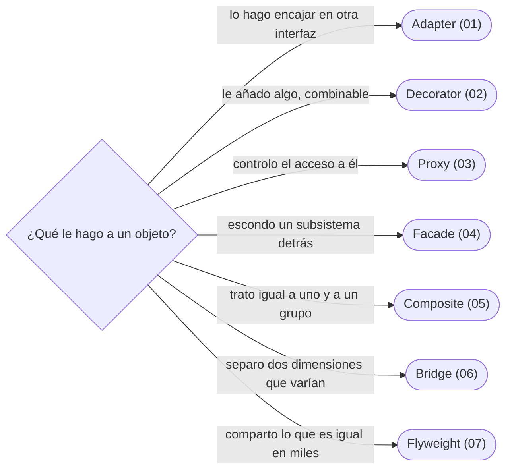

# 05 — Patrones estructurales

> Cómo se componen objetos para que encajen, se envuelvan o se agrupen: Adapter, Decorator, Proxy (y los tres que se confunden), Facade, Composite, Bridge y Flyweight.
>
> **Vigencia:** 2026-10-03.

---

## 1. 🗺️ Índice

| | Documento | Tipo |
|---|---|---|
| [`01`](01-adapter.md) | Adapter | Capítulo |
| [`02`](02-decorator.md) | Decorator | Capítulo |
| [`03`](03-proxy.md) | Proxy, y los tres que se confunden | Capítulo |
| [`04`](04-facade.md) | Facade | Capítulo |
| [`05`](05-composite.md) | Composite | Capítulo |
| [`06`](06-bridge.md) | Bridge | Capítulo |
| [`07`](07-flyweight.md) | Flyweight | Capítulo |
| [`08`](08-simulacion-de-entrevista.md) | Simulación de entrevista | Simulación |
| [`09`](09-respuestas.md) | Respuestas | Solucionario |

**Orden de lectura.** En orden numérico. `03` es el dueño de la tabla Proxy, Decorator y Adapter; léelo después de `01` y `02`. Al terminar los capítulos, la simulación con cronómetro, y solo después el solucionario.

---

## 2. 🧠 Mapa mental

---

## 3. 🏷️ Niveles de los patrones

A: se escribe y se defiende en la entrevista · B: se reconoce y se explica · C: ficha corta, con lo que lo reemplazó.

| Patrón | Nivel | Capítulo |
|---|---|---|
| Adapter | A | [`01`](01-adapter.md) |
| Decorator | A | [`02`](02-decorator.md) |
| Proxy | A | [`03`](03-proxy.md) |
| Facade | A | [`04`](04-facade.md) |
| Composite | A | [`05`](05-composite.md) |
| Bridge | B | [`06`](06-bridge.md) |
| Flyweight | C | [`07`](07-flyweight.md) |

---

## 4. 🚫 Qué NO está aquí

El proxy de Spring con sus trampas, completo (`13/01`); el Gateway de Fowler (`08/05`).

---

**Versiones ejecutadas:** GCC 14.4 (C++23) · JDK 21.0.12, 17.0.20 y 25.0.4 · mermaid-cli 11.17.0 · Spring Boot 4.1.1 (Spring Framework 7.0.9, Hibernate 7.4.5, H2 2.4.240) (2026-10-04).

---

**Anterior:** [`04` — Patrones creacionales](../04-creacionales/README.md) ·
**Corpus:** [README](../README.md) ·
**Siguiente:** [`06` — Patrones de comportamiento](../06-comportamiento/README.md)
