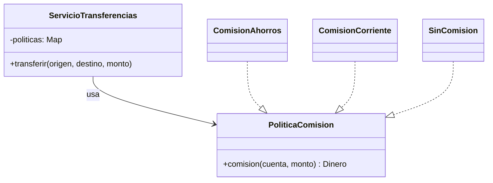
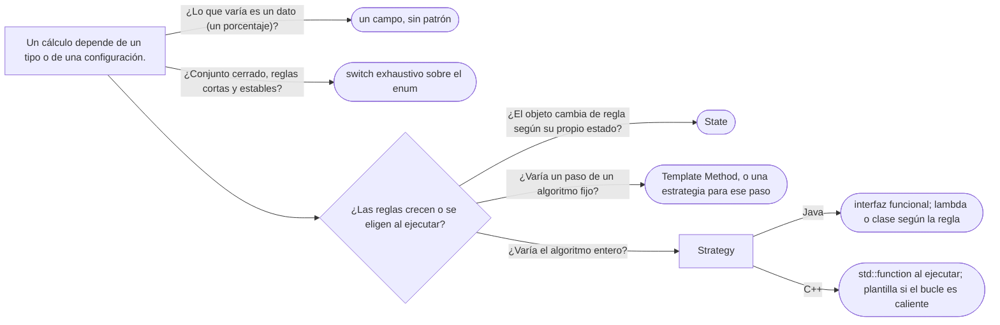

# 01 — Strategy

> Reemplazar un condicional que crece por **algoritmos intercambiables** detrás de una interfaz, saber cuándo
> una lambda basta, y en C++ elegir entre `std::function` y un parámetro de plantilla. **Nivel: A.** Se lee suelto;
> lo que asume, en el recordatorio de §1. Para profundizar:
> [`03/02` — SOLID sin catecismo](../03-principios-de-diseno/02-solid-sin-catecismo.md#3--ocp-puntos-de-extensión-donde-se-espera-el-cambio)
> (OCP). **Desviación declarada del dominio fijo:** `TipoCuenta` (`AHORROS`, `CORRIENTE`, `NOMINA`) se añade para
> este capítulo.
>
> **Vigencia:** 2026-10-03.
>
> **Versiones ejecutadas:** GCC 14.4 (C++23) · JDK 21.0.12, 17.0.20 y 25.0.4 · mermaid-cli 11.17.0 (2026-10-04).

---

## 1. 🎯 El problema

**Recordatorio de lo que se asume.** Una **interfaz** fija qué hace un objeto sin decir cómo; **polimorfismo** es
que la llamada a un método de la interfaz ejecute la implementación del objeto concreto. Una **lambda** de Java
es una implementación de una interfaz de un solo método escrita en una línea. `Dinero` es el monto con su moneda.

Cada transferencia cobra una comisión que depende del tipo de cuenta de origen, y el cálculo vive en un `switch`:

```java
public Dinero comision(Cuenta origen, Dinero monto) {
    switch (origen.tipo()) {
        case AHORROS:   return origen.transferenciasDelMes() < 3 ? Dinero.cero(COP) : Dinero.cop("4500.00");
        case CORRIENTE: return monto.por(new BigDecimal("0.004")).minimo(Dinero.cop("2500.00"));
        case NOMINA:    return Dinero.cero(COP);
        default:        throw new IllegalStateException("tipo sin comisión: " + origen.tipo());
    }
}
```

- Cada tipo de cuenta nuevo —la cuenta empresarial que el negocio ya anunció— es un `case` en un método que
  conoce todas las reglas. Cambiar la de ahorros obliga a volver a probar las otras.
- Y la campaña de diciembre, "sin comisión para nadie durante una semana", no tiene dónde ponerse sin otro `if`
  delante de todo.

Lo que varía es **el cálculo**. El patrón consiste en darle a cada cálculo su objeto, y que quien los usa reciba
uno sin saber cuál.

---

## 2. 📐 La estructura

**La intención, en una frase del GoF:** definir una familia de algoritmos, encapsular cada uno y hacerlos
intercambiables; el algoritmo varía independientemente de los clientes que lo usan.



- **Strategy** (`PoliticaComision`): la interfaz del algoritmo. Es una interfaz.
- **Concrete Strategy** (`ComisionAhorros`, `ComisionCorriente`, `SinComision`): cada regla en su clase, o en
  su lambda.
- **Context** (`ServicioTransferencias`): **tiene** una estrategia (o un mapa de ellas) y la llama; no sabe cuál
  es.

Quién elige la estrategia es la pregunta que el diagrama no contesta: puede ser el cliente al construir el
contexto, una configuración, o un mapa por tipo como aquí. La estrategia **no** cambia sola: si el objeto cambia
de algoritmo según su propio estado, eso es State.

---

## 3. 🏛️ Cómo nació

El GoF lo presenta con un editor que parte el texto en líneas con algoritmos distintos (simple, TeX, por
columnas). En C++98, la estrategia es una clase abstracta y el contexto guarda un puntero:

```cpp
class PoliticaComision {
public:
    virtual ~PoliticaComision() {}
    virtual Dinero comision(const Cuenta& c, const Dinero& monto) const = 0;
};

class ServicioTransferencias {
public:
    explicit ServicioTransferencias(PoliticaComision* p) : politica_(p) {}   // ¿lo posee? el tipo no lo dice
    void transferir(Cuenta& o, Cuenta& d, const Dinero& m) {
        Dinero c = politica_->comision(o, m);
        o.debitar(m + c);
        d.acreditar(m);
    }
private:
    PoliticaComision* politica_;
};
```

- Es el patrón entero, y en C++98 cada estrategia, por pequeña que sea, es una clase con su destructor virtual.
- El puntero crudo vuelve a dejar abierta la propiedad: ¿la destruye el servicio o quien la creó?

---

## 4. 💻 C++ moderno

C++ ofrece **dos** formas de estrategia, y elegir entre ellas es la pregunta de C++ en la entrevista.

**En tiempo de ejecución, con `std::function`**: cualquier cosa invocable con la firma correcta —una lambda,
una función, un objeto— es una estrategia, sin jerarquía.

```cpp
using PoliticaComision = std::function<Dinero(const Cuenta&, const Dinero&)>;

class ServicioTransferencias {
public:
    explicit ServicioTransferencias(std::unordered_map<TipoCuenta, PoliticaComision> politicas)
        : politicas_{std::move(politicas)} {}
    void transferir(Cuenta& o, Cuenta& d, const Dinero& m) {
        Dinero c = politicas_.at(o.tipo())(o, m);
        o.debitar(m + c);
        d.acreditar(m);
    }
private:
    std::unordered_map<TipoCuenta, PoliticaComision> politicas_;
};

ServicioTransferencias servicio{{
    {TipoCuenta::Nomina,    [](const Cuenta&, const Dinero&) { return Dinero::cero(); }},
    {TipoCuenta::Corriente, [](const Cuenta&, const Dinero& m) { return std::min(m * 0.004, Dinero{2500}); }},
}};
```

**En tiempo de compilación, con un parámetro de plantilla** (el *policy-based design*): la estrategia es un tipo,
y el compilador puede expandir la llamada en línea.

```cpp
template <class Politica>
class CalculadoraLote {
public:
    explicit CalculadoraLote(Politica p) : politica_{p} {}
    Dinero total(std::span<const Transferencia> lote) const {
        Dinero t = Dinero::cero();
        for (const auto& x : lote) t = t + politica_(x.origen(), x.monto());   // sin llamada indirecta
        return t;
    }
private:
    Politica politica_;
};
```

| | `std::function` | Parámetro de plantilla |
|---|---|---|
| Se elige | Al ejecutar: por tipo de cuenta, por configuración | Al compilar |
| Costo por llamada | Una llamada indirecta; una asignación si la lambda captura mucho | Ninguno: se puede expandir en línea |
| Tipo del contexto | Uno solo para todas las estrategias | Uno distinto por estrategia |
| Cuándo | Lo habitual en lógica de negocio | Bucles calientes, librerías (`std::sort` con su comparador) |

- `std::sort(v.begin(), v.end(), comparador)` es el Strategy de la STL por plantilla: el comparador es la
  estrategia y nunca hay una llamada virtual.
- Los montos con `0.004` son un atajo de lectura; con dinero de verdad, la multiplicación pasa por un tipo
  decimal, como en el bloque de modelado.

---

## 5. 💻 Java

En Java la interfaz de un solo método hace que **la lambda sea la estrategia**, y la clase solo hace falta cuando
la regla tiene estado o nombre propio que merezca un archivo:

```java
@FunctionalInterface
public interface PoliticaComision {
    Dinero comision(Cuenta origen, Dinero monto);

    PoliticaComision SIN_COMISION = (c, m) -> Dinero.cero(m.moneda());
}

public final class ComisionAhorros implements PoliticaComision {          // tiene una regla con nombre
    private final int gratuitasPorMes;
    public ComisionAhorros(int gratuitasPorMes) { this.gratuitasPorMes = gratuitasPorMes; }
    public Dinero comision(Cuenta c, Dinero m) {
        return c.transferenciasDelMes() < gratuitasPorMes ? Dinero.cero(m.moneda()) : Dinero.cop("4500.00");
    }
}

Map<TipoCuenta, PoliticaComision> politicas = new EnumMap<>(Map.<TipoCuenta, PoliticaComision>of(
        TipoCuenta.AHORROS,   new ComisionAhorros(3),
        TipoCuenta.CORRIENTE, (c, m) -> m.por(new BigDecimal("0.004")).minimo(Dinero.cop("2500.00")),
        TipoCuenta.NOMINA,    PoliticaComision.SIN_COMISION));

// la campaña de diciembre es otra estrategia, sin tocar ninguna regla
PoliticaComision campana = PoliticaComision.SIN_COMISION;
```

- El `switch` de §1 se convirtió en datos: un mapa de tipo a regla. La cuenta empresarial es una entrada, y la
  campaña de diciembre, un mapa distinto inyectado durante una semana.
- `Comparator` es la estrategia más usada del JDK: `personas.sort(Comparator.comparing(Persona::fechaNacimiento))`
  pasa un algoritmo de comparación a un algoritmo de ordenación que no sabe nada de personas.

> 💡 **Truco.** Un `enum` con una lambda por constante une la estrategia y la elección cuando el conjunto es
> cerrado: `NOMINA((c, m) -> Dinero.cero(COP))`. Funciona mientras las reglas sean pocas y no necesiten
> dependencias inyectadas; cuando una regla necesita un repositorio o un reloj, vuelve al mapa.

---

## 6. 🔀 Variantes

- **La lambda como estrategia.** La forma por defecto en Java 8+ y en C++ con `std::function`. Una clase solo
  cuando la regla tiene estado, configuración o un nombre que se busca.
- **Estrategia elegida por un registro.** El mapa por tipo de §5: es Strategy más un registro, y es la forma más
  común en el dominio.
- **Estrategia por defecto.** El contexto recibe una estrategia opcional y usa una por defecto (`SIN_COMISION`)
  si no hay; evita los `null` y el `if` de "no hay regla".
- **Estrategias que se componen.** `Comparator.comparing(...).thenComparing(...)` combina estrategias; con
  comisiones, "la menor de dos políticas" es una estrategia hecha de otras dos.

---

## 7. ⚖️ Con qué se confunde

| Se confunde con | La diferencia, en una frase |
|---|---|
| **State** | El State cambia de algoritmo **solo**, según el estado del propio objeto y con transiciones; la estrategia la elige **alguien de fuera** y no cambia sola (ver [`06` — State](06-state.md)) |
| **Template Method** | El Template Method varía **un paso** por **herencia**; el Strategy varía **el algoritmo entero** por **composición** (ver [`02` — Template Method](02-template-method.md)) |
| **Bridge** | Estructura casi igual; en el Bridge las dos partes tienen jerarquía y el vínculo es duradero (ver [`05/06` — Bridge](../05-estructurales/06-bridge.md)) |
| **Command** | El Command encapsula **una petición** con sus datos para ejecutarla, encolarla o deshacerla; la estrategia encapsula **cómo** se hace algo (ver [`04` — Command](04-command.md)) |

**La sobregeneralización.** "Strategy necesita una clase por algoritmo" era cierto en el C++ y el Java de 1994. Hoy
una lambda o un `std::function` es una estrategia completa, y una interfaz funcional con tres lambdas en un mapa es
el patrón entero. Y "Strategy y State son lo mismo" confunde el diagrama con la intención: tienen la misma forma, y
la diferencia es **quién** cambia el objeto delegado y **cuándo**.

---

## 8. 🔭 Dónde aparece de verdad

- **JDK:** `Comparator` en `List.sort` y `TreeMap`; el `RejectedExecutionHandler` de `ThreadPoolExecutor`, que
  decide qué hacer cuando la cola está llena; las interfaces de `java.util.function` en toda la API de *streams*.
- **Spring:** `PasswordEncoder` en Spring Security (BCrypt, Argon2, intercambiables); `ResourceLoader`; las
  implementaciones de `TaskExecutor`.
- **STL:** el comparador de `std::sort` y `std::map`, el *hash* y la igualdad de `std::unordered_map`, y el
  *allocator* de todos los contenedores: estrategias por plantilla.

---

## 9. 🏷️ Lo que cuesta, y cuándo no

**El precio**, en las cuatro monedas:

- **Indirección:** para saber cuánto se cobra a una cuenta de ahorros hay que encontrar qué estrategia se
  registró para `AHORROS`, que ya no está junto al `switch` sino en la raíz de composición.
- **Acoplamiento:** todas las estrategias comparten una firma. Si la cuenta empresarial necesita un dato que las
  otras no (el volumen mensual de la empresa), o se añade a la firma de todas o la estrategia lo pide por su
  cuenta.
- **Legibilidad:** con tres reglas de una línea, el `switch` se lee de un vistazo y el mapa de estrategias
  también; con veinte reglas complejas, las clases ganan claramente.
- **Rendimiento:** una llamada indirecta por cálculo, irrelevante salvo en bucles calientes (y ahí la plantilla
  de C++ lo elimina).

**Cuándo no.**

- **Un `switch` sobre un conjunto cerrado y estable**, con reglas cortas que no van a crecer: tres `case` se leen
  mejor que tres clases. Con el `switch` exhaustivo de Java 21 sobre un `enum`, el compilador además avisa del caso
  que falta.
- **Una sola regla**, "por si mañana hay otra": la interfaz sin segunda implementación es generalización
  especulativa.
- **Cuando lo que varía es un dato** (un porcentaje distinto por tipo), no un algoritmo: un campo en el tipo de
  cuenta basta.

> **Veredicto:** Strategy cuando el algoritmo varía y la variación crece o se elige al ejecutar; en Java, con una
> interfaz funcional y lambdas, y una clase solo para la regla que tiene estado o nombre propio. Con un conjunto
> cerrado de reglas cortas, el `switch` exhaustivo sigue siendo la respuesta honesta.

---

## 10. 🧭 Cómo se elige



**La frase en voz alta:** *"Strategy, porque lo que varía es el cálculo de la comisión y no quiero un `switch` que
crezca con cada tipo de cuenta. En Java es una interfaz funcional: las reglas cortas son lambdas en un mapa por
tipo, y la de ahorros, que tiene parámetros, es una clase."*

---

## ⚠️ Errores frecuentes

| Se dice | Lo preciso |
|---|---|
| "Strategy necesita una clase por algoritmo" | Una lambda o un `std::function` es una estrategia completa; la clase, solo si la regla lo merece |
| "Strategy y State son lo mismo" | Misma forma; la estrategia la elige alguien de fuera, el estado cambia solo con transiciones |
| "Todo `switch` es un Strategy esperando" | Un `switch` exhaustivo sobre un conjunto cerrado y estable es más legible que tres clases |
| "Strategy y Template Method son intercambiables" | El Template Method varía un paso por herencia; el Strategy, el algoritmo por composición |
| "En C++ la estrategia es siempre virtual" | También es un parámetro de plantilla sin coste en ejecución, como el comparador de `std::sort` |
| "`std::function` es gratis" | Cuesta una llamada indirecta y, si la lambda captura mucho, una asignación |

---

## 📚 Para profundizar

- **Libro** — Gamma, Helm, Johnson y Vlissides, *Design Patterns* (Addison-Wesley, 1994), cap. 5, "Behavioral
  Patterns", sección "Strategy": la familia de algoritmos y quién elige.
- **Libro** — Iglberger, *C++ Software Design* (O'Reilly, 2022), cap. 5, "The Strategy and Command Design
  Patterns": la estrategia con herencia, con `std::function` y por plantilla. **El que destaca** para C++.
- **Libro** — Freeman y Robson, *Head First Design Patterns*, 2.ª ed. (O'Reilly, 2021), cap. 1, "Intro to Design
  Patterns": el Strategy como primer patrón, contado desde la composición.
- [Java 21 API — `Comparator`](https://docs.oracle.com/en/java/javase/21/docs/api/java.base/java/util/Comparator.html):
  la estrategia de comparación, con sus combinadores.
- [cppreference — `std::function`](https://en.cppreference.com/cpp/utility/functional/function): el contenedor
  de invocables que borra el tipo.
- **Tutorial** — [Refactoring Guru — Strategy](https://refactoring.guru/design-patterns/strategy).

---

## 🧠 Preguntas

Sin respuestas aquí. Todas, con enunciado literal y respuesta en tres capas, en
[`11` — Respuestas](11-respuestas.md#01--strategy).

1. ¿Cuál es la intención del Strategy? 🟢
2. ¿Qué participantes tiene el Strategy, y quién elige la estrategia? 🟢
3. ¿Por qué una lambda puede ser una estrategia en Java? 🟢
4. ¿Por qué `Comparator` es un Strategy? 🟢
5. ¿Qué diferencia hay entre Strategy y State? 🟡
6. ¿Qué diferencia hay entre Strategy y Template Method? 🟡
7. ¿Qué diferencia hay entre `std::function` y un parámetro de plantilla como estrategia en C++? 🟡
8. ¿Qué diferencia hay entre Strategy y Bridge? 🟡
9. ¿Qué diferencia hay entre una estrategia como clase y como lambda, y cuándo eliges cada una? 🟡
10. ¿Por qué "Strategy necesita una clase por algoritmo" es falso hoy? 🟠
11. ¿Cuándo un `switch` es mejor que un Strategy? 🟠
12. ¿Qué haces si una estrategia nueva necesita un dato que las demás no usan? 🟠
13. ¿Cuándo el costo de `std::function` importa? 🟠
14. Reescribe el `switch` de comisiones de §1 con un Strategy en Java, con la cuenta empresarial añadida. 🔴
15. Escribe en C++ una estrategia de comisión por plantilla y otra con `std::function`, y di cuándo usarías
    cada una. 🔴
16. Un compañero creó `IComisionStrategy`, `ComisionStrategyFactory` y una clase por tipo para tres reglas de una
    línea que no cambian desde hace años. Revísalo. 🔴

---

**Anterior:** [`05/08` — Simulación de entrevista](../05-estructurales/08-simulacion-de-entrevista.md) ·
**Siguiente:** [`02` — Template Method](02-template-method.md) ·
**Relacionado:** [`04` — Command](04-command.md)
