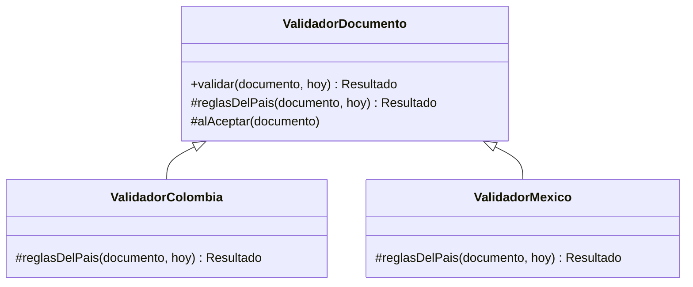
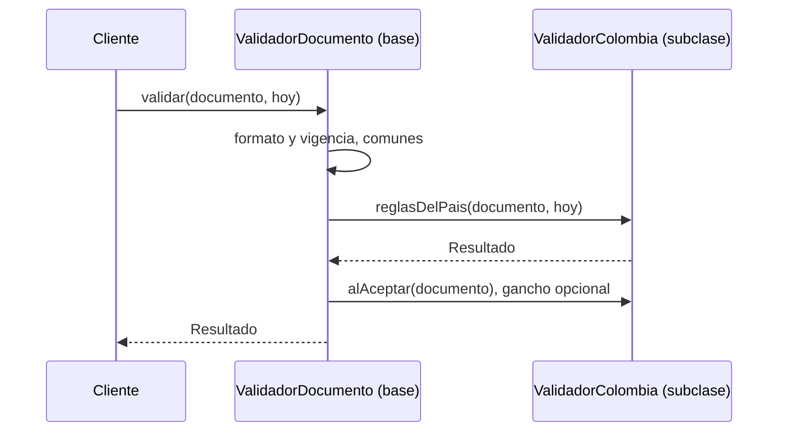
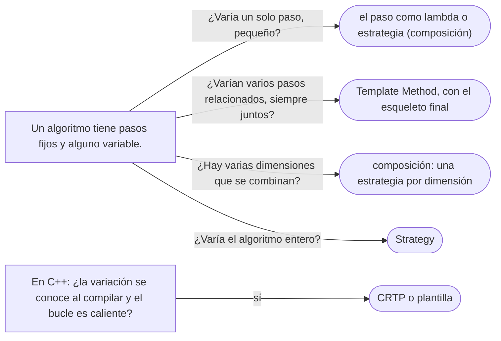

# 02 — Template Method

> Fijar el **esqueleto** de un algoritmo en una clase base y dejar que las subclases varíen **algunos pasos**;
> el idioma NVI de C++; por qué `JdbcTemplate` se llama así y sin embargo está más cerca de Strategy; y cuándo la
> herencia que pide el patrón se cambia por composición. **Nivel: A.** Asume leído
> [`01/06` — Herencia vertical y horizontal](../01-modelo-de-objetos/06-herencia-vertical-y-horizontal.md) y
> [`01` — Strategy](01-strategy.md).
>
> **Vigencia:** 2026-10-03.
>
> **Versiones ejecutadas:** GCC 14.4 (C++23) · JDK 21.0.12, 17.0.20 y 25.0.4 · Spring Boot 4.1.1 (Spring Framework 7.0.9, Hibernate 7.4.5, H2 2.4.240) · mermaid-cli 11.17.0 (2026-10-04).

---

## 1. 🎯 El problema

Validar un documento tiene siempre los mismos pasos, en el mismo orden: comprobar el formato del número, comprobar
que esté vigente, y aplicar las reglas propias del país emisor. Hoy hay dos validadores, uno por país, y los dos
son así:

```java
class ValidadorColombia {
    Resultado validar(Documento d, LocalDate hoy) {
        if (!d.tipo().formato().matcher(d.numero()).matches()) return Resultado.rechazado("formato");
        if (d.vencimiento() != null && d.vencimiento().isBefore(hoy)) return Resultado.rechazado("vencido");
        // reglas de Colombia
        if (d.tipo().codigo().equals("TI") && !d.titular().esMenor(hoy)) return Resultado.rechazado("TI de un adulto");
        return Resultado.aceptado();
    }
}
class ValidadorMexico { /* los dos primeros pasos copiados, y sus reglas */ }
```

- Los pasos comunes están **copiados**. Cuando se decidió que un documento que vence **hoy** sigue vigente, se
  corrigió en Colombia y no en México.
- Y nada obliga al orden: un validador nuevo podría comprobar las reglas del país antes del formato, y aceptar un
  número mal formado que cumple las reglas.

Lo que se quiere es que el **orden y los pasos comunes** estén en un solo sitio, y que cada país solo escriba **lo
suyo**. Eso es el Template Method.

---

## 2. 📐 La estructura

**La intención, en una frase del GoF:** definir el esqueleto de un algoritmo en una operación, delegando algunos
pasos en las subclases; el Template Method deja que las subclases redefinan ciertos pasos sin cambiar la
estructura del algoritmo.



- **Abstract Class** (`ValidadorDocumento`): el método plantilla `validar`, **que no se sobrescribe**, y los pasos.
- **Operaciones primitivas** (`reglasDelPais`): abstractas; la subclase **tiene** que darlas.
- **Ganchos** (*hooks*, `alAceptar`): con una implementación por defecto, normalmente vacía; la subclase **puede**
  sobrescribirlos.
- **Concrete Class** (`ValidadorColombia`, `ValidadorMexico`): solo lo que varía.

El orden de llamadas es lo que el patrón fija, y se ve mejor en una secuencia:



La base llama a la subclase, y no al revés: es el "principio de Hollywood" aplicado dentro de una jerarquía.

---

## 3. 🏛️ Cómo nació

En C++98 el GoF escribe el método plantilla como **no virtual** y los pasos como virtuales protegidos:

```cpp
class ValidadorDocumento {
public:
    virtual ~ValidadorDocumento() {}
    Resultado validar(const Documento& d, const Fecha& hoy) {        // no virtual: el esqueleto
        if (!d.tipo().admiteFormato(d.numero())) return Resultado::rechazado("formato");
        if (d.vence() && d.vencimiento() < hoy) return Resultado::rechazado("vencido");
        Resultado r = reglasDelPais(d, hoy);
        if (r.aceptado()) alAceptar(d);
        return r;
    }
protected:
    virtual Resultado reglasDelPais(const Documento& d, const Fecha& hoy) = 0;   // primitiva
    virtual void alAceptar(const Documento&) {}                                  // gancho
};
```

- Que `validar` no sea virtual es la mitad del patrón: la subclase **no puede** cambiar el orden.
- El GoF ya advierte que hay que documentar qué es primitiva (obligatoria) y qué es gancho (opcional), porque el
  lenguaje no lo distingue.

---

## 4. 💻 C++ moderno: el idioma NVI

En C++ esa forma tiene nombre propio: ***Non-Virtual Interface*** (NVI). La interfaz **pública** es no virtual, y
las funciones virtuales son **privadas**. Herb Sutter lo formuló como guía en 2001: preferir interfaces no
virtuales, usando Template Method.

```cpp
class ValidadorDocumento {
public:
    virtual ~ValidadorDocumento() = default;
    Resultado validar(const Documento& d, std::chrono::year_month_day hoy) const {   // la interfaz pública
        if (!d.tipo().admiteFormato(d.numero())) return Resultado::rechazado("formato");
        if (d.vencimiento() && *d.vencimiento() < hoy) return Resultado::rechazado("vencido");
        auto r = reglasDelPais(d, hoy);
        if (r.aceptado()) alAceptar(d);
        return r;
    }
private:
    virtual Resultado reglasDelPais(const Documento& d, std::chrono::year_month_day hoy) const = 0;
    virtual void alAceptar(const Documento&) const {}
};

class ValidadorColombia final : public ValidadorDocumento {
    Resultado reglasDelPais(const Documento& d, std::chrono::year_month_day hoy) const override {
        if (d.tipo().codigo() == "TI" && !d.titular().esMenor(hoy)) return Resultado::rechazado("TI de un adulto");
        return Resultado::aceptado();
    }
};
```

- Una función virtual **privada** se puede sobrescribir en la derivada aunque la derivada no la pueda **llamar**:
  así la subclase aporta el paso y solo la base decide cuándo se ejecuta.
- NVI da además un sitio para lo que toda llamada debe hacer —medir, comprobar precondiciones, registrar— sin
  confiar en que cada subclase lo recuerde. La mayoría de la librería estándar de C++ sigue esta forma, según
  observa el propio Sutter.

---

## 5. 💻 Java

```java
public abstract class ValidadorDocumento {
    public final Resultado validar(Documento d, LocalDate hoy) {          // final: el esqueleto no se toca
        if (!d.tipo().formato().matcher(d.numero()).matches()) return Resultado.rechazado("formato");
        if (d.vencimiento() != null && d.vencimiento().isBefore(hoy)) return Resultado.rechazado("vencido");
        Resultado r = reglasDelPais(d, hoy);
        if (r.aceptado()) alAceptar(d);
        return r;
    }
    protected abstract Resultado reglasDelPais(Documento d, LocalDate hoy);   // primitiva
    protected void alAceptar(Documento d) { }                                  // gancho
}

public final class ValidadorColombia extends ValidadorDocumento {
    @Override protected Resultado reglasDelPais(Documento d, LocalDate hoy) {
        if (d.tipo().codigo().equals("TI") && !d.titular().esMenor(hoy)) return Resultado.rechazado("TI de un adulto");
        return Resultado.aceptado();
    }
}
```

- `final` en `validar` hace en Java lo que la no virtualidad en C++. Sin `final`, una subclase puede
  sobrescribir el esqueleto, y el patrón queda en una convención.
- La regla "vence hoy, sigue vigente" está **una vez**, en la base. Un país nuevo es una clase con un método.
- Las reglas de cada país son de ejemplo, no la normativa real de ningún país.

**La alternativa por composición.** El mismo esqueleto con el paso variable **pasado como objeto** —una estrategia—
en lugar de sobrescrito:

```java
public final class ValidadorDocumento {
    private final ReglasPais reglas;                                   // @FunctionalInterface
    public ValidadorDocumento(ReglasPais reglas) { this.reglas = reglas; }
    public Resultado validar(Documento d, LocalDate hoy) { /* mismos pasos; reglas.aplicar(d, hoy) */ }
}
```

- Sin herencia: el validador es `final`, las reglas se prueban solas y se combinan al ejecutar. Es lo que se escribe
  cada vez más, y es el camino que siguió `JdbcTemplate` (§7).

---

## 6. 🔀 Variantes

- **Primitivas contra ganchos.** Lo abstracto obliga; lo vacío por defecto ofrece. Demasiados ganchos convierten la
  base en un enjambre de puntos de extensión que nadie sabe en qué orden se llaman.
- **Template Method por composición**: el paso como estrategia (§5). Cambia herencia por un parámetro.
- **El método fábrica como paso.** Si el paso variable es "crear un objeto", el Template Method se llama Factory
  Method (ver [`04/01`](../04-creacionales/01-factory-method.md)).
- **En C++, por plantilla.** Con CRTP (la base es una plantilla sobre la derivada) el paso se resuelve al compilar,
  sin llamada virtual; es el Template Method estático.

---

## 7. ⚖️ Con qué se confunde

| Se confunde con | La diferencia, en una frase |
|---|---|
| **Strategy** | El Template Method varía **un paso** por **herencia**; el Strategy varía **el algoritmo** por **composición** (ver [`01` — Strategy](01-strategy.md)) |
| **Factory Method** | Es un Template Method cuyo paso variable es crear un objeto |
| **Una clase base con utilidades** | Una base que ofrece métodos para que las subclases llamen no invierte el control; en el Template Method, la base llama a la subclase |
| **`JdbcTemplate`** | Fija el esqueleto, pero los pasos variables se le **pasan** como *callbacks*: está más cerca de Strategy |

**Por qué `JdbcTemplate` engaña.** Su nombre dice *template*, y sí fija el esqueleto de una operación JDBC: obtener
la conexión, preparar la sentencia, ejecutar, recorrer el `ResultSet`, traducir las excepciones y cerrar. Pero los
pasos variables **no se sobrescriben en una subclase**: se le pasan como objetos. Su Javadoc lo dice: el código que
lo usa solo implementa interfaces de *callback* —`PreparedStatementCreator`, `ResultSetExtractor`, `RowMapper`—, con
un contrato claro.

```java
List<Persona> menores = jdbc.query(
        "SELECT nombre, fecha_nacimiento FROM persona WHERE fecha_nacimiento > ?",
        (rs, fila) -> new Persona(rs.getString("nombre"), rs.getDate("fecha_nacimiento").toLocalDate()),  // RowMapper
        LocalDate.now(reloj).minusYears(18));
```

- La plantilla (el esqueleto) es real; la variación es por **composición**, no por herencia. Es la versión moderna del
  patrón, y por eso "`JdbcTemplate` es un Template Method" es medio cierto: tiene la intención del Template Method y
  el mecanismo del Strategy.

---

## 8. 🔭 Dónde aparece de verdad

- **`AbstractList`**: su Javadoc dice que para una lista no modificable basta con implementar `get(int)` y `size()`;
  `iterator`, `contains`, `indexOf`, `equals` y `hashCode` están escritos en la base en términos de esos dos.
- **`HttpServlet.service`**: despacha cada petición al `doGet`, `doPost` correspondiente; la Javadoc dice que casi no
  hay razón para sobrescribir `service`. Es el método plantilla, y los `doXXX`, los pasos.
- **`InputStream.read(byte[], int, int)`**, escrito en términos del `read()` abstracto de un byte.
- **En Spring**, además de `JdbcTemplate` (que engaña), `AbstractController` y las clases `Abstract…` de configuración
  son Template Method clásico, con herencia.

---

## 9. 🏷️ Lo que cuesta, y cuándo no

**El precio**, en las cuatro monedas:

- **Acoplamiento:** el más fuerte que hay. La subclase depende del esqueleto entero de la base, de en qué orden se
  llaman sus pasos y de qué estado deja la base antes de cada uno. Cambiar el esqueleto puede romper subclases que
  nadie ve (la clase base frágil).
- **Indirección y legibilidad:** el flujo salta de la base a la subclase y vuelve (el problema *yo-yo*). Para saber
  qué hace `validar` en Colombia hay que leer dos clases a la vez.
- **Flexibilidad:** la variación se fija al compilar la subclase, y una clase solo puede heredar de una base: no se
  combinan dos variaciones (reglas de Colombia y auditoría de México) sin multiplicar subclases.
- **Rendimiento:** una llamada virtual por paso; irrelevante casi siempre.

**Cuándo no.**

- **Cuando el paso variable es uno y pequeño**: pasarlo como lambda (§5) es más simple que una jerarquía.
- **Cuando hay varias dimensiones de variación**: el Template Method las multiplica; la composición las combina.
- **Cuando la base no es tuya** o pertenece a otro equipo: heredar de ella ata tu código a sus cambios internos.

> **Veredicto:** Template Method cuando el esqueleto es estable, los pasos variables son pocos y relacionados, y la
> jerarquía ya existe por otras razones; con el método plantilla `final` (o no virtual) y los pasos protegidos o
> privados. Para un paso suelto, o para combinar variaciones, el paso se pasa como objeto.

---

## 10. 🧭 Cómo se elige



**La frase en voz alta:** *"El esqueleto de la validación —formato, vigencia, reglas del país— va en la base con el
método plantilla `final`, y cada país solo implementa sus reglas. Si solo variara ese paso y nada más, se lo pasaría
como estrategia en lugar de heredar, que es lo que hace `JdbcTemplate` con sus callbacks."*

---

## ⚠️ Errores frecuentes

| Se dice | Lo preciso |
|---|---|
| "`JdbcTemplate` es un Template Method" | Fija el esqueleto, pero los pasos se le pasan como *callbacks*: el mecanismo es de Strategy |
| "Template Method y Strategy son lo mismo" | Uno varía un paso por herencia; el otro, el algoritmo por composición |
| "El método plantilla puede ser virtual" | Si la subclase puede sobrescribirlo, puede cambiar el orden: va `final` (Java) o no virtual (C++) |
| "En C++ una virtual privada no se puede sobrescribir" | Sí se puede: la derivada no puede llamarla, pero sí redefinirla; es la base del NVI |
| "Todos los pasos deben ser abstractos" | Los ganchos tienen implementación por defecto; distinguir primitivas y ganchos es parte del diseño |
| "Toda clase base abstracta es un Template Method" | Solo si la base tiene el algoritmo y llama a los pasos de la subclase |

---

## 📚 Para profundizar

- **Libro** — Gamma, Helm, Johnson y Vlissides, *Design Patterns* (Addison-Wesley, 1994), cap. 5, "Behavioral
  Patterns", sección "Template Method": operaciones primitivas, ganchos y el "principio de Hollywood".
- **Libro** — Freeman y Robson, *Head First Design Patterns*, 2.ª ed. (O'Reilly, 2021), cap. 8, "The Template Method
  Pattern", con los ganchos y la ordenación de Java como ejemplo.
- [Herb Sutter — *Virtuality*](http://www.gotw.ca/publications/mill18.htm): el artículo del NVI, con la guía
  "prefer to make interfaces nonvirtual, using Template Method". **El que destaca** para C++.
- [Spring Framework — `JdbcTemplate`](https://docs.spring.io/spring-framework/docs/current/javadoc-api/org/springframework/jdbc/core/JdbcTemplate.html):
  el esqueleto y los *callbacks*.
- [Java 21 API — `AbstractList`](https://docs.oracle.com/en/java/javase/21/docs/api/java.base/java/util/AbstractList.html):
  una lista completa a partir de `get` y `size`.
- [Jakarta Servlet 6.0 — `HttpServlet`](https://jakarta.ee/specifications/servlet/6.0/apidocs/jakarta.servlet/jakarta/servlet/http/httpservlet):
  `service` como método plantilla.
- **Tutorial** — [Refactoring Guru — Template Method](https://refactoring.guru/design-patterns/template-method).

---

## 🧠 Preguntas

Sin respuestas aquí. Todas, con enunciado literal y respuesta en tres capas, en
[`11` — Respuestas](11-respuestas.md#02--template-method).

1. ¿Cuál es la intención del Template Method? 🟢
2. ¿Qué diferencia hay entre una operación primitiva y un gancho? 🟢
3. ¿Qué es el idioma NVI de C++? 🟢
4. ¿Por qué `AbstractList` es un Template Method? 🟢
5. ¿Qué diferencia hay entre Template Method y Strategy? 🟡
6. ¿Qué diferencia hay entre Template Method y Factory Method? 🟡
7. ¿Qué diferencia hay entre el método plantilla en Java y en C++? 🟡
8. ¿Qué diferencia hay entre una clase base con utilidades y un Template Method? 🟡
9. ¿Por qué `JdbcTemplate` no es un Template Method en sentido estricto? 🟠
10. ¿Por qué el método plantilla debe ser `final` o no virtual? 🟠
11. ¿Qué es la clase base frágil, y cómo la agrava el Template Method? 🟠
12. ¿Cuándo cambiarías un Template Method por composición? 🟠
13. ¿Por qué en C++ se puede sobrescribir una función virtual privada, y para qué sirve? 🟠
14. Refactoriza los dos validadores de §1 a un Template Method en Java. 🔴
15. Convierte ese Template Method en un validador `final` que recibe las reglas del país como estrategia. 🔴
16. Revisa esta clase y di qué falla: `abstract class Exportador { public void exportar(Persona p) { abrir();
    escribir(p); cerrar(); } protected abstract void escribir(Persona p); protected void abrir() {} protected
    void cerrar() {} }`, con una subclase que sobrescribe `exportar`. 🔴

---

**Anterior:** [`01` — Strategy](01-strategy.md) ·
**Siguiente:** [`03` — Observer](03-observer.md) ·
**Relacionado:** [`01/06` — Herencia vertical y horizontal](../01-modelo-de-objetos/06-herencia-vertical-y-horizontal.md)
