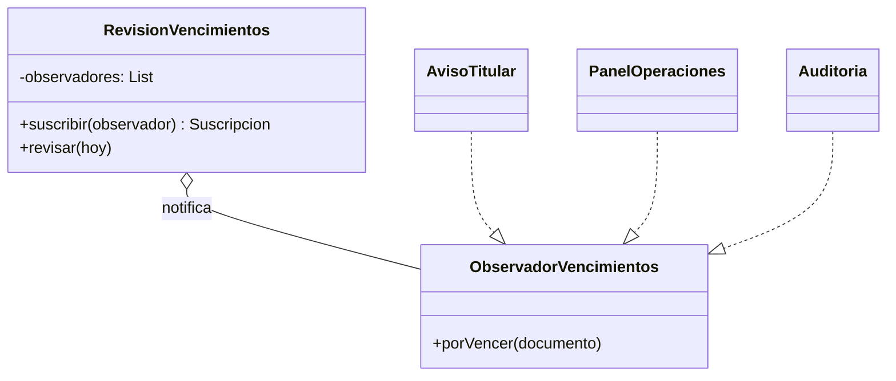
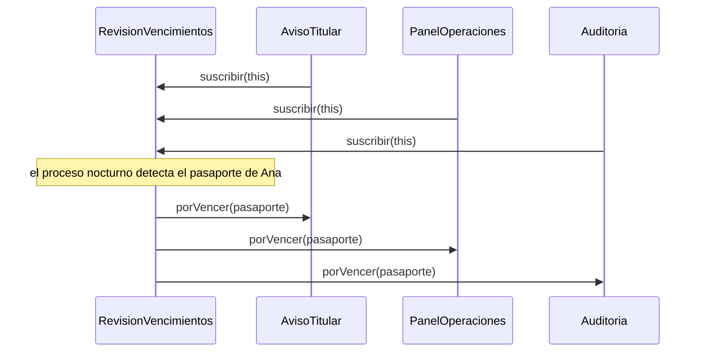
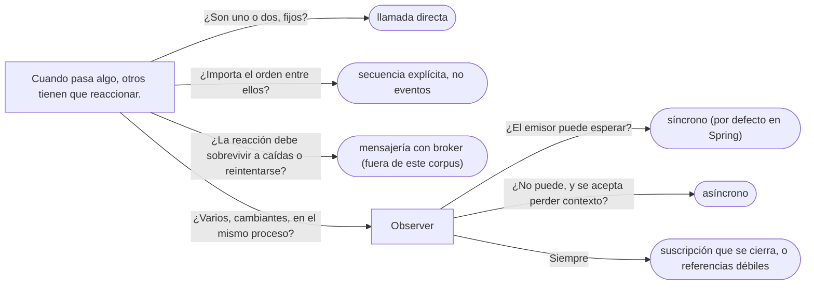

# 03 — Observer

> Notificar un cambio a quien le interese **sin que el emisor conozca a los receptores**; elegir entre
> notificación síncrona y asíncrona; y evitar la fuga clásica del patrón, el observador que nadie desuscribe.
> **Nivel: A.** Se lee suelto; lo que asume, en el recordatorio de §1. Para profundizar:
> [`01` — Strategy](01-strategy.md) (interfaces funcionales) y
> [`04/07` — Más allá del GoF](../04-creacionales/07-mas-alla-del-gof.md#2--raii) (RAII).
>
> **Vigencia:** 2026-10-03.
>
> **Versiones ejecutadas:** GCC 14.4 (C++23) · JDK 21.0.12, 17.0.20 y 25.0.4 · Spring Boot 4.1.1 (Spring Framework 7.0.9, Hibernate 7.4.5, H2 2.4.240) · .NET 10.0.12 (C# 14) · mermaid-cli 11.17.0 (2026-10-04).

**Salto rápido:** [1](#1--el-problema) · [2](#2--la-estructura) · [5](#5--java) · [6](#6--autopsia-el-observador-que-nadie-desuscribe) · [7](#7--variantes) · [10](#10-️-lo-que-cuesta-y-cuándo-no)

---

## 1. 🎯 El problema

**Recordatorio de lo que se asume.** Una **interfaz funcional** tiene un solo método, y una lambda la implementa.
Una **referencia fuerte** mantiene vivo al objeto al que apunta: el recolector de Java no lo reclama mientras
alguien la tenga. En C++, `std::shared_ptr` cuenta referencias y `std::weak_ptr` observa sin contar.

Cuando el proceso nocturno detecta que un documento vence en treinta días, tienen que pasar varias cosas: avisar
a la persona, avisar a su tutora si es menor, marcar el documento en el panel de operaciones y registrarlo en
auditoría. El proceso lo hace así:

```java
public void revisarVencimientos(LocalDate hoy) {
    for (Documento d : documentos.porVencerEn(hoy, 30)) {
        avisos.enviarPorVencer(d.titular(), d);
        if (d.titular().esMenor(hoy)) avisos.enviarPorVencer(d.titular().tutor(), d);
        panel.marcar(d);
        auditoria.registrar("por vencer: " + d.numero());
    }
}
```

- El proceso conoce a **todos** los interesados. Cuando el área de cumplimiento pide que también se le avise, hay
  que tocar el proceso nocturno, que no tiene nada que ver con cumplimiento.
- Y probar el proceso exige falsos de cuatro colaboradores que no le importan.

Lo que el proceso sabe es **qué pasó**: "este documento está por vencer". Quién reacciona no es asunto suyo. El
patrón separa las dos cosas.

---

## 2. 📐 La estructura

**La intención, en una frase del GoF:** definir una dependencia de uno a muchos entre objetos, de modo que cuando
uno cambie de estado, se notifique y actualice automáticamente a todos los que dependen de él.



- **Subject** (`RevisionVencimientos`): mantiene la lista de observadores, permite suscribirse y desuscribirse, y
  **notifica** cuando pasa algo.
- **Observer** (`ObservadorVencimientos`): la interfaz que el sujeto llama. Es una interfaz.
- **Concrete Observer**: cada interesado, que reacciona a su manera.

El sentido del patrón está en el orden de las llamadas:



Los observadores se registran solos, y el sujeto los llama **en el mismo hilo y uno detrás de otro**, salvo que se
diga lo contrario. Esas dos palabras, "mismo hilo", son la mitad de las preguntas de entrevista sobre Observer.

---

## 3. 🏛️ Cómo nació

En C++98 el GoF usa una lista de punteros a observadores en el sujeto:

```cpp
class ObservadorVencimientos {
public:
    virtual ~ObservadorVencimientos() {}
    virtual void porVencer(const Documento& d) = 0;
};

class RevisionVencimientos {
public:
    void suscribir(ObservadorVencimientos* o)   { observadores_.push_back(o); }
    void desuscribir(ObservadorVencimientos* o) { observadores_.remove(o); }
protected:
    void notificar(const Documento& d) {
        for (std::list<ObservadorVencimientos*>::iterator i = observadores_.begin(); i != observadores_.end(); ++i)
            (*i)->porVencer(d);
    }
private:
    std::list<ObservadorVencimientos*> observadores_;     // no los posee
};
```

- El GoF ya discute los problemas que hoy siguen vivos: qué pasa si un observador se destruye sin desuscribirse
  (puntero colgante), qué pasa si un observador modifica el sujeto durante la notificación, y si se manda el dato
  con la notificación (*push*) o el observador lo pide después (*pull*).

---

## 4. 💻 C++ moderno

Dos cambios: los observadores son **invocables** (`std::function`), y la suscripción devuelve un objeto que
**desuscribe al destruirse** (RAII), para que olvidarse sea imposible.

```cpp
class RevisionVencimientos {
public:
    using Observador = std::function<void(const Documento&)>;

    class Suscripcion {                                     // RAII: se desuscribe al salir del ámbito
    public:
        Suscripcion(RevisionVencimientos& r, std::size_t id) : r_{&r}, id_{id} {}
        Suscripcion(Suscripcion&& o) noexcept : r_{std::exchange(o.r_, nullptr)}, id_{o.id_} {}
        ~Suscripcion() { if (r_) r_->observadores_.erase(id_); }
    private:
        RevisionVencimientos* r_;
        std::size_t id_;
    };

    [[nodiscard]] Suscripcion suscribir(Observador o) {
        observadores_.emplace(++ultimo_, std::move(o));
        return Suscripcion{*this, ultimo_};
    }
    void notificar(const Documento& d) const {
        for (const auto& [id, o] : observadores_) o(d);
    }
private:
    std::map<std::size_t, Observador> observadores_;
    std::size_t ultimo_ = 0;
};

auto s = revision.suscribir([&panel](const Documento& d) { panel.marcar(d); });   // vive lo que viva `s`
```

- `[[nodiscard]]` hace que el compilador avise si alguien descarta la suscripción, que se destruiría en el acto.
- La suscripción tiene que morir **antes** que el sujeto, o su destructor accede a un sujeto destruido. Cuando
  esa garantía no existe, el sujeto guarda `std::weak_ptr` a los observadores y, al notificar, descarta los que
  ya expiraron: observar sin mantener vivo.

---

## 5. 💻 Java

```java
@FunctionalInterface
public interface ObservadorVencimientos { void porVencer(Documento d); }

public final class RevisionVencimientos {
    private final List<ObservadorVencimientos> observadores = new CopyOnWriteArrayList<>();

    public AutoCloseable suscribir(ObservadorVencimientos o) {
        observadores.add(o);
        return () -> observadores.remove(o);                 // quien se suscribe recibe cómo irse
    }

    public void revisar(LocalDate hoy) {
        for (Documento d : documentos.porVencerEn(hoy, 30))
            for (var o : observadores) o.porVencer(d);       // el proceso ya no sabe quién escucha
    }
}

revision.suscribir(d -> avisos.enviarPorVencer(d.titular(), d));
revision.suscribir(panel::marcar);
revision.suscribir(d -> auditoria.registrar("por vencer: " + d.numero()));
```

- Cumplimiento se suscribe sin tocar `RevisionVencimientos`. El proceso se prueba con un observador que guarda lo que
  recibe.
- `CopyOnWriteArrayList` permite que un observador se desuscriba **durante** la notificación sin
  `ConcurrentModificationException`, a cambio de copiar la lista en cada alta y baja. Para listas que cambian poco y se
  recorren mucho, es lo correcto.

**`java.util.Observer`, obsoleto.** El JDK tuvo `Observer` y `Observable` desde Java 1.0, y los marcó obsoletos en
Java 9. Su Javadoc da tres razones: el modelo de eventos es muy limitado, el orden de las notificaciones no está
especificado, y los cambios de estado no se corresponden uno a uno con las notificaciones. Remite a `java.beans` para
eventos más ricos, a `java.util.concurrent` para mensajería entre hilos, y a `Flow` para flujos reactivos. Además,
`Observable` es una **clase**: había que heredar de ella para ser observable.

- **`PropertyChangeSupport`** (`java.beans`) es el Observer de las propiedades: el sujeto lo tiene como campo y
  notifica `PropertyChangeEvent` con el valor viejo y el nuevo.
- **`Flow`** (Java 9) define las interfaces de *reactive streams*: `Publisher`, `Subscriber`, `Subscription`, con
  **contrapresión** (el suscriptor pide cuántos elementos quiere). `SubmissionPublisher` es su implementación en el
  JDK.

---

## 6. 🩺 Autopsia: el observador que nadie desuscribe

**1. El código que escribe todo el mundo.** Cada vez que alguien abre el panel de un documento, la pantalla se
suscribe para refrescarse:

```java
public final class PantallaDocumento {
    public PantallaDocumento(Documento d, RevisionVencimientos revision) {
        revision.suscribir(doc -> { if (doc.equals(d)) refrescar(); });   // la suscripción se ignora
    }
    void refrescar() { /* ... */ }
}
```

**2. Por qué parece correcto.** La pantalla se refresca cuando debe, y en las pruebas, que abren dos pantallas y
terminan, todo funciona.

**3. La secuencia que lo rompe.** El servidor lleva una semana arriba y los operadores han abierto cuarenta mil
pantallas. Cada lambda captura `this` (para llamar a `refrescar`), y la lista de `RevisionVencimientos` —que vive lo
que vive la aplicación— tiene cuarenta mil referencias fuertes a pantallas cerradas. **Ninguna se puede recolectar.**
El *heap* crece hasta el `OutOfMemoryError`, y cada notificación recorre cuarenta mil observadores muertos.

**4. El código correcto.** La suscripción se guarda y se cierra con la pantalla:

```java
public final class PantallaDocumento implements AutoCloseable {
    private final AutoCloseable suscripcion;                 // ← cambia: se guarda
    public PantallaDocumento(Documento d, RevisionVencimientos revision) {
        this.suscripcion = revision.suscribir(doc -> { if (doc.equals(d)) refrescar(); });
    }
    @Override public void close() throws Exception { suscripcion.close(); }   // ← cambia: se desuscribe
    void refrescar() { /* ... */ }
}
```

**5. La generalización.** Es el *lapsed listener*: un sujeto de vida larga con referencias fuertes a observadores de
vida corta. Aparece en los *listeners* de interfaces gráficas, en los eventos de C#, en los *callbacks* registrados en
un servicio *singleton*. Las salidas son las de siempre: una suscripción que se cierra (RAII o `AutoCloseable`), o
referencias débiles en el sujeto cuando no hay un momento claro de cierre.

---

## 7. 🔀 Variantes

- ***Push* contra *pull*.** En *push* la notificación lleva el dato (`porVencer(documento)`); en *pull* solo avisa y
  el observador pregunta. *Push* es lo habitual hoy; *pull* evita mandar datos que nadie usa, a costa de acoplar al
  observador con el sujeto.
- **Síncrono contra asíncrono.** Síncrono: el sujeto espera a que todos los observadores terminen, en su hilo; una
  excepción o un observador lento afecta al emisor. Asíncrono: los observadores corren en otro hilo; el emisor no
  espera, pero se pierde el orden, el contexto (la transacción, el usuario) y la propagación de errores.
- **Eventos de Spring.** `ApplicationEventPublisher.publishEvent` y `@EventListener` son un Observer gestionado por
  el contenedor; la documentación de Spring lo llama "el patrón Observer estándar", y advierte que por defecto los
  oyentes reciben los eventos **de forma síncrona**: `publishEvent` bloquea hasta que todos terminan. Tienen su sitio
  en [`13/01` §5](../13-patrones-en-la-practica/01-patrones-en-spring.md#5--observer-los-eventos-de-la-aplicación).

> 📝 **En C#:** Observer está en el lenguaje. `event EventHandler<DocumentoPorVencer>` da la lista de suscriptores,
> la suscripción con `+=` y la notificación; lo que no da es la desuscripción automática, y el suscriptor olvidado
> es la fuga de memoria clásica de .NET: el `event` de un objeto de vida larga mantiene vivos a todos sus
> suscriptores.

---

## 8. ⚖️ Con qué se confunde

| Se confunde con | La diferencia, en una frase |
|---|---|
| **Publicar/suscribir con un broker** | En el Observer el sujeto **conoce** su lista y llama a los observadores en proceso; en *pub/sub* un intermediario (Kafka, una cola) desacopla en el tiempo y el espacio, y emisor y receptores no se conocen |
| **Mediator** | El Mediator coordina objetos que se hablan **a través** de él, en las dos direcciones; el Observer es uno a muchos, en una (ver [`08`](08-iterator-y-mediator.md)) |
| **Chain of Responsibility** | La cadena pasa la petición **hasta que alguien la atiende**; el Observer la entrega **a todos** |
| **Callback** | Un *callback* es un observador de **uno**, normalmente pasado en la llamada; el Observer mantiene una lista que crece y decrece |

**La sobregeneralización.** "Observer es publicar/suscribir con un broker" mezcla un patrón de objetos dentro de un
proceso con una arquitectura de mensajería entre procesos. El Observer no tiene cola, ni persistencia, ni
reintentos: si un observador lanza, la notificación de los siguientes depende de cómo esté escrito el bucle. Y "los
observadores se liberan solos" es exactamente la autopsia de §6: con referencias fuertes, nunca.

---

## 9. 🔭 Dónde aparece de verdad

- **Interfaces gráficas**: los *listeners* de Swing y JavaFX, los manejadores de eventos del DOM en el navegador.
- **`java.beans.PropertyChangeSupport`**, **`Flow`** y su `SubmissionPublisher`, y las librerías reactivas que
  implementan *reactive streams*.
- **Spring**: `ApplicationEventPublisher` y `@EventListener`, también para eventos de dominio.
- **C++**: `boost::signals2` y las señales y ranuras de Qt; en la librería estándar no hay un Observer.

---

## 10. 🏷️ Lo que cuesta, y cuándo no

**El precio**, en las cuatro monedas:

- **Indirección:** el flujo ya no se lee en un sitio. Para saber qué pasa cuando un documento está por vencer hay que
  buscar quién se suscribió, y eso puede estar en cualquier parte.
- **Acoplamiento temporal y de orden:** el orden de notificación suele ser el de suscripción y nadie lo documenta; un
  observador que depende de que otro haya corrido antes es un error esperando su momento.
- **Reentrada:** un observador que, al ser notificado, modifica el sujeto (o se suscribe, o dispara otra
  notificación) puede producir bucles o notificaciones con el estado a medio cambiar.
- **Memoria y rendimiento:** las fugas de §6, y en síncrono, un observador lento hace lento al emisor; uno que lanza
  puede cortar la notificación a los demás.

**Cuándo no.**

- **Uno o dos interesados fijos que no cambian**: una llamada directa se lee mejor que una suscripción.
- **Cuando el orden importa**: si la auditoría debe registrarse antes del aviso, eso es una secuencia, no un evento.
- **Cuando la reacción debe ser fiable** (sobrevivir a una caída, reintentarse): eso es mensajería con un *broker*,
  no un Observer en memoria.

> **Veredicto:** Observer cuando el emisor no debe conocer a los interesados y estos cambian; con una suscripción que
> se cierra, una decisión explícita sobre síncrono o asíncrono, y ningún observador que dependa del orden. Si la
> reacción tiene que sobrevivir a una caída, no es Observer: es mensajería.

---

## 11. 🧭 Cómo se elige



**La frase en voz alta:** *"El proceso nocturno publica 'este documento está por vencer' y no sabe quién escucha; los
avisos, el panel y la auditoría se suscriben. La suscripción devuelve algo que se cierra, porque un observador que
nadie desuscribe es la fuga de memoria clásica del patrón."*

---

## ⚠️ Errores frecuentes

| Se dice | Lo preciso |
|---|---|
| "Observer es publicar/suscribir con un broker" | Es un patrón en proceso, sin cola ni persistencia; el *broker* es otra arquitectura |
| "Los observadores se liberan solos" | Con referencias fuertes, el sujeto los mantiene vivos: hay que desuscribirse |
| "Los eventos de Spring son asíncronos" | Por defecto son síncronos: `publishEvent` bloquea hasta que todos los oyentes terminan |
| "`java.util.Observer` es la forma estándar en Java" | Está obsoleto desde Java 9; su Javadoc remite a `java.beans`, a `java.util.concurrent` y a `Flow` |
| "El orden de notificación está garantizado" | Suele ser el de suscripción, pero ni el patrón ni `Observable` lo especifican |
| "Un observador que falla no afecta a los demás" | En un bucle síncrono, una excepción corta la notificación a los siguientes |
| "En C++ un puntero al observador basta" | Si el observador se destruye antes, el sujeto llama a un puntero colgante; suscripción RAII o `weak_ptr` |

---

## 📚 Para profundizar

- **Libro** — Gamma, Helm, Johnson y Vlissides, *Design Patterns* (Addison-Wesley, 1994), cap. 5, "Behavioral
  Patterns", sección "Observer": *push* y *pull*, y las referencias colgantes.
- **Libro** — Freeman y Robson, *Head First Design Patterns*, 2.ª ed. (O'Reilly, 2021), cap. 2, "The Observer
  Pattern".
- **Libro** — Nystrom, *Game Programming Patterns* (2014), cap. "Observer", libre en
  [su sitio](https://gameprogrammingpatterns.com/observer.html): el *lapsed listener* y por qué el patrón no es lento.
  **El que destaca.**
- [Java 21 API — `Observable`](https://docs.oracle.com/en/java/javase/21/docs/api/java.base/java/util/Observable.html):
  la nota de obsolescencia, con sus razones.
- [Java 21 API — `Flow`](https://docs.oracle.com/en/java/javase/21/docs/api/java.base/java/util/concurrent/Flow.html):
  las interfaces de *reactive streams*.
- [Spring Framework — Additional Capabilities of the `ApplicationContext`](https://docs.spring.io/spring-framework/reference/core/beans/context-introduction.html):
  la sección de eventos, síncronos por defecto.
- [C# — Events](https://learn.microsoft.com/en-us/dotnet/csharp/programming-guide/events/): el Observer del lenguaje.

---

## 🧠 Preguntas

Sin respuestas aquí. Todas, con enunciado literal y respuesta en tres capas, en
[`11` — Respuestas](11-respuestas.md#03--observer).

1. ¿Cuál es la intención del Observer? 🟢
2. ¿Qué participantes tiene el Observer? 🟢
3. ¿Por qué se marcó obsoleto `java.util.Observer`? 🟢
4. ¿Qué es la contrapresión en `Flow`? 🟢
5. ¿Qué diferencia hay entre Observer y publicar/suscribir con un *broker*? 🟡
6. ¿Qué diferencia hay entre notificación *push* y *pull*? 🟡
7. ¿Qué diferencia hay entre notificación síncrona y asíncrona? 🟡
8. ¿Qué diferencia hay entre el Observer en C++, en Java y con `event` en C#? 🟡
9. ¿Qué diferencia hay entre Observer y Mediator? 🟡
10. ¿Por qué un observador olvidado provoca una fuga de memoria? 🟠
11. ¿Qué pasa si un observador lanza una excepción durante la notificación? 🟠
12. ¿Qué es la reentrada en un Observer, y cómo se evita? 🟠
13. ¿Por qué `CopyOnWriteArrayList` es una buena lista de observadores? 🟠
14. ¿Cuándo no usarías Observer? 🟠
15. Refactoriza `revisarVencimientos` de §1 con un Observer en Java. 🔴
16. Escribe en C++ una suscripción RAII que se desuscriba sola al destruirse. 🔴
17. Diagnostica: la memoria del servidor crece una semana después del despliegue, y el volcado muestra cuarenta mil
    `PantallaDocumento` vivas. 🔴
18. Revisa este código: un `@EventListener` que envía el correo de bienvenida dentro de la misma transacción en la que
    se guarda la persona. Di qué puede fallar. 🔴

---

**Anterior:** [`02` — Template Method](02-template-method.md) ·
**Siguiente:** [`04` — Command](04-command.md) ·
**Relacionado:** [`01` — Strategy](01-strategy.md)
