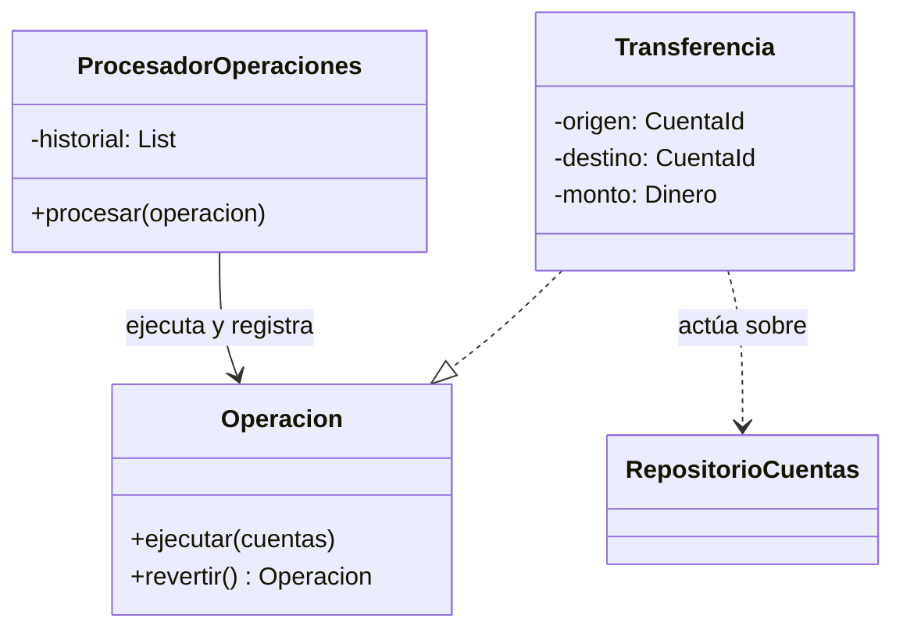
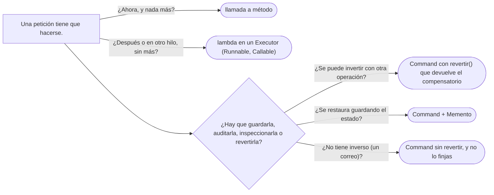

# 04 — Command

> Convertir una petición en un **objeto** —la transferencia de Ana a Luis como algo que se guarda, se encola, se
> registra y se revierte— y decir qué se gana con eso y qué no: un `Runnable` es la mitad del patrón. **Nivel: A.**
> Asume leído [`01` — Strategy](01-strategy.md) y
> [`02/06` — Entidades, valores y primitivos](../02-modelado-oo/06-entidades-valores-y-primitivos.md).
>
> **Vigencia:** 2026-10-03.
>
> **Versiones ejecutadas:** GCC 14.4 (C++23) · JDK 21.0.12, 17.0.20 y 25.0.4 · Spring Boot 4.1.1 (Spring Framework 7.0.9, Hibernate 7.4.5, H2 2.4.240) · mermaid-cli 11.17.0 (2026-10-04).

---

## 1. 🎯 El problema

Hoy una transferencia es una llamada que se ejecuta y desaparece:

```java
@PostMapping("/transferencias")
public void transferir(@RequestBody SolicitudTransferencia s) {
    Cuenta origen = cuentas.obtener(s.origen());
    Cuenta destino = cuentas.obtener(s.destino());
    origen.debitar(s.monto());
    destino.acreditar(s.monto());
}
```

Y el negocio pide cuatro cosas que esta forma no permite:

- **Programarla**: Ana quiere transferir 250 000,00 COP a la cuenta de Luis el día 1 de cada mes. Hay que guardar
  la petición y ejecutarla después.
- **Encolarla**: los lotes nocturnos de nómina llegan por miles y se procesan con un número limitado de hilos.
- **Registrarla**: auditoría quiere saber qué se pidió, quién lo pidió y cuándo, aunque falle.
- **Revertirla**: un operador se equivocó de cuenta y hay que deshacer la transferencia.

Las cuatro necesitan lo mismo: que la transferencia **exista como objeto** antes, durante y después de
ejecutarse. Eso es el Command.

---

## 2. 📐 La estructura

**La intención, en una frase del GoF:** encapsular una petición como un objeto, para poder parametrizar clientes
con peticiones distintas, encolarlas o registrarlas, y permitir operaciones que se pueden deshacer.



- **Command** (`Operacion`): la interfaz, con `ejecutar` y, si se puede deshacer, la operación inversa. Es una
  interfaz.
- **Concrete Command** (`Transferencia`): guarda **todo lo necesario** para ejecutarse después: origen, destino y
  monto. Es un dato con comportamiento.
- **Receiver** (las cuentas, a través de `RepositorioCuentas`): quien hace el trabajo real.
- **Invoker** (`ProcesadorOperaciones`): ejecuta comandos sin saber qué hacen, y los registra o los encola.
- **Client**: crea el comando con sus datos (el controlador, el programador de tareas, el lote nocturno).

Lo que separa al Command de "una función que se llama después" son las dos primeras líneas: **los datos de la
petición viajan dentro del objeto**, y el objeto puede ofrecer más que ejecutarse.

---

## 3. 🏛️ Cómo nació

El GoF lo presenta con los menús de un editor: cada opción del menú tiene un comando, y el editor guarda los
ejecutados para deshacerlos. En C++98:

```cpp
class Operacion {
public:
    virtual ~Operacion() {}
    virtual void ejecutar() = 0;
    virtual void deshacer() = 0;
};

class Transferencia : public Operacion {
public:
    Transferencia(Cuenta& o, Cuenta& d, const Dinero& m) : origen_(o), destino_(d), monto_(m) {}
    void ejecutar() { origen_.debitar(monto_); destino_.acreditar(monto_); }
    void deshacer() { destino_.debitar(monto_); origen_.acreditar(monto_); }
private:
    Cuenta& origen_;
    Cuenta& destino_;
    Dinero monto_;
};

std::vector<Operacion*> historial;    // para deshacer: el último ejecutado, al final
```

- El comando guarda referencias a sus receptores. Sirve para un editor en memoria; para una transferencia programada
  para el mes que viene, las referencias a objetos `Cuenta` cargados hoy no sirven: hay que guardar **identificadores**.
- El historial de punteros crudos repite la pregunta de siempre en C++98: ¿quién destruye los comandos?

---

## 4. 💻 C++ moderno

Si el comando solo tiene que **ejecutarse**, un invocable basta: una lambda que captura sus datos por valor, en un
`std::function` o, para colas de tareas que no se copian, en un `std::move_only_function` (C++23).

```cpp
std::deque<std::move_only_function<void()>> cola;

cola.emplace_back([o = CuentaId{"CTA-0001"}, d = CuentaId{"CTA-0003"}, m = Dinero::cop(250'000), &cuentas] {
    cuentas.transferir(o, d, m);                     // los datos viajan capturados por valor
});
```

Si además hay que **deshacer, registrar o inspeccionar**, el comando vuelve a ser un tipo con nombre:

```cpp
struct Transferencia {
    CuentaId origen, destino;
    Dinero monto;

    void ejecutar(RepositorioCuentas& cuentas) const { cuentas.transferir(origen, destino, monto); }
    Transferencia revertir() const { return {destino, origen, monto}; }   // el inverso es otro comando
};

std::vector<Transferencia> historial;                // por valor: sin punteros, sin propiedad que discutir
```

- Un comando de **valor** —identificadores y un `Dinero`— se copia, se serializa y se guarda sin preguntar quién lo
  posee. Es el cambio más útil respecto del C++98 del GoF.
- Iglberger muestra esta progresión en *C++ Software Design*: del Command con jerarquía al Command como valor con
  *type erasure*, que es lo que hace `std::function` por dentro.

---

## 5. 💻 Java

```java
public interface Operacion {
    void ejecutar(RepositorioCuentas cuentas);
    Operacion revertir();
}

public record Transferencia(CuentaId origen, CuentaId destino, Dinero monto) implements Operacion {
    public void ejecutar(RepositorioCuentas cuentas) {
        cuentas.obtener(origen).debitar(monto);
        cuentas.obtener(destino).acreditar(monto);
    }
    public Transferencia revertir() { return new Transferencia(destino, origen, monto); }   // un reverso, no un borrado
}

public final class ProcesadorOperaciones {
    private final RepositorioCuentas cuentas;
    private final Deque<Operacion> historial = new ArrayDeque<>();
    private final Auditoria auditoria;

    public ProcesadorOperaciones(RepositorioCuentas cuentas, Auditoria auditoria) {
        this.cuentas = cuentas;
        this.auditoria = auditoria;
    }

    @Transactional
    public void procesar(Operacion op) {
        auditoria.registrar(op);                  // se registra lo pedido, aunque después falle
        op.ejecutar(cuentas);
        historial.push(op);
    }

    @Transactional
    public void revertirUltima() { procesar(historial.pop().revertir()); }
}
```

- La transferencia es un **record**: inmutable, comparable, serializable a JSON. Se puede guardar en una tabla de
  operaciones programadas y ejecutarse el día 1, o mandarse a una cola.
- **Deshacer en un banco no es borrar**: es ejecutar la operación **compensatoria**. `revertir()` devuelve otra
  transferencia, de Luis a Ana, que queda también en la auditoría. La historia no se reescribe.
- El procesador no sabe qué es una transferencia: ejecuta `Operacion`. El pago programado o un ajuste contable son
  comandos nuevos sin tocarlo. El historial en memoria es para el ejemplo: en un banco es una tabla de
  operaciones, que sobrevive a un reinicio y que comparten todos los servidores.

**`Runnable` y `Callable`** son el Command reducido a "ejecútate": `executor.submit(() -> procesador.procesar(t))`
mete en la cola de un `ExecutorService` un comando sin datos visibles, sin inverso y sin nombre. Sirve para ejecutar
después o en otro hilo; no sirve para registrar, inspeccionar ni deshacer.

---

## 6. 🔀 Variantes

- **Deshacer y rehacer**: dos pilas, la de ejecutados y la de deshechos. Con operaciones compensatorias, deshacer es
  ejecutar el inverso; con un estado que se puede restaurar, se guarda una instantánea antes de ejecutar (la
  combinación con Memento: ver [`09` — Memento e Interpreter](09-memento-e-interpreter.md)).
- **Macro comando**: un comando hecho de otros, que se ejecutan en orden y se revierten en orden inverso. La nómina de
  una empresa es una macro de transferencias: un Composite de comandos (ver
  [`05/05` — Composite](../05-estructurales/05-composite.md)).
- **Registro para repetir**: guardar los comandos en orden permite reconstruir el estado repitiéndolos desde el
  principio, y es la idea detrás de los registros de operaciones de las bases de datos.
- **La *closure* como comando**: una lambda que captura sus datos es un Command de una sola operación. Es la forma por
  defecto cuando no hace falta más que ejecutar.

---

## 7. ⚖️ Con qué se confunde

| Se confunde con | La diferencia, en una frase |
|---|---|
| **`Runnable`** | Un `Runnable` es un comando con una sola capacidad, ejecutarse; el patrón añade datos visibles, nombre, y a menudo el inverso |
| **Strategy** | La estrategia encapsula **cómo** se hace algo y se reutiliza; el comando encapsula **una petición concreta** con sus datos (ver [`01` — Strategy](01-strategy.md)) |
| **Un evento** | El comando es una **intención** que puede fallar ("transfiere"); el evento es un **hecho** que ya ocurrió ("se transfirió") |
| **Memento** | El Memento guarda el **estado** para restaurarlo; el comando guarda la **operación** para repetirla o invertirla |

**La sobregeneralización.** "Command es un `Runnable`" se queda con la mitad que más se usa —ejecutar después— y
pierde la otra mitad, la que justifica el patrón: que la petición sea un **dato** que se guarda, se inspecciona, se
registra y se invierte. Un `Runnable` en una cola no se puede auditar ("¿qué transferencia era?") ni revertir.

---

## 8. 🔭 Dónde aparece de verdad

- **JDK**: `Runnable` y `Callable` en `ExecutorService`; `javax.swing.Action`, que es un comando con nombre, icono y
  estado habilitado para menús y botones.
- **Spring**: `TransactionTemplate.execute(callback)` ejecuta un comando dentro de una transacción; los *jobs* de
  Spring Batch y las tareas programadas con `@Scheduled` encapsulan trabajo para ejecutar después.
- **C++**: `std::function`, `std::move_only_function` y `std::packaged_task`, que es un comando cuyo resultado se
  recoge con un `std::future`.
- **Cualquier editor** con deshacer, y cualquier sistema que guarde "órdenes" para procesarlas después: órdenes de
  pago, órdenes de compra, transferencias programadas.

---

## 9. 🏷️ Lo que cuesta, y cuándo no

**El precio**, en las cuatro monedas:

- **Indirección:** una clase (o un record) por tipo de operación, y un invocador entre quien pide y quien hace. Para
  saber qué pasa al transferir hay que mirar el comando, no el controlador.
- **Acoplamiento:** el comando tiene que llevar **todo** lo necesario para ejecutarse más tarde, y nada que caduque:
  identificadores, no objetos cargados; valores, no referencias a una sesión.
- **Legibilidad:** el inverso no siempre existe. Una transferencia se compensa; un correo enviado no se "desenvía".
  Prometer `revertir()` en todos los comandos obliga a inventar inversos falsos.
- **Rendimiento:** un objeto por petición; irrelevante salvo en flujos enormes, y ahí el comando como valor pequeño
  ayuda.

**Cuándo no.**

- **Cuando la petición se ejecuta en el acto y no hace falta nada más**: una llamada a método.
- **Cuando solo se necesita ejecutar después**: una lambda en un `Executor`, sin jerarquía.
- **Cuando el inverso no existe**: no lo inventes; separa los comandos reversibles de los que no lo son.

> **Veredicto:** Command cuando la petición tiene que existir como dato —programarse, encolarse, auditarse o
> revertirse— y en un dominio con dinero, revertir es ejecutar el compensatorio, no borrar. Para "ejecuta esto
> después", una lambda basta.

---

## 10. 🧭 Cómo se elige



**La frase en voz alta:** *"La transferencia es un record con origen, destino y monto: un comando que se programa, se
encola y se audita. Revertirla no borra nada: crea la transferencia inversa, que también queda registrada."*

---

## ⚠️ Errores frecuentes

| Se dice | Lo preciso |
|---|---|
| "Command es un `Runnable`" | El `Runnable` es la mitad: ejecutar; el patrón es la petición como dato, con lo que se registra, inspecciona y revierte |
| "Deshacer es borrar la operación" | En un dominio con dinero es ejecutar la compensatoria, y la historia queda |
| "Todo comando tiene inverso" | Un correo enviado no se desenvía; separar reversibles de irreversibles |
| "El comando puede guardar las entidades cargadas" | Si se ejecuta después, guarda identificadores y valores, no objetos de una sesión que ya cerró |
| "Command y Strategy son lo mismo porque los dos son objetos con un método" | La estrategia es un algoritmo reutilizable; el comando, una petición concreta con sus datos |
| "Un comando y un evento son intercambiables" | El comando es una intención que puede fallar; el evento, un hecho consumado |

---

## 📚 Para profundizar

- **Libro** — Gamma, Helm, Johnson y Vlissides, *Design Patterns* (Addison-Wesley, 1994), cap. 5, "Behavioral
  Patterns", sección "Command": menús, deshacer y macro comandos.
- **Libro** — Iglberger, *C++ Software Design* (O'Reilly, 2022), cap. 5, "The Strategy and Command Design Patterns":
  la diferencia entre los dos, y el comando como valor. **El que destaca** para C++.
- **Libro** — Nystrom, *Game Programming Patterns* (2014), cap. "Command", libre en
  [su sitio](https://gameprogrammingpatterns.com/command.html): deshacer y repetir con comandos.
- **Libro** — Freeman y Robson, *Head First Design Patterns*, 2.ª ed. (O'Reilly, 2021), cap. 6, "The Command
  Pattern": el control remoto, macros y deshacer.
- [Java 21 API — `ExecutorService`](https://docs.oracle.com/en/java/javase/21/docs/api/java.base/java/util/concurrent/ExecutorService.html):
  la cola de comandos `Runnable` y `Callable`.
- [cppreference — `std::move_only_function`](https://en.cppreference.com/cpp/utility/functional/move_only_function):
  el contenedor de comandos que no se copian, de C++23.
- **Tutorial** — [Refactoring Guru — Command](https://refactoring.guru/design-patterns/command).

---

## 🧠 Preguntas

Sin respuestas aquí. Todas, con enunciado literal y respuesta en tres capas, en
[`11` — Respuestas](11-respuestas.md#04--command).

1. ¿Cuál es la intención del Command? 🟢
2. ¿Qué participantes tiene el Command? 🟢
3. ¿Por qué `Runnable` es un Command incompleto? 🟢
4. ¿Qué diferencia hay entre Command y Strategy? 🟡
5. ¿Qué diferencia hay entre un comando y un evento? 🟡
6. ¿Qué diferencia hay entre deshacer con un comando inverso y con un Memento? 🟡
7. ¿Qué diferencia hay entre un comando en C++ como `std::function` y como tipo con nombre? 🟡
8. ¿Por qué deshacer una transferencia no es borrarla? 🟠
9. ¿Qué debe guardar un comando que se ejecuta un mes después, y qué no? 🟠
10. ¿Qué haces con un comando que no tiene inverso? 🟠
11. ¿Cuándo un Command es ceremonia? 🟠
12. Escribe en Java `Transferencia` como comando con `revertir()`, y un procesador que la audite y la ejecute. 🔴
13. Escribe un macro comando para la nómina de una empresa que, si falla una transferencia, revierta las
    anteriores. 🔴
14. Revisa este código y di qué falla: `executor.submit(() -> transferir(origen, destino, monto));` usado como
    "registro de operaciones programadas" que auditoría consulta. 🔴

---

**Anterior:** [`03` — Observer](03-observer.md) ·
**Siguiente:** [`05` — Chain of Responsibility](05-chain-of-responsibility.md) ·
**Relacionado:** [`01` — Strategy](01-strategy.md)
