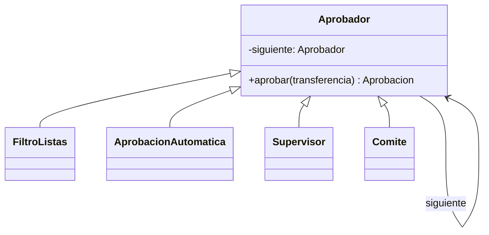
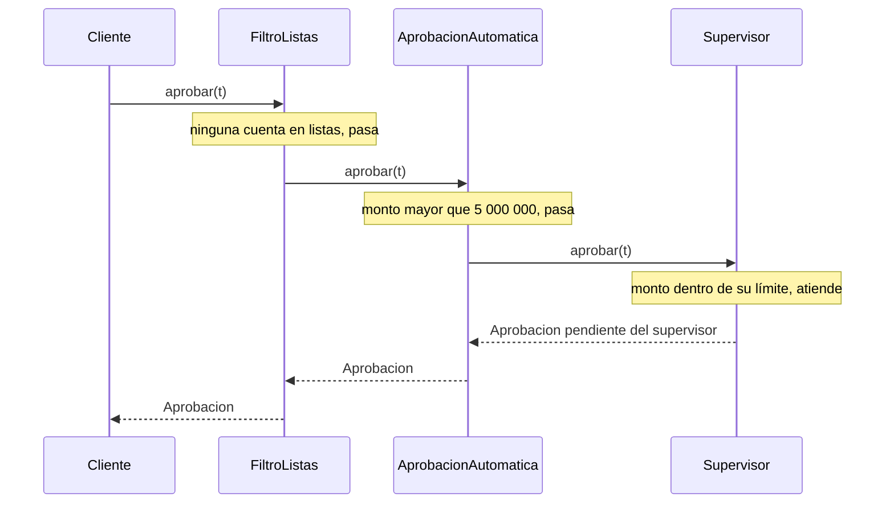
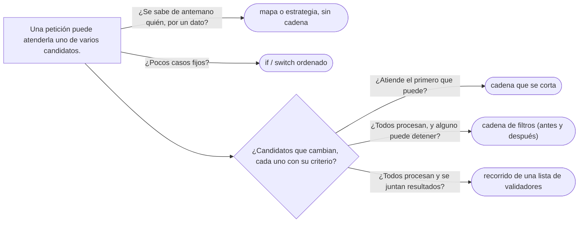

# 05 — Chain of Responsibility

> Encadenar manejadores que deciden, cada uno, si atienden una petición o la pasan al siguiente; distinguir la
> cadena que **se corta** de la que **acumula**; y reconocerla en los filtros de servlet, la `SecurityFilterChain`
> de Spring y el *middleware*. **Nivel: A.** Las validaciones de un documento, que son la otra cara del patrón,
> aparecen en §6 como la variante que acumula; el problema de apertura es la aprobación por monto, porque muestra
> mejor la cadena que se corta. Asume leído [`02` — Template Method](02-template-method.md) y
> [`05/02` — Decorator](../05-estructurales/02-decorator.md).
>
> **Vigencia:** 2026-10-04.
>
> **Versiones ejecutadas:** GCC 14.4 (C++23) · JDK 21.0.12, 17.0.20 y 25.0.4 · Spring Boot 4.1.1 (Spring Framework 7.0.9, Hibernate 7.4.5, H2 2.4.240) · mermaid-cli 11.17.0 (2026-10-04).

---

## 1. 🎯 El problema

Una transferencia necesita aprobación según el monto: hasta 5 000 000 COP la aprueba el sistema; hasta
50 000 000, un supervisor; hasta 500 000 000, la gerencia; por encima, el comité. Y antes de nada se comprueba
que ninguna de las dos cuentas esté en las listas restrictivas. El código:

```java
public Aprobacion aprobar(Transferencia t) {
    if (listas.contiene(t.origen()) || listas.contiene(t.destino())) return Aprobacion.rechazada("lista restrictiva");
    if (t.monto().menorOIgual(Dinero.cop("5000000.00")))   return Aprobacion.automatica();
    if (t.monto().menorOIgual(Dinero.cop("50000000.00")))  return supervisores.pedir(t);
    if (t.monto().menorOIgual(Dinero.cop("500000000.00"))) return gerencia.pedir(t);
    return comite.pedir(t);
}
```

- Cada nivel nuevo —el negocio quiere uno para transferencias internacionales— es un `if` en medio de los demás,
  y el **orden** de los `if` es parte de la regla sin que nada lo diga.
- Y el método conoce a todos los aprobadores: cambiar los umbrales de la gerencia obliga a tocar el método que
  también decide las listas restrictivas.

Lo que hay es una **secuencia de candidatos**, cada uno con su criterio, y la petición tiene que llegar al primero
que la pueda atender. El patrón da a cada candidato su objeto y los encadena.

---

## 2. 📐 La estructura

**La intención, en una frase del GoF:** evitar acoplar el emisor de una petición con su receptor, dando a más de
un objeto la oportunidad de atenderla; se encadenan los receptores y se pasa la petición por la cadena hasta que
uno la atienda.



- **Handler** (`Aprobador`): la interfaz común y la referencia al **siguiente**.
- **Concrete Handler**: cada uno decide, con su propio criterio, si atiende o pasa.
- **Client**: entrega la petición al **primer** eslabón, y no sabe quién la atenderá.

El orden de las llamadas es el patrón, y se ve en la secuencia de una transferencia de 30 000 000 COP:



- La petición **no llega** a la gerencia ni al comité: el supervisor la atendió y la cadena se cortó ahí.
- En el diagrama de clases, `Aprobador` es una clase base abstracta (la que guarda el siguiente), y por eso la
  relación es de herencia y no de realización.

---

## 3. 🏛️ Cómo nació

El GoF lo presenta con la ayuda contextual de una interfaz gráfica: el botón no tiene ayuda, se la pide a su
diálogo, el diálogo a la ventana. En C++98:

```cpp
class Aprobador {
public:
    explicit Aprobador(Aprobador* siguiente = 0) : siguiente_(siguiente) {}
    virtual ~Aprobador() {}
    virtual Aprobacion aprobar(const Transferencia& t) {
        if (siguiente_) return siguiente_->aprobar(t);        // por defecto, pasa
        return Aprobacion::rechazada("nadie la atendió");
    }
private:
    Aprobador* siguiente_;
};

class Supervisor : public Aprobador {
public:
    Supervisor(Aprobador* siguiente) : Aprobador(siguiente) {}
    Aprobacion aprobar(const Transferencia& t) {
        if (t.monto() <= Dinero::cop(50000000)) return pedirASupervisores(t);
        return Aprobador::aprobar(t);                          // no es suya: al siguiente
    }
};
```

- La clase base hace el "pasar" por defecto, y cada manejador solo dice cuándo atiende.
- Qué pasa si **nadie** atiende es una decisión que el GoF deja explícita: la petición puede caer del final de la
  cadena sin respuesta. Aquí se rechaza, que es lo prudente con dinero.

---

## 4. 💻 C++ moderno

Con la cadena como **lista** en lugar de punteros enlazados, y cada eslabón como un invocable que devuelve "atendí"
o "no es mía":

```cpp
using Aprobador = std::function<std::optional<Aprobacion>(const Transferencia&)>;

Aprobacion aprobar(std::span<const Aprobador> cadena, const Transferencia& t) {
    for (const auto& eslabon : cadena)
        if (auto r = eslabon(t)) return *r;                    // el primero que responde, corta
    return Aprobacion::rechazada("nadie la atendió");
}

std::vector<Aprobador> cadena{
    [&](const Transferencia& t) -> std::optional<Aprobacion> {
        if (listas.contiene(t.origen()) || listas.contiene(t.destino())) return Aprobacion::rechazada("lista");
        return std::nullopt;                                   // no es mía: pasa
    },
    [](const Transferencia& t) -> std::optional<Aprobacion> {
        if (t.monto() <= Dinero::cop(5'000'000)) return Aprobacion::automatica();
        return std::nullopt;
    },
};
```

- `std::optional` dice en el tipo lo que en el GoF era una convención: "no la atendí". El orden de la cadena es el
  orden del `vector`, visible en un sitio.
- Sin referencias a "siguiente" en cada eslabón, un eslabón no puede olvidarse de pasar la petición, ni pasarla dos
  veces.

---

## 5. 💻 Java

```java
@FunctionalInterface
public interface Aprobador {
    Optional<Aprobacion> aprobar(Transferencia t);         // vacío: no es mía
}

public final class CadenaAprobacion {
    private final List<Aprobador> eslabones;
    public CadenaAprobacion(List<Aprobador> eslabones) { this.eslabones = List.copyOf(eslabones); }

    public Aprobacion aprobar(Transferencia t) {
        for (Aprobador a : eslabones) {
            Optional<Aprobacion> r = a.aprobar(t);
            if (r.isPresent()) return r.get();
        }
        return Aprobacion.rechazada("nadie la atendió");
    }
}

var cadena = new CadenaAprobacion(List.of(
        new FiltroListasRestrictivas(listas),
        hastaMonto(Dinero.cop("5000000.00"),   t -> Aprobacion.automatica()),
        hastaMonto(Dinero.cop("50000000.00"),  supervisores::pedir),
        hastaMonto(Dinero.cop("500000000.00"), gerencia::pedir),
        t -> Optional.of(comite.pedir(t))));               // el último atiende siempre
```

- El nivel para transferencias internacionales es un eslabón más, insertado donde corresponde. Los umbrales de la
  gerencia viven en su eslabón.
- `hastaMonto` es una pequeña fábrica que devuelve un `Aprobador`: cada eslabón se prueba solo, con una
  transferencia de prueba.

**La cadena que acumula.** La variante más usada hoy no corta en el primero que atiende: **todos** los eslabones
procesan, y cualquiera puede **detener** la cadena. Es la forma de los filtros de servlet:

```java
public final class FiltroAuditoria implements Filter {
    @Override
    public void doFilter(ServletRequest req, ServletResponse res, FilterChain cadena)
            throws IOException, ServletException {
        long inicio = System.nanoTime();
        try {
            cadena.doFilter(req, res);                     // pasa al siguiente: el filtro decide si y cuándo
        } finally {                                        // el "después" corre también si el resto lanza
            auditoria.registrar(((HttpServletRequest) req).getRequestURI(), System.nanoTime() - inicio);
        }
    }
}
```

- Cada filtro hace su parte **antes** y **después** del resto, y decide si llama a `cadena.doFilter`. El de
  autenticación no la llama si no hay credenciales: ahí la cadena se corta.
- El `finally` no es adorno: sin él, la petición cuyo controlador lanza una excepción sale del filtro por arriba y el
  "después" no corre. Comprobado en Tomcat: sin `finally`, la petición que terminó en error no quedó auditada.

---

## 6. 🔀 Variantes

| Variante | Cómo funciona | Ejemplo |
|---|---|---|
| **Se corta en el primero** | El primero que atiende responde; el resto no se entera | La aprobación por monto; la ayuda contextual del GoF |
| **Acumula, y cualquiera puede cortar** | Todos procesan antes y después del resto; uno puede detener | Filtros de servlet, `SecurityFilterChain`, *middleware* de Express |
| **Acumula sin cortar** | Todos procesan y se juntan los resultados | Una validación que devuelve **todos** los errores del documento |

- La segunda es, mirada de cerca, una pila de **decoradores** construida por el marco: cada filtro envuelve al resto.
  La diferencia con un decorador escrito a mano es que el eslabón puede no llamar al siguiente.
- La tercera ya no es Chain of Responsibility en sentido estricto: es un recorrido de una lista. Se le sigue llamando
  "cadena de validadores", y es lo correcto cuando el usuario quiere ver todos sus errores juntos.

---

## 7. ⚖️ Con qué se confunde

| Se confunde con | La diferencia, en una frase |
|---|---|
| **Decorator** | El decorador siempre delega en el envuelto; el eslabón de una cadena puede no pasar (ver [`05/02`](../05-estructurales/02-decorator.md)) |
| **Composite** | El compuesto pasa la petición a **todos** sus hijos y combina; la cadena la pasa **en orden** hasta que alguien la atiende (ver [`05/05`](../05-estructurales/05-composite.md)) |
| **Observer** | El Observer notifica a **todos** los suscriptores; la cadena busca **uno** (ver [`03` — Observer](03-observer.md)) |
| **Strategy** | La estrategia se elige **antes** de llamar; en la cadena, cada candidato decide **al recibir** la petición (ver [`01` — Strategy](01-strategy.md)) |

**La sobregeneralización.** "En una Chain todos los eslabones procesan la petición" describe los filtros de
servlet, que son la variante que acumula. En la forma del GoF, la petición se detiene en el primero que la
atiende, y los que vienen detrás **ni la ven**. Las dos existen; la entrevista suele preguntar por la diferencia.

---

## 8. 🔭 Dónde aparece de verdad

- **Jakarta Servlet**: `Filter` y `FilterChain`. Cada filtro recibe la cadena y decide si llama a `doFilter`.
- **Spring Security**: la `SecurityFilterChain`, una lista de filtros (autenticación, CSRF, autorización) por la
  que pasa cada petición; un filtro que no autentica corta la cadena con un 401.
- **Spring MVC**: los `HandlerInterceptor`, con `preHandle` que devuelve `false` para cortar.
- **Excepciones**: la propagación de una excepción por la pila de llamadas hasta el primer `catch` que la acepta
  es la cadena del GoF hecha lenguaje.
- **Fuera de Java**: el *middleware* de Express o de ASP.NET Core, el mismo diseño de "acumula y cualquiera corta".

---

## 9. 🏷️ Lo que cuesta, y cuándo no

**El precio**, en las cuatro monedas:

- **Indirección:** para saber quién atiende una transferencia de 30 000 000 COP hay que recorrer la cadena con la
  cabeza. La depuración atraviesa N eslabones.
- **Acoplamiento al orden:** el orden **es** la regla, y vive donde se arma la cadena. Poner el filtro de listas
  después del aprobador automático aprobaría transferencias a cuentas restringidas.
- **Garantía de recepción:** nada garantiza que alguien atienda; si la cadena se queda sin eslabones, la petición
  cae del final. Hay que decidir qué pasa entonces.
- **Rendimiento:** una llamada por eslabón; irrelevante salvo cadenas enormes.

**Cuándo no.**

- **Tres casos fijos que no cambian**: un `if` o un `switch` ordenado se lee mejor que tres clases.
- **Cuando se sabe de antemano quién atiende**: entonces es una búsqueda en un mapa o una estrategia elegida, no
  una cadena de candidatos.
- **Cuando el orden importa pero nadie lo documenta**: la cadena lo esconde; o se arma en un solo sitio a la vista,
  o se prefiere la secuencia explícita.

> **Veredicto:** Chain of Responsibility cuando hay una secuencia de candidatos que cambia, cada uno con su
> criterio, y la petición debe llegar al primero que pueda; con la cadena armada en un solo sitio y un final que
> decide qué pasa si nadie atiende. Para filtros que procesan antes y después, la variante que acumula.

---

## 10. 🧭 Cómo se elige



**La frase en voz alta:** *"La aprobación por monto es una cadena: listas restrictivas, automática, supervisor,
gerencia, comité. Cada eslabón decide si es suya; la primera que la atiende corta. Los filtros de servlet son la
otra variante: todos procesan, y el de autenticación puede detener la cadena."*

---

## ⚠️ Errores frecuentes

| Se dice | Lo preciso |
|---|---|
| "En una Chain todos los eslabones procesan la petición" | En la forma del GoF se detiene en el primero que atiende; la variante de filtros es la que acumula |
| "El orden de la cadena da igual" | El orden es parte de la regla: el filtro de listas va antes de la aprobación automática |
| "Siempre alguien atiende" | Nada lo garantiza; el final de la cadena tiene que decidir qué pasa |
| "Chain y Decorator son lo mismo" | El decorador siempre delega; el eslabón puede no pasar la petición |
| "Cada eslabón debe guardar la referencia al siguiente" | Es la forma del GoF; una lista recorrida por la cadena evita olvidos y dobles llamadas |
| "Un `if` encadenado es siempre un antipatrón" | Con pocos casos fijos es la forma más legible |

---

## 📚 Para profundizar

- **Libro** — Gamma, Helm, Johnson y Vlissides, *Design Patterns* (Addison-Wesley, 1994), cap. 5, "Behavioral
  Patterns", sección "Chain of Responsibility": la ayuda contextual y la petición que nadie atiende. **El que
  destaca.**
- [Jakarta Servlet 6.0 — `Filter`](https://jakarta.ee/specifications/servlet/6.0/apidocs/jakarta.servlet/jakarta/servlet/filter):
  el filtro y su `doFilter`.
- [Jakarta Servlet 6.0 — `FilterChain`](https://jakarta.ee/specifications/servlet/6.0/apidocs/jakarta.servlet/jakarta/servlet/filterchain):
  la cadena que el contenedor arma.
- [Spring Security — Servlet Architecture](https://docs.spring.io/spring-security/reference/servlet/architecture.html):
  `SecurityFilterChain` y el orden de sus filtros.
- [Spring Framework — Interception](https://docs.spring.io/spring-framework/reference/web/webmvc/mvc-servlet/handlermapping-interceptor.html):
  los `HandlerInterceptor` y su `preHandle`.
- **Tutorial** — [Refactoring Guru — Chain of Responsibility](https://refactoring.guru/design-patterns/chain-of-responsibility).

---

## 🧠 Preguntas

Sin respuestas aquí. Todas, con enunciado literal y respuesta en tres capas, en
[`11` — Respuestas](11-respuestas.md#05--chain-of-responsibility).

1. ¿Cuál es la intención de Chain of Responsibility? 🟢
2. ¿Qué participantes tiene, y qué sabe el cliente? 🟢
3. ¿Qué hace un filtro de servlet con su `FilterChain`? 🟢
4. ¿Qué es la `SecurityFilterChain` de Spring? 🟢
5. ¿Qué diferencia hay entre la cadena que se corta y la que acumula? 🟡
6. ¿Qué diferencia hay entre Chain of Responsibility y Decorator? 🟡
7. ¿Qué diferencia hay entre Chain of Responsibility y Observer? 🟡
8. ¿Qué cambia en la cadena entre C++98 y una lista de `std::function` con `std::optional`? 🟡
9. ¿Por qué el orden de la cadena es parte de la regla? 🟠
10. ¿Qué haces si nadie atiende la petición? 🟠
11. ¿Cuándo una cadena es ceremonia? 🟠
12. ¿Por qué validar un documento devolviendo todos sus errores no es una cadena en sentido estricto? 🟠
13. Refactoriza `aprobar` de §1 a una cadena en Java, con un nivel nuevo para transferencias internacionales. 🔴
14. Escribe un filtro de servlet que rechace con 401 las peticiones sin cabecera `Authorization` y deje pasar las
    demás. 🔴

---

**Anterior:** [`04` — Command](04-command.md) ·
**Siguiente:** [`06` — State](06-state.md) ·
**Relacionado:** [`05/02` — Decorator](../05-estructurales/02-decorator.md)
