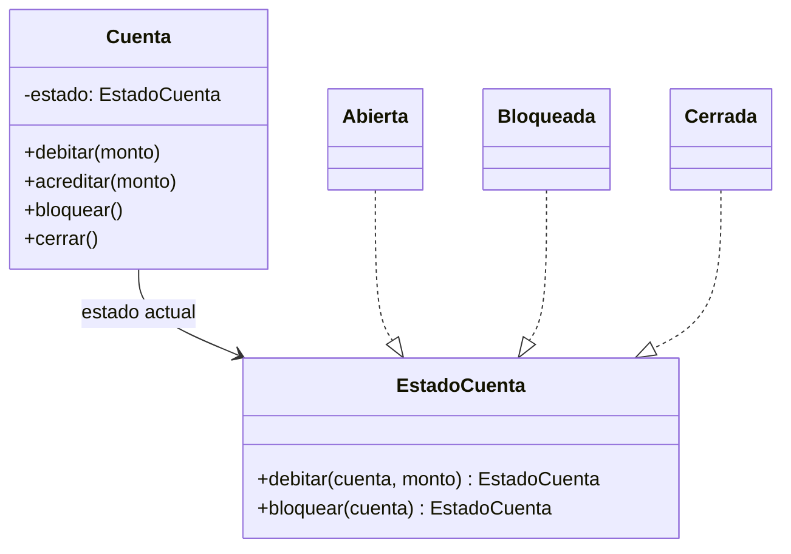
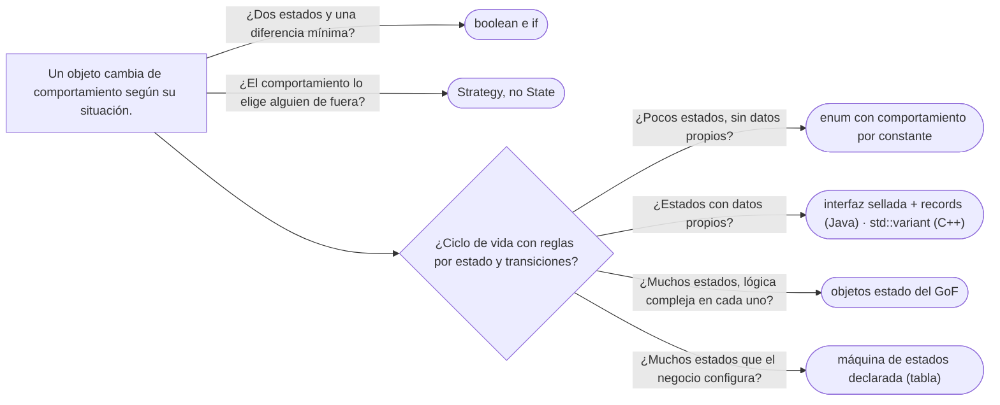

# 06 — State

> Modelar el ciclo de vida de un objeto **sin *flags***: cada estado con su comportamiento y sus transiciones
> explícitas; decidir quién cambia de estado; elegir entre objetos estado, un `enum` con comportamiento y una
> interfaz sellada; y separar State de Strategy, que tienen el mismo diagrama. **Nivel: A.** Asume leído
> [`01/03` §7](../01-modelo-de-objetos/03-inmutabilidad-y-objetos-especiales.md#7--enums-objetos-con-identidad-garantizada)
> (enums con comportamiento) y [`01` — Strategy](01-strategy.md).
>
> **Vigencia:** 2026-10-03.
>
> **Versiones ejecutadas:** GCC 14.4 (C++23) · JDK 21.0.12, 17.0.20 y 25.0.4 · mermaid-cli 11.17.0 (2026-10-04).

---

## 1. 🎯 El problema

`Cuenta` empezó con un `boolean bloqueada`. Después llegó el cierre, y con él otro `boolean`:

```java
public class Cuenta {
    private boolean bloqueada;
    private boolean cerrada;
    private Dinero saldo;

    public void debitar(Dinero monto) {
        if (cerrada) throw new IllegalStateException("cuenta cerrada");
        if (bloqueada) throw new IllegalStateException("cuenta bloqueada");
        saldo = saldo.menos(monto);
    }
    public void acreditar(Dinero monto) {
        if (cerrada) throw new IllegalStateException("cuenta cerrada");
        saldo = saldo.mas(monto);                       // una bloqueada recibe créditos: ¿a propósito?
    }
    public void bloquear() { bloqueada = true; }       // ¿y si está cerrada?
    public void cerrar() { cerrada = true; }           // ¿y si tiene saldo?
}
```

- Dos `boolean` son **cuatro** combinaciones, y una —bloqueada **y** cerrada— no significa nada, pero nada impide
  llegar a ella: `cerrar()` y después `bloquear()`.
- Cada operación repite la cascada de `if` sobre los *flags*, y la regla de cada estado está repartida por todos
  los métodos. Para saber qué puede hacer una cuenta bloqueada hay que leer la clase entera.
- Las **transiciones** no existen como concepto: cualquiera pone cualquier *flag* en cualquier momento.

El ciclo de vida real es pequeño y cerrado, y cabe en una tabla:

```text
Estado      bloquear    desbloquear   cerrar (saldo cero)   debitar   acreditar
ABIERTA     BLOQUEADA   ❌             CERRADA               ✅        ✅
BLOQUEADA   ❌           ABIERTA       CERRADA               ❌        ✅
CERRADA     ❌           ❌             ❌                     ❌        ❌
```

- Cada fila es un estado; cada columna de evento dice a qué estado se pasa (❌: la operación no se admite). Las
  reglas de ejemplo —una bloqueada recibe créditos pero no débitos— son del dominio del corpus, no de un banco real.

---

## 2. 📐 La estructura

**La intención, en una frase del GoF:** permitir que un objeto altere su comportamiento cuando cambia su estado
interno; el objeto parecerá haber cambiado de clase.



- **Context** (`Cuenta`): lo que el cliente usa. Tiene **un** estado actual y le delega las operaciones que
  dependen de él.
- **State** (`EstadoCuenta`): la interfaz con una operación por evento del ciclo de vida.
- **Concrete State** (`Abierta`, `Bloqueada`, `Cerrada`): cada uno sabe qué hace con cada evento **y a qué estado
  pasa**.

El "parecerá haber cambiado de clase" es literal: después de `bloquear()`, la misma `Cuenta` responde a `debitar`
como lo haría una clase distinta, sin que el cliente note nada.

---

## 3. 🏛️ Cómo nació

El GoF lo presenta con una conexión TCP que se comporta distinto según esté establecida, escuchando o cerrada. En
C++98, los estados son objetos y el contexto cambia de puntero:

```cpp
class Cuenta;

class EstadoCuenta {
public:
    virtual ~EstadoCuenta() {}
    virtual void debitar(Cuenta& c, const Dinero& m) { throw OperacionNoPermitida("debitar"); }
    virtual void bloquear(Cuenta& c)                 { throw OperacionNoPermitida("bloquear"); }
};

class Abierta : public EstadoCuenta {
public:
    static Abierta& instancia() { static Abierta a; return a; }   // sin estado propio: compartido
    void debitar(Cuenta& c, const Dinero& m);
    void bloquear(Cuenta& c);                                      // c.cambiarEstado(Bloqueada::instancia())
};
```

- Los estados no tienen campos propios, así que el GoF los comparte: un objeto por estado para todas las cuentas.
  Es un Flyweight, y en C++98 se escribía como un Singleton.
- La clase base hace que toda operación no permitida falle por defecto, y cada estado sobrescribe solo lo que
  admite.

---

## 4. 💻 C++ moderno

La alternativa que C++17 añadió: el estado como **valor** en un `std::variant`, y las transiciones como funciones
que reciben un estado y devuelven el siguiente.

```cpp
struct Abierta {};
struct Bloqueada { std::string motivo; };                // un estado puede llevar datos propios
struct Cerrada { std::chrono::year_month_day fecha; };

using EstadoCuenta = std::variant<Abierta, Bloqueada, Cerrada>;

class Cuenta {
public:
    void debitar(const Dinero& m) {
        if (!std::holds_alternative<Abierta>(estado_)) throw OperacionNoPermitida{"debitar"};
        saldo_ = saldo_ - m;
    }
    void bloquear(std::string motivo) {
        estado_ = std::visit([&](const auto& e) -> EstadoCuenta {
            using E = std::decay_t<decltype(e)>;
            if constexpr (std::is_same_v<E, Abierta>) return Bloqueada{std::move(motivo)};
            else throw OperacionNoPermitida{"bloquear"};      // ni una bloqueada ni una cerrada
        }, estado_);
    }
private:
    EstadoCuenta estado_ = Abierta{};
    Dinero saldo_;
};
```

- **El estado lleva sus datos**: el motivo del bloqueo solo existe en `Bloqueada`. Con *flags*, `motivoBloqueo` sería
  un campo de `Cuenta` que vale `null` la mayor parte del tiempo.
- `std::visit` con `if constexpr` obliga a pensar en todos los estados; con un *overload set* de lambdas, el
  compilador falla si falta uno.
- Es un cambio de enfoque respecto del GoF: las transiciones viven en el contexto, no en los estados. Con tres
  estados y cuatro eventos, se lee mejor; con veinte estados, los objetos del GoF reparten mejor la lógica.

---

## 5. 💻 Java

Para un ciclo de vida **cerrado y pequeño**, un `enum` con comportamiento por constante es la forma más corta del
patrón:

```java
public enum EstadoCuenta {
    ABIERTA {
        EstadoCuenta bloquear() { return BLOQUEADA; }
        EstadoCuenta cerrar(Dinero saldo) { return cerrarSiVacia(saldo); }
        boolean admiteDebitos() { return true; }
    },
    BLOQUEADA {
        EstadoCuenta desbloquear() { return ABIERTA; }
        EstadoCuenta cerrar(Dinero saldo) { return cerrarSiVacia(saldo); }
    },
    CERRADA;

    EstadoCuenta bloquear()             { throw new OperacionNoPermitidaException(this, "bloquear"); }
    EstadoCuenta desbloquear()          { throw new OperacionNoPermitidaException(this, "desbloquear"); }
    EstadoCuenta cerrar(Dinero saldo)   { throw new OperacionNoPermitidaException(this, "cerrar"); }
    boolean admiteDebitos()             { return false; }
    boolean admiteCreditos()            { return this != CERRADA; }

    private static EstadoCuenta cerrarSiVacia(Dinero saldo) {
        if (!saldo.esCero()) throw new OperacionNoPermitidaException(ABIERTA, "cerrar con saldo");
        return CERRADA;
    }
}

public final class Cuenta {
    private EstadoCuenta estado = EstadoCuenta.ABIERTA;
    private Dinero saldo;

    public void debitar(Dinero monto) {
        if (!estado.admiteDebitos()) throw new OperacionNoPermitidaException(estado, "debitar");
        saldo = saldo.menos(monto);
    }
    public void bloquear() { estado = estado.bloquear(); }      // el estado decide si y a dónde
    public void cerrar()   { estado = estado.cerrar(saldo); }
}
```

- Las combinaciones imposibles **no se pueden escribir**: hay un estado, no dos *flags*. `cerrar()` sobre una
  cerrada lanza, y una cerrada no se puede bloquear.
- Cada transición está en un sitio: para saber qué puede hacer `BLOQUEADA`, se lee su bloque.
- Los métodos del `enum` devuelven **el siguiente estado**, y la cuenta lo asigna. Es la decisión de §6.

Cuando los estados necesitan **datos propios** (el motivo y la fecha del bloqueo), el `enum` se queda corto y la forma
es una **interfaz sellada** con un record por estado, el equivalente del `std::variant`:

```java
public sealed interface Estado permits Abierta, Bloqueada, Cerrada {}
public record Abierta() implements Estado {}
public record Bloqueada(String motivo, LocalDate desde) implements Estado {}
public record Cerrada(LocalDate fecha) implements Estado {}

boolean admiteCreditos(Estado e) {
    return switch (e) {
        case Abierta a   -> true;
        case Bloqueada b -> true;
        case Cerrada c   -> false;
    };
}
```

> 📝 **En Java 17:** las interfaces selladas y los records existen; el `switch` con patrones de tipo es de Java 21.
> En 17 se escribe con `if (e instanceof Bloqueada b) …`, sin comprobación de exhaustividad, o se deja el
> comportamiento como métodos de cada record.

---

## 6. 🔀 Variantes: quién decide la transición

La pregunta que el GoF deja abierta y que el entrevistador hace:

| Quién decide | Cómo | Cuándo conviene |
|---|---|---|
| **El estado** | Cada estado devuelve el siguiente (`ABIERTA.bloquear()` devuelve `BLOQUEADA`) | Las transiciones dependen del estado actual: lo habitual |
| **El contexto** | `Cuenta` tiene la tabla de transiciones y los estados solo dan comportamiento | Las transiciones dependen de datos del contexto, o se quieren ver todas juntas |
| **Una tabla** | Un mapa de (estado, evento) a estado siguiente, a menudo desde configuración | Muchos estados y eventos; flujos que cambian sin desplegar (una máquina de estados declarada) |

- Si el estado decide, los estados se **conocen entre sí** (`ABIERTA` sabe que existe `BLOQUEADA`). Es acoplamiento,
  y es el precio de tener cada regla en su sitio.
- Para flujos grandes (un trámite con veinte estados), las librerías de máquinas de estados y los motores de flujo
  reemplazan al patrón escrito a mano.

---

## 7. ⚖️ Con qué se confunde

| Se confunde con | La diferencia, en una frase |
|---|---|
| **Strategy** | Misma estructura; la estrategia la elige **alguien de fuera** y no cambia sola, el estado **cambia por las operaciones del propio objeto** (ver [`01` — Strategy](01-strategy.md)) |
| **Un `enum` con un `switch`** | Un `switch` repetido en cada método es la versión con *flags* con otro nombre; el `enum` con un método por constante es ya el patrón |
| **Una máquina de estados** | El State es **una** forma de implementar una máquina de estados con objetos; también se implementa con tablas |
| **Memento** | El Memento **guarda** un estado para volver a él; el State **es** el estado actual y su comportamiento |

**La sobregeneralización.** "State es un `enum` con un `switch`" describe exactamente lo que el patrón quita: un
`switch (estado)` en cada método de `Cuenta`, que repite la regla de cada estado por toda la clase. El `enum` es una
forma legítima del patrón **cuando cada constante lleva su comportamiento**; con un `switch` en cada método, el `enum`
solo cambió los `boolean` por constantes.

---

## 8. 🔭 Dónde aparece de verdad

- **El JDK**: `Thread.State` es un `enum` sin comportamiento (solo nombra los estados); el comportamiento vive en la
  JVM. Es el contraejemplo útil: un `enum` de estados no es, por sí solo, el patrón.
- **Frameworks**: Spring Statemachine, y los motores de flujos de trabajo, que implementan la versión de tabla.
- **Protocolos**: el ejemplo del GoF, la conexión TCP, sigue siendo el caso de libro: el mismo `send` hace cosas
  distintas según el estado de la conexión.
- **Videojuegos**: Nystrom dedica un capítulo a los estados de un personaje, y a por qué las máquinas de estados
  finitos dejan de bastar.

---

## 9. 🏷️ Lo que cuesta, y cuándo no

**El precio**, en las cuatro monedas:

- **Indirección:** con objetos estado, una clase por estado y una llamada más por operación; para saber qué hace
  `debitar` hay que saber en qué estado está la cuenta.
- **Acoplamiento:** si los estados deciden las transiciones, se conocen entre sí. Añadir un estado (`EMBARGADA`)
  obliga a revisar de qué estados se llega a él.
- **Legibilidad:** el ciclo completo ya no se ve en un sitio; cada estado tiene su trozo. Un diagrama de
  transiciones en la documentación (como el de §1) deja de ser opcional.
- **Persistencia:** el estado se guarda como su nombre (`'BLOQUEADA'` en una columna), y al cargar hay que
  reconstruirlo. Con estados que llevan datos, son columnas que solo valen para un estado.

**Cuándo no.**

- **Dos estados con una diferencia**: un `boolean activa` y un `if` se leen mejor que dos clases.
- **Estados sin comportamiento distinto**: si el estado solo se muestra en pantalla, es un `enum` sin métodos.
- **Flujos grandes y cambiantes**: veinte estados configurables por el negocio son una máquina de estados declarada,
  no veinte clases.

> **Veredicto:** State cuando un objeto tiene un ciclo de vida con reglas distintas por estado y transiciones que
> hay que proteger; en Java, un `enum` con comportamiento por constante para ciclos pequeños, y una interfaz sellada
> con records cuando los estados llevan datos. Con dos estados triviales, un `boolean` honesto.

---

## 10. 🧭 Cómo se elige



**La frase en voz alta:** *"Quito los dos `boolean` de la cuenta y le doy un `EstadoCuenta`: abierta, bloqueada,
cerrada. Cada estado sabe qué operaciones admite y a qué estado pasa; así 'bloqueada y cerrada a la vez' ya no se
puede escribir. Es State y no Strategy porque el estado lo cambian las propias operaciones de la cuenta."*

---

## ⚠️ Errores frecuentes

| Se dice | Lo preciso |
|---|---|
| "State es un `enum` con un `switch`" | Un `switch` en cada método es la versión con *flags* renombrada; el patrón pone el comportamiento en cada estado |
| "State y Strategy son lo mismo" | Misma forma; la estrategia la elige alguien de fuera, el estado lo cambian las operaciones del objeto |
| "Los *flags* son más simples" | Dos *flags* son cuatro combinaciones, y alguna no significa nada pero se puede alcanzar |
| "Cada estado necesita su clase" | En Java, un `enum` con métodos por constante; en C++, un `std::variant` de valores |
| "El estado no puede tener datos" | En C++ con `variant` y en Java con records sellados, cada estado lleva los suyos |
| "Las transiciones las decide siempre el estado" | Pueden decidirlas el estado, el contexto o una tabla; es una decisión de diseño |

---

## 📚 Para profundizar

- **Libro** — Gamma, Helm, Johnson y Vlissides, *Design Patterns* (Addison-Wesley, 1994), cap. 5, "Behavioral
  Patterns", sección "State": la conexión TCP y quién define las transiciones.
- **Libro** — Nystrom, *Game Programming Patterns* (2014), cap. "State", libre en
  [su sitio](https://gameprogrammingpatterns.com/state.html): de los *flags* a las máquinas de estados, y sus límites.
  **El que destaca.**
- **Libro** — Freeman y Robson, *Head First Design Patterns*, 2.ª ed. (O'Reilly, 2021), cap. 10, "The State
  Pattern".
- [cppreference — `std::visit`](https://en.cppreference.com/cpp/utility/variant/visit): el despacho sobre un
  `std::variant`.
- **Tutorial** — [Refactoring Guru — State](https://refactoring.guru/design-patterns/state).

---

## 🧠 Preguntas

Sin respuestas aquí. Todas, con enunciado literal y respuesta en tres capas, en
[`11` — Respuestas](11-respuestas.md#06--state).

1. ¿Cuál es la intención del State? 🟢
2. ¿Qué participantes tiene el State? 🟢
3. ¿Por qué el GoF comparte los objetos estado entre todos los contextos? 🟢
4. ¿Qué hace un `enum` de Java con un método por constante? 🟢
5. ¿Qué diferencia hay entre State y Strategy? 🟡
6. ¿Qué diferencia hay entre un `enum` con comportamiento y un `enum` con un `switch` en cada método? 🟡
7. ¿Qué diferencia hay entre el State con objetos y con `std::variant` en C++? 🟡
8. ¿Qué diferencia hay entre que la transición la decida el estado o el contexto? 🟡
9. ¿Por qué dos *flags* booleanos son peores que un estado? 🟠
10. ¿Cuándo usarías una interfaz sellada con records en lugar de un `enum`? 🟠
11. ¿Cómo se persiste un estado, y qué problema aparece con los estados que llevan datos? 🟠
12. ¿Cuándo un State es ceremonia? 🟠
13. ¿Qué haces si aparece un estado nuevo, `EMBARGADA`, que solo admite créditos? 🟠
14. Refactoriza la `Cuenta` de §1 con un `enum` `EstadoCuenta` con comportamiento. 🔴
15. Escribe los estados de la cuenta como interfaz sellada con records en Java, con el motivo del bloqueo. 🔴
16. Revisa este código y di qué falla: `switch (cuenta.estado()) { case ABIERTA -> …; case BLOQUEADA -> …; }`
    repetido en `debitar`, `acreditar`, `bloquear` y `cerrar`. 🔴

---

**Anterior:** [`05` — Chain of Responsibility](05-chain-of-responsibility.md) ·
**Siguiente:** [`07` — Visitor, y lo que lo reemplaza](07-visitor.md) ·
**Relacionado:** [`01` — Strategy](01-strategy.md)
