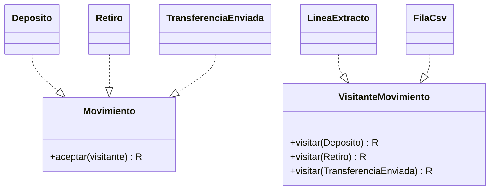
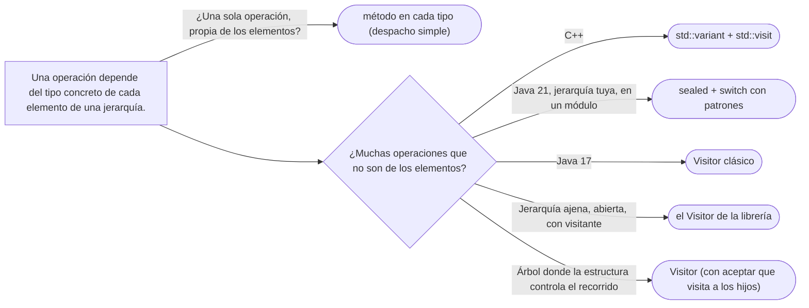

# 07 — Visitor, y lo que lo reemplaza

> Explicar el ***double dispatch*** que Visitor fabrica con dos llamadas, escribir el Visitor clásico, y mostrar
> por qué los tipos sellados con `switch` exhaustivo y `std::variant` con `std::visit` lo reemplazan casi siempre;
> y decir cuándo todavía gana. **Nivel: A.** Se lee suelto; lo que asume, en el recordatorio de §1. Para
> profundizar: [`01/05` §4](../01-modelo-de-objetos/05-polimorfismo-y-despacho.md#4--single-dispatch-y-por-qué-existe-visitor)
> (despacho simple) y [`01/06` §9](../01-modelo-de-objetos/06-herencia-vertical-y-horizontal.md#9--jerarquías-selladas-abiertas-contra-cerradas)
> (el *expression problem*). **Desviación declarada:** la ficha propone la jerarquía de documentos, pero en este
> corpus los documentos se distinguen por un objeto tipo y no por subclases (`02/06`); el ejemplo usa la jerarquía
> de movimientos de una cuenta, que sí es una jerarquía cerrada con datos distintos.
>
> **Vigencia:** 2026-10-03.
>
> **Versiones ejecutadas:** GCC 14.4 (C++23) · JDK 21.0.12, 17.0.20 y 25.0.4 · mermaid-cli 11.17.0 (2026-10-04).

**Salto rápido:** [1](#1--el-problema) · [2](#2--la-estructura) · [4](#4--c-moderno) · [5](#5--java) · [6](#6--cuándo-visitor-todavía-gana) · [9](#9-️-lo-que-cuesta-y-cuándo-no)

---

## 1. 🎯 El problema

**Recordatorio de lo que se asume.** Java y C++ eligen el método al ejecutar mirando el tipo dinámico de **un solo**
objeto, el receptor: es el **despacho simple**. Una jerarquía **sellada** declara la lista cerrada de sus subtipos.
Un `record` es una clase inmutable de datos con su igualdad generada.

Los movimientos de una cuenta son de cinco clases, cada una con sus datos: depósito, retiro (con el cajero),
transferencia enviada (con el destino), transferencia recibida (con el origen) y comisión (con el concepto). Sobre
ellos hay que hacer cada vez más cosas: la línea del extracto, la exportación a CSV, el efecto en el saldo, el informe
para el regulador. La primera versión de cada una es esta:

```java
String lineaExtracto(Movimiento m) {
    if (m instanceof Deposito d)               return "Depósito " + d.monto();
    if (m instanceof Retiro r)                 return "Retiro en " + r.cajero() + " " + r.monto();
    if (m instanceof TransferenciaEnviada t)   return "Enviado a " + t.destino() + " " + t.monto();
    if (m instanceof TransferenciaRecibida t)  return "Recibido de " + t.origen() + " " + t.monto();
    throw new IllegalArgumentException("movimiento desconocido: " + m);   // la comisión, olvidada
}
```

- Cada operación nueva es otra cascada de `instanceof`. Y la de arriba **olvidó la comisión**: compila, y falla al
  ejecutar con el primer extracto que tenga una.
- Meter las operaciones como métodos en `Movimiento` (`lineaExtracto()`, `filaCsv()`, `informeRegulador()`) llena una
  clase de dominio con formatos de presentación y de exportación que no son suyos.

Lo que se quiere es **añadir operaciones** sin tocar los movimientos, y que el compilador avise si una operación
olvida un tipo.

---

## 2. 📐 La estructura

**La intención, en una frase del GoF:** representar una operación que se realiza sobre los elementos de una
estructura de objetos, permitiendo definir operaciones nuevas sin cambiar las clases de los elementos.



- **Element** (`Movimiento`): declara `aceptar(visitante)`.
- **Concrete Element** (`Deposito`, `Retiro`…): implementan `aceptar` llamando al método del visitante **de su propio
  tipo**.
- **Visitor** (`VisitanteMovimiento`): un método `visitar` por cada tipo concreto.
- **Concrete Visitor** (`LineaExtracto`, `FilaCsv`): una operación entera, con un caso por tipo.

**El *double dispatch*, paso a paso.** La operación depende de **dos** tipos —el movimiento y el visitante—, y el
lenguaje solo despacha por uno. Visitor encadena dos despachos simples:

```text
movimiento.aceptar(lineaExtracto)
   1.er despacho, por el tipo dinámico del movimiento   → Retiro.aceptar(v)
   Retiro.aceptar(v) { return v.visitar(this); }        → this es Retiro: la sobrecarga se elige AL COMPILAR
   2.º despacho, por el tipo dinámico del visitante     → LineaExtracto.visitar(Retiro)
```

- El truco está en la segunda línea: dentro de `Retiro`, `this` tiene tipo estático `Retiro`, así que el compilador
  elige `visitar(Retiro)`. Cada clase concreta repite `aceptar` con el mismo cuerpo precisamente por eso: si se
  heredara, `this` sería `Movimiento` y la sobrecarga no sabría a cuál ir.

---

## 3. 🏛️ Cómo nació

El GoF lo presenta con el árbol de sintaxis de un compilador, donde comprobar tipos, generar código y formatear son
operaciones sobre los mismos nodos. En C++98:

```cpp
class Deposito; class Retiro;

class VisitanteMovimiento {
public:
    virtual ~VisitanteMovimiento() {}
    virtual void visitar(const Deposito&) = 0;
    virtual void visitar(const Retiro&) = 0;
};

class Movimiento {
public:
    virtual ~Movimiento() {}
    virtual void aceptar(VisitanteMovimiento& v) const = 0;
};

class Retiro : public Movimiento {
public:
    void aceptar(VisitanteMovimiento& v) const { v.visitar(*this); }   // el segundo despacho
    const std::string& cajero() const { return cajero_; }
private:
    std::string cajero_;
};
```

- Los métodos `visitar` devuelven `void` porque las plantillas virtuales no existen en C++: el resultado se acumula
  en el estado del visitante (`lineaExtracto.resultado()`).
- Añadir una **operación** es una clase visitante nueva, sin tocar los movimientos. Añadir un **tipo** de movimiento
  obliga a tocar la interfaz del visitante y **todos** los visitantes concretos. Esa asimetría es el patrón.

---

## 4. 💻 C++ moderno

Con `std::variant` (C++17) la jerarquía desaparece: los movimientos son **valores** sin base común, y `std::visit`
hace el despacho doble que Visitor fabricaba.

```cpp
struct Deposito              { Dinero monto; };
struct Retiro                { Dinero monto; std::string cajero; };
struct TransferenciaEnviada  { Dinero monto; CuentaId destino; };
struct TransferenciaRecibida { Dinero monto; CuentaId origen; };
struct Comision              { Dinero monto; std::string concepto; };

using Movimiento = std::variant<Deposito, Retiro, TransferenciaEnviada, TransferenciaRecibida, Comision>;

template <class... Ts> struct overloads : Ts... { using Ts::operator()...; };

std::string lineaExtracto(const Movimiento& m) {
    return std::visit(overloads{
        [](const Deposito& d)              { return std::format("Depósito {}", d.monto); },
        [](const Retiro& r)                { return std::format("Retiro en {} {}", r.cajero, r.monto); },
        [](const TransferenciaEnviada& t)  { return std::format("Enviado a {} {}", t.destino, t.monto); },
        [](const TransferenciaRecibida& t) { return std::format("Recibido de {} {}", t.origen, t.monto); },
        [](const Comision& c)              { return std::format("Comisión: {} {}", c.concepto, c.monto); },
    }, m);
}
```

- Si falta el caso de `Comision`, **no compila**: `std::visit` exige que el visitante acepte todas las alternativas.
  Es la comprobación que el `instanceof` de §1 no tenía.
- `overloads` junta varias lambdas en un solo objeto con varios `operator()`; es el idioma que muestra cppreference.
  Desde C++20 no necesita guía de deducción.
- Cada operación es una función con su `std::visit`; no hay `aceptar`, ni base, ni heap. El precio es que añadir un
  tipo exige tocar todas esas funciones, igual que con Visitor; la diferencia es que el compilador las señala.

---

## 5. 💻 Java

**El Visitor clásico**, genérico en el resultado:

```java
public interface VisitanteMovimiento<R> {
    R visitar(Deposito d);
    R visitar(Retiro r);
    R visitar(TransferenciaEnviada t);
    R visitar(TransferenciaRecibida t);
    R visitar(Comision c);
}

public interface Movimiento { <R> R aceptar(VisitanteMovimiento<R> v); }

public record Retiro(Dinero monto, String cajero) implements Movimiento {
    public <R> R aceptar(VisitanteMovimiento<R> v) { return v.visitar(this); }   // repetido en cada record
}
```

**Lo que lo reemplaza: tipos sellados y `switch` exhaustivo** (Java 21). La jerarquía se cierra con `sealed`, los
movimientos son records, y cada operación es un `switch` con patrones que el compilador comprueba:

```java
public sealed interface Movimiento
        permits Deposito, Retiro, TransferenciaEnviada, TransferenciaRecibida, Comision {
    Dinero monto();
}
public record Deposito(Dinero monto) implements Movimiento {}
public record Retiro(Dinero monto, String cajero) implements Movimiento {}
public record TransferenciaEnviada(Dinero monto, CuentaId destino) implements Movimiento {}
public record TransferenciaRecibida(Dinero monto, CuentaId origen) implements Movimiento {}
public record Comision(Dinero monto, String concepto) implements Movimiento {}

static String lineaExtracto(Movimiento m) {
    return switch (m) {                                    // sin default: el compilador conoce los cinco
        case Deposito d               -> "Depósito " + d.monto();
        case Retiro(var monto, var cajero) -> "Retiro en " + cajero + " " + monto;   // record pattern
        case TransferenciaEnviada t   -> "Enviado a " + t.destino() + " " + t.monto();
        case TransferenciaRecibida t  -> "Recibido de " + t.origen() + " " + t.monto();
        case Comision c               -> "Comisión: " + c.concepto() + " " + c.monto();
    };
}
```

- Sin `aceptar`, sin interfaz de visitante, sin `this` repetido. Si mañana aparece `Ajuste`, cada `switch` sobre
  `Movimiento` deja de compilar hasta que lo trate: la misma garantía de Visitor, con un tercio del código.
- El *record pattern* (`Retiro(var monto, var cajero)`, JEP 440) desestructura en el propio caso.
- El pattern matching de `switch` es final en Java 21 (JEP 441).

> 📝 **En Java 17:** los records y `sealed` existen, pero el `switch` con patrones de tipo no. Las opciones son el
> Visitor clásico, que da exhaustividad por la interfaz del visitante, o una cadena de `if (m instanceof Retiro r)`,
> que no la da. Si el proyecto está en 17, Visitor sigue siendo la forma de que el compilador avise del caso olvidado.

---

## 6. 🔀 Cuándo Visitor todavía gana

Los tipos sellados no lo reemplazan **siempre**:

- **En Java 17**, como dice el callout de §5.
- **Cuando la jerarquía no es tuya y no está sellada.** Una librería que expone una jerarquía abierta y una interfaz
  de visitante —`javax.lang.model.element.ElementVisitor` para los elementos del compilador, los visitantes de ASM
  para el *bytecode*— es la única vía que da exhaustividad sin poder sellar.
- **Cuando los tipos no pueden vivir juntos.** La JLS exige que una clase sellada y sus subclases permitidas estén en
  el mismo módulo, o en el mismo paquete si no hay módulos. Una jerarquía repartida entre módulos no se puede sellar.
- **Cuando el recorrido es parte de la operación.** En un árbol (un Composite), el `aceptar` del nodo compuesto puede
  visitar a sus hijos: la estructura controla el recorrido y el visitante solo aporta qué hacer en cada nodo. Con un
  `switch`, el recorrido lo escribe cada operación.

> 📝 **En Java 25:** el patrón sin nombre `_` (JEP 456, final desde Java 22) deja ignorar los componentes que el caso
> no usa: `case Retiro(var monto, _) -> …`. Es un detalle de legibilidad que hace aún más corto el reemplazo de
> Visitor.

Las uniones discriminadas de TypeScript resuelven lo mismo con un campo `tipo` y el estrechamiento del compilador;
tienen su sitio en [`11/02`](../11-los-diferentes/02-javascript-y-typescript.md).

---

## 7. ⚖️ Con qué se confunde

| Se confunde con | La diferencia, en una frase |
|---|---|
| **Iterator** | El Iterator **recorre** una colección; el Visitor **despacha** una operación por el tipo de cada elemento. Pueden ir juntos, pero recorrer no es visitar |
| **Composite** | El Composite es la **estructura**; el Visitor, una forma de llevar **operaciones** por ella sin meterlas en los nodos (ver [`05/05`](../05-estructurales/05-composite.md)) |
| **Strategy** | La estrategia es **una** operación intercambiable; el visitante es una operación con **un caso por tipo** |
| **Sobrecarga** | La sobrecarga se resuelve **al compilar** por el tipo estático; el Visitor la usa dentro de `aceptar`, donde el tipo estático ya es el concreto |

**La sobregeneralización.** "Visitor es para recorrer árboles" nace de que casi todos los ejemplos son árboles
(sintaxis, archivos) y de nombres como `FileVisitor`. Pero el patrón es el *double dispatch*: elegir la operación por
el tipo de dos objetos. Una lista plana de movimientos lo necesita igual que un árbol. Y "con sealed types Visitor no
sirve nunca" ignora los cuatro casos de §6.

---

## 8. 🔭 Dónde aparece de verdad

- **El compilador de Java**: `javax.lang.model.element.ElementVisitor` y los procesadores de anotaciones, que recorren
  clases, métodos y campos con visitantes.
- **`java.nio.file.FileVisitor`** con `Files.walkFileTree`: se llama visitante, pero es sobre todo un recorrido con
  *callbacks* (`preVisitDirectory`, `visitFile`), con solo dos tipos de nodo. Es el ejemplo que alimenta la confusión
  de §7.
- **Herramientas de *bytecode* y de análisis**: ASM, los analizadores de código estático, Clang.
- **C++**: `std::visit` sobre `std::variant`, que es el reemplazo dentro de la propia librería estándar.

---

## 9. 🏷️ Lo que cuesta, y cuándo no

**El precio**, en las cuatro monedas:

- **Acoplamiento:** el visitante conoce **todos** los tipos concretos, y cada tipo conoce la interfaz del visitante.
  Añadir un tipo de movimiento toca la interfaz y todos los visitantes.
- **Encapsulación:** el visitante necesita acceder a los datos de cada elemento, así que los elementos exponen lo que
  quizá no expondrían. Con records, eso ya está expuesto por diseño.
- **Indirección y legibilidad:** dos llamadas para una operación, un `aceptar` idéntico copiado en cada clase, y un
  flujo que salta de elemento a visitante y vuelve. Es el patrón del GoF más difícil de leer para quien no lo conoce.
- **Rendimiento:** dos llamadas virtuales por elemento; irrelevante casi siempre, y `std::visit` lo resuelve con una
  tabla.

**Cuándo no.**

- **Java 21 con una jerarquía tuya**: `sealed` + `switch` con patrones da lo mismo con mucho menos código.
- **C++ con tipos que son valores**: `std::variant` + `std::visit`.
- **Una sola operación, o pocos tipos que cambian a menudo**: un método en cada tipo (despacho simple) es lo natural.

> **Veredicto:** en Java 21 y C++17 en adelante, para operaciones sobre una jerarquía cerrada que es tuya, tipos
> sellados con `switch` exhaustivo o `std::variant` con `std::visit`. Visitor clásico en Java 17, sobre jerarquías
> abiertas de librerías que lo ofrecen, o cuando la estructura debe controlar el recorrido.

---

## 10. 🧭 Cómo se elige



**La frase en voz alta:** *"Visitor existe porque Java y C++ solo despachan por el tipo del receptor, y las operaciones
sobre movimientos dependen del tipo de cada uno. En Java 21 lo resuelvo con un `sealed interface` y un `switch`
exhaustivo: si aparece un tipo nuevo, el compilador me marca cada operación que no lo trata. Visitor lo usaría en Java
17 o sobre una jerarquía que no puedo sellar."*

---

## ⚠️ Errores frecuentes

| Se dice | Lo preciso |
|---|---|
| "Visitor es para recorrer árboles" | Es *double dispatch*: elegir la operación por el tipo de dos objetos; vale igual en una lista plana |
| "Con sealed types Visitor no sirve nunca" | Sigue ganando en Java 17, en jerarquías ajenas abiertas, entre módulos, y cuando la estructura controla el recorrido |
| "Visitor facilita añadir tipos" | Facilita añadir **operaciones**; un tipo nuevo obliga a tocar todos los visitantes |
| "El `aceptar` se puede heredar de la base" | Dentro de la base `this` tiene el tipo estático de la base y la sobrecarga no sabe a qué `visitar` ir |
| "`FileVisitor` es el ejemplo del patrón" | Es más un recorrido con *callbacks* que un despacho por tipo |
| "Un `switch` sobre tipos es un olor de código" | Con una jerarquía sellada y exhaustividad comprobada, es la forma moderna del patrón |
| "`std::visit` es más lento que la herencia" | Despacha con una tabla generada al compilar; no hay asignación ni llamada virtual |

---

## 📚 Para profundizar

- **Libro** — Gamma, Helm, Johnson y Vlissides, *Design Patterns* (Addison-Wesley, 1994), cap. 5, "Behavioral
  Patterns", sección "Visitor": el compilador, y la asimetría entre añadir operaciones y añadir tipos.
- **Libro** — Iglberger, *C++ Software Design* (O'Reilly, 2022), cap. 4, "The Visitor Design Pattern": el Visitor
  clásico frente a `std::variant`. **El que destaca.**
- [JEP 441 — Pattern Matching for switch](https://openjdk.org/jeps/441): final en Java 21.
- [JEP 456 — Unnamed Variables & Patterns](https://openjdk.org/jeps/456): el `_` en patrones, final en Java 22.
- [JLS 21 §8.1.1.2 — Sealed, Non-sealed, and Final Classes](https://docs.oracle.com/javase/specs/jls/se21/html/jls-8.html#jls-8.1.1.2):
  la regla del mismo módulo o paquete.
- [cppreference — `std::visit`](https://en.cppreference.com/cpp/utility/variant/visit): el despacho sobre
  `std::variant`, con el idioma `overloads`.
- [Java 21 API — `ElementVisitor`](https://docs.oracle.com/en/java/javase/21/docs/api/java.compiler/javax/lang/model/element/ElementVisitor.html):
  un Visitor de verdad en el JDK.
- **Material suplementario** — CppCon 2022, Klaus Iglberger: *Breaking Dependencies: The Visitor Design Pattern*.

---

## 🧠 Preguntas

Sin respuestas aquí. Todas, con enunciado literal y respuesta en tres capas, en
[`11` — Respuestas](11-respuestas.md#07--visitor-y-lo-que-lo-reemplaza).

1. ¿Cuál es la intención del Visitor? 🟢
2. ¿Qué es el *double dispatch*? 🟢
3. ¿Qué hace `std::visit`? 🟢
4. ¿Qué es un *record pattern* en Java? 🟢
5. ¿Qué diferencia hay entre Visitor y un `switch` exhaustivo sobre tipos sellados? 🟡
6. ¿Qué diferencia hay entre Visitor e Iterator? 🟡
7. ¿Qué diferencia hay entre el Visitor clásico en C++ y `std::variant` con `std::visit`? 🟡
8. ¿Qué diferencia hay entre añadir una operación y añadir un tipo con Visitor? 🟡
9. ¿Qué diferencia hay entre Visitor y sobrecarga de métodos? 🟡
10. ¿Por qué `aceptar` se repite en cada clase concreta y no se hereda? 🟠
11. ¿Por qué "Visitor es para recorrer árboles" es impreciso? 🟠
12. ¿Cuándo Visitor todavía gana a los tipos sellados? 🟠
13. ¿Qué haces en Java 17 si quieres exhaustividad sobre una jerarquía? 🟠
14. ¿Por qué el `instanceof` encadenado de §1 es peor que las dos alternativas? 🟠
15. Escribe el Visitor clásico en Java para `lineaExtracto` sobre tres tipos de movimiento. 🔴
16. Reemplaza ese Visitor por una interfaz sellada con records y un `switch` exhaustivo. 🔴
17. Escribe en C++ el efecto de cada movimiento en el saldo con `std::variant` y `std::visit`. 🔴
18. Revisa este código: un `switch (m)` sobre `Movimiento` sellado con `default -> throw new
    IllegalStateException()`. Di qué pierde y cómo lo corriges. 🔴

---

**Anterior:** [`06` — State](06-state.md) ·
**Siguiente:** [`08` — Iterator y Mediator](08-iterator-y-mediator.md) ·
**Relacionado:** [`05/05` — Composite](../05-estructurales/05-composite.md)
