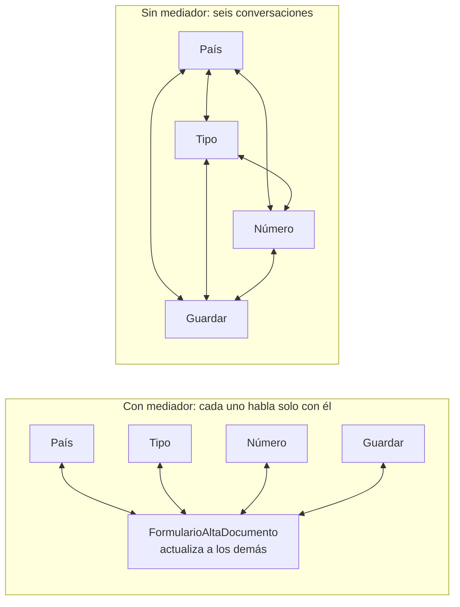
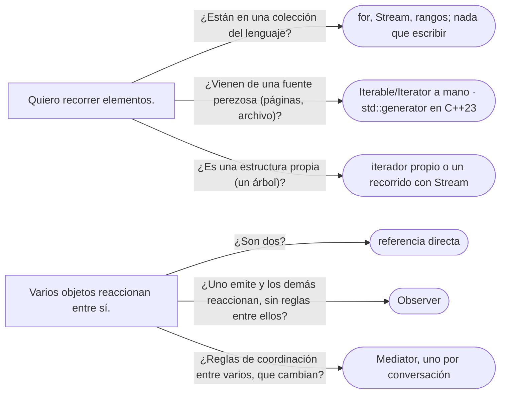

# 08 — Iterator y Mediator

> Dos patrones de nivel B con destinos opuestos: **Iterator**, que el lenguaje absorbió hasta volverlo casi
> invisible —y por eso casi nunca se escribe a mano—, y **Mediator**, que centraliza la coordinación entre objetos
> y corre el riesgo de convertirse en el objeto que lo sabe todo. **Niveles:** Iterator B · Mediator B. Asume leído
> [`05/05` — Composite](../05-estructurales/05-composite.md) y [`03` — Observer](03-observer.md).
>
> **Vigencia:** 2026-10-03.
>
> **Versiones ejecutadas:** JDK 21.0.12, 17.0.20 y 25.0.4 (2026-10-04).

---

## 1. 🎯 El problema

Dos situaciones del sistema de cuentas:

- El extracto de un año de la cuenta de Ana tiene cuarenta mil movimientos. El repositorio los devuelve en una
  `List`, cargados todos en memoria, aunque la pantalla muestre veinte y la exportación los procese de a uno.
- El formulario de alta de documentos tiene un selector de país, uno de tipo de documento, el campo del número y el
  botón de guardar. Cambiar el país cambia los tipos disponibles; cambiar el tipo cambia el formato del número; un
  número válido habilita el botón. Hoy cada componente tiene referencias a los otros tres y los actualiza él mismo.

La primera es un problema de **recorrido**: cómo entregar elementos de uno en uno sin exponer cómo están guardados.
La segunda, de **coordinación**: cómo hacer que varios objetos reaccionen entre sí sin que cada uno conozca a todos.

---

## 2. 🧱 Iterator

**Problema.** Recorrer los elementos de una colección sin exponer su representación —un arreglo, un árbol, páginas
de una base de datos— y sin que cada recorrido tenga que saber cómo está hecha.

**Mecanismo.** Un objeto aparte, el iterador, guarda la **posición** del recorrido y ofrece "¿hay otro?" y "dame el
siguiente". La colección solo sabe crear iteradores. En Java es el par `Iterable` / `Iterator`; en C++, el par
`begin()` / `end()` de iteradores. Los dos lenguajes lo absorbieron en la sintaxis: el `for` mejorado de Java y el
`for` de rango de C++ llaman al iterador sin que se vea.

**Código.** Escribirlo a mano tiene sentido cuando la fuente **no es una colección en memoria**: los movimientos de
un año, leídos por páginas.

```java
public final class MovimientosDeCuenta implements Iterable<Movimiento> {
    private final RepositorioMovimientos repo;
    private final CuentaId cuenta;
    private final int tamanioPagina;

    public MovimientosDeCuenta(RepositorioMovimientos repo, CuentaId cuenta, int tamanioPagina) {
        this.repo = repo; this.cuenta = cuenta; this.tamanioPagina = tamanioPagina;
    }

    @Override public Iterator<Movimiento> iterator() {
        return new Iterator<>() {
            private List<Movimiento> pagina = List.of();
            private int posicion = 0, numeroPagina = 0;
            private boolean agotado = false;

            @Override public boolean hasNext() {
                if (posicion < pagina.size()) return true;
                if (agotado) return false;
                pagina = repo.pagina(cuenta, numeroPagina++, tamanioPagina);   // la siguiente, al necesitarla
                posicion = 0;
                agotado = pagina.size() < tamanioPagina;
                return !pagina.isEmpty();
            }
            @Override public Movimiento next() {
                if (!hasNext()) throw new NoSuchElementException();
                return pagina.get(posicion++);
            }
        };
    }
}

for (Movimiento m : new MovimientosDeCuenta(repo, cta0001, 500)) exportador.escribir(m);   // 500 en memoria, no 40 000
```

- Quien recorre usa un `for` normal y no sabe que hay páginas. Cada llamada a `iterator()` empieza un recorrido nuevo,
  con su propia posición: dos recorridos simultáneos no se pisan.
- Para casi todo lo demás, **no se escribe**: las colecciones del JDK traen el suyo, y `Stream` cubre los recorridos
  con transformación.

La trampa que hay que conocer es el iterador ***fail-fast*** (que falla rápido): los de `ArrayList` y `HashMap` lanzan
`ConcurrentModificationException` si la colección cambia estructuralmente durante el recorrido, salvo a través del
propio iterador.

```java
for (Documento d : documentos) if (d.vencido(hoy)) documentos.remove(d);   // ConcurrentModificationException
documentos.removeIf(d -> d.vencido(hoy));                                   // correcto: lo hace la colección
```

- La Javadoc lo dice: la excepción no siempre indica otro hilo; un solo hilo que modifica la colección mientras la
  recorre la provoca. Y avisa de que el comportamiento *fail-fast* no está garantizado: es para detectar errores, no
  para programar con él.

En C++ el contraste es el par de iteradores y, desde C++20, los **rangos**, que componen recorridos sin bucles
(`movs | std::views::filter(esRetiro)`); y desde C++23, `std::generator`, una corrutina que entrega elementos con
`co_yield`, que es la forma más corta de escribir un iterador a mano. Java no tiene generadores: el equivalente es un
`Iterator` como el de arriba o un `Spliterator` para `Stream`.

**Cuándo sí y cuándo no.** Sí, a mano, para fuentes que no están en memoria (páginas, archivos, cursores) o estructuras
propias (un Composite que se recorre en profundidad). No para colecciones normales, ni para "exponer la lista sin
exponerla": para eso basta devolver una vista no modificable o un `Stream`.

> **Veredicto:** Iterator es una característica del lenguaje, y se usa todos los días sin escribirlo. A mano, solo
> para fuentes perezosas o estructuras propias; y en un recorrido, la colección se modifica con `removeIf` o con el
> propio iterador, nunca por fuera.

---

## 3. 🧱 Mediator

**Problema.** Varios objetos tienen que reaccionar entre sí, y si cada uno conoce a los demás, las relaciones son una
malla: cuatro componentes, doce referencias cruzadas. Cambiar una regla de coordinación obliga a tocar varios
componentes, y ninguno se puede reutilizar sin arrastrar a los otros.

**Mecanismo.** Un objeto mediador concentra la coordinación. Los componentes (los "colegas") solo conocen al
mediador: le avisan de lo que les pasa, y el mediador decide a quién más afecta y qué hacer.



**Código.** Java, con los componentes del formulario como colegas:

```java
public final class FormularioAltaDocumento {                // el mediador
    private final SelectorPais pais;
    private final SelectorTipo tipo;
    private final CampoNumero numero;
    private final BotonGuardar guardar;
    private final CatalogoTipos catalogo;

    public FormularioAltaDocumento(SelectorPais p, SelectorTipo t, CampoNumero n, BotonGuardar g, CatalogoTipos c) {
        pais = p; tipo = t; numero = n; guardar = g; catalogo = c;
        pais.alCambiar(this::paisCambio);                   // los colegas avisan; no se conocen entre sí
        tipo.alCambiar(this::tipoCambio);
        numero.alCambiar(this::numeroCambio);
    }

    private void paisCambio(Pais p)          { tipo.opciones(catalogo.dePais(p)); numero.limpiar(); }
    private void tipoCambio(TipoDocumento t) { numero.formato(t.formato()); numeroCambio(numero.valor()); }
    private void numeroCambio(String valor)  {
        TipoDocumento t = tipo.seleccionado();
        guardar.habilitado(t != null && t.formato().matcher(valor).matches());
    }
}
```

- Las reglas de coordinación —qué pasa al cambiar el país— están en un solo sitio. `SelectorPais` no sabe que existe
  un campo de número, y se puede usar en otro formulario.
- Los colegas avisan al mediador con un Observer (`alCambiar`); el mediador los manda directamente. Es la diferencia
  con el Observer puro: aquí hay alguien que **decide** quién reacciona.

En C++ la forma es la misma, con el mediador recibiendo referencias que no posee y los colegas registrando
`std::function`; el patrón no cambia de lenguaje. En el *backend*, el equivalente es un servicio que orquesta a
varios colaboradores para un caso de uso; y en .NET, la librería MediatR popularizó el nombre para despachar comandos
a sus manejadores, que es un uso más amplio que el del GoF.

**Cuándo sí y cuándo no.** Sí cuando la coordinación entre varios objetos es compleja y cambia, y se quiere en un
sitio. No cuando son dos objetos (una referencia directa basta), ni cuando el mediador empieza a acumular las reglas
de **todo**: el mediador que coordina diez pantallas y cuarenta componentes es el God Object, que tiene su capítulo en
[`12/03` §2](../12-antipatrones/03-antipatrones-de-diseno-oo.md#2-️-god-object).

> **Veredicto:** Mediator cuando varios colegas reaccionan entre sí con reglas que cambian, para que esas reglas vivan
> en un sitio y los colegas no se conozcan. Uno por conversación, no uno para la aplicación: el mediador que lo
> coordina todo es una clase dios.

---

## 4. ⚖️ Con qué se confunden

| Se confunde con | La diferencia, en una frase |
|---|---|
| **Iterator / Visitor** | El Iterator decide **qué elemento sigue**; el Visitor, **qué se hace** según el tipo de cada uno (ver [`07`](07-visitor.md)) |
| **Iterator / `Stream`** | El `Stream` es un recorrido de un solo uso con operaciones encadenadas; el `Iterable` se puede recorrer muchas veces |
| **Mediator / Observer** | En el Observer el emisor no sabe quién reacciona y nadie decide; en el Mediator, el mediador decide quién reacciona y cómo (ver [`03`](03-observer.md)) |
| **Mediator / Facade** | La fachada simplifica un subsistema que **no la conoce**; los colegas **sí** conocen al mediador y le hablan (ver [`05/04`](../05-estructurales/04-facade.md)) |

**La sobregeneralización.** "Hay que implementar Iterator a mano" viene de los libros escritos antes del `for`
mejorado y del `for` de rango. Hoy el iterador lo trae cada colección y lo llama la sintaxis; escribirlo es la
excepción, para fuentes perezosas o estructuras propias.

---

## 5. 🧭 Cómo se elige



**La frase en voz alta:** *"Iterator ya está en el lenguaje; solo lo escribo para leer los movimientos de un año por
páginas sin cargarlos todos. Mediator lo usaría para un formulario donde país, tipo y número dependen entre sí:
las reglas en el mediador, y los componentes sin conocerse."*

---

## ⚠️ Errores frecuentes

| Se dice | Lo preciso |
|---|---|
| "Hay que implementar Iterator a mano" | Lo trae cada colección y lo llama el `for`; a mano, solo para fuentes perezosas o estructuras propias |
| "`ConcurrentModificationException` significa otro hilo" | Un solo hilo que modifica la colección mientras la recorre la provoca |
| "El *fail-fast* garantiza detectar la modificación" | La Javadoc dice que no está garantizado: sirve para detectar errores, no para programar con él |
| "Un `Stream` es un `Iterable`" | El `Stream` se consume una vez; el `Iterable` da un iterador nuevo en cada recorrido |
| "Mediator y Observer son lo mismo" | El mediador decide quién reacciona; en el Observer nadie decide |
| "Un mediador para toda la aplicación simplifica" | Es un God Object: uno por conversación |

---

## 📚 Para profundizar

- **Libro** — Gamma, Helm, Johnson y Vlissides, *Design Patterns* (Addison-Wesley, 1994), cap. 5, "Behavioral
  Patterns", secciones "Iterator" y "Mediator": el iterador externo e interno, y los "directores de diálogo".
- **Libro** — Freeman y Robson, *Head First Design Patterns*, 2.ª ed. (O'Reilly, 2021), cap. 9, "The Iterator and
  Composite Patterns". **El que destaca** para Iterator.
- [Java 21 API — `ConcurrentModificationException`](https://docs.oracle.com/en/java/javase/21/docs/api/java.base/java/util/ConcurrentModificationException.html):
  los iteradores *fail-fast* y sus límites.
- [Java 21 API — `Iterable`](https://docs.oracle.com/en/java/javase/21/docs/api/java.base/java/lang/Iterable.html):
  el contrato que usa el `for` mejorado.
- [cppreference — `std::generator`](https://en.cppreference.com/cpp/coroutine/generator): el iterador como
  corrutina, en C++23.
- **Tutorial** — [Refactoring Guru — Mediator](https://refactoring.guru/design-patterns/mediator).

---

## 🧠 Preguntas

Sin respuestas aquí. Todas, con enunciado literal y respuesta en tres capas, en
[`11` — Respuestas](11-respuestas.md#08--iterator-y-mediator).

1. ¿Cuál es la intención del Iterator? 🟢
2. ¿Qué es un iterador *fail-fast*? 🟢
3. ¿Cuál es la intención del Mediator? 🟢
4. ¿Qué es `std::generator`? 🟢
5. ¿Qué diferencia hay entre `Iterable` y `Stream`? 🟡
6. ¿Qué diferencia hay entre Mediator y Observer? 🟡
7. ¿Qué diferencia hay entre Mediator y Facade? 🟡
8. ¿Qué diferencia hay entre el par `begin()`/`end()` de C++ y el `Iterator` de Java? 🟡
9. ¿Por qué "hay que implementar Iterator a mano" es una idea vieja? 🟠
10. ¿Cuándo sí escribirías un iterador a mano? 🟠
11. ¿Cuándo un Mediator se convierte en un God Object? 🟠
12. ¿Por qué quitar elementos dentro de un `for` mejorado lanza `ConcurrentModificationException`, y cómo se hace
    bien? 🟠
13. Escribe un `Iterable<Movimiento>` que lea los movimientos de una cuenta por páginas. 🔴
14. Rediseña con un Mediator el formulario de alta en el que país, tipo y número se actualizan unos a otros con
    referencias cruzadas. 🔴

---

**Anterior:** [`07` — Visitor, y lo que lo reemplaza](07-visitor.md) ·
**Siguiente:** [`09` — Memento e Interpreter](09-memento-e-interpreter.md) ·
**Relacionado:** [`05/05` — Composite](../05-estructurales/05-composite.md)
