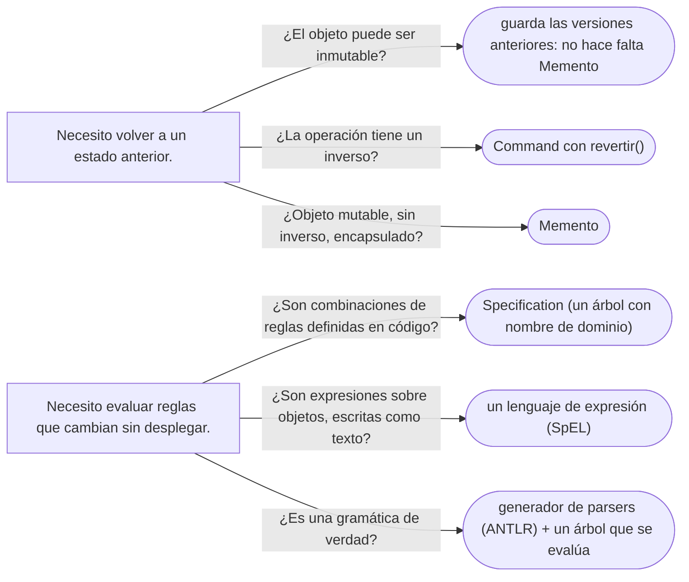

# 09 — Memento e Interpreter

> Dos fichas de nivel C para responder con criterio "¿conoces Memento?" y "¿conoces Interpreter?": qué pretendían,
> un ejemplo mínimo de cada uno, por qué hoy casi no se escriben y qué ocupó su lugar. **Niveles:** Memento C ·
> Interpreter C. Asume leído [`04` — Command](04-command.md) y
> [`05/05` — Composite](../05-estructurales/05-composite.md).
>
> **Vigencia:** 2026-10-03.
>
> **Versiones ejecutadas:** JDK 21.0.12, 17.0.20 y 25.0.4 · .NET 10.0.12 (C# 14) (2026-10-04).

---

## 1. 🎯 El problema

Dos peticiones del negocio que el GoF resolvía con un patrón cada una:

- El formulario de edición de una persona tiene que permitir **deshacer** los últimos cambios —el nombre, la
  dirección, el contacto— antes de guardar. Para volver atrás hay que guardar el estado anterior, y `Persona` no
  expone sus campos internos.
- Los requisitos de una campaña se escriben como texto en la configuración: `edad >= 18 Y pais = CO`. Hay que
  evaluarlos sobre cada persona sin desplegar código cada vez que cambian.

Los dos patrones existen todavía en los libros y en las entrevistas, y casi nadie los escribe ya en su forma original.

---

## 2. 🧱 Memento

**Intención.** Capturar y guardar el estado interno de un objeto sin romper su encapsulación, para poder restaurarlo
después. El objeto (el *originator*) crea el memento y es el único que sabe leerlo; quien lo guarda (el
*caretaker*) solo lo almacena.

**Ejemplo mínimo.**

```java
public final class BorradorPersona {                         // el originator: mutable mientras se edita
    private String nombre;
    private Direccion domicilio;

    public record Instantanea(String nombre, Direccion domicilio) {}   // el memento: inmutable

    public Instantanea guardar() { return new Instantanea(nombre, domicilio); }
    public void restaurar(Instantanea i) { nombre = i.nombre(); domicilio = i.domicilio(); }
    public void cambiarNombre(String n) { nombre = n; }
}

Deque<BorradorPersona.Instantanea> historial = new ArrayDeque<>();   // el caretaker
historial.push(borrador.guardar());
borrador.cambiarNombre("Ana María Rojas Medina");
borrador.restaurar(historial.pop());                                 // deshacer
```

- El historial guarda instantáneas que no puede modificar; solo el borrador sabe aplicarlas. En C++, el GoF lo
  conseguía con una clase memento de interfaz estrecha y `friend` para el originator.

**Por qué hoy es raro.** Porque la **inmutabilidad** lo hace innecesario: si cada cambio produce una `Persona` nueva
en lugar de modificar la misma, "guardar el estado anterior" es guardar la referencia al objeto anterior. Una lista de
versiones inmutables **es** el historial de deshacer, sin memento, sin restaurar y sin riesgo de que la instantánea
comparta algo mutable con el original.

**Qué lo reemplazó.** Los objetos inmutables con métodos que devuelven una copia cambiada (`conNombre(...)`), el
estado de las interfaces gestionado como una secuencia de valores, y, cuando lo que se quiere guardar es la historia
del negocio, un **historial de eventos** del que se reconstruye el estado (los eventos de dominio están en [`09/02`](../09-ddd-tactico-y-otros/02-eventos-servicios-y-fabricas.md)); o el comando con su inverso cuando la
operación se puede compensar (ver [`04`](04-command.md)).

---

## 3. 🧱 Interpreter

**Intención.** Dada una gramática pequeña, representar cada regla como una clase, y evaluar una frase del lenguaje
recorriendo el árbol de objetos que la representa. Es un Composite (el árbol) con una operación `interpretar`.

**Ejemplo mínimo.** La gramática de los requisitos: comparaciones unidas con `Y` y `O`. Con tipos sellados, el árbol
es datos y la interpretación una función:

```java
public sealed interface Requisito permits EdadMinima, PaisEs, Y, O {}
public record EdadMinima(int anios) implements Requisito {}
public record PaisEs(String iso) implements Requisito {}
public record Y(Requisito izq, Requisito der) implements Requisito {}
public record O(Requisito izq, Requisito der) implements Requisito {}

static boolean cumple(Requisito r, Persona p, LocalDate hoy) {
    return switch (r) {
        case EdadMinima e -> p.edad(hoy) >= e.anios();
        case PaisEs c     -> p.nacionalidad().codigoIso().equals(c.iso());
        case Y y          -> cumple(y.izq(), p, hoy) && cumple(y.der(), p, hoy);
        case O o          -> cumple(o.izq(), p, hoy) || cumple(o.der(), p, hoy);
    };
}

Requisito campana = new Y(new EdadMinima(18), new PaisEs("CO"));   // "edad >= 18 Y pais = CO"
boolean anaCumple = cumple(campana, ana, LocalDate.of(2026, 10, 3)); // → true
```

- En la forma del GoF, cada clase tendría su método `interpretar(contexto)`; con tipos sellados, el árbol es datos y
  la interpretación vive en una función, como en `07`.
- Falta la mitad que el patrón **no** cubre: convertir el texto `edad >= 18 Y pais = CO` en ese árbol. El GoF lo deja
  fuera a propósito; es el trabajo de un *parser*.

**Por qué hoy es raro.** Porque en cuanto la gramática crece un poco —precedencia, paréntesis, funciones—, escribir
el *parser* y el intérprete a mano es más trabajo y más errores que usar una herramienta, y porque la mayoría de los
"lenguajes" de negocio que se plantean son expresiones que una librería ya evalúa.

**Qué lo reemplazó.** Los lenguajes de expresión embebidos (SpEL en Spring, que evalúa `#persona.edad >= 18` contra
un objeto), los motores de reglas, los generadores de *parsers* como ANTLR para las gramáticas de verdad, y, para
reglas combinables definidas en código, el patrón Specification ([`09/03`](../09-ddd-tactico-y-otros/03-specification-null-object-y-type-object.md)), que es este mismo árbol con nombre de dominio.

> 📝 **En Java 17:** los records y la interfaz sellada existen; el `switch` con patrones de tipo es de Java 21. En
> 17, `cumple` se escribe con `if (r instanceof Y y) …` encadenados, o con un método `cumple(p, hoy)` abstracto en la
> interfaz que cada record implementa, que es la forma del GoF.
---

## 4. 🔀 El árbol de reglas en otros lenguajes

La parte del Interpreter que sigue viva —una regla como árbol de objetos— aparece en el propio lenguaje en algunos
casos, y ahí deja de ser un patrón que se escribe:

> 📝 **En C#:** las *expression trees* son un Interpreter en el lenguaje. Una lambda asignada a
> `Expression<Func<Persona, bool>>` no se compila a código: se convierte en un árbol de objetos que se puede
> recorrer, y los proveedores de LINQ (Entity Framework) lo **traducen** a SQL en lugar de evaluarlo. Es el mismo
> árbol del patrón, generado por el compilador.


- En Java no hay nada equivalente en el lenguaje; los *Criteria* de JPA y la `Specification` de Spring Data
  construyen árboles parecidos a mano, con una API.

---

## 5. ⚖️ Con qué se confunden

| Se confunde con | La diferencia, en una frase |
|---|---|
| **Memento / Command** | El Memento guarda el **estado** para restaurarlo; el Command guarda la **operación** para invertirla o repetirla |
| **Memento / Prototype** | El Prototype copia un objeto para usar la copia; el Memento guarda una instantánea que solo sirve para volver atrás |
| **Interpreter / Composite** | El Interpreter **es** un Composite cuya operación es evaluar una gramática (ver [`05/05`](../05-estructurales/05-composite.md)) |
| **Interpreter / un compilador** | El patrón cubre la evaluación de un árbol ya construido; el análisis del texto y todo lo demás quedan fuera |

**La sobregeneralización.** "Interpreter se usa para escribir lenguajes" promete demasiado: el patrón sirve para
gramáticas **pequeñas** y estables, y no dice nada de cómo se lee el texto. Para un lenguaje de verdad, el GoF mismo
recomienda herramientas como generadores de *parsers*; lo que queda del patrón es la idea de que una regla puede ser
un árbol de objetos que se evalúa.

---

## 6. 🧭 Cómo se elige



**La frase en voz alta:** *"Memento lo reemplazó la inmutabilidad: si cada versión es un objeto nuevo, deshacer es
volver a la anterior. Interpreter es un Composite que evalúa una gramática pequeña; para leer el texto uso un parser o
un lenguaje de expresión ya hecho, y la idea del árbol de reglas sigue viva en el patrón Specification."*

---

## ⚠️ Errores frecuentes

| Se dice | Lo preciso |
|---|---|
| "Interpreter se usa para escribir lenguajes" | Sirve para gramáticas pequeñas y no cubre el análisis del texto; los lenguajes de verdad usan herramientas |
| "Memento es copiar el objeto" | Es una instantánea que solo el originador sabe leer, para no romper su encapsulación |
| "Para deshacer hace falta Memento" | Con objetos inmutables basta guardar las versiones anteriores; con operaciones reversibles, el inverso |
| "Un memento puede compartir listas con el original" | Si comparte algo mutable, el original lo cambia y la instantánea deja de ser el pasado |
| "Interpreter y Visitor son alternativas" | Se combinan: el Visitor (o un `switch` sellado) es una forma de interpretar el árbol |

---

## 📚 Para profundizar

- **Libro** — Gamma, Helm, Johnson y Vlissides, *Design Patterns* (Addison-Wesley, 1994), cap. 5, "Behavioral
  Patterns", secciones "Memento" e "Interpreter". **El que destaca.**
- **Libro** — Nystrom, *Game Programming Patterns* (2014), cap. "Bytecode", libre en
  [su sitio](https://gameprogrammingpatterns.com/bytecode.html): por qué un intérprete de árbol es lento y qué se hace
  en su lugar.
- [Spring Framework — Spring Expression Language](https://docs.spring.io/spring-framework/reference/core/expressions.html):
  un lenguaje de expresión ya hecho.
- [C# — Expression trees](https://learn.microsoft.com/en-us/dotnet/csharp/advanced-topics/expression-trees/): código
  como datos.
- **Tutorial** — [Refactoring Guru — Memento](https://refactoring.guru/design-patterns/memento).

---

## 🧠 Preguntas

Sin respuestas aquí. Todas, con enunciado literal y respuesta en tres capas, en
[`11` — Respuestas](11-respuestas.md#09--memento-e-interpreter).

1. ¿Cuál es la intención de Memento? 🟢
2. ¿Cuál es la intención de Interpreter? 🟢
3. ¿Qué papeles tienen el *originator* y el *caretaker*? 🟢
4. ¿Qué son las *expression trees* de C#? 🟢
5. ¿Qué diferencia hay entre deshacer con Memento y con objetos inmutables? 🟡
6. ¿Qué diferencia hay entre Interpreter y Composite? 🟡
7. ¿Qué diferencia hay entre Memento y Command para deshacer? 🟡
8. ¿Por qué "Interpreter se usa para escribir lenguajes" es una sobregeneralización? 🟠
9. ¿Qué reemplazó a Memento, y por qué? 🟠
10. ¿Cuándo usarías SpEL o un motor de reglas en lugar de escribir un Interpreter? 🟠
11. Escribe un Memento para un borrador de persona con nombre y dirección, y un historial de deshacer. 🔴
12. Extiende el árbol de requisitos de §3 con una negación (`NO`) y evalúa "mayor de edad y no mexicano". 🔴

---

**Anterior:** [`08` — Iterator y Mediator](08-iterator-y-mediator.md) ·
**Siguiente:** [`10` — Simulación de entrevista](10-simulacion-de-entrevista.md) ·
**Relacionado:** [`04` — Command](04-command.md)
