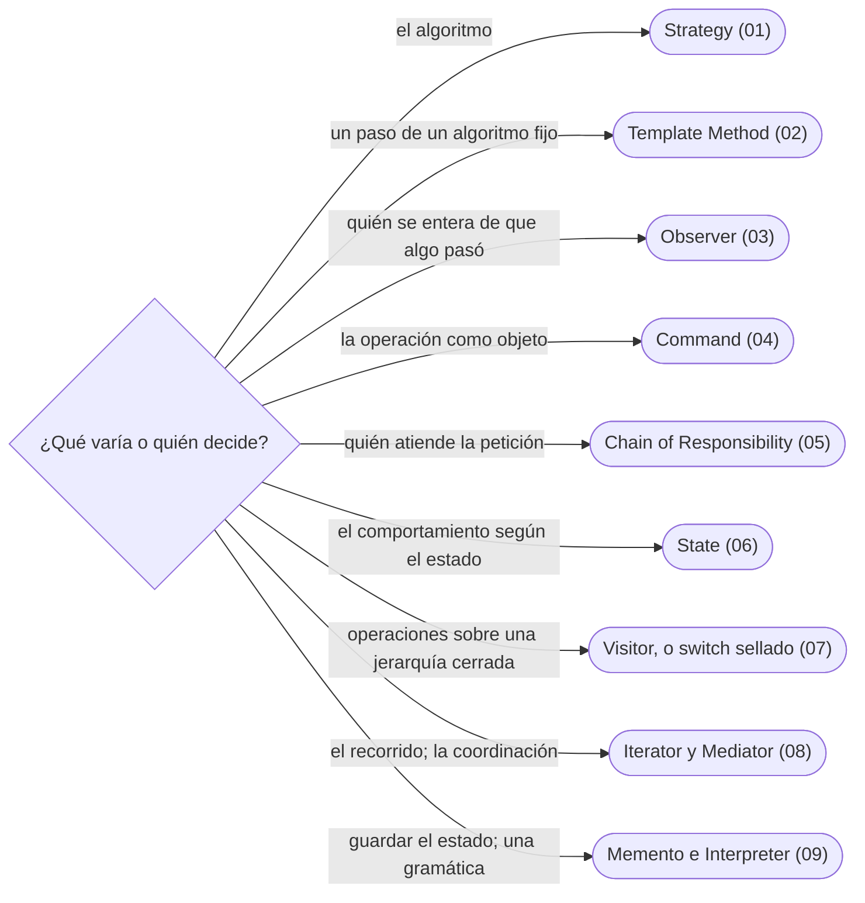

# 06 — Patrones de comportamiento

> Cómo se reparten las decisiones y las responsabilidades entre objetos: Strategy, Template Method, Observer, Command, Chain of Responsibility, State, Visitor (y lo que lo reemplaza), Iterator, Mediator, Memento e Interpreter.
>
> **Vigencia:** 2026-10-03.

---

## 1. 🗺️ Índice

| | Documento | Tipo |
|---|---|---|
| [`01`](01-strategy.md) | Strategy | Capítulo |
| [`02`](02-template-method.md) | Template Method | Capítulo |
| [`03`](03-observer.md) | Observer | Capítulo |
| [`04`](04-command.md) | Command | Capítulo |
| [`05`](05-chain-of-responsibility.md) | Chain of Responsibility | Capítulo |
| [`06`](06-state.md) | State | Capítulo |
| [`07`](07-visitor.md) | Visitor, y lo que lo reemplaza | Capítulo |
| [`08`](08-iterator-y-mediator.md) | Iterator y Mediator | Capítulo |
| [`09`](09-memento-e-interpreter.md) | Memento e Interpreter | Capítulo |
| [`10`](10-simulacion-de-entrevista.md) | Simulación de entrevista | Simulación |
| [`11`](11-respuestas.md) | Respuestas | Solucionario |

**Orden de lectura.** En orden numérico. `01`, `03` y `07` son los más preguntados; `08` y `09` son fichas cortas. Al terminar los capítulos, la simulación con cronómetro, y solo después el solucionario.

---

## 2. 🧠 Mapa mental

---

## 3. 🏷️ Niveles de los patrones

A: se escribe y se defiende en la entrevista · B: se reconoce y se explica · C: ficha corta, con lo que lo reemplazó.

| Patrón | Nivel | Capítulo |
|---|---|---|
| Strategy | A | [`01`](01-strategy.md) |
| Template Method | A | [`02`](02-template-method.md) |
| Observer | A | [`03`](03-observer.md) |
| Command | A | [`04`](04-command.md) |
| Chain of Responsibility | A | [`05`](05-chain-of-responsibility.md) |
| State | A | [`06`](06-state.md) |
| Visitor | A | [`07`](07-visitor.md) |
| Iterator | B | [`08`](08-iterator-y-mediator.md) |
| Mediator | B | [`08`](08-iterator-y-mediator.md) |
| Memento | C | [`09`](09-memento-e-interpreter.md) |
| Interpreter | C | [`09`](09-memento-e-interpreter.md) |

---

## 4. 🚫 Qué NO está aquí

Los eventos de dominio (`09/02`) y los patrones de concurrencia (`10`).

---

**Versiones ejecutadas:** GCC 14.4 (C++23) · JDK 21.0.12, 17.0.20 y 25.0.4 · mermaid-cli 11.17.0 · Spring Boot 4.1.1 (Spring Framework 7.0.9, Hibernate 7.4.5, H2 2.4.240) · .NET 10.0.12 (C# 14) (2026-10-04).

---

**Anterior:** [`05` — Patrones estructurales](../05-estructurales/README.md) ·
**Corpus:** [README](../README.md) ·
**Siguiente:** [`07` — Fowler: dominio y datos](../07-fowler-dominio-y-datos/README.md)
