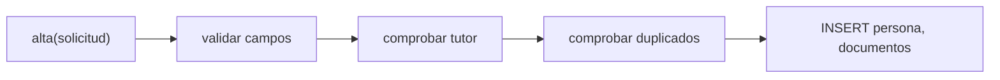
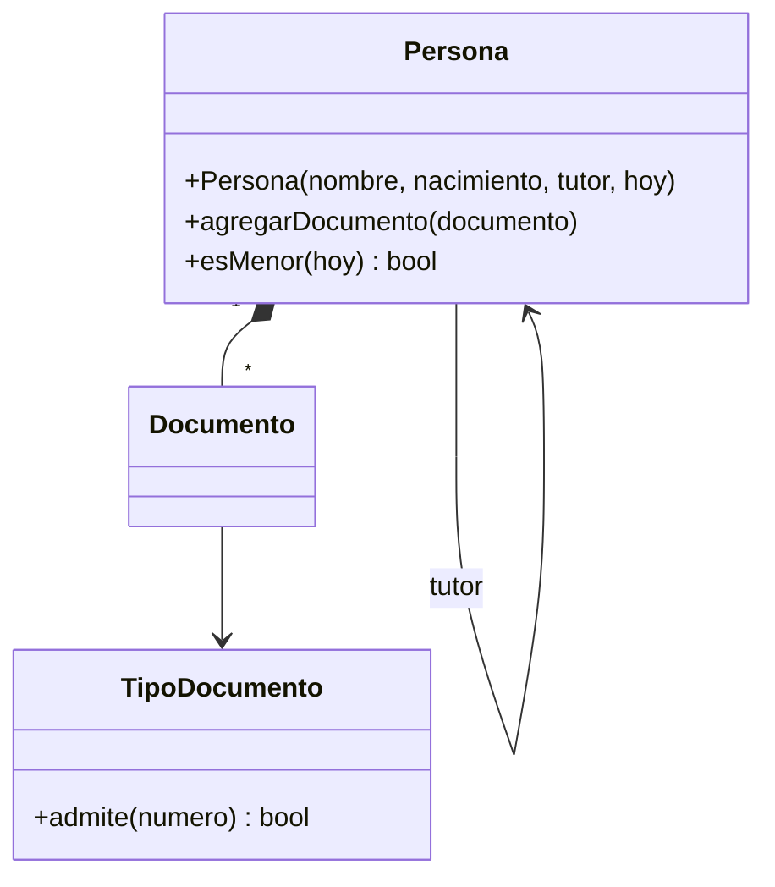
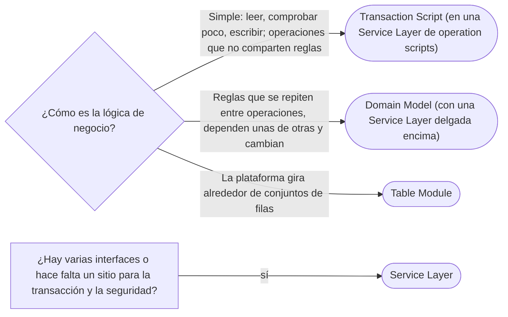

# 01 — Organizar la lógica de dominio

> Elegir cómo se organiza la lógica de negocio según su complejidad —**Transaction Script**, **Domain Model** o
> **Table Module**— y ubicar la **Service Layer** como frontera de la aplicación y lugar de la transacción.
> **Niveles:** Transaction Script A · Domain Model A · Table Module B · Service Layer A. **Lenguajes:** Java; C++ no
> aporta en este capítulo, porque el ecosistema de estos patrones es Java y .NET (§5.2 de la guía). Asume leído
> [`03/01` — Encapsulación de verdad](../03-principios-de-diseno/01-encapsulacion-de-verdad.md) y
> [`05/04` — Facade](../05-estructurales/04-facade.md).
>
> **Vigencia:** 2026-10-03.
>
> **Versiones ejecutadas:** JDK 21.0.12, 17.0.20 y 25.0.4 · Spring Boot 4.1.1 (Spring Framework 7.0.9, Hibernate 7.4.5, H2 2.4.240) · .NET 10.0.12 (C# 14) · mermaid-cli 11.17.0 (2026-10-04).

---

## 1. 🎯 El problema

El alta de una persona con sus documentos tiene reglas: el nombre no puede estar vacío; un menor de edad necesita
tutor, y el tutor tiene que ser mayor; no puede haber dos documentos del mismo tipo y país; el número de cada
documento cumple el formato de su tipo. ¿Dónde se escriben esas reglas?

Hay dos respuestas que se ven en todos los sistemas, y una tercera que se ve menos. Fowler las nombra en el cap. 9
de *PoEAA* y dedica el cap. 2 a cómo elegir. La elección importa porque es casi imposible de cambiar después: decide
la forma de todo el código de negocio.

---

## 2. 🧱 Transaction Script

**Problema.** La mayoría de las operaciones de un sistema son sencillas: leer, comprobar dos cosas, escribir. Para
eso, un modelo de objetos con comportamiento es más estructura de la que hace falta.

**Estructura.** Un **procedimiento por operación del negocio**. Cada uno lee lo que necesita, aplica las reglas en
orden y escribe. Las clases de datos, si las hay, no tienen comportamiento.



**Código.**

```java
@Transactional
public PersonaId alta(SolicitudAlta s) {
    if (s.nombre().isBlank()) throw new SolicitudInvalidaException("nombre vacío");
    boolean menor = s.fechaNacimiento().plusYears(18).isAfter(LocalDate.now(reloj));
    if (menor) {
        if (s.tutorId() == null) throw new SolicitudInvalidaException("un menor necesita tutor");
        LocalDate nacTutor = jdbc.queryForObject(
                "SELECT fecha_nacimiento FROM persona WHERE id = ?", LocalDate.class, s.tutorId());
        if (nacTutor.plusYears(18).isAfter(LocalDate.now(reloj))) throw new SolicitudInvalidaException("tutor menor");
    }
    Set<String> claves = new HashSet<>();
    for (var d : s.documentos()) {
        if (!claves.add(d.codigoTipo() + "/" + d.pais())) throw new SolicitudInvalidaException("documento repetido");
        String formato = jdbc.queryForObject("SELECT formato FROM tipo_documento WHERE codigo = ?", String.class, d.codigoTipo());
        if (!d.numero().matches(formato)) throw new SolicitudInvalidaException("formato de " + d.codigoTipo());
    }
    long id = insertarPersona(s);
    s.documentos().forEach(d -> insertarDocumento(id, d));
    return new PersonaId(id);
}
```

- Se lee de arriba abajo y todo lo que pasa en el alta está aquí. Para un equipo nuevo, es lo más fácil de seguir.
- La regla "un menor necesita tutor mayor" vive **en este método**. Si la edición de una persona, la importación
  nocturna y el cambio de tutor la necesitan, se copia o se extrae a un procedimiento común. Ahí empieza el costo.

**Con qué se confunde.** Con el modelo anémico ([`12/03` §3](../12-antipatrones/03-antipatrones-de-diseno-oo.md#3-️-anemic-domain-model)): un modelo anémico **es** un Transaction Script, con clases de dominio
que solo tienen *getters* y *setters*. Que tenga clases llamadas `Persona` no lo convierte en Domain Model.

**Dónde aparece.** En casi todos los servicios CRUD, los procedimientos almacenados, los *scripts* de lotes y los
servicios de Spring con entidades sin comportamiento.

**Cuándo no.** Cuando las reglas crecen y se repiten entre operaciones: la duplicación aparece en cada script, y una
regla cambiada en uno y no en otro es un error de negocio.

> **Veredicto:** Transaction Script para lógica simple y operaciones que no comparten reglas; es la elección honesta
> de la mayoría de los CRUD. Cuando las mismas reglas aparecen en varios scripts, es la señal de pasar a un modelo.

---

## 3. 🧱 Domain Model

**Problema.** Las reglas se repiten entre operaciones, dependen unas de otras, y el negocio las cambia a menudo. En
scripts, cada cambio toca varios procedimientos.

**Estructura.** Un **modelo de objetos** con datos **y** comportamiento, donde cada regla vive en el objeto que tiene
la información para cumplirla (Information Expert). Las operaciones del sistema se vuelven delgadas: cargan objetos,
les piden cosas y guardan.



**Código.**

```java
public final class Persona {
    private final String nombre;
    private final LocalDate fechaNacimiento;
    private final Persona tutor;
    private final List<Documento> documentos = new ArrayList<>();

    public Persona(String nombre, LocalDate nacimiento, Persona tutor, LocalDate hoy) {
        if (nombre.isBlank()) throw new IllegalArgumentException("nombre vacío");
        if (esMenor(nacimiento, hoy) && (tutor == null || tutor.esMenor(hoy)))
            throw new IllegalArgumentException("un menor necesita un tutor mayor de edad");
        this.nombre = nombre; this.fechaNacimiento = nacimiento; this.tutor = tutor;
    }

    public void agregarDocumento(Documento d) {
        if (!d.tipo().admite(d.numero())) throw new IllegalArgumentException("formato de " + d.tipo().codigo());
        boolean repetido = documentos.stream().anyMatch(x -> x.tipo().equals(d.tipo()) && x.emisor().equals(d.emisor()));
        if (repetido) throw new IllegalArgumentException("documento repetido");
        documentos.add(d);
    }

    public boolean esMenor(LocalDate hoy) { return esMenor(fechaNacimiento, hoy); }
    private static boolean esMenor(LocalDate nacimiento, LocalDate hoy) { return nacimiento.plusYears(18).isAfter(hoy); }
}
```

- Las reglas están **donde están los datos**, una sola vez. El alta, la edición y la importación construyen o
  modifican `Persona`, y ninguna puede saltarse la regla del tutor porque está en el constructor.
- La persistencia queda fuera del modelo: alguien tiene que cargar y guardar estos objetos, y eso es el tema de
  [`02` — Fuentes de datos](02-fuentes-de-datos.md) y [`03`](03-comportamiento-objeto-relacional.md).

**Con qué se confunde.** Con "tener clases de dominio". Un Domain Model se reconoce por dónde están las reglas, no por
el nombre de las clases. Y no es lo mismo que DDD: DDD es una forma de llegar a un buen Domain Model, y añade
agregados, contextos y lenguaje ubicuo.

**Dónde aparece.** En los dominios con reglas de verdad: banca, seguros, logística. En Java, casi siempre con JPA como
Data Mapper por debajo.

**Cuándo no.** Con lógica simple, el modelo es estructura de más; y cuesta aprenderlo bien: un Domain Model mal hecho
—con las reglas repartidas sin criterio— es peor que un Transaction Script ordenado.

> **Veredicto:** Domain Model cuando las reglas son muchas, se repiten entre operaciones y cambian; con las reglas en
> los objetos que tienen los datos. "Domain Model siempre es mejor" es falso: es mejor cuando hay dominio que modelar.

---

## 4. 🧱 Table Module

**Problema.** Se quiere organizar la lógica por **entidad** y no por operación, pero los datos se manejan como
tablas en memoria (un `ResultSet`, un `DataSet`), no como objetos.

**Mecanismo.** **Una clase por tabla**, con los métodos de negocio que operan sobre un conjunto de filas que recibe.
No hay un objeto por persona: hay un objeto `Personas` que sabe hacer cosas con las filas de personas.

**Código.**

```java
public final class ModuloPersonas {
    private final List<Map<String, Object>> filas;          // la tabla en memoria
    public ModuloPersonas(List<Map<String, Object>> filas) { this.filas = filas; }

    public boolean esMenor(long id, LocalDate hoy) {
        var fila = filas.stream().filter(f -> f.get("id").equals(id)).findFirst().orElseThrow();
        return ((LocalDate) fila.get("fecha_nacimiento")).plusYears(18).isAfter(hoy);
    }
}
```

> 📝 **En C#:** el `DataSet` de ADO.NET es una base de datos en memoria con tablas, filas y relaciones, que las
> herramientas de .NET ligaban directamente a formularios. Fowler lo usa como ejemplo de Table Module: el `DataSet`
> trae los datos y una clase por tabla trae la lógica. Con Entity Framework, .NET se movió también a objetos.

**Cuándo sí y cuándo no.** Encajaba con plataformas cuyas herramientas giraban alrededor de conjuntos de filas —el
`DataSet` de .NET, los entornos de formularios ligados a datos—: la lógica por entidad sin pagar el mapeo a objetos.
En Java casi no se usa, porque el ecosistema se fue a JPA y a objetos; hoy aparece como forma intermedia en sistemas
que leen informes por tablas.

> **Veredicto:** Table Module si la plataforma gira alrededor de conjuntos de filas; en Java, raro.

---

## 5. 🧱 Service Layer

**Problema.** Varias interfaces —el API REST, la importación nocturna, un mensaje de otra aplicación— tienen que
ejecutar las mismas operaciones, con su transacción y su seguridad. Si cada una arma la operación, se duplica la
coordinación y cada una abre la transacción a su manera.

**Estructura.** Una capa que define **el borde de la aplicación**: el conjunto de operaciones disponibles, cada una
con su transacción, su autorización y su coordinación. Fowler la define así en *PoEAA*, y describe dos formas de
escribirla: como **fachada de dominio** (métodos delgados que delegan en un Domain Model) o como ***operation
script*** (los métodos llevan la lógica, como un Transaction Script).

**Código**, como fachada sobre el Domain Model de §3:

```java
@Service
public class AltaPersonas {                                   // el borde de la aplicación
    private final RepositorioPersonas personas;
    private final Clock reloj;

    public AltaPersonas(RepositorioPersonas personas, Clock reloj) { this.personas = personas; this.reloj = reloj; }

    @Transactional
    @PreAuthorize("hasRole('OPERADOR')")
    public PersonaId alta(SolicitudAlta s) {
        LocalDate hoy = LocalDate.now(reloj);
        Persona tutor = s.tutorId() == null ? null : personas.obtener(s.tutorId());
        Persona p = new Persona(s.nombre(), s.fechaNacimiento(), tutor, hoy);   // las reglas, en el modelo
        s.documentos().forEach(d -> p.agregarDocumento(d.aDocumento()));
        return personas.guardar(p);
    }
}
```

- La capa **no decide** ninguna regla del negocio: carga, delega en el modelo, guarda. Lo que sí decide es lo de la
  aplicación: la transacción, el permiso, qué operación existe.
- El controlador REST y la importación nocturna llaman a `alta`; ninguno abre transacciones ni comprueba permisos por
  su cuenta.

**Con qué se confunde.** Con la Facade del GoF: una Service Layer se implementa a menudo **como** fachadas (ver
[`05/04`](../05-estructurales/04-facade.md)). Y con "la capa donde va la lógica": en la forma de fachada de dominio, la
lógica está en el modelo y la capa coordina.

**Dónde aparece.** Los `@Service` de Spring con `@Transactional` son, en casi todos los proyectos, una Service Layer;
la pregunta es solo cuál de las dos formas tienen.

**Cuándo no.** Con una sola interfaz y operaciones simples, el controlador puede ser el borde; la capa se justifica
cuando hay varios clientes de las mismas operaciones o cuando la transacción y la seguridad tienen que estar en un
sitio.

> **Veredicto:** Service Layer como borde de la aplicación, con la transacción y la seguridad, y delgada si hay Domain
> Model. "Service Layer es donde va la lógica de negocio" describe el *operation script*, que es un Transaction Script
> con otro nombre.

---

## 6. 🧭 Cómo se elige



**La frase en voz alta:** *"Si el alta es leer, validar dos campos y guardar, un Transaction Script en el servicio es
lo honesto. Cuando las reglas del tutor y de los documentos aparecen en el alta, la edición y la importación, las llevo
a `Persona`, y el servicio queda como borde: transacción, permisos y delegar."*

---

## ⚠️ Errores frecuentes

| Se dice | Lo preciso |
|---|---|
| "Domain Model siempre es mejor" | Es mejor con reglas que se repiten y cambian; con lógica simple, es estructura de más |
| "Service Layer es donde va la lógica de negocio" | Es el borde de la aplicación; con Domain Model, la lógica está en el modelo y la capa coordina |
| "Tener clases `Persona` y `Cuenta` es tener Domain Model" | Si no tienen comportamiento, es un Transaction Script con estructuras de datos: el modelo anémico |
| "Transaction Script es código malo" | Es la elección correcta para lógica simple; el problema es seguir con él cuando las reglas se repiten |
| "Domain Model y DDD son lo mismo" | DDD es una forma de llegar a un buen modelo, con agregados y contextos; el Domain Model es el patrón |
| "Se puede cambiar de uno a otro más adelante sin costo" | La elección da forma a todo el código de negocio; cambiarla es una refactorización grande |

---

## 📚 Para profundizar

- **Libro** — Fowler, *Patterns of Enterprise Application Architecture* (Addison-Wesley, 2002), cap. 2, "Organizing
  Domain Logic" (cómo elegir, con la gráfica de esfuerzo contra complejidad), y cap. 9, "Domain Logic Patterns". **El
  que destaca.**
- **Libro** — Evans, *Domain-Driven Design* (Addison-Wesley, 2003), cap. 5, "A Model Expressed in Software": el modelo
  con comportamiento.
- [martinfowler.com — Transaction Script](https://martinfowler.com/eaaCatalog/transactionScript.html)
- [martinfowler.com — Domain Model](https://martinfowler.com/eaaCatalog/domainModel.html)
- [martinfowler.com — Service Layer](https://martinfowler.com/eaaCatalog/serviceLayer.html)
- [martinfowler.com — *AnemicDomainModel*](https://martinfowler.com/bliki/AnemicDomainModel.html): por qué un modelo
  sin comportamiento es un Transaction Script disfrazado.
- [.NET — `DataSet`](https://learn.microsoft.com/en-us/dotnet/api/system.data.dataset): la tabla en memoria del Table
  Module.

---

## 🧠 Preguntas

Sin respuestas aquí. Todas, con enunciado literal y respuesta en tres capas, en
[`07` — Respuestas](07-respuestas.md#01--organizar-la-lógica-de-dominio).

1. ¿Qué es un Transaction Script? 🟢
2. ¿Qué es un Domain Model? 🟢
3. ¿Qué es un Table Module? 🟢
4. ¿Qué es una Service Layer, según Fowler? 🟢
5. ¿Qué diferencia hay entre Transaction Script y Domain Model? 🟡
6. ¿Qué diferencia hay entre una Service Layer de fachada de dominio y una de *operation scripts*? 🟡
7. ¿Qué diferencia hay entre Domain Model y DDD? 🟡
8. ¿Qué diferencia hay entre Service Layer y la Facade del GoF? 🟡
9. ¿Por qué "Domain Model siempre es mejor" es falso? 🟠
10. ¿Cuál es la señal para pasar de Transaction Script a Domain Model? 🟠
11. ¿Por qué un modelo anémico es un Transaction Script disfrazado? 🟠
12. ¿Qué decide la Service Layer y qué no debe decidir? 🟠
13. ¿Por qué la elección entre Transaction Script y Domain Model es difícil de cambiar después? 🟠
14. Escribe el alta de §1 como Transaction Script, con la regla del tutor. 🔴
15. Lleva la regla del tutor y la de los documentos repetidos a `Persona`, y deja el servicio como borde. 🔴
16. Revisa este servicio y di qué patrón es en realidad: `@Service class ServicioCuentas` con `debitar(id, monto)`
    que hace `c.setSaldo(c.getSaldo().subtract(monto))` tras comprobar el estado con `getEstado()`. 🔴

---

**Anterior:** [`06/10` — Simulación de entrevista](../06-comportamiento/10-simulacion-de-entrevista.md) ·
**Siguiente:** [`02` — Fuentes de datos](02-fuentes-de-datos.md) ·
**Relacionado:** [`03/01` — Encapsulación de verdad](../03-principios-de-diseno/01-encapsulacion-de-verdad.md)
