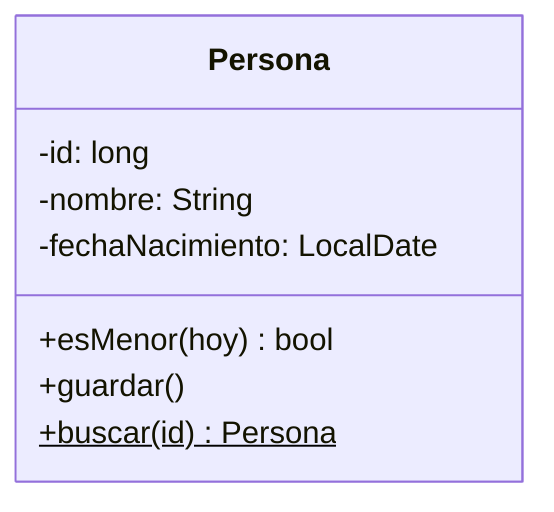
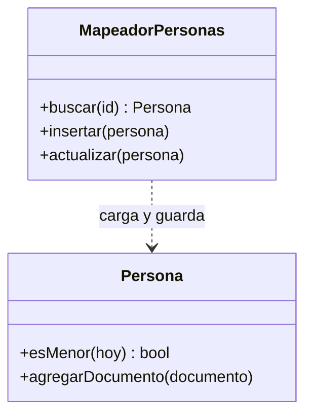
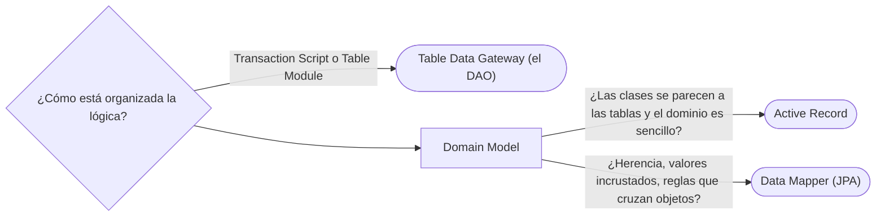

# 02 — Fuentes de datos

> Distinguir las cuatro formas de Fowler de hablar con la base de datos —**Table Data Gateway**, **Row Data
> Gateway**, **Active Record** y **Data Mapper**— y decidir entre las dos que importan hoy: Active Record contra Data
> Mapper. **Niveles:** Table Data Gateway B · Row Data Gateway B · Active Record A · Data Mapper A. **Lenguajes:**
> Java y SQL mínimo; C++ no aporta aquí (§5.2 de la guía). Asume leído
> [`02/07` — Objetos frente a tablas](../02-modelado-oo/07-objetos-frente-a-tablas.md) y
> [`01` — Organizar la lógica de dominio](01-logica-de-dominio.md).
>
> **Vigencia:** 2026-10-03.
>
> **Versiones ejecutadas:** JDK 21.0.12, 17.0.20 y 25.0.4 · Spring Boot 4.1.1 (Spring Framework 7.0.9, Hibernate 7.4.5, H2 2.4.240) · mermaid-cli 11.17.0 · PostgreSQL 18.6 (2026-10-04).

---

## 1. 🎯 El problema

El SQL de las personas está repartido por el código: un `SELECT` en el controlador de la pantalla, otro en el
servicio de alta, un `UPDATE` en la importación nocturna. Cuando la tabla `persona` ganó la columna
`segundo_apellido`, hubo que buscar cada consulta. Y la clase `Persona`, cuando existe, no sabe nada de la base, o lo
sabe todo.

La pregunta de este capítulo es **quién habla con la base de datos**, y qué sabe el resto del código de esa
conversación. Fowler da cuatro respuestas en el cap. 10 de *PoEAA*, de la más cercana a las tablas a la más alejada:

```text
                  ¿Hay objetos de dominio?    ¿Quién sabe del SQL?
Table Data Gateway   no: filas o DTO            un objeto por tabla
Row Data Gateway     no: un objeto por fila     el objeto fila
Active Record        sí                         el propio objeto de dominio
Data Mapper          sí                         un mapeador aparte; el dominio no sabe nada
```

---

## 2. 🧱 Table Data Gateway

**Problema.** Juntar en un sitio todo el SQL de una tabla, para que el resto del código no lo escriba.

**Mecanismo.** Un objeto por **tabla**, con un método por consulta o actualización, que devuelve datos crudos (filas,
`record` de transporte) y no objetos de dominio.

**Código.**

```java
public final class GatewayPersonas {
    private final JdbcTemplate jdbc;
    public GatewayPersonas(JdbcTemplate jdbc) { this.jdbc = jdbc; }

    public List<FilaPersona> menoresDe(LocalDate limite) {
        return jdbc.query("SELECT id, nombre, fecha_nacimiento FROM persona WHERE fecha_nacimiento > ?",
                (rs, n) -> new FilaPersona(rs.getLong("id"), rs.getString("nombre"),
                                           rs.getObject("fecha_nacimiento", LocalDate.class)), limite);
    }
    public void cambiarNombre(long id, String nombre) {
        jdbc.update("UPDATE persona SET nombre = ? WHERE id = ?", nombre, id);
    }
}
```

**Cuándo sí y cuándo no.** Encaja con el Transaction Script y el Table Module: la lógica está en los scripts y el
SQL en el *gateway*. Es lo que muchos llaman DAO. No encaja con un Domain Model, porque devuelve filas y no objetos.

> **Veredicto:** Table Data Gateway para sacar el SQL de los scripts cuando la lógica es simple; es el DAO de toda la
> vida.

---

## 3. 🧱 Row Data Gateway

**Problema.** El mismo que el anterior, pero se quiere manejar cada fila como un objeto con sus campos.

**Mecanismo.** Un objeto por **fila**, con los campos de la fila, y métodos `insertar`, `actualizar` y `borrar`. Una
clase buscadora aparte devuelve esos objetos. El objeto fila **no tiene** lógica de negocio.

**Código.**

```java
public final class FilaPersonaGateway {
    private final long id;
    private String nombre;
    private final LocalDate fechaNacimiento;

    FilaPersonaGateway(long id, String nombre, LocalDate fechaNacimiento) {
        this.id = id; this.nombre = nombre; this.fechaNacimiento = fechaNacimiento;
    }
    public void setNombre(String n) { this.nombre = n; }
    public void actualizar(JdbcTemplate jdbc) {
        jdbc.update("UPDATE persona SET nombre = ?, fecha_nacimiento = ? WHERE id = ?", nombre, fechaNacimiento, id);
    }
}
```

**Cuándo sí y cuándo no.** Se usa poco: si se añade lógica de negocio al objeto fila, se convierte en un Active
Record, que es lo que casi siempre termina pasando.

> **Veredicto:** Row Data Gateway como paso intermedio; en la práctica, o se queda en Table Data Gateway o se vuelve
> Active Record.

---

## 4. 🧱 Active Record

**Problema.** Se quiere un objeto de dominio con comportamiento, y la forma más directa de guardarlo es que sepa
guardarse.

**Estructura.** Un objeto que **envuelve una fila**, encapsula el acceso a la base **y** añade la lógica de dominio
sobre esos datos. Los campos del objeto son las columnas de la tabla.



**Código.**

```java
public class Persona {
    private Long id;
    private String nombre;
    private LocalDate fechaNacimiento;

    public boolean esMenor(LocalDate hoy) { return fechaNacimiento.plusYears(18).isAfter(hoy); }   // dominio

    public void guardar() {                                                                         // persistencia
        if (id == null) id = Bd.jdbc().queryForObject(
                "INSERT INTO persona (nombre, fecha_nacimiento) VALUES (?, ?) RETURNING id",
                Long.class, nombre, fechaNacimiento);
        else Bd.jdbc().update("UPDATE persona SET nombre = ?, fecha_nacimiento = ? WHERE id = ?",
                nombre, fechaNacimiento, id);
    }
    public static Persona buscar(long id) {
        return Bd.jdbc().queryForObject("SELECT id, nombre, fecha_nacimiento FROM persona WHERE id = ?", (rs, n) -> {
            Persona p = new Persona();
            p.id = rs.getLong("id");
            p.nombre = rs.getString("nombre");
            p.fechaNacimiento = rs.getObject("fecha_nacimiento", LocalDate.class);
            return p;
        }, id);
    }
    public void cambiarNombre(String n) { this.nombre = n; }
}

Persona ana = Persona.buscar(1L);
ana.cambiarNombre("Ana María Rojas Medina");
ana.guardar();
```

- Poco código y muy directo: el objeto se carga, se modifica y se guarda a sí mismo.
- El acceso a la base pasa por un estático (`Bd.jdbc()`): el objeto de dominio depende de la infraestructura, y probar
  `esMenor` sin base es fácil, pero probar cualquier cosa que guarde no lo es.

**Con qué se confunde.** Con JPA. Una entidad de JPA **no** se guarda a sí misma: no tiene `save()`; la guarda el
`EntityManager`. Eso es Data Mapper. Los marcos de Active Record son Ruby on Rails (`ActiveRecord`), el ORM de Django
y, en Java, Hibernate con Panache en su modo Active Record (`PanacheEntity`), que también ofrece el modo repositorio.

**Dónde aparece.** En Rails, Django y Laravel, donde es la forma por defecto, y en aplicaciones CRUD de dominio
sencillo.

**Cuándo no.** Cuando el modelo de objetos deja de parecerse a las tablas: herencia, objetos de valor incrustados,
colecciones, reglas que cruzan objetos. Ahí el objeto tiene que saber de su tabla **y** del dominio, y las dos cosas
tiran en direcciones distintas.

> **Veredicto:** Active Record cuando el dominio es sencillo y las clases se parecen a las tablas: es lo más
> productivo. "Active Record es un antipatrón" es falso; lo que es un error es usarlo en un dominio complejo.

---

## 5. 🧱 Data Mapper

**Problema.** Un Domain Model rico no se parece a las tablas, y las reglas de negocio no deberían saber nada de SQL.

**Estructura.** Una capa de **mapeadores** que mueve datos entre los objetos y la base, manteniendo a los dos
independientes. El objeto de dominio no sabe que existe una base de datos.



**Código.**

```java
public final class MapeadorPersonas {
    private final JdbcTemplate jdbc;
    public MapeadorPersonas(JdbcTemplate jdbc) { this.jdbc = jdbc; }

    public Persona buscar(PersonaId id) {
        return jdbc.queryForObject("SELECT id, nombre, fecha_nacimiento FROM persona WHERE id = ?",
                (rs, n) -> Persona.reconstituir(new PersonaId(rs.getLong("id")), rs.getString("nombre"),
                                                rs.getObject("fecha_nacimiento", LocalDate.class)),
                id.valor());
    }
    public void actualizar(Persona p) {
        jdbc.update("UPDATE persona SET nombre = ? WHERE id = ?", p.nombre(), p.id().valor());
    }
}
```

- `Persona` no tiene `guardar`, ni conoce `JdbcTemplate`: se prueba sin base. El mapeador sabe de las dos partes.
- `reconstituir` es un camino de creación distinto del constructor del alta: reconstruye un objeto que ya existió, sin
  volver a aplicar las validaciones de "nuevo" ni disparar efectos.

**Con qué se confunde.** Con el Repository: el mapeador traduce entre filas y objetos; el Repository ofrece una
interfaz de colección del dominio, y suele usar un mapeador por debajo (ver [`05` — Metadatos y
consultas](05-metadatos-y-consultas.md#2--repository)).

**Dónde aparece.** **JPA y Hibernate son Data Mapper**: las anotaciones describen el mapeo, el `EntityManager` lo
ejecuta, y la entidad no se guarda a sí misma. También MyBatis, SQLAlchemy en Python y Entity Framework en .NET.

**Cuándo no.** Con un dominio simple, un mapeador escrito a mano es mucho código; un ORM lo reduce, a cambio de
aprender su ciclo de vida (que es el tema de [`03`](03-comportamiento-objeto-relacional.md)).

> **Veredicto:** Data Mapper cuando hay un Domain Model que no se parece a las tablas; en Java, casi siempre JPA. Saber
> que JPA es un Data Mapper, y no un Active Record, es la respuesta que la entrevista busca.

---

## 6. 🧭 Cómo se elige



**La frase en voz alta:** *"Active Record cuando el objeto es casi una fila y el dominio es simple, como en Rails. Para
un modelo rico uso Data Mapper, que es lo que es JPA: la entidad no se guarda a sí misma, la guarda el
`EntityManager`, y por eso puedo probar las reglas sin base de datos."*

---

## ⚠️ Errores frecuentes

| Se dice | Lo preciso |
|---|---|
| "JPA es Active Record" | Es Data Mapper: la entidad no tiene `save`; la guarda el `EntityManager` |
| "Active Record es un antipatrón" | Es lo más productivo con un dominio sencillo; el error es usarlo en uno complejo |
| "DAO y Data Mapper son lo mismo" | El DAO suele ser un Table Data Gateway que devuelve datos; el Data Mapper mapea objetos de dominio |
| "Con Data Mapper el dominio no sabe nada de la base" | No sabe del SQL; en JPA, las anotaciones sí están en las entidades, como metadatos |
| "Row Data Gateway y Active Record son lo mismo" | El Row Data Gateway no tiene lógica de negocio; cuando la gana, es un Active Record |
| "El mapeador puede usar el mismo constructor que el alta" | Reconstruir lo que ya existió no debe repetir las validaciones de lo nuevo; hace falta otro camino |

---

## 📚 Para profundizar

- **Libro** — Fowler, *Patterns of Enterprise Application Architecture* (Addison-Wesley, 2002), cap. 10, "Data Source
  Architectural Patterns", y cap. 3, "Mapping to Relational Databases". **El que destaca.**
- [martinfowler.com — Active Record](https://martinfowler.com/eaaCatalog/activeRecord.html)
- [martinfowler.com — Data Mapper](https://martinfowler.com/eaaCatalog/dataMapper.html)
- [martinfowler.com — Table Data Gateway](https://martinfowler.com/eaaCatalog/tableDataGateway.html)
- [Quarkus — Simplified Hibernate ORM with Panache](https://quarkus.io/guides/hibernate-orm-panache/): Active Record
  y repositorio sobre el mismo Hibernate.
- [Rails Guides — Active Record Basics](https://guides.rubyonrails.org/active_record_basics.html): el patrón como
  forma por defecto de un marco.

---

## 🧠 Preguntas

Sin respuestas aquí. Todas, con enunciado literal y respuesta en tres capas, en
[`07` — Respuestas](07-respuestas.md#02--fuentes-de-datos).

1. ¿Qué es un Table Data Gateway? 🟢
2. ¿Qué es un Row Data Gateway? 🟢
3. ¿Qué es un Active Record? 🟢
4. ¿Qué es un Data Mapper? 🟢
5. ¿Qué diferencia hay entre Active Record y Data Mapper? 🟡
6. ¿Qué diferencia hay entre Row Data Gateway y Active Record? 🟡
7. ¿Qué diferencia hay entre un DAO y un Data Mapper? 🟡
8. ¿Qué diferencia hay entre Data Mapper y Repository? 🟡
9. ¿Qué diferencia hay entre Hibernate con Panache en modo Active Record y JPA con un repositorio? 🟡
10. ¿Por qué "JPA es Active Record" es falso? 🟠
11. ¿Cuándo Active Record deja de servir? 🟠
12. ¿Por qué un Data Mapper necesita un camino de reconstrucción distinto del constructor? 🟠
13. ¿Qué fuente de datos va con cada forma de organizar la lógica? 🟠
14. Escribe un Table Data Gateway de personas con una consulta y una actualización. 🔴
15. Escribe un Data Mapper a mano para `Persona` con `buscar` y `actualizar`. 🔴
16. Revisa esta clase y di qué patrón es y qué problema tiene en un dominio complejo: `class Cuenta { … public void
    guardar() { Bd.jdbc().update(…); } public void debitar(Dinero m) { … guardar(); } }`. 🔴

---

**Anterior:** [`01` — Organizar la lógica de dominio](01-logica-de-dominio.md) ·
**Siguiente:** [`03` — Comportamiento objeto-relacional](03-comportamiento-objeto-relacional.md) ·
**Relacionado:** [`02/07` — Objetos frente a tablas](../02-modelado-oo/07-objetos-frente-a-tablas.md)
