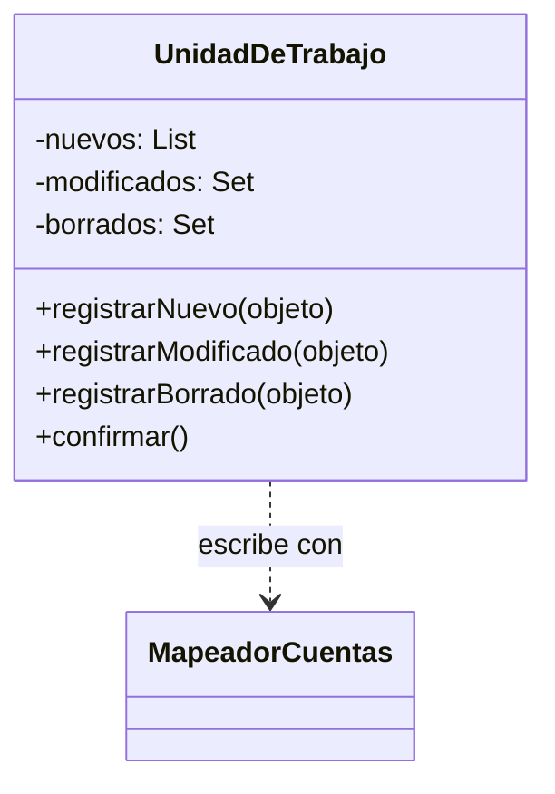
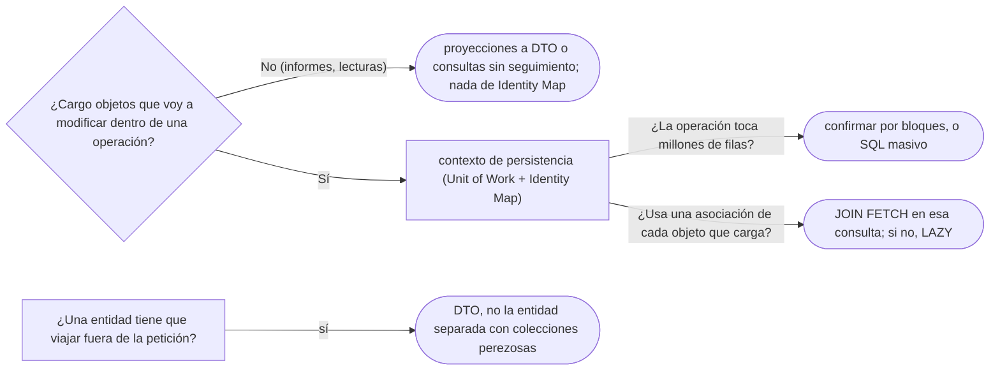

# 03 — Comportamiento objeto-relacional

> Qué hace el `EntityManager` de JPA por dentro, contado con los tres patrones que lo componen: **Unit of Work**
> (qué hay que escribir y cuándo), **Identity Map** (un objeto por fila, y por qué importa para `==`) y **Lazy
> Load** (cargar al recorrer, con sus trampas). **Niveles:** los tres A. **Es el dueño de Unit of Work e Identity
> Map.** **Lenguajes:** Java; C++ no aporta (§5.2 de la guía). Se lee suelto; lo que asume, en el recordatorio de
> §1. Para profundizar: [`02` — Fuentes de datos](02-fuentes-de-datos.md) y
> [`05/03` — Proxy](../05-estructurales/03-proxy.md).
>
> **Vigencia:** 2026-10-03.
>
> **Versiones ejecutadas:** JDK 21.0.12, 17.0.20 y 25.0.4 · Spring Boot 4.1.1 (Spring Framework 7.0.9, Hibernate 7.4.5, H2 2.4.240) · .NET 10.0.12 (C# 14) · mermaid-cli 11.17.0 (2026-10-04).

**Salto rápido:** [1](#1--el-problema) · [2](#2--unit-of-work) · [3](#3--identity-map) · [4](#4--lazy-load) · [5](#5--los-tres-en-jpa) · [6](#6--cómo-se-elige)

---

## 1. 🎯 El problema

**Recordatorio de lo que se asume.** Un **Data Mapper** es un objeto que carga objetos de dominio desde la base y los
guarda, sin que el dominio sepa de SQL; JPA lo es. Una **transacción** de base de datos agrupa escrituras que se
confirman o se deshacen juntas. Un **proxy** es un objeto con la interfaz de otro que se pone delante para controlar
el acceso a él.

Con un mapeador escrito a mano, una transferencia de Ana a Luis es así:

```java
Cuenta origen  = mapeador.buscar(new CuentaId("CTA-0001"));
Cuenta destino = mapeador.buscar(new CuentaId("CTA-0003"));
origen.debitar(monto);
mapeador.actualizar(origen);                  // ¿y si se olvida esta línea?
destino.acreditar(monto);
mapeador.actualizar(destino);
Cuenta otraVez = mapeador.buscar(new CuentaId("CTA-0001"));
boolean misma = (otraVez == origen);          // false: dos objetos para la misma fila
```

- Quien modifica tiene que **acordarse de guardar** cada objeto que tocó. Olvidar una línea es perder un cambio sin
  ningún error.
- Cargar dos veces la misma fila da **dos objetos**. Si uno se modifica y el otro se guarda después, el segundo pisa al
  primero (el problema de [`02/07` §6](../02-modelado-oo/07-objetos-frente-a-tablas.md#6--identidad-clave-primaria-contra-referencia)).
- Y si `Cuenta` tiene sus mil movimientos, cargarla los trae todos, aunque la transferencia no los mire.

Son tres problemas de **comportamiento** —cuándo se escribe, cuántos objetos hay, cuándo se carga— y cada uno tiene su
patrón.

---

## 2. 🧱 Unit of Work

**Problema.** Saber qué objetos se crearon, modificaron o borraron durante una operación de negocio, y escribirlos
todos juntos al final, en el orden correcto y en una transacción, sin que el código de negocio se acuerde de guardar.

**Estructura.** Un objeto que lleva **tres listas** —nuevos, modificados (*dirty*), borrados— durante la operación, y
un `confirmar()` que las escribe.



**Código**: una unidad de trabajo mínima, escrita a mano, para ver qué hace JPA.

```java
public final class UnidadDeTrabajo {
    private final List<Cuenta> nuevas = new ArrayList<>();
    private final Set<Cuenta> modificadas = new LinkedHashSet<>();
    private final MapeadorCuentas mapeador;
    private final TransactionTemplate tx;

    public UnidadDeTrabajo(MapeadorCuentas mapeador, TransactionTemplate tx) { this.mapeador = mapeador; this.tx = tx; }

    public void registrarNueva(Cuenta c)     { nuevas.add(c); }
    public void registrarModificada(Cuenta c) { if (!nuevas.contains(c)) modificadas.add(c); }

    public void confirmar() {
        tx.executeWithoutResult(estado -> {           // todo o nada
            nuevas.forEach(mapeador::insertar);
            modificadas.forEach(mapeador::actualizar);
        });
        nuevas.clear();
        modificadas.clear();
    }
}

origen.debitar(monto);    uow.registrarModificada(origen);
destino.acreditar(monto); uow.registrarModificada(destino);
uow.confirmar();          // dos UPDATE en una transacción
```

- El negocio ya no llama a `actualizar`: registra lo que tocó, o —mejor— el objeto se registra solo al cambiar.
  Escribir todo junto permite agrupar las sentencias y ordenarlas (las inserciones de los padres antes que las de los
  hijos).
- Esta versión todavía exige `registrarModificada`. JPA da el paso siguiente: **detecta** los cambios comparando cada
  objeto con una copia de cómo estaba al cargarlo (§5).

**Con qué se confunde.** Con la transacción de la base: la unidad de trabajo **produce** la transacción al confirmar, pero
mientras dura la operación no tiene nada abierto en la base. Y con el Command: el comando es una operación; la unidad de
trabajo, el registro de todo lo que cambió durante una.

**Dónde aparece.** El `EntityManager` de JPA (el contexto de persistencia), la `Session` de Hibernate, el `DbContext` de
Entity Framework y la `Session` de SQLAlchemy.

**Cuándo no.** Con un Transaction Script que escribe con SQL directo, no hay objetos que seguir. Y en procesos por lotes de
millones de filas, una unidad de trabajo que acumula todo agota la memoria: se confirma por bloques o se usa SQL masivo.

> **Veredicto:** Unit of Work cuando una operación de negocio modifica varios objetos que hay que escribir juntos; en Java,
> casi siempre es el contexto de persistencia de JPA. Lo que hay que saber es **cuándo** escribe, porque no es cuando se
> cambia el objeto.

---

## 3. 🧱 Identity Map

**Problema.** Que cada fila se cargue **una sola vez** por operación, para que todo el código que pide a Ana reciba el
mismo objeto, y los cambios de uno los vean los demás.

**Estructura.** Un mapa de identificador a objeto ya cargado, que el mapeador consulta **antes** de ir a la base.

**Código.**

```java
public final class MapaIdentidad {
    private final Map<CuentaId, Cuenta> cargadas = new HashMap<>();

    public Cuenta buscar(CuentaId id, Function<CuentaId, Cuenta> cargar) {
        return cargadas.computeIfAbsent(id, cargar);        // la segunda vez, el mismo objeto
    }
}

Cuenta a = mapa.buscar(cta0001, mapeador::cargar);
Cuenta b = mapa.buscar(cta0001, mapeador::cargar);
boolean misma = (a == b);                                    // → true dentro de la misma operación
```

- El mapa vive lo que vive la operación (la unidad de trabajo), **no** lo que vive la aplicación: dos peticiones tienen
  dos mapas, y por eso dos objetos distintos para la misma fila.

**Con qué se confunde.** Con una caché de rendimiento. Evita consultas repetidas, sí, pero su razón de ser es la
**coherencia**: que no haya dos objetos para la misma fila que diverjan y se pisen al guardar. Una caché compartida entre
peticiones es otra cosa (la caché de segundo nivel de Hibernate), con sus propios problemas de concurrencia.

**Dónde aparece.** Dentro de cada contexto de persistencia de JPA: la Javadoc de `EntityManager` define el contexto como un
conjunto de entidades en el que, para cada identidad persistente, hay **como mucho una** instancia.

**Cuándo no.** Sin un modelo de objetos que se modifique (consultas de solo lectura para informes), el mapa solo gasta
memoria; JPA permite consultas que no registran las entidades, o proyecciones a DTO.

> **Veredicto:** Identity Map siempre que se carguen entidades que se van a modificar; es la condición para que `==`
> signifique "la misma fila" dentro de una operación. Fuera de ella, la identidad es el identificador, y `equals` va por él.

---

## 4. 🧱 Lazy Load

**Problema.** Una `Cuenta` tiene mil movimientos y una `Persona`, sus documentos. Cargarlos siempre es caro, y muchas
operaciones no los miran.

**Estructura.** El objeto se carga **sin** sus asociaciones, y algo en su lugar las trae la primera vez que se usan.
Fowler describe cuatro formas: **inicialización perezosa** (el campo es `null` y el *getter* carga), **proxy virtual**
(un objeto con la interfaz del real que carga al primer uso), ***value holder*** (un envoltorio con `get()` que carga) y
***ghost*** (el objeto real, con solo el identificador, que se completa al primer acceso).

**Código**, en JPA:

```java
@Entity
public class Cuenta {
    @Id private String id;
    @OneToMany(mappedBy = "cuenta", fetch = FetchType.LAZY)   // las colecciones son perezosas por defecto
    private List<Movimiento> movimientos = new ArrayList<>();
}

Cuenta c = em.find(Cuenta.class, "CTA-0001");     // un SELECT de la cuenta
int n = c.getMovimientos().size();                // ahora, el SELECT de los movimientos
```

- La colección es un proxy de Hibernate (ver [`05/03`](../05-estructurales/03-proxy.md)): la consulta se dispara al
  tocarla, no al cargar la cuenta.

**Con qué se confunde.** Con una optimización gratuita. Tiene dos trampas que todo el que usa JPA encuentra:

- **El N+1**: listar cien cuentas y, en un bucle, tocar sus movimientos son 1 + 100 consultas. Lo perezoso convirtió una
  consulta con *join* en ciento una.
- **La colección perezosa fuera de la sesión**: si el contexto de persistencia ya se cerró, tocar la colección lanza
  `LazyInitializationException`; no hay con qué cargarla.

**Dónde aparece.** Las asociaciones `LAZY` de JPA, las referencias de `getReference`, y los *proxies* de cualquier ORM.

**Cuándo no.** Cuando el caso de uso **sí** va a usar la asociación: se pide junta en la consulta (`JOIN FETCH`, un grafo de
entidad) en lugar de dejar que el perezoso dispare una consulta por elemento.

> **Veredicto:** Lazy Load como valor por defecto de las asociaciones, y carga explícita en la consulta de cada caso de uso
> que las necesita. "Lazy Load siempre ahorra" es falso: con un bucle, cuesta una consulta por elemento.

---

## 5. 🧱 Los tres en JPA

El `EntityManager` **es** los tres patrones a la vez, y la Javadoc lo dice con sus palabras:

| Patrón | En JPA | La frase de la Javadoc |
|---|---|---|
| Identity Map | El contexto de persistencia | Para cada identidad persistente hay como mucho una instancia |
| Unit of Work | La detección de cambios y el `flush` | No hay una operación explícita de "actualizar": los cambios de una entidad gestionada se detectan solos, y la sincronización con la base no es inmediata |
| Lazy Load | `FetchType.LAZY`, `getReference` | `getReference` permite crear una asociación sin cargar el estado de la entidad |

```java
@Transactional
public void transferir(CuentaId o, CuentaId d, Dinero monto) {
    Cuenta origen = em.find(Cuenta.class, o.valor());
    Cuenta destino = em.find(Cuenta.class, d.valor());
    origen.debitar(monto);                 // ningún save: el contexto detecta el cambio
    destino.acreditar(monto);
    boolean misma = em.find(Cuenta.class, o.valor()) == origen;   // → true: Identity Map
}                                          // al confirmar: flush, dos UPDATE, commit
```

- Una entidad tiene cuatro estados: **nueva** (sin identidad persistente), **gestionada** (asociada a un contexto
  activo), **separada** (*detached*: tiene identidad pero ningún contexto la sigue) y **borrada**. Solo las gestionadas
  se vigilan; modificar una separada no escribe nada.
- `==` entre dos lecturas de la misma fila es `true` **dentro** del mismo contexto y `false` en dos contextos distintos
  (dos peticiones, dos transacciones). Por eso `equals` de una entidad va por su identificador.

> 📝 **En C#:** `DbContext` de Entity Framework es la misma combinación, y su documentación lo dice: una instancia de
> `DbContext` es una sesión con la base y combina los patrones Unit of Work y Repository. `SaveChanges()` es el `flush`
> con *commit*, y el `ChangeTracker` es la detección de cambios.

---

## 6. 🧭 Cómo se elige



**La frase en voz alta:** *"El `EntityManager` es Unit of Work, Identity Map y Lazy Load. Por eso no llamo a `save` dentro
de una transacción —el contexto detecta los cambios y los escribe en el flush—, por eso dos `find` de Ana en la misma
transacción son `==`, y por eso un bucle que toca colecciones perezosas es un N+1."*

---

## ⚠️ Errores frecuentes

| Se dice | Lo preciso |
|---|---|
| "El Identity Map es una caché de rendimiento" | Su razón de ser es la coherencia: un objeto por fila dentro de la operación; el ahorro de consultas es un efecto |
| "Lazy Load siempre ahorra" | En un bucle, convierte una consulta en una por elemento (N+1) |
| "Hay que llamar a `save` después de modificar una entidad" | Una entidad gestionada se escribe sola en el `flush`; `save` sobre ella no hace nada útil |
| "Modificar una entidad la escribe en la base" | Se escribe al sincronizar (el `flush`), no al modificar; y solo si está gestionada |
| "Dos lecturas de la misma fila son siempre el mismo objeto" | Solo dentro del mismo contexto de persistencia |
| "La unidad de trabajo es la transacción" | La produce al confirmar; mientras dura la operación no tiene nada abierto en la base |
| "`LazyInitializationException` es un error de Hibernate" | Es tocar una asociación perezosa sin contexto activo: un error de diseño del caso de uso |

---

## 📚 Para profundizar

- **Libro** — Fowler, *Patterns of Enterprise Application Architecture* (Addison-Wesley, 2002), cap. 11,
  "Object-Relational Behavioral Patterns": Unit of Work, Identity Map y Lazy Load, con las cuatro formas de este último.
  **El que destaca.**
- [Jakarta Persistence 3.2 — `EntityManager`](https://jakarta.ee/specifications/persistence/3.2/apidocs/jakarta.persistence/jakarta/persistence/entitymanager):
  el contexto de persistencia, los cuatro estados y la sincronización.
- [martinfowler.com — Unit of Work](https://martinfowler.com/eaaCatalog/unitOfWork.html)
- [martinfowler.com — Identity Map](https://martinfowler.com/eaaCatalog/identityMap.html)
- [martinfowler.com — Lazy Load](https://martinfowler.com/eaaCatalog/lazyLoad.html)
- [EF Core — `DbContext`](https://learn.microsoft.com/en-us/dotnet/api/microsoft.entityframeworkcore.dbcontext): Unit
  of Work y Repository en .NET.

---

## 🧠 Preguntas

Sin respuestas aquí. Todas, con enunciado literal y respuesta en tres capas, en
[`07` — Respuestas](07-respuestas.md#03--comportamiento-objeto-relacional).

1. ¿Qué es una Unit of Work? 🟢
2. ¿Qué es un Identity Map? 🟢
3. ¿Qué es Lazy Load, y qué cuatro formas describe Fowler? 🟢
4. ¿Qué cuatro estados tiene una entidad de JPA? 🟢
5. ¿Qué diferencia hay entre Unit of Work y la transacción de la base? 🟡
6. ¿Qué diferencia hay entre Identity Map y una caché de segundo nivel? 🟡
7. ¿Qué diferencia hay entre una entidad gestionada y una separada? 🟡
8. ¿Qué diferencia hay entre el `EntityManager` de JPA y el `DbContext` de C#? 🟡
9. ¿Qué diferencia hay entre `find` y `getReference`? 🟡
10. ¿Por qué no hace falta llamar a `save` dentro de una transacción con JPA? 🟠
11. ¿Por qué `==` entre dos lecturas de la misma persona da `true` en una transacción y `false` en dos? 🟠
12. ¿Qué es el problema N+1 y cómo se evita? 🟠
13. ¿Por qué aparece `LazyInitializationException`, y cuál es la salida correcta? 🟠
14. ¿Cuándo una unidad de trabajo es un problema? 🟠
15. Escribe una unidad de trabajo mínima a mano que registre cuentas nuevas y modificadas y las escriba en una
    transacción. 🔴
16. Escribe un Identity Map mínimo y muestra que dos búsquedas de la misma cuenta dan el mismo objeto. 🔴
17. Diagnostica: una pantalla lista cien personas con el número de documentos de cada una, y el registro muestra 101
    consultas. 🔴
18. Revisa este código: un controlador devuelve una `Persona` gestionada como JSON, y la serialización falla con
    `LazyInitializationException` al tocar `documentos`. Di qué falla y cómo lo corriges. 🔴

---

**Anterior:** [`02` — Fuentes de datos](02-fuentes-de-datos.md) ·
**Siguiente:** [`04` — Estructura objeto-relacional](04-estructura-objeto-relacional.md) ·
**Relacionado:** [`05/03` — Proxy](../05-estructurales/03-proxy.md)
