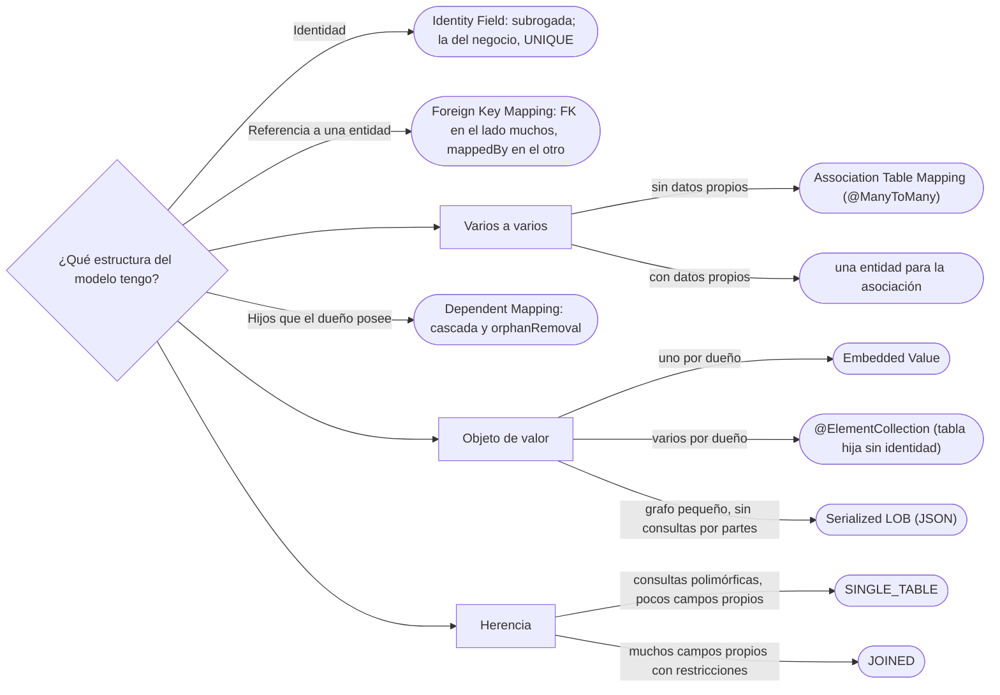

# 04 — Estructura objeto-relacional

> Mapear cada estructura del modelo a tablas —identidad, referencias, colecciones, objetos de valor, herencia— con los
> patrones del cap. 12 de *PoEAA*, y elegir con criterio entre los tres mapeos de herencia. **Niveles:** Identity Field
> B · Foreign Key Mapping B · Embedded Value B · Single, Class y Concrete Table Inheritance B · Association Table
> Mapping C · Dependent Mapping C · Serialized LOB C · Inheritance Mappers C. **Lenguajes:** Java con anotaciones de
> Jakarta Persistence, y SQL; C++ no aporta (§5.2 de la guía). **Desviación declarada:** la ficha propone documentos
> con subclases para la herencia, pero en el corpus los documentos se distinguen por un objeto tipo (`02/06`); el
> ejemplo de herencia es la jerarquía de movimientos de [`06/07`](../06-comportamiento/07-visitor.md). Asume leído
> [`02/07` — Objetos frente a tablas](../02-modelado-oo/07-objetos-frente-a-tablas.md) y
> [`03` — Comportamiento objeto-relacional](03-comportamiento-objeto-relacional.md).
>
> **Vigencia:** 2026-10-03.
>
> **Versiones ejecutadas:** JDK 21.0.12, 17.0.20 y 25.0.4 (2026-10-04).

**Salto rápido:** [1](#1--el-problema) · [2](#2--identity-field) · [3](#3--foreign-key-mapping) · [5](#5--embedded-value) · [7](#7--los-tres-mapeos-de-herencia) · [8](#8--cómo-se-elige)

---

## 1. 🎯 El problema

[`02/07`](../02-modelado-oo/07-objetos-frente-a-tablas.md) dejó planteadas las diferencias entre el modelo de objetos y el
relacional: la referencia contra la clave foránea, la colección contra la tabla hija, el objeto de valor que no es una
tabla, la herencia que la tabla no tiene. Este capítulo da, para cada una, el patrón con nombre y su anotación de
Jakarta Persistence:

```text
En el modelo                            En la base                       Patrón
identidad del objeto                    clave primaria                   Identity Field
Documento ──▶ TipoDocumento             FK en documento                  Foreign Key Mapping
Persona ◆── Documento (los posee)       tabla hija, borrado en cascada   Dependent Mapping
Persona ◀──▶ Cuenta (varios a varios)   tabla intermedia                 Association Table Mapping
Dinero, Direccion                       columnas en la tabla del dueño   Embedded Value
preferencias (un grafo pequeño)         una columna JSON                 Serialized LOB
Movimiento y sus subtipos               una, varias o muchas tablas      Single / Class / Concrete Table Inheritance
```

---

## 2. 🧱 Identity Field

**Problema.** Un objeto en memoria se identifica por su referencia; una fila, por su clave primaria. Para cargar y
guardar, el objeto tiene que **llevar** la clave.

**Mecanismo.** Un campo del objeto guarda la clave primaria de su fila. La decisión es de qué clave: **natural** (el
número de cuenta `CTA-0001`) o **subrogada** (un número que genera la base y no significa nada).

**Código.**

```java
@Entity
public class Persona {
    @Id @GeneratedValue(strategy = GenerationType.IDENTITY)
    private Long id;                                  // subrogada: la asigna la base al insertar
}

@Entity
public class Cuenta {
    @Id private String numero;                        // natural: "CTA-0001", la asigna el negocio
}
```

**Cuándo sí y cuándo no.** Subrogada casi siempre: las claves naturales cambian (un número de documento corregido,
`01/02` §6) y arrastran el cambio a todas las FK. Natural solo si el negocio garantiza que no cambia. El precio de la
subrogada asignada al insertar es que una entidad nueva **no tiene id** hasta guardarse, y un `equals` por id falla
antes de eso ([`01/02` §9](../01-modelo-de-objetos/02-igualdad-identidad-y-hash.md#9--entidades-identidad-o-clave-natural)).

> **Veredicto:** clave subrogada en la tabla, y la identidad del negocio como dato con su restricción `UNIQUE`; si el
> `equals` necesita id desde el principio, generarlo en la aplicación (un UUID) en lugar de esperar a la base.

---

## 3. 🧱 Foreign Key Mapping

**Problema.** Una referencia entre objetos (`documento.tipo()`) tiene que convertirse en una clave foránea, y una
colección (`persona.documentos()`) también, pero en la tabla del otro lado.

**Mecanismo.** La referencia de uno se guarda como FK en su tabla; la colección del otro lado **no tiene columna**: es la
misma FK leída desde el otro extremo.

**Código.**

```java
@Entity
public class Documento {
    @ManyToOne(optional = false) @JoinColumn(name = "persona_id")
    private Persona titular;                          // el dueño de la relación: tiene la FK
}

@Entity
public class Persona {
    @OneToMany(mappedBy = "titular")                 // el lado inverso: no hay columna, se lee la FK de documento
    private List<Documento> documentos = new ArrayList<>();
}
```

- Las dos puntas navegables de [`02/03`](../02-modelado-oo/03-navegabilidad-y-coherencia.md) son **una sola FK** en la
  base. JPA solo mira el lado que tiene la FK (el *owning side*): si se añade el documento a la lista de la persona y no
  se asigna `documento.titular`, **no se guarda la relación**. Por eso la puerta única que mantiene las dos puntas es
  obligatoria también con JPA.

**Cuándo sí y cuándo no.** Siempre para referencias a una entidad. No para objetos de valor (§5) ni para colecciones que
la entidad posee del todo (§4).

> **Veredicto:** una FK en la tabla del lado "muchos", y el lado "uno" con `mappedBy`; las dos puntas se mantienen con una
> sola puerta en el código.

---

## 4. 🧱 Association Table Mapping, Dependent Mapping y el titular polimórfico

**Association Table Mapping** (C). **Intención:** mapear una asociación de varios a varios con una tabla intermedia que
solo tiene las dos FK. **Ejemplo mínimo:** `@ManyToMany @JoinTable(name = "titularidad")` entre `Cuenta` y `Persona`.
**Por qué hoy es raro:** en cuanto la asociación tiene datos (el porcentaje de cada titular, la fecha desde), deja de ser una
tabla de dos columnas. **Qué lo reemplazó:** una entidad explícita para la asociación, `Titularidad`, con dos
`@ManyToOne` y sus propios campos (la clase de asociación de `02/02`).

**Dependent Mapping** (C). **Intención:** que los objetos que pertenecen del todo a otro (los documentos de una persona)
los cargue y guarde el mapeador del dueño, sin vida propia. **Ejemplo mínimo:** `@OneToMany(mappedBy = "titular", cascade
= CascadeType.ALL, orphanRemoval = true)`, o `@ElementCollection` si los hijos son objetos de valor. **Por qué hoy es
raro escribirlo:** el ORM lo hace con esas dos opciones. **Qué lo reemplazó:** la cascada y el borrado de huérfanos, que
son la composición de `02/04` dicha al ORM.

**El titular polimórfico.** `Cuenta → Titular`, donde el titular puede ser una `Persona` o una `Organizacion` (la interfaz
de rol de `01/09` E3), es una FK que apuntaría a **dos tablas**, y una FK solo apunta a una. Las salidas:

| Opción | Cómo | Lo que cuesta |
|---|---|---|
| Dos FK opcionales | `persona_id` y `organizacion_id`, con un `CHECK` de que exactamente una no es nula | Una columna nula siempre; la base sigue garantizando la integridad |
| Superclase mapeada | Una entidad abstracta `Titular` con herencia `JOINED` (§7) | Mete en el modelo la superclase `Parte` que `01/09` E3 desaconsejó |
| Asociación genérica | Tipo e id sin FK (`@Any` de Hibernate) | Sin integridad referencial: la base acepta un id que no existe |

- La primera es la que se defiende en una entrevista: el modelo sigue con la interfaz `Titular`, y la base conserva sus
  claves foráneas.

---

## 5. 🧱 Embedded Value

**Problema.** Un objeto de valor (`Dinero`, `Direccion`) no tiene identidad, y darle una tabla propia con clave sería
darle una (`02/07` §7).

**Mecanismo.** Los campos del objeto de valor se guardan como **columnas de la tabla de su dueño**.

**Código.**

```java
@Embeddable
public record Dinero(BigDecimal monto, String moneda) {}       // un record: válido desde Jakarta Persistence 3.2

@Entity
public class Cuenta {
    @Id private String numero;
    @Embedded
    @AttributeOverride(name = "monto",  column = @Column(name = "saldo_monto"))
    @AttributeOverride(name = "moneda", column = @Column(name = "saldo_moneda"))
    private Dinero saldo;
}
```

- `saldo_monto` y `saldo_moneda` son dos columnas de `cuenta`. Si la cuenta tuviera otro `Dinero` (el límite de
  sobregiro), otro par de columnas con otros nombres: por eso los `@AttributeOverride`.
- Que un `record` pueda ser `@Embeddable` lo admite Jakarta Persistence 3.2; en versiones anteriores, el objeto de valor
  embebido tenía que ser una clase con constructor sin argumentos.
- Aquí la moneda es el código ISO en un `String`. En el `Dinero` de [`02/06`](../02-modelado-oo/06-entidades-valores-y-primitivos.md#5--dinero-por-qué-no-double)
  es un `Currency`, que la especificación no mapea por sí sola: hace falta un `AttributeConverter` (o el soporte propio
  del proveedor).

**Cuándo sí y cuándo no.** Para todo objeto de valor de una sola instancia por dueño. Una **colección** de objetos de
valor (las direcciones de una persona) no cabe en columnas: va en una tabla hija con `@ElementCollection`, que es una
tabla sin identidad propia.

> **Veredicto:** los objetos de valor se incrustan en la tabla de su dueño; nunca una tabla `dinero` con su clave.

---

## 6. 🧱 Serialized LOB e Inheritance Mappers

**Serialized LOB** (C). **Intención:** guardar un grafo de objetos pequeño, que no se consulta por partes, serializado en
una sola columna. **Ejemplo mínimo:** las preferencias de notificación de una persona en una columna `jsonb`, con un
convertidor. **Por qué hoy es raro… o no:** en forma de objeto Java serializado, sí (frágil e ilegible); en forma de JSON,
volvió con las columnas JSON de las bases relacionales. **Qué lo reemplazó:** el JSON, que la base puede indexar y
consultar en parte; con el costo de perder las restricciones de las columnas.

**Inheritance Mappers** (C). **Intención:** organizar los mapeadores de una jerarquía con un mapeador abstracto para lo común
y uno concreto por clase. **Ejemplo mínimo:** un `MapeadorMovimientos` con la parte común y `MapeadorRetiros` con la propia.
**Por qué hoy es raro:** el ORM lo hace por dentro a partir de `@Inheritance`. **Qué lo reemplazó:** las anotaciones de
herencia de §7.

---

## 7. 🧱 Los tres mapeos de herencia

**Problema.** `Movimiento` tiene subtipos con datos distintos (`Retiro` con el cajero, `TransferenciaEnviada` con el
destino), y la base no tiene herencia.

**Mecanismo.** Tres formas, que en Jakarta Persistence son una opción de `@Inheritance`:

```java
@Entity
@Inheritance(strategy = InheritanceType.SINGLE_TABLE)       // o JOINED, o TABLE_PER_CLASS
@DiscriminatorColumn(name = "tipo")
public abstract class Movimiento {
    @Id @GeneratedValue private Long id;
    @Embedded private Dinero monto;
    private LocalDate fecha;
}

@Entity @DiscriminatorValue("RETIRO")
public class Retiro extends Movimiento { private String cajero; }

@Entity @DiscriminatorValue("ENVIADA")
public class TransferenciaEnviada extends Movimiento { private String destino; }
```

```text
SINGLE_TABLE          movimiento(id, tipo, monto, moneda, fecha, cajero, destino, origen, concepto)
JOINED                movimiento(id, tipo, monto, moneda, fecha) + retiro(id, cajero) + enviada(id, destino) + …
TABLE_PER_CLASS       retiro(id, monto, moneda, fecha, cajero) + enviada(id, monto, moneda, fecha, destino) + …
```

**La tabla de decisión**, con los movimientos:

| | **Single Table** | **Class Table** (`JOINED`) | **Concrete Table** (`TABLE_PER_CLASS`) |
|---|---|---|---|
| Tablas | Una | Una por clase, unidas por la clave | Una por clase concreta |
| Columnas de subtipos | Nulas en las filas de otros subtipos: no admiten `NOT NULL` | En su tabla, con sus restricciones | En su tabla |
| Leer un subtipo | ✅ un `SELECT` | ❌ un *join* por nivel | ✅ un `SELECT` |
| Consulta polimórfica ("todos los movimientos de la cuenta") | ✅ un `SELECT` | ❌ *joins* con todas las subtablas | ❌ un `UNION` de todas las tablas |
| Cambiar un subtipo | Columnas nuevas en la tabla común | Solo su tabla | Solo su tabla, pero lo común repetido en todas |
| Para los movimientos | **La elegida**: el extracto es polimórfico y los subtipos tienen pocos campos | Si los subtipos tuvieran muchos campos propios con restricciones | Si casi nunca se consultaran juntos |

- El extracto —"todos los movimientos de la cuenta, ordenados por fecha"— es la consulta principal, y es polimórfica:
  `SINGLE_TABLE` la resuelve con un `SELECT`. El precio son columnas nulas y restricciones que se comprueban con `CHECK`
  por tipo, no con `NOT NULL`.
- `TABLE_PER_CLASS` es opcional en la especificación de Jakarta Persistence: un proveedor puede no implementarlo.

**Cuándo no.** Si la jerarquía es solo de comportamiento y no de datos, no hace falta mapear herencia: un `enum` con el tipo
y una sola clase bastan. Y la mejor herencia que mapear es la que no existe: el objeto tipo de `02/06` es una tabla de
tipos y una FK.

> **Veredicto:** `SINGLE_TABLE` cuando las consultas son polimórficas y los subtipos tienen pocos campos; `JOINED` cuando
> los subtipos tienen mucho propio y se necesitan restricciones; `TABLE_PER_CLASS` casi nunca. "La herencia se mapea
> siempre con una tabla por clase" ignora que esa es la opción que más *joins* paga.

---

## 8. 🧭 Cómo se elige



**La frase en voz alta:** *"Los movimientos los mapearía en una sola tabla con discriminador: el extracto es una
consulta polimórfica y cada subtipo tiene uno o dos campos. Pago columnas nulas, que compenso con `CHECK` por tipo. Si
cada subtipo tuviera veinte campos con restricciones, `JOINED`."*

---

## ⚠️ Errores frecuentes

| Se dice | Lo preciso |
|---|---|
| "La herencia se mapea siempre con una tabla por clase" | Es `JOINED`, la que más *joins* paga; con consultas polimórficas suele ganar `SINGLE_TABLE` |
| "Con `@OneToMany` basta añadir a la lista para que se guarde la relación" | JPA guarda el lado que tiene la FK: hay que asignar `documento.titular` |
| "Un objeto de valor necesita su propia tabla" | Se incrusta en la del dueño; una tabla con clave le daría identidad |
| "Las claves naturales son más limpias" | Cambian, y el cambio se propaga a todas las FK; mejor subrogada y la natural como `UNIQUE` |
| "Una asociación polimórfica se mapea con una FK" | Una FK apunta a una tabla; hacen falta dos FK con `CHECK`, una superclase o una asociación sin integridad |
| "`TABLE_PER_CLASS` funciona en cualquier proveedor" | Es opcional en la especificación |
| "`@ManyToMany` sirve para los titulares de una cuenta" | En cuanto la titularidad tiene datos (porcentaje, desde), es una entidad |

---

## 📚 Para profundizar

- **Libro** — Fowler, *Patterns of Enterprise Application Architecture* (Addison-Wesley, 2002), cap. 12,
  "Object-Relational Structural Patterns", y la sección "Structural Mapping Patterns" del cap. 3. **El que destaca.**
- [Jakarta Persistence 3.2 — `InheritanceType`](https://jakarta.ee/specifications/persistence/3.2/apidocs/jakarta.persistence/jakarta/persistence/inheritancetype):
  las tres estrategias.
- [Jakarta Persistence 3.2 — `Embeddable`](https://jakarta.ee/specifications/persistence/3.2/apidocs/jakarta.persistence/jakarta/persistence/embeddable):
  qué puede ser incrustable, records incluidos.
- [martinfowler.com — Single Table Inheritance](https://martinfowler.com/eaaCatalog/singleTableInheritance.html)
- [martinfowler.com — Class Table Inheritance](https://martinfowler.com/eaaCatalog/classTableInheritance.html)
- [martinfowler.com — Embedded Value](https://martinfowler.com/eaaCatalog/embeddedValue.html)
- [martinfowler.com — Foreign Key Mapping](https://martinfowler.com/eaaCatalog/foreignKeyMapping.html)

---

## 🧠 Preguntas

Sin respuestas aquí. Todas, con enunciado literal y respuesta en tres capas, en
[`07` — Respuestas](07-respuestas.md#04--estructura-objeto-relacional).

1. ¿Qué es un Identity Field? 🟢
2. ¿Qué es Foreign Key Mapping? 🟢
3. ¿Qué es un Embedded Value? 🟢
4. ¿Qué son los tres mapeos de herencia de Fowler? 🟢
5. ¿Qué es un Serialized LOB, y en qué forma volvió? 🟢
6. ¿Qué diferencia hay entre clave natural y clave subrogada? 🟡
7. ¿Qué diferencia hay entre `SINGLE_TABLE` y `JOINED`? 🟡
8. ¿Qué diferencia hay entre Association Table Mapping y una entidad para la asociación? 🟡
9. ¿Qué diferencia hay entre `@Embedded` y `@ElementCollection`? 🟡
10. ¿Qué diferencia hay entre el lado dueño y el lado inverso de una relación en JPA? 🟡
11. ¿Por qué "la herencia se mapea siempre con una tabla por clase" es falso? 🟠
12. ¿Qué precio paga `SINGLE_TABLE`, y cómo se compensa? 🟠
13. ¿Por qué una entidad nueva sin id es un problema para `equals`, y qué haces? 🟠
14. ¿Cómo mapeas `Cuenta → Titular` si el titular puede ser una persona o una organización? 🟠
15. ¿Cuándo no hace falta mapear herencia en absoluto? 🟠
16. Escribe el mapeo de `Movimiento` con `SINGLE_TABLE` y dos subtipos. 🔴
17. Escribe el mapeo de `Cuenta` con su saldo como `Dinero` incrustado. 🔴
18. Revisa este código y di por qué el documento no queda asociado: `persona.getDocumentos().add(doc);
    em.persist(doc);` con `@OneToMany(mappedBy = "titular")` en `Persona`. 🔴

---

**Anterior:** [`03` — Comportamiento objeto-relacional](03-comportamiento-objeto-relacional.md) ·
**Siguiente:** [`05` — Metadatos y consultas](05-metadatos-y-consultas.md) ·
**Relacionado:** [`02/07` — Objetos frente a tablas](../02-modelado-oo/07-objetos-frente-a-tablas.md)
