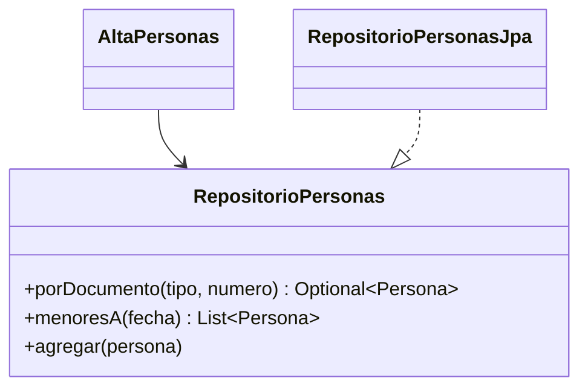
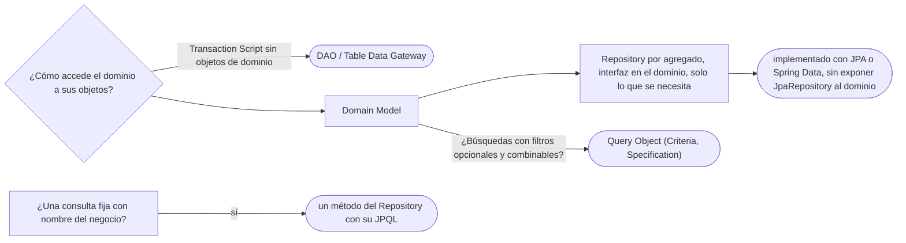

# 05 — Metadatos y consultas

> Distinguir el **Repository** del DAO y decidir cuánto expone; construir consultas como objetos con **Query Object**
> (la Criteria API y la `Specification` de Spring Data); y reconocer en las anotaciones de JPA el **Metadata Mapping**.
> **Niveles:** Repository A · Query Object B · Metadata Mapping C. **Lenguajes:** Java; C++ no aporta (§5.2 de la guía).
> Asume leído [`02` — Fuentes de datos](02-fuentes-de-datos.md) y
> [`03` — Comportamiento objeto-relacional](03-comportamiento-objeto-relacional.md).
>
> **Vigencia:** 2026-10-03.
>
> **Versiones ejecutadas:** JDK 21.0.12, 17.0.20 y 25.0.4 · Spring Boot 4.1.1 (Spring Framework 7.0.9, Hibernate 7.4.5, H2 2.4.240) · mermaid-cli 11.17.0 (2026-10-04).

---

## 1. 🎯 El problema

El servicio de alta, el de transferencias y la importación nocturna necesitan personas: buscarlas por documento,
listar los menores con tutor, guardar las nuevas. Hoy cada uno lo hace a su manera:

```java
// en el servicio de alta
Persona p = em.createQuery("select p from Persona p join p.documentos d where d.numero = :n", Persona.class)
              .setParameter("n", numero).getSingleResult();
// en la importación
List<Persona> menores = em.createQuery("select p from Persona p where p.fechaNacimiento > :f", Persona.class)
              .setParameter("f", LocalDate.now().minusYears(18)).getResultList();
```

- La consulta "persona por documento" está escrita tres veces, con tres variantes. La regla "es menor" vive en un
  `WHERE` copiado, y en otra parte vive en `Persona.esMenor`. Los servicios saben de JPQL y de `EntityManager`.

Lo que el dominio quiere es pedir personas **como a una colección**, en su idioma: "la persona de este documento", "los
menores a esta fecha". El Repository es eso.

---

## 2. 🧱 Repository

**Problema.** Que el dominio acceda a sus objetos persistidos sin saber de consultas ni de la base, y que las consultas
estén en un sitio, con nombres del negocio.

**Estructura.** Una interfaz con forma de **colección en memoria** de objetos de dominio —agregar, quitar, buscar por
criterios del negocio—, definida junto al dominio, e implementada en la infraestructura sobre un Data Mapper.



**Código.**

```java
public interface RepositorioPersonas {                          // en el paquete del dominio
    Optional<Persona> porDocumento(TipoDocumento tipo, String numero);
    List<Persona> menoresA(LocalDate fecha);
    void agregar(Persona p);
}

@Repository
class RepositorioPersonasJpa implements RepositorioPersonas {   // en la infraestructura
    private final EntityManager em;
    RepositorioPersonasJpa(EntityManager em) { this.em = em; }

    public Optional<Persona> porDocumento(TipoDocumento tipo, String numero) {
        return em.createQuery("""
                select p from Persona p join p.documentos d
                where d.tipo = :tipo and d.numero = :numero""", Persona.class)
                .setParameter("tipo", tipo).setParameter("numero", numero)
                .getResultStream().findFirst();
    }
    public List<Persona> menoresA(LocalDate fecha) {
        return em.createQuery("select p from Persona p where p.fechaNacimiento > :limite", Persona.class)
                .setParameter("limite", fecha.minusYears(18)).getResultList();
    }
    public void agregar(Persona p) { em.persist(p); }
}
```

- Los servicios dependen de `RepositorioPersonas`, una interfaz del dominio. Se prueban con una implementación en memoria
  que guarda personas en un `Map`.
- No hay `actualizar`: una colección no tiene "actualizar". Las personas cargadas se modifican y la unidad de trabajo
  escribe los cambios (`03` §5). Esa ausencia es la que separa un Repository de un DAO.

**Con qué se confunde.** Con el DAO, que es la confusión que la entrevista busca:

| | **Repository** | **DAO** |
|---|---|---|
| Habla de | Objetos del dominio, como una colección | Tablas y operaciones de persistencia |
| Métodos | `porDocumento`, `menoresA`, `agregar` | `insert`, `update`, `delete`, `findById` por tabla |
| Interfaz definida | Junto al dominio, en su idioma | Junto a la persistencia |
| Unidad | Un agregado (la persona con sus documentos) | Una tabla |

**Dónde aparece.** Spring Data: una interfaz que extiende `JpaRepository<Persona, Long>` obtiene la implementación generada,
y métodos como `findByFechaNacimientoAfter` se derivan de su nombre. Es un Repository con mucho de DAO genérico (tiene
`save`, `deleteAll`, `findAll`).

**Cuándo no.** El Repository genérico para todo —un `RepositorioGenerico<T>` con `findAll`, `save` y `delete` para cada
entidad— no es un Repository: no habla el idioma del dominio, expone operaciones que el dominio no debería tener (borrar
cualquier movimiento) y deja las consultas a quien lo use.

> **Veredicto:** un Repository por agregado, con una interfaz en el idioma del dominio y solo las operaciones que el
> dominio necesita. Spring Data es una buena implementación, pero conviene que el dominio vea una interfaz propia y no
> los cuarenta métodos de `JpaRepository`.

---

## 3. 🧱 Query Object

**Problema.** Una pantalla de búsqueda de personas con filtros opcionales —nombre, país, rango de edad, tipo de
documento— produce un JPQL armado concatenando cadenas, con un `if` por filtro y el riesgo de errores de sintaxis y de
inyección.

**Mecanismo.** La consulta se construye como un **árbol de objetos** (criterios combinables) que un intérprete traduce a
SQL. En JPA, la **Criteria API**; en Spring Data, la `Specification`, que su documentación presenta como basada en el
concepto de *specification* del libro de Evans; el patrón, en memoria y con sus usos, está en [`09/03`](../09-ddd-tactico-y-otros/03-specification-null-object-y-type-object.md).

**Código**, con Spring Data:

```java
public final class FiltrosPersona {
    public static Specification<Persona> nacidaAntesDe(LocalDate f) {
        return (raiz, consulta, cb) -> cb.lessThan(raiz.get("fechaNacimiento"), f);
    }
    public static Specification<Persona> deNacionalidad(String iso) {
        return (raiz, consulta, cb) -> cb.equal(raiz.get("nacionalidad").get("codigoIso"), iso);
    }
}

Specification<Persona> filtro = FiltrosPersona.nacidaAntesDe(hoy.minusYears(18));
if (pais != null) filtro = filtro.and(FiltrosPersona.deNacionalidad(pais));
List<Persona> resultado = repositorioSpringData.findAll(filtro);    // con JpaSpecificationExecutor
```

- Cada filtro es un objeto con nombre que se prueba y se combina; no hay concatenación de cadenas ni parámetros sin
  enlazar.

**Cuándo sí y cuándo no.** Sí para búsquedas con filtros combinables y opcionales. No para consultas fijas: un método con
nombre y su JPQL se leen mejor que un árbol de criterios. Y los nombres de atributos como cadenas (`"fechaNacimiento"`)
fallan al ejecutar si se renombra el campo; el metamodelo estático de JPA lo evita a costa de código generado.

> **Veredicto:** Query Object para búsquedas con filtros variables; JPQL con nombre para las consultas fijas. El árbol
> de criterios es el mismo de Specification e Interpreter, aplicado a consultas.

---

## 4. 🧱 Metadata Mapping

**Intención.** Describir el mapeo entre objetos y tablas como **datos** (metadatos), y que un código genérico lo
interprete o genere el acceso, en lugar de escribir un mapeador a mano por clase.

**Ejemplo mínimo.** Las anotaciones de JPA son exactamente eso:

```java
@Entity @Table(name = "persona")
public class Persona {
    @Id @GeneratedValue private Long id;
    @Column(name = "fecha_nacimiento", nullable = false) private LocalDate fechaNacimiento;
}
```

**Por qué hoy es raro escribirlo.** Porque nadie escribe ya el código que lee los metadatos: lo hacen los ORM. Lo que se
escribe son los metadatos (anotaciones, `orm.xml`).

**Qué lo reemplazó.** Los ORM con anotaciones; y, en el otro extremo, las herramientas que **generan** código desde el
esquema (jOOQ), que hacen el mismo mapeo en compilación.

---

## 5. 🧭 Cómo se elige



**La frase en voz alta:** *"El Repository es una colección del dominio: `porDocumento`, `menoresA`, `agregar`, y no tiene
`update` porque la unidad de trabajo escribe los cambios. Un DAO habla de tablas. Spring Data me da la implementación, pero
el dominio ve mi interfaz, no los cuarenta métodos de `JpaRepository`."*

---

## ⚠️ Errores frecuentes

| Se dice | Lo preciso |
|---|---|
| "Repository y DAO son lo mismo" | El Repository es una colección del dominio en su idioma; el DAO, operaciones de persistencia por tabla |
| "Un Repository genérico para todo es buena idea" | Expone operaciones que el dominio no debería tener y no habla su idioma |
| "Un Repository necesita `update`" | Las entidades cargadas se modifican y la unidad de trabajo escribe; una colección no tiene `update` |
| "Spring Data es el patrón Repository" | Es una implementación con mucho de DAO genérico; el dominio debería ver una interfaz propia |
| "Construir el JPQL concatenando filtros es más simple" | Es frágil y abre la puerta a la inyección; los filtros variables van con Criteria o Specification |
| "Las anotaciones de JPA son configuración" | Son metadatos de mapeo: el patrón Metadata Mapping, interpretado por el ORM |

---

## 📚 Para profundizar

- **Libro** — Fowler, *Patterns of Enterprise Application Architecture* (Addison-Wesley, 2002), cap. 13,
  "Object-Relational Metadata Mapping Patterns": Metadata Mapping, Query Object y Repository.
- **Libro** — Evans, *Domain-Driven Design* (Addison-Wesley, 2003), cap. 6, "The Life Cycle of a Domain Object", sección
  de repositorios: uno por agregado, con la ilusión de una colección en memoria. **El que destaca.**
- [martinfowler.com — Repository](https://martinfowler.com/eaaCatalog/repository.html)
- [martinfowler.com — Query Object](https://martinfowler.com/eaaCatalog/queryObject.html)
- [Spring Data JPA — Core concepts](https://docs.spring.io/spring-data/jpa/reference/repositories/core-concepts.html):
  la abstracción de repositorio.
- [Spring Data JPA — Specifications](https://docs.spring.io/spring-data/jpa/reference/jpa/specifications.html): el Query
  Object de Spring Data, basado en las *specifications* de Evans.

---

## 🧠 Preguntas

Sin respuestas aquí. Todas, con enunciado literal y respuesta en tres capas, en
[`07` — Respuestas](07-respuestas.md#05--metadatos-y-consultas).

1. ¿Qué es un Repository? 🟢
2. ¿Qué es un Query Object? 🟢
3. ¿Qué es Metadata Mapping? 🟢
4. ¿Qué es una `Specification` de Spring Data? 🟢
5. ¿Qué diferencia hay entre Repository y DAO? 🟡
6. ¿Qué diferencia hay entre un Repository propio y un `JpaRepository` de Spring Data? 🟡
7. ¿Qué diferencia hay entre un Query Object y un método de consulta con nombre? 🟡
8. ¿Qué diferencia hay entre Repository y Data Mapper? 🟡
9. ¿Por qué un Repository no tiene `update`? 🟠
10. ¿Por qué un Repository genérico para todas las entidades es mala idea? 🟠
11. ¿Dónde se define la interfaz del Repository, y por qué ahí? 🟠
12. ¿Qué riesgo tienen los nombres de atributos como cadenas en la Criteria API, y cómo se evita? 🟠
13. ¿Por qué un Repository va por agregado y no por tabla? 🟠
14. Diseña la interfaz `RepositorioPersonas` para el alta, la importación y la pantalla de menores. 🔴
15. Escribe una búsqueda de personas con filtros opcionales de nacionalidad y edad con `Specification`. 🔴
16. Revisa esta interfaz y di qué falla: `interface RepositorioCuentas extends JpaRepository<Cuenta, String> {}`,
    inyectada en el servicio de transferencias, que además llama a `deleteAll()` en un test de integración y a
    `save(cuenta)` después de cada `debitar`. 🔴

---

**Anterior:** [`04` — Estructura objeto-relacional](04-estructura-objeto-relacional.md) ·
**Siguiente:** [`06` — Simulación de entrevista](06-simulacion-de-entrevista.md) ·
**Relacionado:** [`03` — Comportamiento objeto-relacional](03-comportamiento-objeto-relacional.md)
