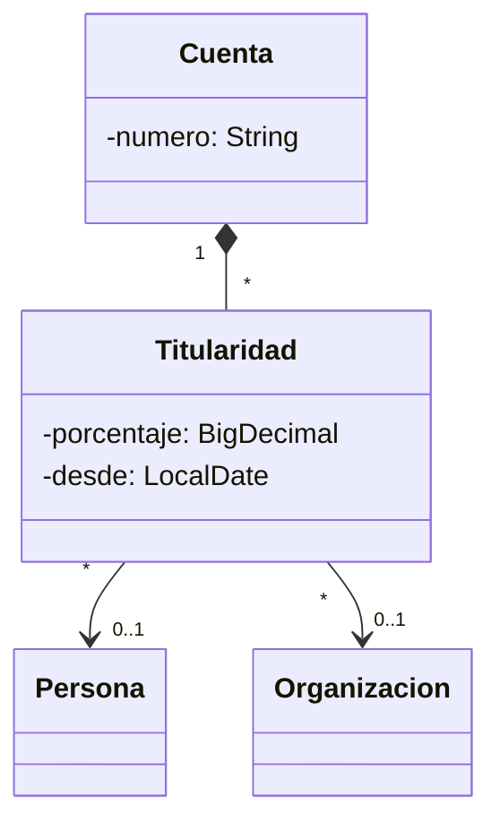

# 07 — Respuestas

> Solucionario del bloque `07-fowler-dominio-y-datos`: Fowler: dominio y datos. Cada respuesta en tres capas:
> **⏱️ 30 segundos** (lo que dices primero, sin que te lo pidan), **🗣️ 2 minutos** (lo que
> añades cuando dicen "cuéntame más") y **🔬 El detalle** (para estudiar, no para decir en voz
> alta). Los enunciados están copiados literalmente de su capítulo.
>
> **Vigencia:** 2026-10-04.
>
> **Versiones ejecutadas:** JDK 21.0.12, 17.0.20 y 25.0.4 · Spring Boot 4.1.1 (Spring Framework 7.0.9, Hibernate 7.4.5, H2 2.4.240) · mermaid-cli 11.17.0 · PostgreSQL 18.6 (2026-10-04).

**Salto rápido:** [01](#01--organizar-la-lógica-de-dominio) · [02](#02--fuentes-de-datos) · [03](#03--comportamiento-objeto-relacional) · [04](#04--estructura-objeto-relacional) · [05](#05--metadatos-y-consultas) · [06](#06--simulación-de-entrevista)

---

# 01 — Organizar la lógica de dominio

**01 → 1. ¿Qué es un Transaction Script? 🟢**

⏱️ Organizar la lógica de negocio como un procedimiento por operación: cada uno lee lo que necesita, aplica las reglas
en orden y escribe.
🗣️ El alta de una persona es un método que valida el nombre, comprueba el tutor con una consulta, revisa los
documentos repetidos y hace los `INSERT`. Todo lo del alta está ahí, y se lee de arriba abajo.
🔬 Fowler lo presenta en el cap. 9 de *PoEAA* como la forma más simple de organizar la lógica. Su problema es la
duplicación cuando varias operaciones comparten reglas.

**01 → 2. ¿Qué es un Domain Model? 🟢**

⏱️ Un modelo de objetos con datos y comportamiento, donde cada regla de negocio vive en el objeto que tiene la
información para cumplirla.
🗣️ La regla del tutor está en el constructor de `Persona`, y la de los documentos repetidos en `agregarDocumento`. Las
operaciones del sistema cargan objetos, les piden cosas y guardan; ninguna puede saltarse una regla.
🔬 La persistencia queda fuera del modelo, y por eso un Domain Model suele ir con un Data Mapper (JPA) por debajo.

**01 → 3. ¿Qué es un Table Module? 🟢**

⏱️ Una clase por tabla con la lógica de negocio que opera sobre un conjunto de filas en memoria, en lugar de un objeto
por fila.
🗣️ No hay un objeto por persona: hay un `ModuloPersonas` que recibe las filas de personas y sabe hacer cosas con ellas.
Encajaba con plataformas que giraban alrededor de conjuntos de filas, como el `DataSet` de .NET.
🔬 En Java casi no se usa: el ecosistema se fue a objetos con JPA. Es nivel B en este corpus porque se reconoce más de
lo que se escribe.

**01 → 4. ¿Qué es una Service Layer, según Fowler? 🟢**

⏱️ La capa que define el borde de la aplicación: el conjunto de operaciones disponibles, cada una con su transacción,
su seguridad y su coordinación.
🗣️ Fowler describe dos formas: fachada de dominio, con métodos delgados que delegan en un Domain Model, y *operation
script*, donde los métodos llevan la lógica. Las dos son el sitio donde varias interfaces (REST, lotes) encuentran las
mismas operaciones.
🔬 En Spring, los `@Service` con `@Transactional` son casi siempre una Service Layer; la pregunta es cuál de las dos
formas tienen.

**01 → 5. ¿Qué diferencia hay entre Transaction Script y Domain Model? 🟡**

⏱️ El Transaction Script organiza la lógica por operación, en procedimientos; el Domain Model, por concepto, en objetos
con datos y comportamiento.
🗣️ Con Transaction Script, la regla del tutor vive en el alta, y la edición la repite. Con Domain Model, vive en
`Persona`, una vez. El primero es más simple al empezar; el segundo escala mejor cuando las reglas se repiten y
cambian.
🔬 Fowler lo dibuja como una gráfica de esfuerzo contra complejidad: el Transaction Script es más barato con poca
complejidad y se dispara cuando crece; el Domain Model cuesta más al principio y crece más despacio.

**01 → 6. ¿Qué diferencia hay entre una Service Layer de fachada de dominio y una de *operation scripts*? 🟡**

⏱️ En la de fachada, los métodos son delgados y delegan las reglas en un Domain Model; en la de *operation scripts*,
los métodos contienen la lógica, como Transaction Scripts.
🗣️ `AltaPersonas.alta` que construye una `Persona` (y el constructor valida) es fachada de dominio. Un `alta` con todas
las comprobaciones dentro es *operation script*. Las dos ponen la transacción y la seguridad en la capa.
🔬 Muchos proyectos dicen tener Domain Model y tienen *operation scripts* con entidades anémicas: la diferencia está en
dónde están las reglas.

**01 → 7. ¿Qué diferencia hay entre Domain Model y DDD? 🟡**

⏱️ El Domain Model es un patrón de organización de la lógica; DDD es un enfoque para diseñar ese modelo, con agregados,
contextos delimitados y lenguaje ubicuo.
🗣️ Se puede tener un Domain Model sin aplicar DDD, y DDD casi siempre produce un Domain Model. Fowler nombra el patrón;
Evans explica cómo hacer que el modelo refleje el negocio.
🔬 Los bloques de construcción tácticos de DDD (entidad, valor, agregado) tienen su bloque en este corpus.

**01 → 8. ¿Qué diferencia hay entre Service Layer y la Facade del GoF? 🟡**

⏱️ La Facade simplifica un subsistema; la Service Layer define el borde de toda la aplicación, con transacción y
seguridad. Una Service Layer se implementa a menudo como un conjunto de fachadas.
🗣️ `AltaPersonas` es las dos cosas: una fachada sobre repositorio, modelo y notificador, y una operación del borde de
la aplicación con su `@Transactional`.
🔬 Ver `05/04 → 5`. La diferencia práctica: si es la entrada de un caso de uso de la aplicación, servicio de aplicación;
si simplifica una librería técnica, fachada.

**01 → 9. ¿Por qué "Domain Model siempre es mejor" es falso? 🟠**

⏱️ Porque con lógica simple el modelo es estructura de más, y un Domain Model mal hecho —reglas repartidas sin
criterio— es peor que un Transaction Script ordenado.
🗣️ Un CRUD de catálogos, con leer, validar dos campos y guardar, no gana nada con un modelo rico: gana clases y mapeo.
El Domain Model compensa cuando las reglas se repiten entre operaciones y cambian.
🔬 Fowler lo dice en el cap. 2: la elección depende de la complejidad de la lógica, y la mayoría de las aplicaciones
empiezan simples.

**01 → 10. ¿Cuál es la señal para pasar de Transaction Script a Domain Model? 🟠**

⏱️ Que la misma regla aparezca en varios scripts, y que un cambio de negocio obligue a tocar varios procedimientos a la
vez.
🗣️ Cuando la regla del tutor está en el alta, en la edición y en la importación, y una de las tres quedó distinta, la
regla pide un dueño: `Persona`. Otra señal es que los scripts empiecen a llamarse entre sí para reutilizar trozos.
🔬 La migración se puede hacer por partes: mover una regla al objeto que tiene sus datos, hacer que los scripts la usen,
repetir.

**01 → 11. ¿Por qué un modelo anémico es un Transaction Script disfrazado? 🟠**

⏱️ Porque las clases de dominio solo tienen datos y *getters/setters*, y toda la lógica vive en servicios que las
manipulan: es exactamente un Transaction Script con estructuras de datos que se llaman como conceptos.
🗣️ Tiene el costo de un Domain Model (clases, mapeo) y los problemas de un Transaction Script (reglas repetidas, que
cualquiera se salta con un *setter*). Fowler lo describió como antipatrón en 2003.
🔬 No es siempre un error: si la lógica es simple, ser honesto y llamarlo Transaction Script está bien. El problema es
creer que se tiene un Domain Model. El antipatrón completo es de [`12/03` §3](../12-antipatrones/03-antipatrones-de-diseno-oo.md#3-️-anemic-domain-model).

**01 → 12. ¿Qué decide la Service Layer y qué no debe decidir? 🟠**

⏱️ Decide lo de la aplicación: qué operaciones existen, la transacción, la autorización y la coordinación. No debe
decidir las reglas del negocio, si hay un Domain Model que las tenga.
🗣️ `@Transactional` y `@PreAuthorize` en `AltaPersonas` son decisiones de la aplicación. "Un menor necesita tutor" es
del dominio: si la capa la comprueba, la importación que no use la capa podría saltársela.
🔬 La regla práctica: si una comprobación tiene sentido aunque cambie la interfaz (REST, lotes, mensajes), es del
dominio; si depende de quién llama, es de la aplicación.

**01 → 13. ¿Por qué la elección entre Transaction Script y Domain Model es difícil de cambiar después? 🟠**

⏱️ Porque da forma a todo el código de negocio: dónde están las reglas, cómo se prueban, cómo se mapea a la base. Cambiar
de uno a otro es mover reglas de cientos de métodos a decenas de clases.
🗣️ Además arrastra la persistencia: un Transaction Script suele usar SQL directo o un Table Data Gateway; un Domain
Model, un Data Mapper. Cambiar la organización obliga a cambiar el acceso a datos.
🔬 Por eso conviene decidirlo pronto con la complejidad esperada del dominio, y migrar por partes cuando las señales
aparecen, no de golpe.

**01 → 14. Escribe el alta de §1 como Transaction Script, con la regla del tutor. 🔴**

⏱️ Un método transaccional que valida el nombre, calcula si es menor, comprueba con una consulta que el tutor existe y
es mayor, y hace los `INSERT`.
🗣️

```java
@Transactional
public PersonaId alta(SolicitudAlta s) {
    if (s.nombre().isBlank()) throw new SolicitudInvalidaException("nombre vacío");
    LocalDate hoy = LocalDate.now(reloj);
    if (s.fechaNacimiento().plusYears(18).isAfter(hoy)) {
        if (s.tutorId() == null) throw new SolicitudInvalidaException("un menor necesita tutor");
        LocalDate nacTutor = jdbc.queryForObject(
                "SELECT fecha_nacimiento FROM persona WHERE id = ?", LocalDate.class, s.tutorId());
        if (nacTutor.plusYears(18).isAfter(hoy)) throw new SolicitudInvalidaException("el tutor es menor");
    }
    long id = jdbc.queryForObject(
            "INSERT INTO persona (nombre, fecha_nacimiento, tutor_id) VALUES (?, ?, ?) RETURNING id",
            Long.class, s.nombre(), s.fechaNacimiento(), s.tutorId());
    return new PersonaId(id);
}
```

🔬 Lo que preguntará después: qué pasa si el tutor no existe (`queryForObject` lanza `EmptyResultDataAccessException`;
conviene traducirla a un error de negocio); y qué pasa con la edición de una persona (tendría que repetir la regla, que es
la señal de §2 para pasar a un modelo). `RETURNING` es de PostgreSQL: en otros motores, se pide la clave generada.

**01 → 15. Lleva la regla del tutor y la de los documentos repetidos a `Persona`, y deja el servicio como borde. 🔴**

⏱️ El constructor de `Persona` valida nombre y tutor; `agregarDocumento` valida formato y repetidos; el servicio carga el
tutor, construye, agrega y guarda, con la transacción.
🗣️

```java
public Persona(String nombre, LocalDate nacimiento, Persona tutor, LocalDate hoy) {
    if (nombre.isBlank()) throw new IllegalArgumentException("nombre vacío");
    if (nacimiento.plusYears(18).isAfter(hoy) && (tutor == null || tutor.esMenor(hoy)))
        throw new IllegalArgumentException("un menor necesita un tutor mayor de edad");
    this.nombre = nombre; this.fechaNacimiento = nacimiento; this.tutor = tutor;
}

@Transactional
public PersonaId alta(SolicitudAlta s) {
    LocalDate hoy = LocalDate.now(reloj);
    Persona tutor = s.tutorId() == null ? null : personas.obtener(s.tutorId());
    Persona p = new Persona(s.nombre(), s.fechaNacimiento(), tutor, hoy);
    s.documentos().forEach(d -> p.agregarDocumento(d.aDocumento()));
    return personas.guardar(p);
}
```

🔬 Lo que preguntará después: por qué `hoy` es un parámetro del constructor (para probar la regla sin el reloj); y qué
excepción ve el cliente REST (la del dominio, traducida a un 422 por un manejador de excepciones del borde).

**01 → 16. Revisa este servicio y di qué patrón es en realidad: `@Service class ServicioCuentas` con `debitar(id, monto)` que hace `c.setSaldo(c.getSaldo().subtract(monto))` tras comprobar el estado con `getEstado()`. 🔴**

⏱️ Es un Transaction Script con un modelo anémico: la regla (no debitar una cuenta bloqueada, no dejar el saldo negativo)
vive en el servicio, y `Cuenta` solo tiene datos y *setters* que cualquiera puede usar para saltársela.
🗣️ Si la lógica es así de simple y solo hay un sitio que debita, es aceptable, pero hay que llamarlo por su nombre. Si
otras operaciones también tocan el saldo, la regla pide un dueño: `cuenta.debitar(monto)`, que comprueba el estado y el
saldo, y el servicio queda como borde.
🔬 Lo que preguntará después: qué riesgo concreto tiene el `setSaldo` público (que otra operación cambie el saldo sin
comprobar el estado ni registrar un movimiento); y cómo migrar sin romper (añadir `debitar` a `Cuenta`, cambiar el
servicio para usarlo, y después quitar el *setter*).

# 02 — Fuentes de datos

**02 → 1. ¿Qué es un Table Data Gateway? 🟢**

⏱️ Un objeto por tabla que concentra todo su SQL, con un método por consulta o actualización, y que devuelve datos
crudos —filas o registros de transporte—, no objetos de dominio.
🗣️ `GatewayPersonas` con `menoresDe(limite)` y `cambiarNombre(id, nombre)`: el resto del código no escribe SQL. Encaja
con el Transaction Script, que tiene la lógica, mientras el *gateway* tiene el acceso.
🔬 Es lo que la mayoría de los equipos llama DAO. Fowler lo pone en el cap. 10 de *PoEAA*, junto con los otros tres.

**02 → 2. ¿Qué es un Row Data Gateway? 🟢**

⏱️ Un objeto por fila, con los campos de la fila y métodos para insertarse, actualizarse y borrarse, sin lógica de
negocio. Un buscador aparte devuelve esos objetos.
🗣️ Es un Table Data Gateway con un objeto por fila en lugar de filas crudas. En la práctica dura poco: en cuanto se le
añade lógica de negocio, es un Active Record.
🔬 Se ve en código generado desde el esquema, donde cada tabla produce una clase con sus campos y sus operaciones de
guardado.

**02 → 3. ¿Qué es un Active Record? 🟢**

⏱️ Un objeto de dominio que envuelve una fila, sabe cargarse y guardarse a sí mismo, y además tiene la lógica de negocio
sobre esos datos.
🗣️ `Persona.buscar(1)`, `ana.cambiarNombre(...)`, `ana.guardar()`: el objeto lo hace todo. Es la forma por defecto en
Ruby on Rails, Django y Laravel, y en Java la ofrece Hibernate con Panache.
🔬 Sus campos son las columnas de la tabla, y por eso funciona mejor cuanto más se parecen las clases a las tablas.

**02 → 4. ¿Qué es un Data Mapper? 🟢**

⏱️ Una capa de mapeadores que mueve datos entre los objetos de dominio y la base, de modo que el dominio no sabe nada de
la base y la base nada del dominio.
🗣️ `MapeadorPersonas.buscar(id)` lee la fila y reconstruye una `Persona`; `actualizar(p)` escribe sus campos. `Persona`
no tiene `guardar` y se prueba sin base. JPA, Hibernate, MyBatis y SQLAlchemy son Data Mapper.
🔬 Fowler lo recomienda para Domain Models que no se parecen a las tablas: herencia, objetos de valor incrustados,
colecciones.

**02 → 5. ¿Qué diferencia hay entre Active Record y Data Mapper? 🟡**

⏱️ En Active Record el objeto de dominio sabe guardarse; en Data Mapper lo guarda otro objeto y el dominio no sabe de la
base. Active Record es más directo; Data Mapper separa más.
🗣️ Active Record va bien cuando las clases son casi filas y el dominio es simple; Data Mapper, cuando el modelo es rico y
no se parece a las tablas. Con Active Record, probar lógica que guarda exige la base; con Data Mapper, no.
🔬 La elección suele venir del marco: Rails y Django eligen Active Record; JPA, Data Mapper. Panache ofrece las dos
sobre el mismo Hibernate.

**02 → 6. ¿Qué diferencia hay entre Row Data Gateway y Active Record? 🟡**

⏱️ Los dos son un objeto por fila que sabe guardarse; el Row Data Gateway no tiene lógica de negocio y el Active Record
sí.
🗣️ Es una diferencia de responsabilidad, no de mecanismo: en cuanto alguien añade `esMenor()` a un Row Data Gateway, se
convirtió en Active Record.
🔬 Fowler los separa porque el Row Data Gateway encaja con un Transaction Script (la lógica está fuera) y el Active Record
es ya un Domain Model simple.

**02 → 7. ¿Qué diferencia hay entre un DAO y un Data Mapper? 🟡**

⏱️ El DAO, tal como se usa casi siempre, es un Table Data Gateway: un objeto por tabla que devuelve datos. El Data Mapper
mapea objetos de dominio completos, con sus relaciones, en las dos direcciones.
🗣️ Un DAO puede devolver entidades (entonces hace de mapeador) o filas (entonces es un *gateway*). La palabra "DAO" viene
de los patrones de J2EE y no distingue los dos casos; Fowler sí.
🔬 En la entrevista conviene preguntar qué devuelve: si devuelve objetos de dominio y los reconstruye, es un mapeador; si
devuelve filas, un *gateway*.

**02 → 8. ¿Qué diferencia hay entre Data Mapper y Repository? 🟡**

⏱️ El Data Mapper traduce entre filas y objetos; el Repository ofrece al dominio una interfaz de colección
(`agregar`, `buscarPorDocumento`) y suele usar un mapeador por debajo.
🗣️ El Repository habla el idioma del dominio y oculta cómo se guarda; el mapeador habla de tablas y columnas. En JPA, el
`EntityManager` es el mapeador y un `RepositorioPersonas` escrito encima es el Repository.
🔬 El Repository tiene su capítulo en este bloque, junto con Query Object.

**02 → 9. ¿Qué diferencia hay entre Hibernate con Panache en modo Active Record y JPA con un repositorio? 🟡**

⏱️ Con Panache en modo Active Record, la entidad extiende `PanacheEntity` y tiene `persist()` y búsquedas estáticas: se
guarda a sí misma. Con un repositorio, la entidad es un objeto JPA normal y la guarda el repositorio.
🗣️ Por debajo es el mismo Hibernate, que es un Data Mapper con su unidad de trabajo. Panache ofrece la **interfaz** de
Active Record sobre él, para dominios simples, y la de repositorio para los demás.
🔬 Es un buen ejemplo de que el patrón describe lo que ve el código de dominio, no el motor que hay debajo.

**02 → 10. ¿Por qué "JPA es Active Record" es falso? 🟠**

⏱️ Porque una entidad de JPA no se guarda a sí misma: no tiene `save()`. La carga y la guarda el `EntityManager`, que es
el mapeador. Eso es Data Mapper.
🗣️ La confusión viene de que la entidad lleva anotaciones con el nombre de la tabla y las columnas, y parece "saber" de
la base. Pero las anotaciones son metadatos que lee el mapeador; la entidad no ejecuta SQL.
🔬 Spring Data añade repositorios con `save()`, que tampoco están en la entidad: siguen siendo un Repository sobre un
Data Mapper.

**02 → 11. ¿Cuándo Active Record deja de servir? 🟠**

⏱️ Cuando el modelo deja de parecerse a las tablas: herencia, objetos de valor incrustados, colecciones con reglas,
invariantes que cruzan objetos.
🗣️ Entonces el objeto tiene que saber a la vez de su tabla y de su dominio, y las dos cosas tiran en direcciones
distintas. Además, la lógica que guarda no se prueba sin base.
🔬 Fowler lo dice en el cap. 3: Active Record es buena elección si la lógica no es compleja; con un Domain Model rico, el
Data Mapper aísla mejor.

**02 → 12. ¿Por qué un Data Mapper necesita un camino de reconstrucción distinto del constructor? 🟠**

⏱️ Porque el constructor del alta valida lo nuevo y puede disparar efectos (fijar la fecha de alta, publicar un evento), y
reconstruir una persona que ya existe no debe repetir nada de eso.
🗣️ Si una regla cambió —ahora el nombre exige dos palabras—, las personas antiguas que no la cumplen tienen que poder
cargarse. Un `reconstituir(...)` de paquete, o el constructor sin argumentos que usa JPA por reflexión, separa los dos
caminos.
🔬 Evans lo llama reconstitución en *DDD*: crear un objeto nuevo y traer de vuelta uno existente son operaciones distintas.

**02 → 13. ¿Qué fuente de datos va con cada forma de organizar la lógica? 🟠**

⏱️ Transaction Script con Table Data Gateway (o SQL directo); Table Module con Table Data Gateway sobre conjuntos de filas;
Domain Model simple con Active Record; Domain Model rico con Data Mapper.
🗣️ La regla es que la fuente de datos siga a la lógica: si la lógica trabaja con filas, el acceso devuelve filas; si
trabaja con objetos, el acceso tiene que reconstruirlos.
🔬 Fowler hace este emparejamiento en el cap. 3 de *PoEAA*. Mezclar —un Domain Model con un *gateway* que devuelve filas—
obliga a mapear a mano en cada servicio.

**02 → 14. Escribe un Table Data Gateway de personas con una consulta y una actualización. 🔴**

⏱️ Una clase con un `JdbcTemplate`, un método que devuelve registros de transporte y otro que actualiza, sin objetos de
dominio.
🗣️

```java
public record FilaPersona(long id, String nombre, LocalDate fechaNacimiento) {}

public final class GatewayPersonas {
    private final JdbcTemplate jdbc;
    public GatewayPersonas(JdbcTemplate jdbc) { this.jdbc = jdbc; }

    public List<FilaPersona> menoresDe(LocalDate limite) {
        return jdbc.query("SELECT id, nombre, fecha_nacimiento FROM persona WHERE fecha_nacimiento > ?",
                (rs, n) -> new FilaPersona(rs.getLong("id"), rs.getString("nombre"),
                                           rs.getObject("fecha_nacimiento", LocalDate.class)), limite);
    }
    public int cambiarNombre(long id, String nombre) {
        return jdbc.update("UPDATE persona SET nombre = ? WHERE id = ?", nombre, id);
    }
}
```

🔬 Lo que preguntará después: por qué `cambiarNombre` devuelve el número de filas (para detectar que el id no existía);
y quién decide que un menor es el que nació después de `limite` (el script que llama: el *gateway* no tiene reglas).

**02 → 15. Escribe un Data Mapper a mano para `Persona` con `buscar` y `actualizar`. 🔴**

⏱️ Un mapeador con `JdbcTemplate` que reconstruye una `Persona` con un método de reconstitución y que escribe sus campos
en la tabla; `Persona` no sabe de la base.
🗣️

```java
public final class MapeadorPersonas {
    private final JdbcTemplate jdbc;
    public MapeadorPersonas(JdbcTemplate jdbc) { this.jdbc = jdbc; }

    public Optional<Persona> buscar(PersonaId id) {
        List<Persona> r = jdbc.query("SELECT id, nombre, fecha_nacimiento FROM persona WHERE id = ?",
                (rs, n) -> Persona.reconstituir(new PersonaId(rs.getLong("id")), rs.getString("nombre"),
                                                rs.getObject("fecha_nacimiento", LocalDate.class)),
                id.valor());
        return r.stream().findFirst();
    }
    public void actualizar(Persona p) {
        int filas = jdbc.update("UPDATE persona SET nombre = ? WHERE id = ?", p.nombre(), p.id().valor());
        if (filas != 1) throw new PersonaNoEncontradaException(p.id());
    }
}
```

🔬 Lo que preguntará después: qué pasa si se carga la misma persona dos veces (dos objetos para una fila: hace falta un
Identity Map, tema de `03`); y cómo se mapean los documentos (con otra consulta o un *join*, y es ahí donde un ORM
empieza a compensar).

**02 → 16. Revisa esta clase y di qué patrón es y qué problema tiene en un dominio complejo: `class Cuenta { … public void guardar() { Bd.jdbc().update(…); } public void debitar(Dinero m) { … guardar(); } }`. 🔴**

⏱️ Es un Active Record, y además llama a `guardar()` desde una regla de negocio: `debitar` escribe en la base cada vez.
En un dominio complejo, eso mezcla la regla con la persistencia y rompe la transacción de negocio.
🗣️ Una transferencia debita y acredita: con este diseño, el débito se guarda antes de que el crédito exista, y si el
crédito falla, el débito quedó escrito. Además `debitar` no se puede probar sin base. El arreglo: que `debitar` solo
cambie el estado, y que la transacción y el guardado los haga quien coordina (un servicio con Data Mapper o un
`EntityManager`).
🔬 Lo que preguntará después: por qué el estático `Bd.jdbc()` es un problema añadido (dependencia oculta de la
infraestructura, como un Singleton); y si el Active Record podría servir aquí (sí, si `debitar` no guardara y el servicio
llamara a `guardar` de las dos cuentas dentro de una transacción).

# 03 — Comportamiento objeto-relacional

**03 → 1. ¿Qué es una Unit of Work? 🟢**

⏱️ Un objeto que registra qué se creó, modificó y borró durante una operación de negocio, y al final lo escribe todo
junto, en orden y en una transacción.
🗣️ En una transferencia, el débito y el crédito quedan registrados como cambios; al confirmar, la unidad de trabajo hace
los dos `UPDATE` juntos. El código de negocio no se acuerda de guardar nada.
🔬 Fowler la describe en el cap. 11 de *PoEAA*. En Java es el contexto de persistencia de JPA, que además detecta los
cambios solo.

**03 → 2. ¿Qué es un Identity Map? 🟢**

⏱️ Un mapa de identificador a objeto ya cargado, que garantiza que cada fila se cargue una sola vez por operación: quien
pide a Ana dos veces recibe el mismo objeto.
🗣️ El mapeador consulta el mapa antes de ir a la base. Así no hay dos objetos para la misma fila que diverjan y se pisen
al guardar, y `==` significa "la misma fila" dentro de la operación.
🔬 La Javadoc de `EntityManager` lo define así: en un contexto de persistencia hay, para cada identidad persistente, como
mucho una instancia.

**03 → 3. ¿Qué es Lazy Load, y qué cuatro formas describe Fowler? 🟢**

⏱️ Cargar un objeto sin sus asociaciones y traerlas la primera vez que se usan. Fowler describe inicialización perezosa,
proxy virtual, *value holder* y *ghost*.
🗣️ La inicialización perezosa carga en el *getter* si el campo es `null`; el proxy virtual pone un objeto con la
interfaz del real que carga al primer uso; el *value holder* envuelve el valor en un objeto con `get()`; el *ghost* es el
objeto real con solo su identificador, que se completa al primer acceso.
🔬 Las colecciones `LAZY` de Hibernate son proxies virtuales; `getReference` devuelve algo cercano a un *ghost*.

**03 → 4. ¿Qué cuatro estados tiene una entidad de JPA? 🟢**

⏱️ Nueva (sin identidad persistente), gestionada (asociada a un contexto activo), separada (con identidad, pero sin
contexto que la siga) y borrada (marcada para eliminarse al sincronizar).
🗣️ Solo las gestionadas se vigilan: sus cambios se escriben en el `flush`. Una separada se puede modificar sin que pase
nada en la base, que es una fuente clásica de "guardé y no se guardó".
🔬 `persist` pasa una nueva a gestionada; `merge` copia el estado de una separada a una gestionada (y devuelve esa, no la
que se pasó); `remove` pasa a borrada.

**03 → 5. ¿Qué diferencia hay entre Unit of Work y la transacción de la base? 🟡**

⏱️ La unidad de trabajo es un registro en memoria de los cambios de una operación; la transacción es la garantía de la
base de que un grupo de escrituras se confirma o se deshace junto. La unidad de trabajo produce la transacción al
confirmar.
🗣️ Mientras la operación de negocio transcurre, la unidad de trabajo puede no tener nada abierto en la base; solo al
`flush` y al `commit` usa la transacción. En JPA dentro de `@Transactional` las dos coinciden en duración, y por eso se
confunden.
🔬 Una unidad de trabajo larga (una conversación de varias pantallas) no puede mantener una transacción abierta: ahí
entra el bloqueo optimista: ver [`08/03`](../08-fowler-presentacion-distribucion-y-base/03-concurrencia-offline.md).

**03 → 6. ¿Qué diferencia hay entre Identity Map y una caché de segundo nivel? 🟡**

⏱️ El Identity Map vive lo que la operación y existe para la coherencia: un objeto por fila. La caché de segundo nivel se
comparte entre operaciones y existe para el rendimiento.
🗣️ El Identity Map no tiene problemas de concurrencia: es de una sola operación. La caché de segundo nivel sí: puede
servir datos viejos, y necesita políticas de expiración e invalidación.
🔬 En Hibernate, la de primer nivel es el contexto de persistencia (el Identity Map) y no se puede desactivar; la de
segundo nivel es opcional y se configura por entidad.

**03 → 7. ¿Qué diferencia hay entre una entidad gestionada y una separada? 🟡**

⏱️ La gestionada está asociada a un contexto de persistencia activo, que detecta sus cambios y la escribe; la separada
tiene identidad pero ningún contexto la sigue: sus cambios no se escriben.
🗣️ Una entidad devuelta por un servicio transaccional queda separada cuando la transacción termina. Si el controlador la
modifica, no pasa nada en la base; y si toca una asociación perezosa, lanza `LazyInitializationException`.
🔬 Para volver a escribirla hace falta `merge`, que devuelve una copia gestionada; seguir usando la separada después del
`merge` es un error común.

**03 → 8. ¿Qué diferencia hay entre el `EntityManager` de JPA y el `DbContext` de C#? 🟡**

⏱️ Ninguna de fondo: los dos son una sesión con la base que combina Unit of Work, Identity Map y acceso a las entidades.
La documentación de `DbContext` dice que combina los patrones Unit of Work y Repository.
🗣️ En EF, `SaveChanges()` es el `flush` con su transacción, y el `ChangeTracker` detecta los cambios. En JPA, el *commit*
de la transacción provoca el `flush`.
🔬 Una diferencia práctica: EF ofrece `AsNoTracking()` para consultas que no registran entidades; en JPA se consigue con
proyecciones a DTO o con indicaciones (*hints*) de solo lectura del proveedor.

**03 → 9. ¿Qué diferencia hay entre `find` y `getReference`? 🟡**

⏱️ `find` carga la entidad (o devuelve `null` si no existe); `getReference` devuelve una referencia que puede no estar
cargada, para crear una asociación sin consultar la base.
🗣️ Para asignar la cuenta a un movimiento basta `getReference(Cuenta.class, "CTA-0001")`: el `INSERT` del movimiento
solo necesita la clave. Si se toca el estado de la referencia y no existe, se lanza `EntityNotFoundException`.
🔬 La Javadoc dice que el proveedor puede, pero no está obligado a, lanzar la excepción en el propio `getReference`: el
error puede llegar tarde.

**03 → 10. ¿Por qué no hace falta llamar a `save` dentro de una transacción con JPA? 🟠**

⏱️ Porque una entidad gestionada es seguida por el contexto de persistencia: sus cambios se detectan solos y se escriben
en el `flush`. La Javadoc lo dice: no hay una operación explícita de actualizar.
🗣️ `origen.debitar(monto)` dentro de `@Transactional` basta; al confirmar, Hibernate compara la entidad con la copia que
guardó al cargarla y genera el `UPDATE`. Un `repository.save(origen)` ahí no añade nada.
🔬 `save` de Spring Data sobre una entidad ya gestionada no hace nada útil; sobre una separada, hace un `merge`. Saber cuál
de las dos se tiene es lo que evita sorpresas.

**03 → 11. ¿Por qué `==` entre dos lecturas de la misma persona da `true` en una transacción y `false` en dos? 🟠**

⏱️ Porque dentro de un contexto de persistencia el Identity Map garantiza un objeto por fila; en dos contextos (dos
transacciones, dos peticiones) cada uno tiene su mapa y su objeto.
🗣️ Por eso `equals` de una entidad no puede ser `==`: dos objetos de la misma persona en dos peticiones tienen que ser
iguales. Va por el identificador, con el cuidado de que una entidad nueva aún no tiene identificador.
🔬 Ver `01/02` §9 para la igualdad de entidades, y `02/07` §6 para el problema de dos objetos por fila.

**03 → 12. ¿Qué es el problema N+1 y cómo se evita? 🟠**

⏱️ Una consulta para traer N objetos, y luego una consulta más por cada uno al tocar una asociación perezosa en un bucle:
N+1 consultas donde bastaba una o dos.
🗣️ Se evita pidiendo la asociación junto con los objetos en la consulta de ese caso de uso: `JOIN FETCH`, un
`@EntityGraph`, o una proyección a DTO que traiga solo lo que se muestra. El perezoso queda como valor por defecto para
los demás casos.
🔬 Se detecta activando el registro de SQL en desarrollo o con herramientas que cuentan consultas por petición; un test que
falle si una pantalla pasa de cierto número de consultas lo previene.

**03 → 13. ¿Por qué aparece `LazyInitializationException`, y cuál es la salida correcta? 🟠**

⏱️ Porque se toca una asociación perezosa de una entidad separada: el contexto de persistencia que podía cargarla ya se
cerró. La salida es cargar lo necesario dentro de la transacción, o devolver un DTO.
🗣️ Lo típico: el servicio devuelve una `Persona`, la transacción termina, y el controlador o el serializador de JSON toca
`documentos`. La solución es que el caso de uso pida los documentos con `JOIN FETCH` y devuelva un DTO con lo que la
pantalla necesita.
🔬 La "solución" de mantener la sesión abierta hasta la vista (*Open Session in View*) esconde el problema y produce N+1
en la serialización; Spring Boot la activa por defecto y avisa en el registro al arrancar.

**03 → 14. ¿Cuándo una unidad de trabajo es un problema? 🟠**

⏱️ Cuando acumula demasiados objetos: un proceso por lotes que carga millones de filas en un solo contexto agota la
memoria y hace cada `flush` más lento, porque compara todo lo que sigue.
🗣️ La salida es confirmar por bloques y limpiar el contexto (`flush` y `clear` cada mil), o usar SQL masivo sin
entidades. También es un problema cuando nadie sabe cuándo escribe: un `flush` automático antes de una consulta puede
lanzar un error de restricción lejos de donde se modificó el objeto.
🔬 Hibernate hace `flush` antes de las consultas que podrían verse afectadas por los cambios aún sin escribir; es correcto y
sorprende.

**03 → 15. Escribe una unidad de trabajo mínima a mano que registre cuentas nuevas y modificadas y las escriba en una transacción. 🔴**

⏱️ Una clase con una lista de nuevas y un conjunto de modificadas, métodos para registrarlas, y un `confirmar` que las
escribe con el mapeador dentro de una transacción y limpia los registros.
🗣️

```java
public final class UnidadDeTrabajo {
    private final List<Cuenta> nuevas = new ArrayList<>();
    private final Set<Cuenta> modificadas = new LinkedHashSet<>();
    private final MapeadorCuentas mapeador;
    private final TransactionTemplate tx;

    public UnidadDeTrabajo(MapeadorCuentas mapeador, TransactionTemplate tx) { this.mapeador = mapeador; this.tx = tx; }

    public void registrarNueva(Cuenta c)      { nuevas.add(c); }
    public void registrarModificada(Cuenta c) { if (!nuevas.contains(c)) modificadas.add(c); }

    public void confirmar() {
        tx.executeWithoutResult(e -> {
            nuevas.forEach(mapeador::insertar);
            modificadas.forEach(mapeador::actualizar);
        });
        nuevas.clear();
        modificadas.clear();
    }
}
```

🔬 Lo que preguntará después: por qué un `LinkedHashSet` (para no escribir dos veces una cuenta registrada dos veces, y
conservar el orden); qué falta para ser como JPA (la detección automática de cambios, comparando con una copia tomada al
cargar, y el Identity Map); y qué pasa si `confirmar` falla (la transacción se deshace, pero los objetos en memoria
quedaron modificados: hay que descartarlos).

**03 → 16. Escribe un Identity Map mínimo y muestra que dos búsquedas de la misma cuenta dan el mismo objeto. 🔴**

⏱️ Un `Map` de identificador a cuenta consultado antes de cargar: si está, se devuelve; si no, se carga y se guarda.
🗣️

```java
public final class MapaIdentidad {
    private final Map<CuentaId, Cuenta> cargadas = new HashMap<>();
    private final MapeadorCuentas mapeador;
    public MapaIdentidad(MapeadorCuentas mapeador) { this.mapeador = mapeador; }

    public Cuenta buscar(CuentaId id) { return cargadas.computeIfAbsent(id, mapeador::cargar); }
}

var mapa = new MapaIdentidad(mapeador);
Cuenta a = mapa.buscar(new CuentaId("CTA-0001"));
Cuenta b = mapa.buscar(new CuentaId("CTA-0001"));
boolean misma = (a == b);      // → true: la segunda vez no se consulta la base
```

🔬 Lo que preguntará después: cuánto debe vivir el mapa (lo que la operación: si viviera toda la aplicación, sería una
caché compartida con datos viejos y problemas de concurrencia); y por qué `CuentaId` necesita `equals` y `hashCode`
(porque es la clave del mapa: un *record* los da).

**03 → 17. Diagnostica: una pantalla lista cien personas con el número de documentos de cada una, y el registro muestra 101 consultas. 🔴**

⏱️ Es un N+1: una consulta trae las cien personas y, al pedir `documentos().size()` de cada una, la colección perezosa
dispara una consulta por persona.
🗣️ Para un número, lo mejor es no cargar los documentos: una consulta que devuelva el conteo agrupado
(`SELECT p.id, p.nombre, COUNT(d) … GROUP BY …`) proyectada a un DTO. Si la pantalla sí necesita los documentos, un
`JOIN FETCH` en la consulta de la pantalla.
🔬 Lo que preguntará después: por qué no cambiar la asociación a `EAGER` (porque todas las demás consultas pagarían los
documentos, y `EAGER` en colecciones también produce N+1 o productos cartesianos); y cómo evitar que vuelva (un test que
cuente las consultas de esa pantalla).

**03 → 18. Revisa este código: un controlador devuelve una `Persona` gestionada como JSON, y la serialización falla con `LazyInitializationException` al tocar `documentos`. Di qué falla y cómo lo corriges. 🔴**

⏱️ La entidad salió de la transacción separada, y el serializador tocó la colección perezosa sin contexto. El defecto de
fondo es exponer la entidad en el API: la salida es un DTO armado dentro del caso de uso, con lo que la pantalla
necesita.
🗣️ El servicio transaccional consulta la persona con sus documentos (`JOIN FETCH`) y devuelve un
`record PersonaDto(String nombre, List<DocumentoDto> documentos)`. El controlador serializa el DTO, que no tiene nada
perezoso.
🔬 Lo que preguntará después: por qué no dejar activada *Open Session in View*, que Spring Boot trae encendida (porque
mantiene la conexión durante la serialización y oculta N+1); y qué más gana el DTO (el contrato del API deja de cambiar
cada vez que cambia la entidad, y no se filtran campos internos). Los DTO tienen su capítulo en
[`08/02`](../08-fowler-presentacion-distribucion-y-base/02-distribucion.md).

# 04 — Estructura objeto-relacional

**04 → 1. ¿Qué es un Identity Field? 🟢**

⏱️ Un campo del objeto que guarda la clave primaria de su fila, para poder cargarlo y guardarlo. En JPA, el campo con
`@Id`.
🗣️ La decisión es qué clave: subrogada (un número que genera la base y no significa nada) o natural (el número de cuenta
del negocio). Casi siempre subrogada, con la clave del negocio como dato y una restricción `UNIQUE`.
🔬 Fowler lo pone al principio del cap. 12 de *PoEAA* porque todo el resto del mapeo se apoya en él.

**04 → 2. ¿Qué es Foreign Key Mapping? 🟢**

⏱️ Mapear una referencia entre objetos como una clave foránea en la tabla del lado "muchos"; la colección del otro lado no
tiene columna: es la misma FK leída desde el otro extremo.
🗣️ `Documento.titular` es `@ManyToOne` con la columna `persona_id`; `Persona.documentos` es `@OneToMany(mappedBy =
"titular")`, sin columna. Las dos puntas navegables del modelo son una sola FK.
🔬 Por eso en JPA hay un lado dueño (el que tiene la FK) y uno inverso, y solo el dueño se escribe.

**04 → 3. ¿Qué es un Embedded Value? 🟢**

⏱️ Guardar los campos de un objeto de valor como columnas de la tabla de su dueño, sin tabla ni clave propia.
🗣️ El saldo de una cuenta, un `Dinero`, son dos columnas de `cuenta`: `saldo_monto` y `saldo_moneda`. En JPA,
`@Embeddable` en el valor y `@Embedded` en el dueño, con `@AttributeOverride` para nombrar las columnas.
🔬 Desde Jakarta Persistence 3.2 un `record` puede ser `@Embeddable`, que encaja con un objeto de valor inmutable.

**04 → 4. ¿Qué son los tres mapeos de herencia de Fowler? 🟢**

⏱️ Single Table Inheritance (una tabla para toda la jerarquía, con discriminador), Class Table Inheritance (una tabla por
clase, unidas por la clave) y Concrete Table Inheritance (una tabla por clase concreta, con lo común repetido).
🗣️ En Jakarta Persistence son `SINGLE_TABLE`, `JOINED` y `TABLE_PER_CLASS`. Cada uno paga en algo distinto: columnas
nulas, *joins* o uniones.
🔬 La especificación dice que el soporte de `TABLE_PER_CLASS` es opcional, y que las aplicaciones que lo usan no son
portables.

**04 → 5. ¿Qué es un Serialized LOB, y en qué forma volvió? 🟢**

⏱️ Guardar un grafo de objetos pequeño serializado en una sola columna, porque no se consulta por partes. Volvió en forma
de columnas JSON.
🗣️ Las preferencias de notificación de una persona caben en un `jsonb`: no tienen identidad propia y casi nunca se buscan
por un campo. La serialización binaria de Java era frágil e ilegible; el JSON se lee y la base puede indexarlo.
🔬 El precio es perder las restricciones de las columnas (tipos, `NOT NULL`, FK) dentro del JSON.

**04 → 6. ¿Qué diferencia hay entre clave natural y clave subrogada? 🟡**

⏱️ La natural significa algo en el negocio (el número de documento); la subrogada no significa nada y la genera el sistema.
La natural puede cambiar; la subrogada, no.
🗣️ Si la natural cambia (un número de pasaporte corregido), el cambio se propaga a todas las FK que la usan. Con subrogada,
la natural es un dato más con `UNIQUE`, y corregirla toca una fila.
🔬 La subrogada asignada por la base al insertar deja a la entidad nueva sin id hasta guardarla; un UUID generado en la
aplicación evita ese hueco, a costa de claves más grandes.

**04 → 7. ¿Qué diferencia hay entre `SINGLE_TABLE` y `JOINED`? 🟡**

⏱️ `SINGLE_TABLE` pone toda la jerarquía en una tabla con discriminador: consultas rápidas, columnas nulas. `JOINED` pone
una tabla por clase: restricciones por subtipo, *joins* para leer.
🗣️ Para el extracto de movimientos, polimórfico y con subtipos de pocos campos, `SINGLE_TABLE` lo resuelve con un
`SELECT`. Si cada subtipo tuviera muchos campos obligatorios, `JOINED` permite `NOT NULL` en su tabla.
🔬 Con `JOINED`, una consulta polimórfica hace *join* con todas las subtablas; con jerarquías anchas, se nota.

**04 → 8. ¿Qué diferencia hay entre Association Table Mapping y una entidad para la asociación? 🟡**

⏱️ Association Table Mapping es una tabla intermedia con solo las dos FK (`@ManyToMany`); la entidad para la asociación
tiene además datos propios y su identidad.
🗣️ La titularidad de una cuenta empieza siendo "qué personas son titulares", y enseguida necesita porcentaje y fecha
desde. Entonces es una entidad `Titularidad` con dos `@ManyToOne`: la clase de asociación de `02/02`.
🔬 Por eso `@ManyToMany` se usa poco en dominios reales: casi toda asociación de varios a varios acaba teniendo datos.

**04 → 9. ¿Qué diferencia hay entre `@Embedded` y `@ElementCollection`? 🟡**

⏱️ `@Embedded` incrusta un objeto de valor en columnas de la tabla del dueño; `@ElementCollection` guarda una colección
de valores en una tabla hija sin identidad propia.
🗣️ El saldo de una cuenta es `@Embedded`; las direcciones de una persona, `@ElementCollection` (o una entidad, si se
necesitan referencias a ellas).
🔬 Una `@ElementCollection` se reescribe entera cuando cambia en muchos proveedores (borrar todas las filas e insertarlas
de nuevo); con colecciones grandes, una entidad hija rinde mejor.

**04 → 10. ¿Qué diferencia hay entre el lado dueño y el lado inverso de una relación en JPA? 🟡**

⏱️ El lado dueño es el que tiene la FK, y es el único que JPA mira para escribir la relación; el inverso (`mappedBy`) solo
sirve para navegar.
🗣️ Añadir un documento a `persona.getDocumentos()` sin asignar `documento.titular` no guarda la relación: el lado inverso
se ignora al escribir. Por eso hace falta una puerta única que actualice las dos puntas.
🔬 Es la coherencia de las dos puntas de `02/03` con consecuencias en la base: en memoria, el modelo queda incoherente; en
la base, la relación no existe.

**04 → 11. ¿Por qué "la herencia se mapea siempre con una tabla por clase" es falso? 🟠**

⏱️ Porque una tabla por clase (`JOINED`) es solo una de tres opciones, y la que más *joins* paga. Con consultas
polimórficas y subtipos pequeños, una sola tabla es más rápida y más simple.
🗣️ La elección depende de las consultas: si se lee sobre todo la jerarquía entera (el extracto), `SINGLE_TABLE`; si se leen
subtipos por separado y tienen muchos campos con restricciones, `JOINED`.
🔬 Y a veces la mejor respuesta es no tener herencia de datos: un objeto tipo (`02/06`) es una tabla de tipos y una FK.

**04 → 12. ¿Qué precio paga `SINGLE_TABLE`, y cómo se compensa? 🟠**

⏱️ Columnas que solo valen para un subtipo y quedan nulas en los demás, así que no pueden ser `NOT NULL`. Se compensa con
restricciones `CHECK` por valor del discriminador.
🗣️ `CHECK (tipo <> 'RETIRO' OR cajero IS NOT NULL)` devuelve a la base la garantía que el `NOT NULL` no puede dar. Además, la
tabla crece en columnas con cada subtipo nuevo.
🔬 Con muchos subtipos y muchos campos propios, la tabla se vuelve dispersa y difícil de leer: es la señal para `JOINED`.

**04 → 13. ¿Por qué una entidad nueva sin id es un problema para `equals`, y qué haces? 🟠**

⏱️ Porque si `equals` y `hashCode` van por un id que la base asigna al insertar, la entidad cambia de hash al guardarse; si
estaba en un `HashSet`, se pierde.
🗣️ Las salidas: generar el id en la aplicación (un UUID) al crear el objeto, o usar una clave natural inmutable para la
igualdad, o un `hashCode` constante por clase con `equals` por id (correcto, pero degrada los conjuntos).
🔬 Ver `01/02` §9. Es uno de los temas más discutidos de JPA, y la entrevista suele valorar que se conozca el problema más
que una solución concreta.

**04 → 14. ¿Cómo mapeas `Cuenta → Titular` si el titular puede ser una persona o una organización? 🟠**

⏱️ Con dos FK opcionales, `persona_id` y `organizacion_id`, y un `CHECK` de que exactamente una no es nula. El modelo
conserva la interfaz `Titular` y la base, su integridad referencial.
🗣️ Las alternativas son peores: una superclase mapeada `Titular` con `JOINED` mete en el modelo la superclase que se había
evitado, y una asociación genérica (tipo más id, `@Any` de Hibernate) pierde las claves foráneas.
🔬 En el código, la entidad tiene los dos campos privados y un método `titular()` que devuelve el que no es nulo como
`Titular`.

**04 → 15. ¿Cuándo no hace falta mapear herencia en absoluto? 🟠**

⏱️ Cuando la jerarquía es de comportamiento y no de datos (los subtipos no tienen campos propios), o cuando los tipos se
pueden modelar como datos (un objeto tipo).
🗣️ Si `Retiro` y `Deposito` solo difieren en el signo, un `enum` con el tipo y una clase `Movimiento` bastan. Si los tipos de
documento solo difieren en formato y vigencia, `TipoDocumento` es una tabla de tipos.
🔬 Menos herencia en el modelo es menos decisiones de mapeo: es otra razón para el objeto tipo de `02/06`.

**04 → 16. Escribe el mapeo de `Movimiento` con `SINGLE_TABLE` y dos subtipos. 🔴**

⏱️ Una entidad abstracta con `@Inheritance(strategy = SINGLE_TABLE)` y `@DiscriminatorColumn`, y dos entidades
hijas con `@DiscriminatorValue` y su campo propio.
🗣️

```java
@Entity
@Inheritance(strategy = InheritanceType.SINGLE_TABLE)
@DiscriminatorColumn(name = "tipo")
public abstract class Movimiento {
    @Id @GeneratedValue private Long id;
    @ManyToOne(optional = false) private Cuenta cuenta;
    @Embedded private Dinero monto;
    private LocalDate fecha;
}

@Entity @DiscriminatorValue("RETIRO")
public class Retiro extends Movimiento { private String cajero; }

@Entity @DiscriminatorValue("ENVIADA")
public class TransferenciaEnviada extends Movimiento { private String destino; }
```

```sql
ALTER TABLE movimiento ADD CONSTRAINT retiro_con_cajero CHECK (tipo <> 'RETIRO' OR cajero IS NOT NULL);
```

🔬 Lo que preguntará después: cómo se consulta solo los retiros (`SELECT r FROM Retiro r`: el proveedor añade `WHERE tipo =
'RETIRO'`); y qué pasa si mañana `Retiro` tiene diez campos más (se reconsidera `JOINED`).

**04 → 17. Escribe el mapeo de `Cuenta` con su saldo como `Dinero` incrustado. 🔴**

⏱️ `Dinero` como `@Embeddable` y `Cuenta` con `@Embedded` y dos `@AttributeOverride` para nombrar las columnas.
🗣️

```java
@Embeddable
public record Dinero(BigDecimal monto, String moneda) {}

@Entity
public class Cuenta {
    @Id private String numero;
    @Embedded
    @AttributeOverride(name = "monto",  column = @Column(name = "saldo_monto", precision = 19, scale = 2))
    @AttributeOverride(name = "moneda", column = @Column(name = "saldo_moneda", length = 3))
    private Dinero saldo;
}
```

🔬 Lo que preguntará después: por qué `precision = 19, scale = 2` (para que la base use `NUMERIC(19, 2)` y no un tipo de coma
flotante; la escala depende de la moneda, y monedas con más decimales necesitan otra); y cómo se mapea `Currency` (con un
`AttributeConverter<Currency, String>`).

**04 → 18. Revisa este código y di por qué el documento no queda asociado: `persona.getDocumentos().add(doc); em.persist(doc);` con `@OneToMany(mappedBy = "titular")` en `Persona`. 🔴**

⏱️ Porque `Persona.documentos` es el lado inverso: JPA solo escribe la relación desde el lado dueño, `Documento.titular`, y
nadie lo asignó. El documento se guarda con `persona_id` nulo (o falla si la columna es `NOT NULL`).
🗣️ El arreglo es una puerta única en `Persona` que mantenga las dos puntas:

```java
public void agregarDocumento(Documento d) {
    documentos.add(d);
    d.asignarTitular(this);         // el lado dueño: esto es lo que escribe la FK
}
```

🔬 Lo que preguntará después: por qué no exponer `getDocumentos()` modificable (porque permite justo este error: la
colección se devuelve como vista no modificable); y si con `cascade = PERSIST` en la lista haría falta el `persist(doc)`
(no, pero seguiría haciendo falta asignar el titular).

# 05 — Metadatos y consultas

**05 → 1. ¿Qué es un Repository? 🟢**

⏱️ Una interfaz con forma de colección en memoria de objetos de dominio —agregar, buscar por criterios del negocio—,
definida junto al dominio e implementada en la infraestructura.
🗣️ `RepositorioPersonas` con `porDocumento`, `menoresA` y `agregar`: los servicios piden personas en el idioma del
negocio, y no saben de JPQL ni de `EntityManager`. Se prueban con una versión en memoria.
🔬 Fowler lo incluye en el cap. 13 de *PoEAA* y Evans lo desarrolla en el cap. 6 de *DDD*: un repositorio por agregado,
con la ilusión de una colección.

**05 → 2. ¿Qué es un Query Object? 🟢**

⏱️ Una consulta construida como un árbol de objetos —criterios combinables— que un intérprete traduce a SQL, en lugar
de una cadena de JPQL armada a mano.
🗣️ En JPA es la Criteria API; en Spring Data, la `Specification`. Cada filtro (nacida antes de, de nacionalidad) es un
objeto que se combina con `and` y `or`.
🔬 Es el mismo árbol del Interpreter y de la Specification de DDD, aplicado a consultas.

**05 → 3. ¿Qué es Metadata Mapping? 🟢**

⏱️ Describir el mapeo entre objetos y tablas como datos —metadatos—, y que un código genérico los interprete, en lugar de
escribir un mapeador por clase.
🗣️ Las anotaciones de JPA (`@Entity`, `@Column`, `@ManyToOne`) son exactamente eso: Hibernate las lee y genera el acceso.
También el `orm.xml`, que dice lo mismo sin tocar las clases.
🔬 Es nivel C porque nadie escribe ya el intérprete de metadatos: lo trae el ORM.

**05 → 4. ¿Qué es una `Specification` de Spring Data? 🟢**

⏱️ Un criterio de consulta como objeto: una interfaz funcional que, dados la raíz, la consulta y el constructor de
criterios de JPA, devuelve un predicado. Se combinan con `and`, `or` y `not`.
🗣️ El repositorio extiende `JpaSpecificationExecutor` y acepta `findAll(especificacion)`. Así una búsqueda con filtros
opcionales se arma sin concatenar cadenas.
🔬 La documentación de Spring Data dice que se basa en el concepto de *specification* del libro de Evans. El patrón
Specification tiene su capítulo en [`09/03`](../09-ddd-tactico-y-otros/03-specification-null-object-y-type-object.md).

**05 → 5. ¿Qué diferencia hay entre Repository y DAO? 🟡**

⏱️ El Repository es una colección del dominio, en su idioma, por agregado; el DAO es un objeto de acceso a datos, con
operaciones de persistencia por tabla.
🗣️ El Repository tiene `porDocumento` y `agregar`, y no tiene `update`; el DAO tiene `insert`, `update`, `delete` y
`findById`. La interfaz del Repository vive con el dominio; la del DAO, con la persistencia.
🔬 En la práctica muchos proyectos llaman Repository a un DAO. La pregunta que los separa: ¿los métodos hablan de
tablas o de conceptos del negocio?

**05 → 6. ¿Qué diferencia hay entre un Repository propio y un `JpaRepository` de Spring Data? 🟡**

⏱️ El propio expone solo lo que el dominio necesita, con nombres del negocio; `JpaRepository` expone decenas de métodos
genéricos (`save`, `deleteAll`, `findAll`) a cualquiera que lo reciba.
🗣️ Lo razonable es usar Spring Data como implementación: una interfaz propia del dominio, implementada por una clase que
delega en el `JpaRepository`, o una interfaz de Spring Data que extiende `Repository` (sin métodos) y declara solo los
suyos.
🔬 Spring Data permite justamente esto: extender `Repository<T, ID>`, que no trae ningún método, y declarar solo los que
se quieren exponer.

**05 → 7. ¿Qué diferencia hay entre un Query Object y un método de consulta con nombre? 🟡**

⏱️ El método con nombre es una consulta fija (`menoresA(fecha)`); el Query Object construye consultas variables con
criterios combinables.
🗣️ Para las consultas fijas, un método con su JPQL se lee mejor y se revisa de un vistazo. Para una pantalla de búsqueda
con cinco filtros opcionales, el Query Object evita treinta y dos combinaciones de `if`.
🔬 Spring Data deriva consultas de los nombres de método (`findByFechaNacimientoAfter`); con más de dos o tres condiciones,
el nombre se vuelve ilegible y conviene un `@Query` o una `Specification`.

**05 → 8. ¿Qué diferencia hay entre Repository y Data Mapper? 🟡**

⏱️ El Data Mapper traduce entre filas y objetos; el Repository ofrece al dominio una interfaz de colección y suele usar
un mapeador por debajo.
🗣️ En JPA, el `EntityManager` es el mapeador (con la unidad de trabajo y el mapa de identidad), y `RepositorioPersonasJpa`
es el Repository escrito encima. El Repository habla de personas; el mapeador, de columnas.
🔬 Ver `02 → 8`.

**05 → 9. ¿Por qué un Repository no tiene `update`? 🟠**

⏱️ Porque imita una colección en memoria, y una colección no tiene "actualizar": se saca un objeto, se modifica, y sigue
en la colección. Con JPA, la unidad de trabajo escribe los cambios de las entidades cargadas.
🗣️ Un `update` explícito invita a pensar en filas y a olvidar llamarlo. Sin él, el código del dominio modifica objetos y la
transacción se encarga.
🔬 Spring Data tiene `save`, que sobre una entidad gestionada no hace nada útil; muchos equipos lo llaman igualmente por
costumbre. Ver `03 → 10`.

**05 → 10. ¿Por qué un Repository genérico para todas las entidades es mala idea? 🟠**

⏱️ Porque no habla el idioma del dominio, expone operaciones que el dominio no debería tener —borrar cualquier movimiento,
listar todas las cuentas— y deja que cada servicio arme sus consultas.
🗣️ Un `RepositorioGenerico<T>` con `findAll`, `save` y `delete` es un DAO genérico con otro nombre. Los repositorios
existen para dar a cada agregado las operaciones que tienen sentido para él.
🔬 Una clase base genérica en la **implementación** sí puede ahorrar código; el problema es exponerla como interfaz del
dominio.

**05 → 11. ¿Dónde se define la interfaz del Repository, y por qué ahí? 🟠**

⏱️ En el paquete del dominio, junto a la entidad que guarda; la implementación, en la infraestructura. Así la dependencia
apunta de la infraestructura al dominio.
🗣️ Es la inversión de dependencias: el dominio dice qué necesita (`porDocumento`) y la infraestructura lo implementa con
JPA. El dominio se compila y se prueba sin JPA.
🔬 Ver `03/02` §6. En arquitecturas de puertos y adaptadores, el Repository es el puerto de salida típico.

**05 → 12. ¿Qué riesgo tienen los nombres de atributos como cadenas en la Criteria API, y cómo se evita? 🟠**

⏱️ Que al renombrar un campo la consulta compila y falla al ejecutar: `raiz.get("fechaNacimiento")` no se entera del
cambio. Se evita con el metamodelo estático de JPA (`Persona_.fechaNacimiento`), generado al compilar.
🗣️ El metamodelo da un atributo tipado por cada campo: un renombrado rompe la compilación de las consultas que lo usan,
que es lo que se quiere. El precio es un generador de código en la compilación.
🔬 Los tests de integración de las búsquedas son la otra red; sin metamodelo, son la única.

**05 → 13. ¿Por qué un Repository va por agregado y no por tabla? 🟠**

⏱️ Porque el dominio carga y guarda agregados enteros —una persona con sus documentos—, y un repositorio por tabla
permitiría modificar documentos saltándose las reglas de la persona.
🗣️ Si existe `RepositorioDocumentos` con `save`, cualquiera agrega un documento repetido sin pasar por
`Persona.agregarDocumento`. Con un repositorio de personas, los documentos solo cambian a través de su dueño.
🔬 Es la regla de Evans: un repositorio por raíz de agregado. Los agregados tienen su capítulo en [`09/01`](../09-ddd-tactico-y-otros/01-entidad-valor-y-agregado.md).

**05 → 14. Diseña la interfaz `RepositorioPersonas` para el alta, la importación y la pantalla de menores. 🔴**

⏱️ Una interfaz del dominio con lo que esos tres casos piden: buscar por identificador y por documento, listar los
menores a una fecha, y agregar.
🗣️

```java
public interface RepositorioPersonas {
    Optional<Persona> porId(PersonaId id);
    Optional<Persona> porDocumento(TipoDocumento tipo, String numero);   // el alta y la importación evitan duplicados
    List<Persona> menoresA(LocalDate fecha);                            // la pantalla de menores
    void agregar(Persona p);
}
```

Sin `update` (la unidad de trabajo escribe), sin `delete` (las personas no se borran: se dan de baja con un método del
dominio) y sin `findAll` (nadie necesita todas).
🔬 Lo que preguntará después: si `menoresA` debería devolver personas o un DTO (si la pantalla solo muestra nombre y edad,
una proyección es más barata, y puede ser otro método o una consulta aparte del lado de lectura); y cómo se prueba el
alta (con una implementación en memoria sobre un `Map`).

**05 → 15. Escribe una búsqueda de personas con filtros opcionales de nacionalidad y edad con `Specification`. 🔴**

⏱️ Dos fábricas de `Specification<Persona>`, una por filtro, y una combinación que añade cada una solo si su parámetro
llegó.
🗣️

```java
public final class FiltrosPersona {
    public static Specification<Persona> nacidaAntesDe(LocalDate f) {
        return (raiz, consulta, cb) -> cb.lessThan(raiz.get("fechaNacimiento"), f);
    }
    public static Specification<Persona> deNacionalidad(String iso) {
        return (raiz, consulta, cb) -> cb.equal(raiz.get("nacionalidad").get("codigoIso"), iso);
    }
}

public List<Persona> buscar(String pais, Integer edadMinima, LocalDate hoy) {
    Specification<Persona> filtro = (raiz, consulta, cb) -> cb.conjunction();   // sin filtros: todas
    if (edadMinima != null) filtro = filtro.and(FiltrosPersona.nacidaAntesDe(hoy.minusYears(edadMinima)));
    if (pais != null)       filtro = filtro.and(FiltrosPersona.deNacionalidad(pais));
    return personasSpringData.findAll(filtro);
}
```

🔬 Lo que preguntará después: qué pasa con la paginación (`findAll(filtro, Pageable)`); y si los nombres en cadena son un
riesgo (sí: el metamodelo estático lo evita).

**05 → 16. Revisa esta interfaz y di qué falla: `interface RepositorioCuentas extends JpaRepository<Cuenta, String> {}`, inyectada en el servicio de transferencias, que además llama a `deleteAll()` en un test de integración y a `save(cuenta)` después de cada `debitar`. 🔴**

⏱️ El servicio recibe una interfaz con decenas de operaciones que el dominio no debería tener (`deleteAll` incluido), y los
`save` después de `debitar` no aportan nada dentro de una transacción: la unidad de trabajo ya escribe los cambios.
🗣️ El arreglo: una interfaz propia `RepositorioCuentas` en el dominio con `porNumero` y `agregar`, implementada con Spring
Data; quitar los `save` sobre entidades gestionadas; y en los tests de integración, limpiar con transacciones que se
deshacen o con SQL, no con un método que existe también en producción.
🔬 Lo que preguntará después: si los `save` hacen daño (sobre entidades gestionadas, no; pero esconden que el código cree
que necesita guardar, y sobre entidades separadas hacen un `merge` que puede pisar cambios); y cómo restringir lo que Spring
Data expone (extender `Repository<Cuenta, String>` y declarar solo los métodos necesarios).

# 06 — Simulación de entrevista

Las `S#` que ya son preguntas de capítulo remiten a su respuesta; las demás, en tres capas. Los
ejercicios, desarrollados al final.

**06 → S1. ¿Qué diferencia hay entre Transaction Script y Domain Model, y cuál es la señal para cambiar? 🟡**

Ver `01 → 5` y `01 → 10`.

**06 → S2. ¿Por qué un modelo anémico es un Transaction Script disfrazado? 🟠**

Ver `01 → 11`.

**06 → S3. ¿Qué decide la Service Layer y qué no? 🟠**

Ver `01 → 12`.

**06 → S4. ¿Qué es un Table Module, y por qué se ve poco en Java? 🟢**

Ver `01 → 3`.

**06 → S5. ¿Qué diferencia hay entre Active Record y Data Mapper? 🟡**

Ver `02 → 5`.

**06 → S6. ¿Por qué JPA es un Data Mapper y no un Active Record? 🟠**

Ver `02 → 10`.

**06 → S7. ¿Qué diferencia hay entre DAO, Data Mapper y Repository? 🟡**

Ver `02 → 7`, `02 → 8` y `05 → 5`.

**06 → S8. ¿Por qué el mapeador necesita un camino de reconstrucción distinto del constructor? 🟠**

Ver `02 → 12`.

**06 → S9. ¿Qué tres patrones de Fowler es el `EntityManager`? 🟢**

⏱️ Unit of Work, Identity Map y Lazy Load, sobre un Data Mapper. Registra y escribe los cambios en el `flush`, garantiza
un objeto por fila dentro del contexto, y carga las asociaciones al recorrerlas.
🗣️ Su Javadoc lo dice con sus palabras: el contexto de persistencia tiene como mucho una instancia por identidad, no hay
una operación explícita de actualizar porque los cambios se detectan solos, y `getReference` crea asociaciones sin cargar
el estado.
🔬 Ver `03 → 1`, `03 → 2`, `03 → 3` y la tabla de `03` §5.

**06 → S10. ¿Por qué no hace falta llamar a `save` dentro de una transacción? 🟠**

Ver `03 → 10`.

**06 → S11. ¿Qué es el N+1 y cómo se evita? 🟠**

Ver `03 → 12`.

**06 → S12. ¿Por qué aparece `LazyInitializationException`? 🟠**

Ver `03 → 13`.

**06 → S13. ¿Qué diferencia hay entre una entidad gestionada y una separada? 🟡**

Ver `03 → 7`.

**06 → S14. ¿Por qué el Identity Map no es una caché de rendimiento? 🟠**

Ver `03 → 6`.

**06 → S15. ¿Cómo eliges entre `SINGLE_TABLE`, `JOINED` y `TABLE_PER_CLASS`? 🟠**

Ver `04 → 7` y `04 → 11`.

**06 → S16. ¿Qué es un Embedded Value, y por qué un `Dinero` no tiene tabla propia? 🟢**

Ver `04 → 3`.

**06 → S17. ¿Qué pasa si solo actualizas el lado inverso de una relación en JPA? 🟠**

Ver `04 → 10` y `04 → 18`.

**06 → S18. ¿Clave natural o subrogada, y por qué? 🟡**

Ver `04 → 6`.

**06 → S19. ¿Por qué un Repository no tiene `update`? 🟠**

Ver `05 → 9`.

**06 → S20. ¿Cuándo usarías una `Specification` en lugar de un método con nombre? 🟡**

Ver `05 → 7`.

**06 → S21. ¿Por qué no exponer `JpaRepository` al dominio? 🟠**

Ver `05 → 6` y `05 → 16`.

**06 → S22. ¿Qué es el `DbContext` de Entity Framework en términos de Fowler? 🟢**

Ver `03 → 8`.

**06 → S23. ¿Por qué este bloque casi no tiene C++? 🟡**

⏱️ Porque los patrones de *PoEAA* se escribieron con ejemplos en Java y C#, y el ecosistema de ORM de C++ es marginal: en
C++ se suele escribir el acceso a datos a mano o con librerías de SQL, sin un mapeador de objetos con unidad de trabajo.
🗣️ La guía del corpus lo declara como excepción: en los bloques de Fowler, Java primero y completo, y C++ solo donde
aporta. Donde sí aporta es en los objetos de valor y en `Dinero`: ver [`08/05`](../08-fowler-presentacion-distribucion-y-base/05-patrones-base.md).
🔬 Lo que sí se lleva a C++ son las ideas: un Repository como interfaz del dominio, la propiedad de los objetos cargados,
la separación entre dominio y SQL.

**06 → S24. ¿Qué marcos de otros lenguajes son Active Record y cuáles Data Mapper? 🟡**

⏱️ Active Record: Ruby on Rails (`ActiveRecord`), el ORM de Django y Laravel (Eloquent). Data Mapper: Hibernate y JPA,
SQLAlchemy en Python, Entity Framework en .NET y MyBatis.
🗣️ Hibernate con Panache ofrece las dos interfaces sobre el mismo motor: `PanacheEntity` (Active Record) y
`PanacheRepository` (repositorio). Es la prueba de que el patrón describe lo que ve el dominio, no el motor.
🔬 Ver `02 → 9`.

**06 → S25. "Usamos Domain Model en todos los servicios, también en el de catálogos." ¿Qué preguntas? 🔴**

⏱️ Qué reglas tiene el catálogo. Si son "el código no se repite" y poco más, un Domain Model es estructura de más: un
Transaction Script con un *gateway* lo resuelve con menos código.
🗣️ No hace falta una sola organización para todo el sistema: cada parte elige según su complejidad. Las transferencias
merecen un modelo rico; un catálogo de países, no.
🔬 Fowler lo dice en el cap. 2: la elección depende de la complejidad de la lógica. La uniformidad tiene valor, pero no a
costa de modelar donde no hay nada que modelar.

**06 → S26. "Los ORM son lentos; nosotros escribimos todo en SQL." ¿Qué respondes? 🔴**

⏱️ Que el ORM no es lento por sí mismo: lo lento es usarlo sin saber qué hace, con N+1 y cargas de más. Y que escribir todo
en SQL tiene su costo: mapear a mano y perder la unidad de trabajo y el mapa de identidad.
🗣️ Lo razonable es mezclar: el ORM para las operaciones con reglas sobre objetos, y SQL directo (o proyecciones) para
informes, cambios masivos y consultas que el ORM escribe mal. Las dos cosas en el mismo proyecto.
🔬 Con un Transaction Script, el SQL directo es lo natural y no hay nada que defender. Con un Domain Model, renunciar al ORM
obliga a escribir un Data Mapper a mano.

**06 → S27. El entrevistador dice que `save` siempre hace falta "por seguridad". ¿Cómo lo manejas? 🔴**

⏱️ Explicando el mecanismo sin entrar en guerra: dentro de una transacción, una entidad gestionada se escribe sola en el
`flush`, y `save` sobre ella no hace nada útil. Donde sí hace falta es con entidades nuevas o separadas.
🗣️ Se puede conceder que llamarlo es inofensivo sobre una gestionada; el riesgo está en que esconde de qué estado es la
entidad, y sobre una separada hace un `merge` que puede pisar cambios de otro.
🔬 Ver `03 → 10`. La prueba rápida: activar el registro de SQL y mostrar que el `UPDATE` sale en el *commit* aunque no haya
`save`.

**06 → S28. "¿Para qué Repository si ya tengo Spring Data?" 🔴**

⏱️ Spring Data es una forma de implementar el Repository, no un sustituto del patrón. El patrón pide una interfaz del
dominio con lo que el dominio necesita; Spring Data, por defecto, da cuarenta métodos genéricos.
🗣️ Se pueden tener las dos cosas: una interfaz que extiende `Repository<Persona, Long>` (sin métodos) y declara solo
`porDocumento`, `menoresA` y `save`, implementada por Spring Data. El dominio ve lo justo.
🔬 Ver `05 → 6`.

**06 → S29. "Activamos `EAGER` en todas las relaciones para evitar `LazyInitializationException`." ¿Qué le dices? 🔴**

⏱️ Que cambian un error visible por un problema de rendimiento invisible: cada consulta trae todo el grafo, y las
colecciones `EAGER` producen N+1 o productos cartesianos.
🗣️ La salida es cargar lo necesario en la consulta de cada caso de uso (`JOIN FETCH`, grafos de entidad) dentro de la
transacción, y devolver DTO al borde. `LAZY` como valor por defecto.
🔬 Además, un `EAGER` es difícil de deshacer en una consulta concreta (solo con grafos de entidad, y el soporte varía
entre proveedores), mientras que un `LAZY` se carga por consulta con `JOIN FETCH`. Por eso la recomendación habitual es
`LAZY` en todo y carga explícita donde haga falta. Ver `03 → 13`.

**06 → S30. Te piden que expliques el `EntityManager` sin nombrar JPA. ¿Qué dices? 🔴**

⏱️ Que es una unidad de trabajo con un mapa de identidad: durante una operación, guarda un objeto por fila, registra qué
cambió, y al final lo escribe todo en una transacción; y carga las asociaciones cuando se recorren.
🗣️ Lo explicaría con los tres problemas que resuelve: olvidarse de guardar, tener dos objetos para la misma fila, y cargar
de más. Cada uno es un patrón de Fowler con su precio: escribir más tarde de lo que se cree, `==` que solo vale dentro de la
operación, y el N+1.
🔬 Es la mejor forma de mostrar que se entiende la herramienta y no solo su API.

---

**06 → E1. Dos casos, dos organizaciones.**

**Enunciado.** El catálogo de países, con la regla de código ISO único; y las transferencias, con varias reglas y tres
canales que las ejecutan.

**El primer diseño que sale.** La misma organización para los dos, la que el equipo use por costumbre.

**El bueno.**

1. **Catálogo de países: Transaction Script** (o un servicio CRUD sobre un repositorio sencillo). La única regla —código
   único— la garantiza mejor una restricción `UNIQUE` de la base que cualquier objeto. Un modelo rico no aportaría nada.
2. **Transferencias: Domain Model.** Estado de la cuenta, saldo, límite diario y comisión son reglas que dependen unas de
   otras y que tres canales necesitan iguales. Viven en `Cuenta` y en una política de comisión; una Service Layer delgada
   (`ServicioTransferencias`) pone la transacción y coordina.

**Lo que cuesta.** Dos estilos en el mismo sistema, que hay que explicar al equipo. A cambio, cada parte paga lo justo.

**Lo que preguntará después.** Qué pasa si el catálogo gana reglas (un país con varios formatos de documento): se
reevalúa; y dónde va el límite diario (en `Cuenta` si el dato está ahí, o en un servicio de dominio si necesita consultar los
movimientos del día).

**06 → E2. Dos lecturas de Ana.**

**Enunciado.** Dos `find` de la misma persona en una transacción, y dos lecturas en transacciones distintas; decir qué
imprimen `==`, el nombre y `equals`.

**El primer diseño que sale.** "Siempre `false`, son dos objetos" o "siempre `true`, es la misma fila".

**El bueno.**

- **Caso 1, una transacción.** `a == b` es `true`: el contexto de persistencia es un Identity Map y el segundo `find` devuelve
  el mismo objeto sin consultar. `b.nombre()` devuelve el nombre nuevo, porque `b` **es** `a`. Al confirmar, un `UPDATE`.
- **Caso 2, dos transacciones.** `a == b` es `false`: cada transacción tuvo su contexto y su objeto. `a.equals(b)` depende de
  cómo esté escrito `equals`: si va por identidad (el de `Object`), `false`; si va por el identificador, `true`, que es lo
  correcto para una entidad.

**Lo que cuesta.** Nada que diseñar: es entender el mecanismo. El error típico es escribir `equals` por todos los campos
(entonces dos lecturas de Ana en distintos momentos podrían ser distintas) o no escribirlo (entonces nunca son iguales fuera
de un contexto).

**Lo que preguntará después.** Qué pasa si se modifica `a` en el caso 2 (nada en la base: está separada); y qué cambiaría con
la caché de segundo nivel (podría ahorrar la consulta, pero seguirían siendo dos objetos).

**06 → E3. El repositorio de personas.**

**Enunciado.** Un repositorio para el alta, la edición del tutor, la importación y una búsqueda con filtros opcionales.

**El primer diseño que sale.** `interface RepositorioPersonas extends JpaRepository<Persona, Long>` y que cada servicio use
lo que quiera.

**El bueno.** Una interfaz del dominio, en su paquete, con lo que los casos de uso piden:

```java
public interface RepositorioPersonas {
    Optional<Persona> porId(PersonaId id);
    Optional<Persona> porDocumento(TipoDocumento tipo, String numero);
    List<Persona> buscar(FiltroPersonas filtro);                  // nombre, nacionalidad, rango de edad: opcionales
    void agregar(Persona p);
}

public record FiltroPersonas(String nombre, String nacionalidad, Integer edadMin, Integer edadMax, LocalDate hoy) {}
```

La implementación con Spring Data traduce el filtro a una `Specification`, añadiendo un criterio por cada campo no nulo, y
la edición del tutor no necesita nada más: carga la persona, llama a `asignarTutor` y la unidad de trabajo escribe.

**Lo que cuesta.** Una clase de implementación que delega en Spring Data, en lugar de inyectar la interfaz generada
directamente. A cambio, el dominio no ve `deleteAll`.

**Lo que preguntará después.** Si la búsqueda debería devolver entidades (si es para una pantalla de resultados, mejor una
proyección a DTO; si es para editar, entidades); y cómo se prueba (una implementación en memoria del repositorio para los
servicios, y tests de integración para las consultas).

**06 → E4. Los documentos vencidos.**

**Enunciado.** Marcar cada noche como vencidos los documentos cuya fecha pasó, sobre tres millones de filas; un compañero
propone cargarlos y recorrerlos.

**El primer diseño que sale.** El del compañero: cargar personas con documentos, recorrer y llamar a `vencer()`, dentro de
una transacción enorme.

**El bueno.** Una sola sentencia SQL, sin entidades:

```sql
UPDATE documento
SET estado = 'VENCIDO'
WHERE estado = 'VIGENTE' AND vencimiento < CURRENT_DATE;
```

Ejecutada desde un proceso programado, con `JdbcTemplate` o una consulta de actualización masiva. Tarda segundos donde el
recorrido tardaría horas y llenaría la memoria de la unidad de trabajo.

**Lo que cuesta.** La regla "vencido" queda escrita en SQL además de en el dominio, y hay que mantenerlas iguales. Y las
entidades que estuvieran cargadas en un contexto abierto no se enteran del cambio (no es problema en un proceso nocturno
separado).

**Lo que preguntará después.** Qué pasa si al vencer hay que avisar a cada titular (entonces el `UPDATE` devuelve o marca las
filas afectadas, y otro proceso, por bloques, envía los avisos); y por qué no un Domain Model aquí (porque no hay reglas que
proteger por objeto: es una transformación de datos).

**06 → E5. Los titulares de una cuenta.**

**Enunciado.** Una cuenta con varios titulares, cada uno con porcentaje y fecha desde, y titulares que pueden ser personas u
organizaciones.

**El primer diseño que sale.** `@ManyToMany` entre `Cuenta` y `Persona`, y una superclase `Parte` para meter a las
organizaciones.

**El bueno.** Una entidad para la asociación, `Titularidad`, con el titular polimórfico como dos FK opcionales:



```sql
CREATE TABLE titularidad (
    id BIGINT PRIMARY KEY,
    cuenta_numero VARCHAR(8) NOT NULL REFERENCES cuenta(numero),
    persona_id BIGINT REFERENCES persona(id),
    organizacion_id BIGINT REFERENCES organizacion(id),
    porcentaje NUMERIC(5, 2) NOT NULL,
    desde DATE NOT NULL,
    CHECK ((persona_id IS NULL) <> (organizacion_id IS NULL))     -- exactamente uno
);
```

```java
@Entity
public class Titularidad {
    @Id @GeneratedValue private Long id;
    @ManyToOne(optional = false) private Cuenta cuenta;
    @ManyToOne private Persona persona;
    @ManyToOne private Organizacion organizacion;
    private BigDecimal porcentaje;
    private LocalDate desde;

    public Titular titular() { return persona != null ? persona : organizacion; }
}
```

**Lo que cuesta.** Una columna nula en cada fila y un método que elige. La regla "los porcentajes suman 100" no la puede
garantizar la base fila a fila: va en `Cuenta`, que es dueña de sus titularidades.

**Lo que preguntará después.** Por qué no `@ManyToMany` (porque la titularidad tiene datos: porcentaje y desde); y cómo se
protege la suma del 100 % ante dos ediciones simultáneas (bloqueo optimista sobre la cuenta: ver
[`08/03`](../08-fowler-presentacion-distribucion-y-base/03-concurrencia-offline.md#4--coarse-grained-lock-e-implicit-lock)).
