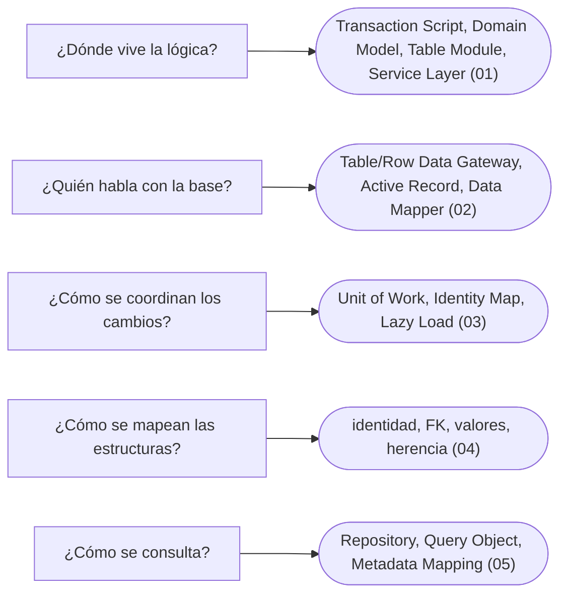

# 07 — Fowler: dominio y datos

> Los patrones de *Patterns of Enterprise Application Architecture* que deciden cómo se organiza la lógica de negocio y cómo llegan los objetos a la base de datos: lo que hay debajo de JPA.
>
> **Vigencia:** 2026-10-03.

---

## 1. 🗺️ Índice

| | Documento | Tipo |
|---|---|---|
| [`01`](01-logica-de-dominio.md) | Organizar la lógica de dominio | Capítulo |
| [`02`](02-fuentes-de-datos.md) | Fuentes de datos | Capítulo |
| [`03`](03-comportamiento-objeto-relacional.md) | Comportamiento objeto-relacional | Capítulo |
| [`04`](04-estructura-objeto-relacional.md) | Estructura objeto-relacional | Capítulo |
| [`05`](05-metadatos-y-consultas.md) | Metadatos y consultas | Capítulo |
| [`06`](06-simulacion-de-entrevista.md) | Simulación de entrevista | Simulación |
| [`07`](07-respuestas.md) | Respuestas | Solucionario |

**Orden de lectura.** En orden numérico. `01` decide la forma de todo lo demás; `03` es el dueño de Unit of Work e Identity Map. Al terminar los capítulos, la simulación con cronómetro, y solo después el solucionario.

---

## 2. 🧠 Mapa mental

---

## 3. 🏷️ Niveles de los patrones

A: se escribe y se defiende en la entrevista · B: se reconoce y se explica · C: ficha corta, con lo que lo reemplazó.

| Capítulo | Patrones y nivel |
|---|---|
| [`01`](01-logica-de-dominio.md) | Transaction Script A · Domain Model A · Table Module B · Service Layer A |
| [`02`](02-fuentes-de-datos.md) | Table Data Gateway B · Row Data Gateway B · Active Record A · Data Mapper A |
| [`03`](03-comportamiento-objeto-relacional.md) | Unit of Work A · Identity Map A · Lazy Load A |
| [`04`](04-estructura-objeto-relacional.md) | Identity Field B · Foreign Key Mapping B · Embedded Value B · Single, Class y Concrete Table Inheritance B · Association Table Mapping C · Dependent Mapping C · Serialized LOB C · Inheritance Mappers C |
| [`05`](05-metadatos-y-consultas.md) | Repository A · Query Object B · Metadata Mapping C |

---

## 4. 🚫 Qué NO está aquí

La presentación, la distribución y los patrones base de Fowler (`08`); los agregados de DDD (`09/01`).

---

**Versiones ejecutadas:** JDK 21.0.12, 17.0.20 y 25.0.4 · Spring Boot 4.1.1 (Spring Framework 7.0.9, Hibernate 7.4.5, H2 2.4.240) · .NET 10.0.12 (C# 14) · mermaid-cli 11.17.0 (2026-10-04).

---

**Anterior:** [`06` — Patrones de comportamiento](../06-comportamiento/README.md) ·
**Corpus:** [README](../README.md) ·
**Siguiente:** [`08` — Fowler: presentación, distribución y base](../08-fowler-presentacion-distribucion-y-base/README.md)
