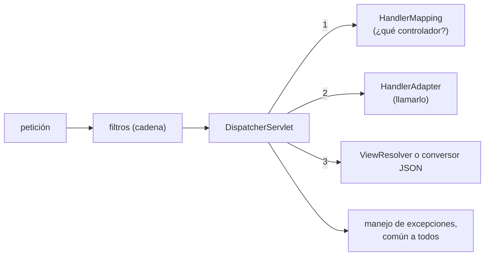
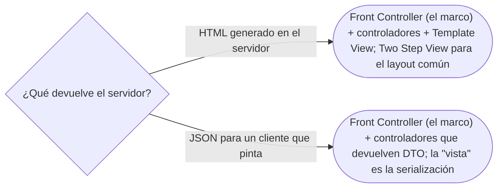

# 01 — Presentación web

> Ubicar los patrones de presentación del cap. 14 de *PoEAA* en un *backend* de hoy: qué queda del **MVC** original
> en Spring MVC, por qué el `DispatcherServlet` es un **Front Controller**, y qué reemplazó a las vistas de plantilla
> cuando el servidor pasó a devolver JSON. **Niveles:** MVC B · Front Controller B · Page Controller C · Template View
> C · Transform View C · Two Step View C · Application Controller C. **Lenguajes:** Java; C++ no aporta (§5.2 de la
> guía). Asume leído [`06/03` — Observer](../06-comportamiento/03-observer.md) y
> [`07/01` — Organizar la lógica de dominio](../07-fowler-dominio-y-datos/01-logica-de-dominio.md).
>
> **Vigencia:** 2026-10-03.
>
> **Versiones ejecutadas:** JDK 21.0.12, 17.0.20 y 25.0.4 · Spring Boot 4.1.1 (Spring Framework 7.0.9, Hibernate 7.4.5, H2 2.4.240) (2026-10-04).

---

## 1. 🎯 El problema

La aplicación de cuentas tiene una pantalla web para que los operadores consulten personas, y un API JSON que usan la
aplicación móvil y otros sistemas. En las dos, cada petición tiene que pasar por lo mismo —autenticación, registro,
traducción de errores— y después llegar al código que sabe atenderla y a algo que la presente.

Fowler ordenó eso en siete patrones cuando la presentación web era HTML generado en el servidor. Hoy la mayoría de los
*backends* devuelven JSON, y la pregunta de la entrevista es qué sigue vivo: **dos** patrones (MVC, Front Controller)
y cinco fichas que se reconocen.

---

## 2. 🧱 Model View Controller

**Problema.** Si el código que muestra la pantalla, el que interpreta lo que hace el usuario y las reglas del negocio
están mezclados, no se puede cambiar uno sin tocar los otros, ni probar las reglas sin la pantalla.

**Mecanismo.** Separar tres papeles: el **modelo** (los datos y las reglas), la **vista** (lo que se muestra) y el
**controlador** (lo que recibe la acción del usuario y decide qué hacer). Pero hay **dos MVC** con el mismo nombre:

| | MVC original (Smalltalk-80) | MVC de servidor (Spring MVC) |
|---|---|---|
| Dónde vive | En una aplicación de escritorio, con el modelo en memoria | En un servidor, una petición cada vez |
| Cómo se entera la vista | **Observa** al modelo y se redibuja cuando cambia (Observer) | No observa nada: se genera **una vez** por petición |
| Controlador | Uno por vista, interpreta teclado y ratón | Uno por grupo de rutas, interpreta la petición HTTP |
| Lo esencial | La separación entre dominio y presentación | La separación entre el manejo de la petición y la vista |

- Fowler describe el original en su artículo *GUI Architectures* con dos ideas: la presentación separada del dominio, y
  la sincronización por Observer entre modelo y vista. La segunda **no existe** en el MVC de servidor: es la diferencia
  que el entrevistador busca.

**Código**, la versión de servidor:

```java
@Controller
public class ControladorPersonas {
    private final ConsultaPersonas consulta;
    public ControladorPersonas(ConsultaPersonas consulta) { this.consulta = consulta; }

    @GetMapping("/personas/{id}")
    public String ver(@PathVariable long id, Model modelo) {
        modelo.addAttribute("persona", consulta.ficha(id));   // el "modelo" de Spring: datos para la vista
        return "persona/ficha";                               // el nombre de la vista (una plantilla)
    }
}
```

- El `Model` de Spring no es el modelo de dominio: es un mapa de datos para la vista. El modelo de verdad es
  `ConsultaPersonas` y lo que hay detrás.

**Cuándo sí y cuándo no.** La separación siempre. El nombre "MVC" con cuidado: un API JSON tiene controladores y
modelo, y la "vista" es la serialización a JSON.

> **Veredicto:** de MVC queda la separación entre dominio y presentación, que es innegociable; la sincronización por
> Observer es de las interfaces de escritorio y del *frontend*, no del servidor. "MVC es Spring MVC" confunde un
> patrón de las interfaces de escritorio de Smalltalk con su adaptación a peticiones HTTP.

---

## 3. 🧱 Front Controller

**Problema.** Todas las peticiones necesitan lo mismo —seguridad, registro, idioma, traducción de errores—, y si cada
página lo hace, se repite y se olvida.

**Mecanismo.** **Un solo** punto de entrada recibe todas las peticiones, hace lo común y **despacha** a un manejador
según la ruta.

**Código.** No se escribe: es el `DispatcherServlet`. La documentación de Spring lo dice así: Spring MVC está diseñado
alrededor del patrón Front Controller, con un servlet central que da un algoritmo común para procesar las peticiones y
delega el trabajo en componentes configurables.



**Cuándo sí y cuándo no.** Siempre que se use un marco web: está dentro. Escribirlo a mano solo tiene sentido en un
servidor mínimo sin marco.

> **Veredicto:** Front Controller es el `DispatcherServlet` (y el *router* de cualquier marco web). Lo que se escribe hoy
> son los manejadores a los que despacha y los filtros que van antes.

---

## 4. 🧱 Las fichas de nivel C

**Page Controller.** **Intención:** un controlador por página, que recibe la petición de esa página. **Ejemplo
mínimo:** un servlet por URL, o un JSP que se procesa a sí mismo. **Por qué hoy es raro:** los marcos ponen un Front
Controller delante. **Qué lo reemplazó:** los métodos `@GetMapping` de un controlador, que son "una página" cada uno,
despachados por el Front Controller.

**Template View.** **Intención:** generar HTML con una plantilla que tiene marcadores donde se insertan los datos.
**Ejemplo mínimo:** `<td th:text="${persona.nombre}">` en Thymeleaf, o un JSP. **Por qué hoy es raro:** en un *backend*
que sirve a una aplicación de una sola página o a un móvil, el HTML lo genera el cliente. **Qué lo reemplazó:** la
serialización a JSON en el servidor y las plantillas del lado del cliente; en las aplicaciones de servidor que quedan,
sigue siendo la forma normal.

**Transform View.** **Intención:** generar la salida transformando los datos elemento por elemento, como hace XSLT con
un XML. **Ejemplo mínimo:** una hoja XSLT que convierte el XML de una persona en HTML. **Por qué hoy es raro:** XSLT
cayó en desuso fuera de integraciones con XML. **Qué lo reemplazó:** el mapeo a DTO y su serialización a JSON es, en
espíritu, una transformación de datos a una representación.

**Two Step View.** **Intención:** generar primero una representación lógica de la página y después el HTML final, para
aplicar un aspecto común a todas las páginas en un solo sitio. **Ejemplo mínimo:** las plantillas de *layout* (Thymeleaf
Layout, Tiles). **Por qué hoy es raro:** en el servidor, porque el HTML se fue al cliente. **Qué lo reemplazó:** los
componentes y *layouts* de los marcos de *frontend*.

**Application Controller.** **Intención:** un objeto que decide el **flujo** entre pantallas —después de esta, cuál— y
qué comando ejecutar, separado de los controladores de entrada. **Ejemplo mínimo:** un asistente de alta en varios pasos
con su máquina de estados en el servidor. **Por qué hoy es raro:** el flujo de pantallas vive en el cliente. **Qué lo
reemplazó:** el *router* del *frontend* y, en el servidor, los procesos de negocio de varios pasos modelados como estados
(ver [`06/06`](../06-comportamiento/06-state.md)).

---

## 5. 🧭 Cómo se elige



En los dos: el dominio no sabe nada de la presentación.

**La frase en voz alta:** *"Spring MVC es un Front Controller, el `DispatcherServlet`, que despacha a mis controladores. Lo
llamamos MVC por la separación entre dominio y presentación; el Observer entre modelo y vista del MVC original no existe en
el servidor, donde la vista se genera una vez por petición."*

---

## ⚠️ Errores frecuentes

| Se dice | Lo preciso |
|---|---|
| "MVC es Spring MVC" | Spring MVC adapta MVC a peticiones HTTP; el original era de escritorio, con la vista observando al modelo |
| "El `Model` de Spring es el modelo de dominio" | Es un mapa de datos para la vista; el dominio está detrás de los servicios |
| "En un API JSON no hay MVC" | Hay controladores y modelo; la vista es la serialización |
| "El controlador es donde va la lógica de negocio" | Interpreta la petición y delega; las reglas van en el dominio |
| "Front Controller es una clase que escribimos" | Es el `DispatcherServlet` o el *router* del marco |
| "Template View está muerto" | Sigue siendo lo normal en aplicaciones que generan HTML en el servidor |

---

## 📚 Para profundizar

- **Libro** — Fowler, *Patterns of Enterprise Application Architecture* (Addison-Wesley, 2002), cap. 4, "Web
  Presentation", y cap. 14, "Web Presentation Patterns".
- [martinfowler.com — *GUI Architectures*](https://martinfowler.com/eaaDev/uiArchs.html): el MVC original, con la
  presentación separada y la sincronización por Observer. **El que destaca.**
- [Spring Framework — `DispatcherServlet`](https://docs.spring.io/spring-framework/reference/web/webmvc/mvc-servlet.html):
  "designed around the front controller pattern".
- [martinfowler.com — Front Controller](https://martinfowler.com/eaaCatalog/frontController.html)
- [martinfowler.com — Model View Controller](https://martinfowler.com/eaaCatalog/modelViewController.html)

---

## 🧠 Preguntas

Sin respuestas aquí. Todas, con enunciado literal y respuesta en tres capas, en
[`07` — Respuestas](07-respuestas.md#01--presentación-web).

1. ¿Qué tres papeles separa MVC? 🟢
2. ¿Qué es un Front Controller? 🟢
3. ¿Qué es un Template View? 🟢
4. ¿Qué es un Application Controller? 🟢
5. ¿Qué es un Page Controller, y qué lo reemplazó? 🟢
6. ¿Qué diferencia hay entre el MVC original y el MVC de servidor? 🟡
7. ¿Qué diferencia hay entre el `Model` de Spring y el modelo de dominio? 🟡
8. ¿Qué diferencia hay entre Front Controller y Page Controller? 🟡
9. ¿Qué diferencia hay entre Template View y Transform View? 🟡
10. ¿Por qué "MVC es Spring MVC" es impreciso? 🟠
11. ¿Dónde está la "vista" en un API que devuelve JSON? 🟠
12. ¿Qué hace el `DispatcherServlet` en cada petición? 🟠
13. Escribe un controlador de Spring que muestre la ficha de una persona sin poner reglas de negocio en él. 🔴
14. Revisa este controlador y di qué falla: un `@GetMapping` que consulta con `JdbcTemplate`, calcula si la persona es
    menor y decide qué plantilla devolver según el país. 🔴

---

**Anterior:** [`07/06` — Simulación de entrevista](../07-fowler-dominio-y-datos/06-simulacion-de-entrevista.md) ·
**Siguiente:** [`02` — Distribución](02-distribucion.md) ·
**Relacionado:** [`06/03` — Observer](../06-comportamiento/03-observer.md)
