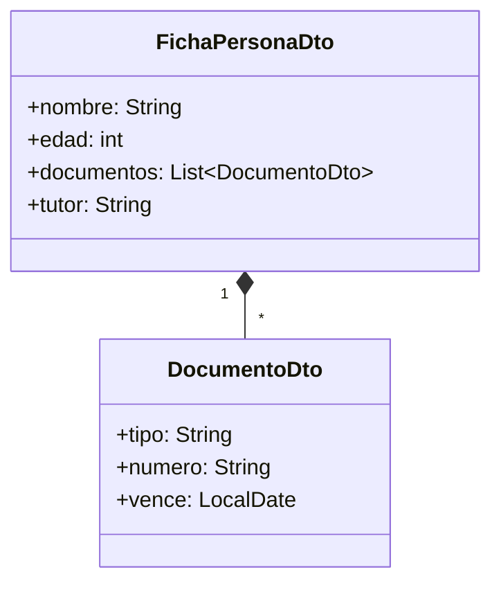
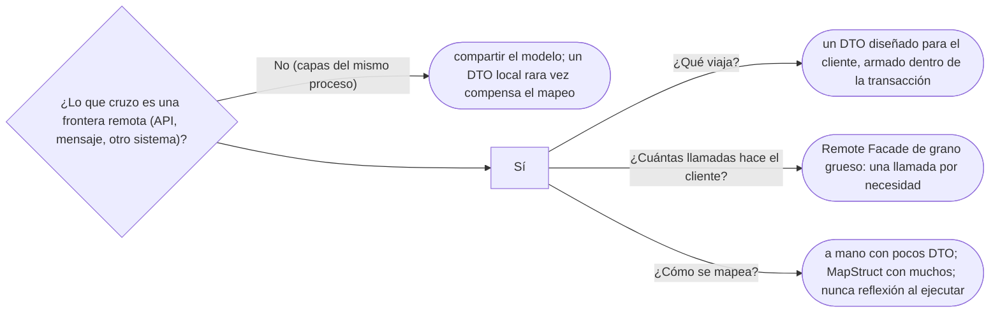

# 02 — Distribución

> Diseñar lo que cruza una frontera remota: el **Data Transfer Object** que viaja en vez de la entidad, y la **Remote
> Facade** de grano grueso que hace que una llamada por red valga la pena; y decirlos con la primera ley de Fowler de
> los objetos distribuidos. **Niveles:** Data Transfer Object A · Remote Facade B. **Lenguajes:** Java; C++ no aporta
> (§5.2 de la guía). Asume leído [`02/06` — Entidades, valores y primitivos](../02-modelado-oo/06-entidades-valores-y-primitivos.md)
> y [`07/03` — Comportamiento objeto-relacional](../07-fowler-dominio-y-datos/03-comportamiento-objeto-relacional.md).
>
> **Vigencia:** 2026-10-04.
>
> **Versiones ejecutadas:** JDK 21.0.12, 17.0.20 y 25.0.4 · Spring Boot 4.1.1 (Spring Framework 7.0.9, Hibernate 7.4.5, H2 2.4.240) · mermaid-cli 11.17.0 · Jackson 3.1.5 (2026-10-04).

---

## 1. 🎯 El problema

La aplicación móvil muestra la ficha de una persona con sus documentos. La primera versión del API devuelve la entidad
tal cual:

```java
@GetMapping("/personas/{id}")
public Persona ficha(@PathVariable long id) {
    return repositorio.porId(new PersonaId(id)).orElseThrow();
}
```

Y en dos semanas aparecen todos los problemas a la vez:

- La serialización toca `documentos`, que es perezosa. Spring Boot deja activada por defecto la sesión abierta en la
  vista (y lo avisa en el registro al arrancar): la colección se carga con consultas lanzadas **durante la
  serialización**, N+1 en cuanto se devuelve una lista. Si alguien la apaga, `LazyInitializationException` fuera de la
  transacción.
- El JSON incluye los documentos, que incluyen a su persona, que incluye sus documentos (y el `tutor`, a sus
  representados): un ciclo, el `toString` con ciclo de `02/03` ahora en JSON. Jackson lo corta al pasar su profundidad
  máxima, pero en la prueba con Spring Boot 4.1 la respuesta ya había salido con `200`: el cliente recibe un JSON
  truncado con estado de éxito.
- Se renombra un campo de `Persona` por una razón del dominio, y la aplicación móvil deja de funcionar.
- Y la pantalla, para mostrar la ficha completa, hace cuatro llamadas: la persona, sus documentos, su tutor, sus
  cuentas.

El dominio salió de su proceso, y lo que cruza una frontera remota tiene que diseñarse para cruzarla.

---

## 2. 🧱 La primera ley de los objetos distribuidos

Fowler la escribió en *PoEAA* y la retomó en 2014 a propósito de los microservicios: **"no distribuyas tus objetos"**.

- Una llamada dentro del proceso cuesta nanosegundos; una por red, milisegundos, y puede fallar a medias. Un modelo de
  objetos pensado para muchas llamadas pequeñas (`persona.getNombre()`, `persona.getDocumentos()`) es razonable en
  memoria y desastroso por red.
- Por eso lo que cruza una frontera remota tiene una forma **distinta** del modelo: pocas llamadas, cada una con mucho
  dentro. Los dos patrones de este capítulo son esa forma.

---

## 3. 🧱 Data Transfer Object

**Problema.** Por red conviene mandar todo lo que el cliente necesita en una sola respuesta, en una forma estable y
serializable, sin arrastrar el comportamiento ni las asociaciones del modelo.

**Estructura.** Un objeto **solo de datos**, sin comportamiento, que agrupa lo que viaja en una llamada. Fowler lo define
como un objeto que lleva datos entre procesos para reducir el número de llamadas.



**Código**, con records:

```java
public record DocumentoDto(String tipo, String numero, LocalDate vence) {}
public record FichaPersonaDto(String nombre, int edad, List<DocumentoDto> documentos, String tutor) {}

@Transactional(readOnly = true)
public FichaPersonaDto ficha(PersonaId id, LocalDate hoy) {
    Persona p = repositorio.porIdConDocumentos(id).orElseThrow(() -> new PersonaNoEncontrada(id));
    return new FichaPersonaDto(
            p.nombre(),
            p.edad(hoy),
            p.documentos().stream().map(d -> new DocumentoDto(d.tipo().codigo(), d.numero(), d.vencimiento())).toList(),
            p.tutor().map(Persona::nombre).orElse(null));
}
```

- El DTO se arma **dentro** de la transacción, con los documentos cargados en la misma consulta: no hay perezosos fuera
  de sesión, ni N+1, ni ciclos (el tutor viaja como su nombre, no como objeto).
- El contrato del API es `FichaPersonaDto`. Renombrar un campo de `Persona` toca el mapeo, no a los clientes.
- La edad viaja **calculada**: el cliente no tiene la regla, y no debería tenerla.

**Con qué se confunde.** Con el modelo anémico: los dos son objetos sin comportamiento, pero el DTO **está diseñado** para
no tenerlo, porque vive en la frontera; el modelo anémico es un modelo de dominio al que le falta lo que debería tener. Y
con el Value Object: el DTO no tiene igualdad de valor ni invariantes; es un sobre.

**Dónde aparece.** En todo API REST bien diseñado, en los mensajes de gRPC (generados desde el contrato), en los eventos que
se publican a otros sistemas.

**Cuándo no.** **Dentro** del mismo proceso, entre capas que podrían compartir el modelo, Fowler advierte en su bliki
(*LocalDTO*) que el costo del mapeo rara vez compensa, y cita a Randy Stafford: no hay que subestimar ese costo. El DTO es
para fronteras **remotas**: un API, un mensaje, otro sistema.

**El mapeo.** A mano, con un método o un constructor como el de arriba, para pocos DTO: se lee, se depura y el compilador
avisa. Con un generador como MapStruct, que escribe el mapeo al compilar a partir de una interfaz, cuando hay muchos DTO
parecidos a sus entidades. Lo que conviene evitar son los mapeadores por reflexión en tiempo de ejecución, que fallan tarde
y en silencio cuando un campo cambia de nombre.

> **Veredicto:** en cada frontera remota, un DTO diseñado para el cliente y armado dentro de la transacción. "Exponer la
> entidad ahorra código" lo ahorra la primera semana y lo cobra con perezosos, ciclos y clientes rotos.

---

## 4. 🧱 Remote Facade

**Problema.** La pantalla de la ficha hace cuatro llamadas porque el API expone el modelo con su granularidad: una ruta por
objeto. Cada llamada es una ida y vuelta por la red.

**Mecanismo.** Una fachada **de grano grueso** sobre el modelo de grano fino: cada operación remota hace mucho trabajo
dentro del servidor y devuelve un DTO con todo lo necesario. La fachada no tiene lógica de dominio: traduce entre la
granularidad remota y la local.

**Código.**

```java
@RestController
@RequestMapping("/personas")
public class FachadaPersonas {                                // fina en lógica, gruesa en datos
    private final ConsultaPersonas consulta;
    private final Clock reloj;
    public FachadaPersonas(ConsultaPersonas consulta, Clock reloj) { this.consulta = consulta; this.reloj = reloj; }

    @GetMapping("/{id}/ficha")
    public FichaPersonaDto ficha(@PathVariable long id) {    // una llamada: persona, documentos, tutor
        return consulta.ficha(new PersonaId(id), LocalDate.now(reloj));
    }
}
```

**Cuándo sí y cuándo no.** Sí en toda frontera remota que sirve pantallas o procesos con necesidades conocidas. No hace
falta "una fachada por pantalla" si los clientes son muchos y distintos: ahí se diseñan recursos con algo de grano grueso, o
se deja al cliente elegir los campos (GraphQL es, en parte, una respuesta a esta tensión). Y la fachada no debe crecer hasta
ser la clase dios del API: se parte por recurso o por caso de uso.

> **Veredicto:** Remote Facade en toda frontera remota, de grano grueso, sin lógica de dominio y con DTO. Es la Facade del
> GoF ([`05/04`](../05-estructurales/04-facade.md)) con el costo de la red como motivo.

---

## 5. 🧭 Cómo se elige



**La frase en voz alta:** *"La primera ley de Fowler: no distribuyas tus objetos. En la frontera del API no expongo la
entidad: devuelvo un record armado dentro de la transacción, con lo que la pantalla necesita, en una llamada. Dentro del
proceso no pongo DTO entre capas: el mapeo cuesta más de lo que protege."*

---

## ⚠️ Errores frecuentes

| Se dice | Lo preciso |
|---|---|
| "Exponer la entidad ahorra código" | Lo cobra en perezosos fuera de sesión, ciclos, campos internos expuestos y clientes rotos al cambiar el dominio |
| "Un DTO es un modelo anémico" | El DTO está diseñado sin comportamiento porque vive en la frontera; el anémico es un dominio al que le falta |
| "Hay que poner DTO entre todas las capas" | Fowler lo desaconseja dentro del mismo proceso: el mapeo rara vez compensa |
| "El DTO se arma en el controlador" | Se arma dentro de la transacción, donde las asociaciones se pueden cargar |
| "Una ruta por entidad es un API limpio" | Es la granularidad del modelo llevada a la red: muchas llamadas por pantalla |
| "Los mapeadores por reflexión ahorran trabajo" | Fallan al ejecutar y en silencio cuando cambia un campo; el mapeo a mano o generado falla al compilar |

---

## 📚 Para profundizar

- **Libro** — Fowler, *Patterns of Enterprise Application Architecture* (Addison-Wesley, 2002), cap. 7, "Distribution
  Strategies" (la primera ley), y cap. 15, "Distribution Patterns". **El que destaca.**
- [martinfowler.com — *Microservices and the First Law of Distributed Objects*](https://martinfowler.com/articles/distributed-objects-microservices.html):
  la ley, revisada en 2014.
- [martinfowler.com — Data Transfer Object](https://martinfowler.com/eaaCatalog/dataTransferObject.html)
- [martinfowler.com — *LocalDTO*](https://martinfowler.com/bliki/LocalDTO.html): por qué no poner DTO dentro del mismo
  proceso.
- [martinfowler.com — Remote Facade](https://martinfowler.com/eaaCatalog/remoteFacade.html)
- [MapStruct — Reference Guide](https://mapstruct.org/documentation/stable/reference/html/): el mapeo generado al
  compilar.

---

## 🧠 Preguntas

Sin respuestas aquí. Todas, con enunciado literal y respuesta en tres capas, en
[`07` — Respuestas](07-respuestas.md#02--distribución).

1. ¿Qué dice la primera ley de Fowler de los objetos distribuidos? 🟢
2. ¿Qué es un Data Transfer Object? 🟢
3. ¿Qué es una Remote Facade? 🟢
4. ¿Qué diferencia hay entre un DTO y un modelo anémico? 🟡
5. ¿Qué diferencia hay entre un DTO y un Value Object? 🟡
6. ¿Qué diferencia hay entre Remote Facade y la Facade del GoF? 🟡
7. ¿Qué diferencia hay entre mapear a mano, con MapStruct y con reflexión? 🟡
8. ¿Por qué no hay que exponer la entidad en el API? 🟠
9. ¿Dónde se arma el DTO, y por qué ahí? 🟠
10. ¿Por qué Fowler desaconseja los DTO dentro del mismo proceso? 🟠
11. ¿Cuándo una Remote Facade se vuelve un problema? 🟠
12. Diseña el DTO y la operación de la ficha de una persona con sus documentos y su tutor. 🔴
13. Revisa este código y di qué falla: `@GetMapping public List<Persona> todas() { return repositorio.findAll(); }`
    con `Persona` que tiene `documentos` perezosos y `tutor`. 🔴
14. Una pantalla hace seis llamadas al API para pintar el resumen de una cuenta. Propón la Remote Facade. 🔴

---

**Anterior:** [`01` — Presentación web](01-presentacion-web.md) ·
**Siguiente:** [`03` — Concurrencia offline](03-concurrencia-offline.md) ·
**Relacionado:** [`05/04` — Facade](../05-estructurales/04-facade.md)
