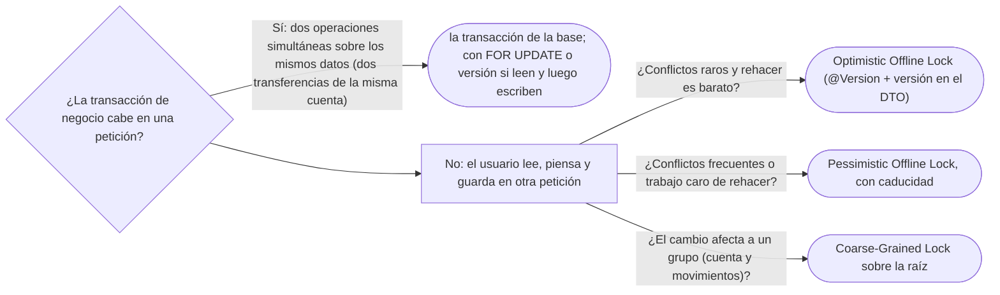

# 03 — Concurrencia offline

> Evitar la **actualización perdida** cuando una transacción de negocio dura más que una transacción de la base —un
> operador que abre la ficha de Ana, piensa y guarda—: el **bloqueo optimista** con versión y `@Version`, qué se le dice
> al usuario cuando hay conflicto, y cuándo hace falta el **bloqueo pesimista**. **Niveles:** Optimistic Offline Lock A ·
> Pessimistic Offline Lock B · Coarse-Grained Lock C · Implicit Lock C. **Lenguajes:** Java y SQL; C++ no aplica, porque
> el problema y sus herramientas son de la capa de persistencia de Java (§5.2 de la guía). Asume leído
> [`07/03` — Comportamiento objeto-relacional](../07-fowler-dominio-y-datos/03-comportamiento-objeto-relacional.md).
>
> **Vigencia:** 2026-10-03.
>
> **Versiones ejecutadas:** JDK 21.0.12, 17.0.20 y 25.0.4 · Spring Boot 4.1.1 (Spring Framework 7.0.9, Hibernate 7.4.5, H2 2.4.240) · PostgreSQL 18.6 (2026-10-04).

---

## 1. 🎯 El problema

Dos operadores abren a la vez la ficha de Ana. El primero cambia su teléfono; el segundo, su correo. Cada uno guarda lo
que ve en su pantalla:

```text
10:00:00  operador A lee Ana   {telefono: "+57 301 555 0101", email: "ana.rojas@example.com"}
10:00:05  operador B lee Ana   {telefono: "+57 301 555 0101", email: "ana.rojas@example.com"}
10:01:30  A guarda             {telefono: "+57 301 555 0199", email: "ana.rojas@example.com"}    transacción 1: OK
10:02:10  B guarda             {telefono: "+57 301 555 0101", email: "ana.rojas.m@example.com"}  transacción 2: OK
resultado                      el teléfono nuevo de A se perdió, y nadie se enteró
```

- Cada guardado fue una transacción correcta y aislada. El problema no está **dentro** de ninguna transacción: está
  **entre** ellas. B guardó sobre datos que ya no eran los que había leído.
- Es la **actualización perdida**, y la transacción de la base no la evita, porque la lectura (10:00:05) y la escritura
  (10:02:10) de B ocurrieron en peticiones distintas, con dos minutos de pensamiento en medio.

Fowler llama **transacción de negocio** a lo que el usuario percibe como una operación (abrir, editar, guardar) y
**concurrencia *offline*** a protegerla cuando se reparte en varias transacciones de la base. Este capítulo es eso.

---

## 2. 🧱 Optimistic Offline Lock

**Problema.** Detectar, al guardar, que alguien cambió los datos desde que se leyeron, sin bloquear a nadie mientras
tanto.

**Estructura.** Cada fila lleva un **número de versión**. Al leer, el cliente se lleva la versión; al guardar, la
escritura solo se aplica si la versión sigue siendo la misma, y la incrementa.

```sql
UPDATE persona SET telefono = ?, email = ?, version = version + 1
WHERE id = ? AND version = ?;           -- 0 filas afectadas: alguien guardó antes
```

**Código.** En JPA es una anotación:

```java
@Entity
public class Persona {
    @Id private Long id;
    @Version private long version;       // la gestiona el proveedor: no se asigna a mano
    private String telefono;
    private String email;

    public long getVersion() { return version; }
    public void corregirContacto(String telefono, String email) { this.telefono = telefono; this.email = email; }
}
```

- Con `@Version`, el proveedor añade `AND version = ?` a cada `UPDATE` y lanza `OptimisticLockException` si no se
  actualizó ninguna fila. La Javadoc de `@Version` lo dice: el campo sirve para detectar fallos de bloqueo optimista.
- Para que funcione **entre peticiones**, la versión tiene que **viajar** con el formulario: el DTO de edición lleva la
  versión que se leyó, y al guardar se compara con esa, no con la que haya ahora en la base.

```java
public record EdicionPersonaDto(long id, long version, String telefono, String email) {}

@Transactional
public void guardar(EdicionPersonaDto dto) {
    Persona p = em.find(Persona.class, dto.id());
    if (p.getVersion() != dto.version()) throw new ConflictoDeEdicionException(dto.id());   // B llega aquí
    p.corregirContacto(dto.telefono(), dto.email());
}                                         // y además el UPDATE lleva AND version = ?, por si alguien entró en medio
```

**Con qué se confunde.** Con la transacción de la base: la transacción protege **dentro** de una petición; el bloqueo
optimista, **entre** peticiones. Y con el bloqueo pesimista: el optimista no bloquea a nadie, detecta al final.

**Dónde aparece.** `@Version` de Jakarta Persistence, las cabeceras `ETag` e `If-Match` de HTTP (la misma idea en el
protocolo: guardar solo si el recurso no cambió) y casi cualquier ORM.

**Cuándo no.** Cuando los conflictos son frecuentes: si diez operadores editan la misma ficha todo el día, la mayoría verá
"alguien cambió esto" y perderá su trabajo. Y cuando perder el trabajo es caro (un formulario de una hora).

**Qué se le dice al usuario.** Nunca "error de concurrencia". Lo útil: "La ficha de Ana cambió mientras la editabas", con
lo que cambió y la opción de volver a cargar o de aplicar sus cambios sobre la versión nueva si no chocan campo a campo.

> **Veredicto:** bloqueo optimista con versión por defecto para la edición entre peticiones; con la versión viajando en
> el formulario y un mensaje que le diga al usuario qué cambió. "La transacción de la base evita la actualización
> perdida" es falso cuando la lectura y la escritura están en peticiones distintas.

---

## 3. 🧱 Pessimistic Offline Lock

**Problema.** Los conflictos son frecuentes o caros, y se prefiere que el segundo operador **no pueda empezar** a editar
mientras el primero no termine.

**Mecanismo.** Al empezar la transacción de negocio, se adquiere un bloqueo **de aplicación** —una fila en una tabla de
bloqueos: "Ana, la edita el operador A, desde las 10:00"— y se libera al guardar o al cancelar. Fowler lo llama *offline*
porque dura más que una transacción de la base.

**Código.**

```java
@Transactional
public void empezarEdicion(PersonaId id, Usuario operador, Instant ahora) {
    int tomados = jdbc.update("""
            INSERT INTO bloqueo_edicion (entidad, id, usuario, desde) VALUES ('persona', ?, ?, ?)
            ON CONFLICT DO NOTHING""", id.valor(), operador.nombre(), ahora);
    if (tomados == 0) throw new EnEdicionPorOtroException(id);       // B se entera antes de escribir nada
}
```

- `ON CONFLICT` es de PostgreSQL; la clave primaria de la tabla es `(entidad, id)`, y es lo que hace atómica la toma del
  bloqueo.
- El problema difícil no es tomarlo sino **soltarlo**: el operador cierra el navegador y el bloqueo queda. Hace falta una
  caducidad y una forma de forzar la liberación.

**No confundir con `SELECT ... FOR UPDATE`.** `LockModeType.PESSIMISTIC_WRITE` en JPA (y `FOR UPDATE` en SQL) es un bloqueo
pesimista **de la base**, que dura lo que dura **una** transacción: sirve para que dos transferencias simultáneas no lean el
mismo saldo, no para que dos operadores no editen la misma ficha durante minutos. Mantener una transacción de la base
abierta mientras el usuario piensa es un error: retiene conexiones y bloquea a todos.

**Cuándo sí y cuándo no.** Sí con conflictos frecuentes y trabajo caro de rehacer. No por defecto: obliga a gestionar la
caducidad, la liberación forzada y la pregunta "¿quién tiene bloqueada a Ana?".

> **Veredicto:** bloqueo pesimista *offline* solo cuando el optimista hace perder demasiado trabajo; con caducidad desde
> el primer día. Para la concurrencia dentro de una transacción, `FOR UPDATE`, que es otra cosa.

---

## 4. 🧱 Coarse-Grained Lock e Implicit Lock

**Coarse-Grained Lock** (C). **Intención:** un solo bloqueo para un grupo de objetos que cambian juntos, en lugar de uno
por objeto. **Ejemplo mínimo:** la cuenta y sus movimientos. Dos operaciones que añaden movimientos a la misma cuenta no
chocan en ninguna fila (cada una inserta la suya), pero juntas pueden dejar el saldo negativo. La versión de la **cuenta**
protege al grupo: cada operación que añade un movimiento incrementa la versión de la cuenta, aunque no cambie ningún campo
de ella.

```java
Cuenta c = em.find(Cuenta.class, numero, LockModeType.OPTIMISTIC_FORCE_INCREMENT);   // sube la versión de la raíz
c.registrar(movimiento);
```

**Por qué hoy es raro escribirlo:** el ORM lo da con un modo de bloqueo. **Qué lo reemplazó:** el agregado de DDD, cuya raíz
es justamente la frontera de consistencia y la unidad de bloqueo; tiene su capítulo en [`09/01`](../09-ddd-tactico-y-otros/01-entidad-valor-y-agregado.md).

**Implicit Lock** (C). **Intención:** que el bloqueo lo tome la infraestructura y no cada desarrollador, para que nadie se
olvide. **Ejemplo mínimo:** con `@Version`, ningún código de negocio compara versiones a mano: el proveedor lo hace en cada
`UPDATE`. **Por qué hoy es raro escribirlo:** viene con el ORM. **Qué lo reemplazó:** `@Version` y los modos de bloqueo de
JPA, que son bloqueo implícito de serie.

---

## 5. 🧭 Cómo se elige



**La frase en voz alta:** *"La transacción de la base no evita la actualización perdida entre dos peticiones. Le pongo
`@Version` a la entidad, mando la versión en el formulario y la compruebo al guardar; si cambió, le digo al operador qué
cambió. Bloqueo pesimista solo si los conflictos son frecuentes, y nunca dejando una transacción abierta mientras el usuario
piensa."*

---

## ⚠️ Errores frecuentes

| Se dice | Lo preciso |
|---|---|
| "La transacción de la base evita la actualización perdida" | Protege dentro de una petición; entre leer en una y escribir en otra, hace falta una versión |
| "Con `@Version` ya está resuelto" | Entre peticiones, la versión tiene que viajar en el formulario y compararse con la leída |
| "`SELECT ... FOR UPDATE` es el bloqueo pesimista *offline*" | Dura una transacción de la base; el *offline* dura lo que la edición, con una tabla de bloqueos |
| "Se puede mantener la transacción abierta mientras el usuario edita" | Retiene conexiones y bloquea a todos; es el error que el patrón evita |
| "El bloqueo pesimista es más seguro" | Cambia conflictos por bloqueos huérfanos y esperas; necesita caducidad |
| "Añadir un movimiento no cambia la cuenta, así que no hay conflicto" | Puede romper un invariante del grupo (el saldo): el bloqueo va sobre la raíz |
| "Al usuario se le muestra el error de concurrencia" | Se le dice qué cambió y qué puede hacer |

---

## 📚 Para profundizar

- **Libro** — Fowler, *Patterns of Enterprise Application Architecture* (Addison-Wesley, 2002), cap. 5, "Concurrency"
  (con David Rice), y cap. 16, "Offline Concurrency Patterns". **El que destaca.**
- [Jakarta Persistence 3.2 — `Version`](https://jakarta.ee/specifications/persistence/3.2/apidocs/jakarta.persistence/jakarta/persistence/version):
  el campo de versión y los fallos de bloqueo optimista.
- [Jakarta Persistence 3.2 — `LockModeType`](https://jakarta.ee/specifications/persistence/3.2/apidocs/jakarta.persistence/jakarta/persistence/lockmodetype):
  los modos optimistas y pesimistas, y el `FORCE_INCREMENT`.
- [martinfowler.com — Optimistic Offline Lock](https://martinfowler.com/eaaCatalog/optimisticOfflineLock.html)
- [martinfowler.com — Pessimistic Offline Lock](https://martinfowler.com/eaaCatalog/pessimisticOfflineLock.html)
- [martinfowler.com — Coarse-Grained Lock](https://martinfowler.com/eaaCatalog/coarseGrainedLock.html)

---

## 🧠 Preguntas

Sin respuestas aquí. Todas, con enunciado literal y respuesta en tres capas, en
[`07` — Respuestas](07-respuestas.md#03--concurrencia-offline).

1. ¿Qué es la actualización perdida? 🟢
2. ¿Qué es una transacción de negocio, según Fowler? 🟢
3. ¿Qué es el bloqueo optimista con versión? 🟢
4. ¿Qué hace `@Version` en JPA? 🟢
5. ¿Qué diferencia hay entre bloqueo optimista y pesimista? 🟡
6. ¿Qué diferencia hay entre `SELECT ... FOR UPDATE` y un Pessimistic Offline Lock? 🟡
7. ¿Qué diferencia hay entre una transacción de la base y una transacción de negocio? 🟡
8. ¿Qué relación hay entre `@Version` y las cabeceras `ETag` e `If-Match` de HTTP? 🟡
9. ¿Por qué la transacción de la base no evita la actualización perdida entre peticiones? 🟠
10. ¿Por qué la versión tiene que viajar en el formulario? 🟠
11. ¿Qué le dices al usuario cuando hay un conflicto? 🟠
12. ¿Cuándo usarías el bloqueo pesimista *offline*, y qué problema trae? 🟠
13. ¿Por qué añadir un movimiento puede necesitar bloquear la cuenta, si no cambia ninguno de sus campos? 🟠
14. Escribe la entidad `Persona` con `@Version` y el servicio que guarda una edición comprobando la versión leída. 🔴
15. Escribe el SQL de un `UPDATE` con bloqueo optimista y di qué significa que afecte a cero filas. 🔴
16. Revisa este diseño: el servicio de edición abre una transacción al cargar la ficha y la confirma cuando el operador
    pulsa "guardar". Di qué falla y cómo lo corriges. 🔴

---

**Anterior:** [`02` — Distribución](02-distribucion.md) ·
**Siguiente:** [`04` — Estado de sesión](04-estado-de-sesion.md) ·
**Relacionado:** [`07/03` — Comportamiento objeto-relacional](../07-fowler-dominio-y-datos/03-comportamiento-objeto-relacional.md)
