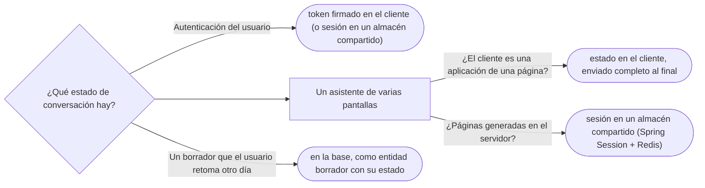

# 04 — Estado de sesión

> Decir dónde vive el estado de una conversación con el usuario —en el cliente, en el servidor o en la base de datos—,
> qué cuesta cada opción, y qué las reemplazó en un *backend* de hoy: *tokens*, servicios sin estado y almacenes
> externos. **Niveles:** Client Session State C · Server Session State C · Database Session State C. **Lenguajes:**
> Java; C++ no aporta (§5.2 de la guía). Asume leído [`01` — Presentación web](01-presentacion-web.md) y
> [`03` — Concurrencia offline](03-concurrencia-offline.md).
>
> **Vigencia:** 2026-10-03.
>
> **Versiones ejecutadas:** JDK 21.0.12, 17.0.20 y 25.0.4 · Spring Boot 4.1.1 (Spring Framework 7.0.9, Tomcat 11.0.24) (2026-10-04).

---

## 1. 🎯 El problema

El alta de una persona se hace en un asistente de tres pantallas: datos básicos, documentos, contacto. Lo que el
operador escribió en la primera pantalla tiene que seguir existiendo cuando llega a la tercera, pero todavía no es una
persona: no ha pasado las validaciones y no debe estar en la tabla `persona`.

Ese dato a medias es **estado de sesión**: pertenece a una conversación con un usuario y dura lo que dura la
conversación. Fowler distingue tres sitios donde guardarlo, en el cap. 6 y el cap. 17 de *PoEAA*. Los tres son nivel C
porque hoy se reconocen más de lo que se diseñan: lo que importa es saber dónde está el estado de tu aplicación, porque
**siempre** está en algún sitio.

```text
                     Dónde vive         Escala horizontalmente   Si el servidor se cae   Lo que viaja en cada petición
Client Session       en el cliente      ✅ sin esfuerzo          ✅ se conserva          todo el estado (o un token)
Server Session       en la memoria      ❌ afinidad o réplica    ❌ se pierde            un identificador de sesión
Database Session     en una tabla       ✅                       ✅ se conserva          un identificador de sesión
```

---

## 2. 🧱 Client Session State

**Intención.** Guardar el estado de la conversación en el cliente —un campo oculto, una *cookie*, la memoria de la
aplicación de una sola página— y mandarlo en cada petición. El servidor no guarda nada.

**Ejemplo mínimo.** El asistente de alta guarda los datos de cada paso en el propio cliente y, en la última pantalla,
manda todo junto:

```java
public record SolicitudAltaCompleta(DatosBasicos basicos, List<DocumentoDto> documentos, ContactoDto contacto) {}

@PostMapping("/altas")
public ResponseEntity<PersonaId> alta(@RequestBody @Valid SolicitudAltaCompleta s) {   // todo el estado llega aquí
    return ResponseEntity.status(201).body(altaPersonas.alta(s));
}
```

- El servidor no recuerda nada entre pantallas: cada petición trae lo que necesita. Por eso cualquier servidor la
  atiende.

**Por qué hoy es raro… en su forma original.** El campo oculto con datos de negocio, que el usuario podía manipular, cayó
en desuso. **Qué lo reemplazó:** las aplicaciones de una sola página, que guardan el estado del asistente en memoria del
navegador, y los *tokens* firmados (como los JWT) para el estado de autenticación: el cliente lo lleva, pero no lo puede
alterar sin romper la firma. Lo que viene del cliente se vuelve a validar siempre en el servidor.

---

## 3. 🧱 Server Session State

**Intención.** Guardar el estado en la memoria del servidor, en un objeto de sesión, y mandar al cliente solo un
identificador.

**Ejemplo mínimo.** La `HttpSession` de los servlets:

```java
@PostMapping("/altas/paso1")
public String paso1(DatosBasicos datos, HttpSession sesion) {
    sesion.setAttribute("alta", new AltaEnCurso(datos));       // vive en la memoria de ESTE servidor
    return "redirect:/altas/paso2";
}
```

**Por qué hoy es raro.** Porque ata al usuario a un servidor: si hay varios detrás de un balanceador, hace falta afinidad
de sesión (que el balanceador mande siempre al mismo) o replicar las sesiones entre servidores; y si el servidor se
reinicia, la sesión se pierde. Con contenedores que se crean y se destruyen a menudo, es justo lo que no se quiere.

**Qué lo reemplazó:** servicios **sin estado en memoria**, con el estado de sesión fuera del proceso: en el cliente (§2) o
en un almacén compartido (§4). La API de `HttpSession` se conserva, pero con otra implementación detrás.

---

## 4. 🧱 Database Session State

**Intención.** Guardar el estado de la conversación en una base de datos, como datos **pendientes de confirmar**, y que
cualquier servidor lo recupere con el identificador de sesión.

**Ejemplo mínimo.** Una tabla `alta_en_curso` con los datos del asistente en una columna JSON, y una fecha de caducidad.
Los datos a medias no están en `persona`, así que no aparecen en las búsquedas ni rompen sus invariantes.

**Por qué hoy es raro… en una base relacional.** Escribir en la base de negocio en cada paso de cada usuario es caro, y
limpiar las conversaciones abandonadas es trabajo. **Qué lo reemplazó:** los almacenes de sesión externos y rápidos
—Redis, con Spring Session, que pone una `HttpSession` respaldada por él sin cambiar el código de la aplicación—, que dan
lo mismo con caducidad automática. Cuando el estado es un borrador de negocio que el usuario quiere retomar mañana (una
solicitud de crédito a medias), sigue siendo correcto guardarlo en la base, como un borrador con su propio estado.

---

## 5. ⚖️ "Sin estado" no significa sin estado de sesión

La sobregeneralización que el capítulo desmonta: **"un servicio sin estado no tiene estado de sesión"**. Un servicio sin
estado es uno que no guarda la sesión **en su memoria**, de modo que cualquier instancia atiende cualquier petición. El
estado de sesión sigue existiendo; solo se mudó:

- al **cliente**, que lo manda en cada petición (un *token*, el estado del asistente en la aplicación de una página);
- a un **almacén compartido**, que todas las instancias consultan con el identificador (Redis, una tabla).

En la entrevista, la respuesta precisa a "¿tu servicio tiene estado?" es: "en memoria no; la sesión está en el *token* y en
Redis". Y la pregunta que sigue —"¿qué pasa si Redis se cae?"— es la que muestra que se sabe dónde está el estado.

---

## 6. 🏷️ Lo que cuesta cada sitio

Elegir dónde vive la sesión es elegir qué se paga:

- **En el cliente**: cada petición lleva el estado, así que crece el tráfico; lo que llega hay que validarlo siempre; y
  un *token* emitido no se puede revocar antes de que caduque sin añadir una lista de revocados en el servidor, que es
  estado otra vez. A cambio, el servidor no recuerda nada y escala sin esfuerzo.
- **En la memoria del servidor**: es lo más rápido y lo más simple de programar, y lo paga la operación: afinidad en el
  balanceador, sesiones perdidas en cada despliegue, memoria que crece con los usuarios conectados.
- **En un almacén compartido**: una llamada de red por petición y una pieza más de infraestructura que vigilar; si el
  almacén se cae, nadie tiene sesión. A cambio, las instancias son intercambiables y la caducidad es automática.
- **En la base de negocio**: la escritura más cara y la limpieza de borradores abandonados; a cambio, el borrador
  sobrevive días y se consulta como cualquier dato.

> 🧠 **Modelo mental.** El estado de sesión no desaparece al sacarlo de la memoria: se muda. La pregunta de diseño no
> es "¿tengo estado?" sino "¿dónde lo pongo, y qué pasa cuando ese sitio falla?".

---

## 7. 🧭 Cómo se elige



Nunca: estado de sesión solo en la memoria de una instancia, si hay más de una o se reinician.

**La frase en voz alta:** *"Mis servicios no guardan sesión en memoria, para que cualquier instancia atienda cualquier
petición. El estado de la conversación vive en el cliente —el token, el asistente en la aplicación de una página— o en un
almacén compartido con caducidad. Sin estado en el proceso no es sin estado: es saber dónde está."*

---

## ⚠️ Errores frecuentes

| Se dice | Lo preciso |
|---|---|
| "Un servicio sin estado no tiene estado de sesión" | No lo guarda en su memoria; el estado está en el cliente o en un almacén compartido |
| "La `HttpSession` escala igual que todo" | En memoria, ata al usuario a un servidor y se pierde al reiniciar; hace falta afinidad, réplica o un almacén externo |
| "Lo que manda el cliente se puede creer" | Se vuelve a validar siempre; un *token* firmado garantiza integridad, no que los datos de negocio sean válidos |
| "Los datos a medias van en la tabla de negocio" | Rompen invariantes y aparecen en las búsquedas; van en un borrador aparte o en la sesión |
| "Database Session State está muerto" | Para borradores que se retoman otro día, sigue siendo lo correcto |

---

## 📚 Para profundizar

- **Libro** — Fowler, *Patterns of Enterprise Application Architecture* (Addison-Wesley, 2002), cap. 6, "Session
  State", y cap. 17, "Session State Patterns". **El que destaca.**
- [martinfowler.com — Client Session State](https://martinfowler.com/eaaCatalog/clientSessionState.html)
- [martinfowler.com — Server Session State](https://martinfowler.com/eaaCatalog/serverSessionState.html)
- [martinfowler.com — Database Session State](https://martinfowler.com/eaaCatalog/databaseSessionState.html)
- [Spring Session — Reference](https://docs.spring.io/spring-session/reference/): la `HttpSession` respaldada por un
  almacén externo.
- [RFC 7519 — JSON Web Token](https://www.rfc-editor.org/info/rfc7519/): el *token* firmado que lleva el cliente.

---

## 🧠 Preguntas

Sin respuestas aquí. Todas, con enunciado literal y respuesta en tres capas, en
[`07` — Respuestas](07-respuestas.md#04--estado-de-sesión).

1. ¿Qué es el estado de sesión? 🟢
2. ¿Qué es Client Session State? 🟢
3. ¿Qué es Server Session State? 🟢
4. ¿Qué es Database Session State? 🟢
5. ¿Qué diferencia hay entre guardar la sesión en memoria y en un almacén compartido? 🟡
6. ¿Qué diferencia hay entre un *token* firmado y un identificador de sesión? 🟡
7. ¿Qué diferencia hay entre un borrador en la base y una sesión en Redis? 🟡
8. ¿Por qué "un servicio sin estado no tiene estado de sesión" es falso? 🟠
9. ¿Por qué la sesión en memoria es un problema con contenedores? 🟠
10. ¿Qué validas de lo que manda el cliente, aunque venga en un *token* firmado? 🟠
11. Diseña dónde vive el estado del asistente de alta de tres pantallas si el cliente es una aplicación de una página. 🔴
12. Revisa este diseño: tres instancias del servicio detrás de un balanceador sin afinidad, y el asistente de alta guarda
    sus datos en la `HttpSession` en memoria. Di qué falla y cómo lo corriges. 🔴

---

**Anterior:** [`03` — Concurrencia offline](03-concurrencia-offline.md) ·
**Siguiente:** [`05` — Patrones base](05-patrones-base.md) ·
**Relacionado:** [`01` — Presentación web](01-presentacion-web.md)
