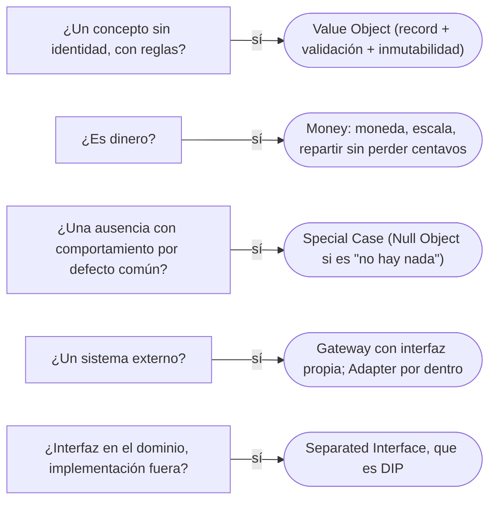

# 05 — Patrones base

> Escribir un **Value Object** y un **Money** correctos —con el reparto de centavos que nadie hace bien a la primera—,
> reconocer **Special Case** y **Gateway**, y responder con criterio por las siete fichas restantes del cap. 18 de
> *PoEAA*. **Niveles:** Value Object A · Money B · Special Case B · Gateway B · Mapper C · Layer Supertype C · Separated
> Interface C · Registry C · Plugin C · Service Stub C · Record Set C. **Es el dueño del patrón Value Object**; el concepto
> es de [`02/06`](../02-modelado-oo/06-entidades-valores-y-primitivos.md#3--el-objeto-de-valor-como-concepto).
> **Lenguajes:** Java; C++ en Value Object y Money, donde aporta. Asume leído
> [`01/02` — Igualdad, identidad y hash](../01-modelo-de-objetos/02-igualdad-identidad-y-hash.md).
>
> **Vigencia:** 2026-10-03.
>
> **Versiones ejecutadas:** GCC 14.4 (C++23) · JDK 21.0.12, 17.0.20 y 25.0.4 (2026-10-04).

**Salto rápido:** [1](#1--el-problema) · [2](#2--value-object) · [3](#3--money) · [4](#4--special-case) · [5](#5--gateway) · [6](#6--las-fichas-de-nivel-c) · [7](#7--cómo-se-elige)

---

## 1. 🎯 El problema

Una comisión de 1 000,00 COP se reparte entre los tres titulares de una cuenta a partes iguales:

```java
BigDecimal total = new BigDecimal("1000.00");
BigDecimal parte = total.divide(new BigDecimal("3"), 2, RoundingMode.HALF_EVEN);   // 333.33
BigDecimal suma = parte.multiply(new BigDecimal("3"));                            // 999.99
```

- Se perdió un centavo. Repetido en cada comisión de cada mes de cada cuenta, el libro contable deja de cuadrar, y la
  diferencia no está en ningún sitio.
- Y el `BigDecimal` suelto no sabe en qué moneda está: nada impide sumar la comisión en COP con el saldo en USD de la
  cuenta de Carmen.

El cap. 18 de *PoEAA* recoge los patrones "base" que usan todos los demás. Dos resuelven este problema —Value Object y
Money—, dos se ven a diario —Special Case y Gateway— y siete son fichas que conviene reconocer.

---

## 2. 🧱 Value Object

**Problema.** Conceptos del dominio que no tienen identidad —un monto, una dirección, un rango de fechas— se representan
con primitivos o con objetos mutables, y se comparan por referencia, se comparten y se modifican por sorpresa.

**Estructura.** Un objeto **sin identidad**, que vale por su contenido: igualdad por valor, **inmutable** y que **se valida
al construirse**. Las operaciones devuelven objetos nuevos en lugar de modificarlo.

**Código.** Java:

```java
public record RangoFechas(LocalDate desde, LocalDate hasta) {
    public RangoFechas {
        Objects.requireNonNull(desde);
        Objects.requireNonNull(hasta);
        if (hasta.isBefore(desde)) throw new IllegalArgumentException("rango invertido");   // se valida a sí mismo
    }
    public boolean contiene(LocalDate f) { return !f.isBefore(desde) && !f.isAfter(hasta); }
    public RangoFechas extendidoHasta(LocalDate nuevoHasta) { return new RangoFechas(desde, nuevoHasta); }   // uno nuevo
}
```

C++, donde el valor es la forma natural de los objetos:

```cpp
struct RangoFechas {
    std::chrono::year_month_day desde, hasta;
    RangoFechas(std::chrono::year_month_day d, std::chrono::year_month_day h) : desde{d}, hasta{h} {
        if (hasta < desde) throw std::invalid_argument{"rango invertido"};
    }
    bool contiene(std::chrono::year_month_day f) const { return desde <= f && f <= hasta; }
    bool operator==(const RangoFechas&) const = default;          // igualdad por valor, generada
};
```

- En C++ un `struct` se copia por valor y se compara con `operator==` por defecto (C++20): el objeto de valor no necesita
  patrón, necesita no usar punteros. En Java, donde todo objeto va por referencia, hay que pedir la igualdad y la
  inmutabilidad explícitamente: `record` lo da.

**Con qué se confunde.** Con el `record`. El `record` es **una forma** de escribirlo en Java, no el patrón: un `record` con
una `List` mutable dentro no es inmutable, uno con un `BigDecimal` compara `1.0` y `1.00` como distintos
([`01/02` §8](../01-modelo-de-objetos/02-igualdad-identidad-y-hash.md)), y uno sin validación en el constructor compacto
no es autovalidado. Y con el DTO: el DTO es un sobre sin invariantes; el Value Object es un concepto del dominio
([`02`](02-distribucion.md)).

**Dónde aparece.** `LocalDate`, `BigDecimal`, `String`, `Duration`, `Currency` en el JDK; `std::chrono::duration` y
`std::string` en C++.

**Cuándo no.** Cuando el concepto tiene identidad que se sigue en el tiempo (una persona, una cuenta): es una entidad. Y
envolver cada `String` en un tipo propio por reflejo convierte el modelo en una colección de envoltorios sin reglas; se
envuelve lo que tiene reglas o lo que se confunde con otro valor del mismo tipo.

> **Veredicto:** todo concepto sin identidad y con reglas es un Value Object: inmutable, autovalidado, con igualdad por
> valor. "Value Object es un record" confunde la herramienta con el patrón: el `record` ayuda y no basta.

---

## 3. 🧱 Money

**Problema.** El dinero necesita dos cosas que ningún tipo numérico da: la **moneda**, para no sumar pesos con dólares, y
un **redondeo que no pierda centavos** al repartir. Fowler se sorprende en el patrón de que ninguna librería base
corriente lo traiga.

**Mecanismo.** Un Value Object con monto y moneda, con la escala de la moneda, que opera en unidades menores (centavos) y
que sabe **repartir** (`allocate`): divide un total en partes según proporciones y reparte el resto, centavo a centavo,
para que la suma de las partes sea exactamente el total.

**Código.** Java:

```java
public record Dinero(BigDecimal monto, Currency moneda) {
    public Dinero {
        monto = monto.setScale(moneda.getDefaultFractionDigits(), RoundingMode.HALF_EVEN);
    }
    public static Dinero cop(String monto) { return new Dinero(new BigDecimal(monto), Currency.getInstance("COP")); }
    public Dinero mas(Dinero otro) {
        if (!moneda.equals(otro.moneda)) throw new IllegalArgumentException("monedas distintas");
        return new Dinero(monto.add(otro.monto), moneda);
    }
    public List<Dinero> repartir(int... proporciones) {
        int escala = moneda.getDefaultFractionDigits();
        long total = monto.movePointRight(escala).longValueExact();          // en centavos
        long suma = IntStream.of(proporciones).asLongStream().sum();
        long[] partes = new long[proporciones.length];
        long asignado = 0;
        for (int i = 0; i < partes.length; i++) {
            partes[i] = total * proporciones[i] / suma;                      // por defecto, hacia abajo
            asignado += partes[i];
        }
        for (int i = 0; asignado < total; i++, asignado++) partes[i]++;       // el resto, un centavo a cada uno
        return LongStream.of(partes).mapToObj(c -> new Dinero(BigDecimal.valueOf(c, escala), moneda)).toList();
    }
}

List<Dinero> partes = Dinero.cop("1000.00").repartir(1, 1, 1);   // → 333.34, 333.33, 333.33: suman 1000.00
```

- El centavo que sobraba va a la primera parte. Quién lo recibe es una **decisión del negocio** (el primero, el titular
  principal, el de mayor porcentaje); lo que no es negociable es que se asigne.
- `repartir(70, 30)` sirve para los titulares con porcentajes. Y `HALF_EVEN` (el redondeo bancario) evita el sesgo
  hacia arriba de `HALF_UP` cuando se redondean muchas cantidades.

C++, con enteros, como en `02/06`:

```cpp
std::vector<Dinero> Dinero::repartir(std::span<const int> proporciones) const {
    std::int64_t suma = std::accumulate(proporciones.begin(), proporciones.end(), std::int64_t{0});
    std::vector<Dinero> partes;
    std::int64_t asignado = 0;
    for (int p : proporciones) {
        partes.push_back(Dinero{centavos * p / suma, moneda});
        asignado += partes.back().centavos;
    }
    for (std::size_t i = 0; asignado < centavos; ++i, ++asignado) partes[i].centavos += 1;
    return partes;
}
```

**Cuándo sí y cuándo no.** Siempre que haya dinero. Las conversiones entre monedas no son una operación de `Dinero`:
necesitan una tasa y una fecha, y son un servicio aparte. Y `long` de centavos tiene un límite (unos 9,2 trillones
de centavos), suficiente para casi todo y no para todo.

> **Veredicto:** el dinero es un `Dinero`, nunca un `double` ni un `BigDecimal` suelto: con moneda, con la escala de su
> moneda, y con un `repartir` que no pierde centavos. "El dinero se guarda en `double` con dos decimales" pierde
> exactitud en cada operación y no sabe en qué moneda está.

---

## 4. 🧱 Special Case

**Problema.** El código se llena de `if (cuenta == null)` para el caso en que no hay cuenta, y cada `if` decide algo
distinto: un sitio muestra "desconocida", otro lanza, otro suma cero.

**Mecanismo.** Una subclase (o implementación) para el caso especial, con el comportamiento por defecto correcto, que se
devuelve en lugar de `null`. Fowler lo define como una subclase que da el comportamiento especial para casos particulares;
el **Null Object** es el caso especial de "no hay nada".

**Código.**

```java
public sealed interface CuentaParaInforme permits CuentaReal, CuentaDesconocida {
    String titular();
    Dinero saldo();
}
public record CuentaDesconocida(String numero) implements CuentaParaInforme {
    public String titular() { return "Titular desconocido"; }
    public Dinero saldo() { return Dinero.cero(COP); }
}

CuentaParaInforme c = repositorio.porNumero(numero).<CuentaParaInforme>map(CuentaReal::new)
        .orElse(new CuentaDesconocida(numero));
informe.agregar(c.titular(), c.saldo());                  // sin if: el caso especial sabe qué responder
```

**Cuándo sí y cuándo no.** Sí cuando el caso especial tiene un comportamiento razonable y **el mismo** en todos los sitios
(un informe de movimientos de una cuenta borrada). No cuando cada sitio necesita reaccionar distinto o cuando la ausencia es
un error: ahí `Optional` o una excepción dicen la verdad, y un Special Case la esconde.

> **Veredicto:** Special Case para ausencias que tienen un comportamiento por defecto común; `Optional` o excepción para las
> que cada llamador debe decidir. El Null Object completo es de [`09/03`](../09-ddd-tactico-y-otros/03-specification-null-object-y-type-object.md).

---

## 5. 🧱 Gateway

**Problema.** El acceso a un sistema externo —el verificador de identidad, la pasarela de SMS, otro servicio— está
repartido por el código con la API ajena a la vista.

**Mecanismo.** Un objeto que **encapsula el acceso** a un sistema o recurso externo, con una interfaz en términos de quien
lo usa. Fowler lo usa como término general: el Table Data Gateway de `07/02` es un Gateway a una tabla.

**Código.** El `VerificadorIdentidad` de [`05/01`](../05-estructurales/01-adapter.md) es un Gateway; su implementación,
`VerificadorIdCheck`, es un Adapter del SDK del proveedor. La interfaz:

```java
public interface VerificadorIdentidad {                 // el Gateway, en el idioma del dominio
    ResultadoVerificacion verificar(Documento d);
}
```

**Cuándo sí y cuándo no.** Siempre para sistemas externos que pueden cambiar o que hay que sustituir en las pruebas. No
para librerías estables del lenguaje.

> **Veredicto:** un Gateway por sistema externo, con interfaz propia; por dentro suele ser un Adapter. Gateway dice **qué**
> es (la puerta a un sistema externo); Adapter, **cómo** se hace encajar.

---

## 6. 🧱 Las fichas de nivel C

| Patrón | Intención | Ejemplo mínimo | Por qué hoy es raro | Qué lo reemplazó |
|---|---|---|---|---|
| **Mapper** | Un objeto que conecta dos subsistemas que no deben conocerse | El Data Mapper entre dominio y base | Se usa sobre todo en su forma especializada | Data Mapper (`07/02`) y los generadores como MapStruct |
| **Layer Supertype** | Una clase base para todos los objetos de una capa | `EntidadBase` con `id` y `version` | Acopla todo a una base, y la herencia se usa para reutilizar | `@MappedSuperclass` con moderación, o composición |
| **Separated Interface** | La interfaz en un paquete y la implementación en otro | `RepositorioPersonas` en el dominio, su JPA en infraestructura | No es raro: es DIP con otro nombre | Inversión de dependencias (`03/02`) |
| **Registry** | Un objeto global para encontrar objetos y servicios | `Registro.repositorioPersonas()` | Es estado global: un Service Locator | Inyección de dependencias (`04/06`) |
| **Plugin** | Elegir implementaciones por configuración, no por código | Un verificador real o simulado según el entorno | Lo hacen los contenedores | Perfiles de Spring, `ServiceLoader` |
| **Service Stub** | Un sustituto de un servicio externo para pruebas o desarrollo | Un verificador que siempre aprueba | No es raro: es un doble de pruebas | Dobles de prueba y servidores simulados |
| **Record Set** | Una representación en memoria de datos tabulares | `ResultSet`, `CachedRowSet` | La lógica se fue a objetos | Proyecciones a DTO; Table Module en .NET |

---

## 7. 🧭 Cómo se elige



**La frase en voz alta:** *"El dinero es un Value Object con moneda y escala, y `repartir` asigna el centavo que sobra para
que las partes sumen el total: 1 000 entre tres son 333,34, 333,33 y 333,33. Un `record` me ayuda a escribirlo, pero el
patrón es la inmutabilidad, la validación y la igualdad por valor."*

---

## ⚠️ Errores frecuentes

| Se dice | Lo preciso |
|---|---|
| "Value Object es un record" | Es un concepto; el `record` es una forma de escribirlo, que no garantiza inmutabilidad profunda ni validación |
| "El dinero se guarda en `double` con dos decimales" | El `double` no representa la mayoría de los decimales; y sin moneda, se suman pesos con dólares |
| "Dividir y redondear reparte bien" | Pierde o inventa centavos; `repartir` asigna el resto para que las partes sumen el total |
| "Special Case y Null Object son lo mismo" | El Null Object es el Special Case de "no hay nada"; hay casos especiales con datos (cuenta desconocida con su número) |
| "Gateway y Adapter son lo mismo" | Gateway nombra la puerta a un sistema externo; Adapter, la técnica para hacerlo encajar |
| "Registry es una buena forma de compartir servicios" | Es estado global; la inyección de dependencias lo reemplaza |
| "`HALF_UP` es el redondeo correcto para dinero" | Sesga hacia arriba con muchas cantidades; `HALF_EVEN` (bancario) lo evita |

---

## 📚 Para profundizar

- **Libro** — Fowler, *Patterns of Enterprise Application Architecture* (Addison-Wesley, 2002), cap. 18, "Base Patterns":
  Value Object, Money (con `allocate`), Special Case y el resto. **El que destaca.**
- **Libro** — Evans, *Domain-Driven Design* (Addison-Wesley, 2003), cap. 5, "A Model Expressed in Software", sección de
  objetos de valor, y cap. 10, "Supple Design", sobre las funciones sin efectos laterales.
- [martinfowler.com — *ValueObject*](https://martinfowler.com/bliki/ValueObject.html): por qué los objetos de valor deben
  ser inmutables.
- [martinfowler.com — Money](https://martinfowler.com/eaaCatalog/money.html)
- [martinfowler.com — Special Case](https://martinfowler.com/eaaCatalog/specialCase.html)
- [Java 21 API — `BigDecimal`](https://docs.oracle.com/en/java/javase/21/docs/api/java.base/java/math/BigDecimal.html):
  escala, redondeo y por qué `equals` compara la escala.

---

## 🧠 Preguntas

Sin respuestas aquí. Todas, con enunciado literal y respuesta en tres capas, en
[`07` — Respuestas](07-respuestas.md#05--patrones-base).

1. ¿Qué es un Value Object? 🟢
2. ¿Qué es el patrón Money? 🟢
3. ¿Qué es un Special Case? 🟢
4. ¿Qué es un Gateway? 🟢
5. ¿Qué es Separated Interface, y con qué principio coincide? 🟢
6. ¿Qué es un Layer Supertype, y qué riesgo tiene? 🟢
7. ¿Qué diferencia hay entre un Value Object y una entidad? 🟡
8. ¿Qué diferencia hay entre un Value Object y un `record`? 🟡
9. ¿Qué diferencia hay entre Special Case y Null Object? 🟡
10. ¿Qué diferencia hay entre Gateway y Adapter? 🟡
11. ¿Qué diferencia hay entre un objeto de valor en C++ y en Java? 🟡
12. ¿Por qué dividir y redondear pierde centavos, y cómo lo evita `repartir`? 🟠
13. ¿Por qué `HALF_EVEN` y no `HALF_UP` para dinero? 🟠
14. ¿Cuándo un Special Case esconde un error en lugar de resolverlo? 🟠
15. ¿Por qué Registry es estado global, y qué lo reemplaza? 🟠
16. ¿Por qué la conversión entre monedas no es una operación de `Dinero`? 🟠
17. Escribe `Dinero.repartir` en Java y muestra el reparto de 1 000,00 COP entre tres. 🔴
18. Escribe en C++ un `Dinero` con centavos en un entero y su operación de reparto. 🔴
19. Escribe un Special Case para una cuenta desconocida en un informe de movimientos. 🔴
20. Revisa este código y di qué falla: `record Dinero(double monto, String moneda) {}` usado para sumar el saldo de
    `CTA-0001` (COP) y `CTA-0002` (USD). 🔴

---

**Anterior:** [`04` — Estado de sesión](04-estado-de-sesion.md) ·
**Siguiente:** [`06` — Simulación de entrevista](06-simulacion-de-entrevista.md) ·
**Relacionado:** [`02/06` — Entidades, valores y primitivos](../02-modelado-oo/06-entidades-valores-y-primitivos.md)
