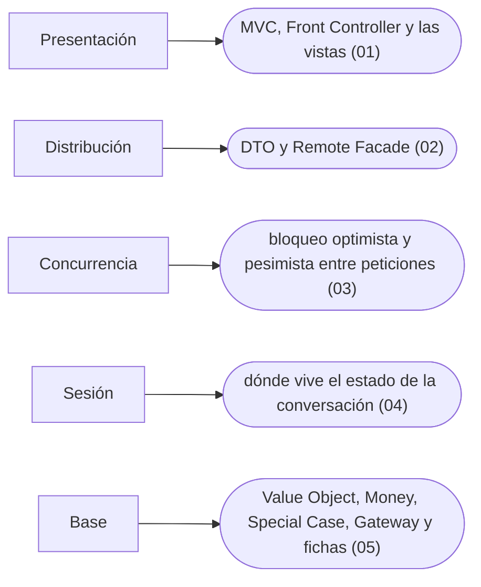

# 08 — Fowler: presentación, distribución y base

> El resto de *PoEAA*: MVC y sus parientes web, los DTO y la fachada remota, la concurrencia entre peticiones con `@Version`, el estado de sesión, y los patrones base —Value Object y Money con su reparto de centavos—.
>
> **Vigencia:** 2026-10-03.

---

## 1. 🗺️ Índice

| | Documento | Tipo |
|---|---|---|
| [`01`](01-presentacion-web.md) | Presentación web | Capítulo |
| [`02`](02-distribucion.md) | Distribución | Capítulo |
| [`03`](03-concurrencia-offline.md) | Concurrencia offline | Capítulo |
| [`04`](04-estado-de-sesion.md) | Estado de sesión | Capítulo |
| [`05`](05-patrones-base.md) | Patrones base | Capítulo |
| [`06`](06-simulacion-de-entrevista.md) | Simulación de entrevista | Simulación |
| [`07`](07-respuestas.md) | Respuestas | Solucionario |

**Orden de lectura.** En orden numérico. `03` y `05` son los que más se preguntan en banca. Al terminar los capítulos, la simulación con cronómetro, y solo después el solucionario.

---

## 2. 🧠 Mapa mental

---

## 3. 🏷️ Niveles de los patrones

A: se escribe y se defiende en la entrevista · B: se reconoce y se explica · C: ficha corta, con lo que lo reemplazó.

| Capítulo | Patrones y nivel |
|---|---|
| [`01`](01-presentacion-web.md) | MVC B · Front Controller B · Page Controller C · Template View C · Transform View C · Two Step View C · Application Controller C |
| [`02`](02-distribucion.md) | Data Transfer Object A · Remote Facade B |
| [`03`](03-concurrencia-offline.md) | Optimistic Offline Lock A · Pessimistic Offline Lock B · Coarse-Grained Lock C · Implicit Lock C |
| [`04`](04-estado-de-sesion.md) | Client Session State C · Server Session State C · Database Session State C |
| [`05`](05-patrones-base.md) | Value Object A · Money B · Special Case B · Gateway B · Mapper C · Layer Supertype C · Separated Interface C · Registry C · Plugin C · Service Stub C · Record Set C |

---

## 4. 🚫 Qué NO está aquí

Los patrones de arquitectura e integración (fuera del corpus, ver el README principal).

---

**Versiones ejecutadas:** JDK 21.0.12, 17.0.20 y 25.0.4 · Spring Boot 4.1.1 (Spring Framework 7.0.9, Hibernate 7.4.5, H2 2.4.240) · mermaid-cli 11.17.0 · GCC 14.4 (C++23) (2026-10-04).

---

**Anterior:** [`07` — Fowler: dominio y datos](../07-fowler-dominio-y-datos/README.md) ·
**Corpus:** [README](../README.md) ·
**Siguiente:** [`09` — DDD táctico y otros](../09-ddd-tactico-y-otros/README.md)
