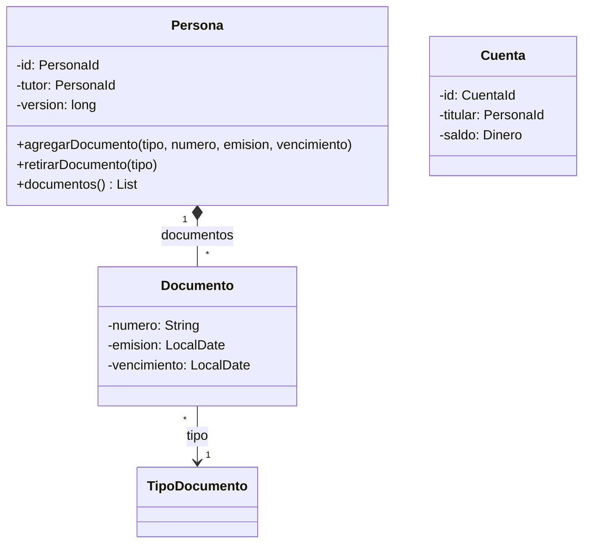
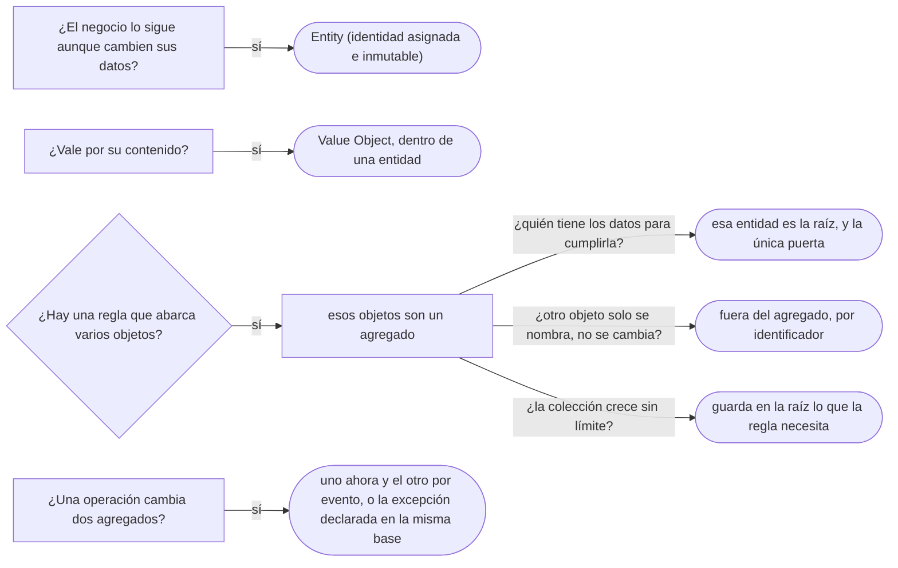

# 01 — Entidad, valor y agregado

> Delimitar un **agregado** y proteger sus invariantes en código: qué objetos cambian juntos, quién es la única puerta,
> cómo se referencian los agregados entre sí y cuántos se modifican por transacción. **Niveles:** Entity A · Aggregate A ·
> Value Object (recordatorio: el patrón es de [`08/05`](../08-fowler-presentacion-distribucion-y-base/05-patrones-base.md#2--value-object)).
> **Lenguajes:** Java; C++ no aporta en este capítulo, porque el ecosistema de DDD es Java y .NET (§5.2 de la guía).
> Asume leído [`02/06` — Entidades, valores y primitivos](../02-modelado-oo/06-entidades-valores-y-primitivos.md) y
> [`02/05` — Redundancia controlada](../02-modelado-oo/05-redundancia-controlada.md).
>
> **Vigencia:** 2026-10-03.
>
> **Versiones ejecutadas:** JDK 21.0.12, 17.0.20 y 25.0.4 · Spring Boot 4.1.1 (Spring Framework 7.0.9, Hibernate 7.4.5, H2 2.4.240) · .NET 10.0.12 (C# 14) · mermaid-cli 11.17.0 · EF Core 10.0.12 (2026-10-04).

---

## 1. 🎯 El problema

Ana no puede tener dos pasaportes colombianos vigentes. La regla está en `Persona.agregarDocumento`, como manda un Domain
Model. Y aun así, un día aparecen dos en la base:

```java
Persona ana = repositorioPersonas.cargar(idAna);
Documento pasaporte = ana.documentos().get(1);           // la lista viva, no una copia
pasaporte.setTipo(tipos.porCodigo("PAS-CO"));            // un setter público en Documento
repositorioDocumentos.guardar(nuevoPasaporte(idAna));    // un repositorio de documentos, sin pasar por Persona
```

- La regla existe, pero hay **tres puertas** para cambiar los documentos de Ana: el método de `Persona`, el *setter* de
  `Documento` y un repositorio que guarda documentos sueltos. Solo la primera comprueba algo.
- Y la regla "un menor necesita un tutor mayor de edad" tiene un problema distinto: el tutor es **otra persona**, que
  se carga, se bloquea y se guarda por su cuenta. ¿Quién la garantiza?

Evans dedica el cap. 6 de *Domain-Driven Design* a este problema y le pone nombre: el **agregado**, la frontera dentro de
la cual un solo objeto garantiza las reglas. Este capítulo lo escribe, junto con la entidad, que es su pieza.

---

## 2. 🧱 Entity

**Problema.** Ana cambia de nombre, de dirección y de documentos, y sigue siendo Ana. Si la igualdad dependiera de sus
datos, cada cambio la convertiría en otra persona, y un `HashSet` de personas la perdería.

**Estructura.** Un objeto definido por una **identidad que se mantiene a lo largo del tiempo**, no por sus atributos. Evans
lo llama *Entity* (también *reference object*). La identidad se asigna una vez, no cambia, y la igualdad compara solo
la identidad.

**Código.**

```java
public final class Persona {
    private final PersonaId id;                  // asignada al crear, nunca cambia
    private String nombre;                       // cambia sin que Persona deje de ser la misma

    @Override public boolean equals(Object o) {
        return o instanceof Persona p && id.equals(p.id);    // solo la identidad
    }
    @Override public int hashCode() { return id.hashCode(); }
}
```

- `PersonaId` es el identificador tipado de [`02/06` §6](../02-modelado-oo/06-entidades-valores-y-primitivos.md#6--identificadores-tipados):
  un `record` con un `UUID`, que se genera al crear la persona y no espera a que la base asigne una secuencia.
- El contrato `equals`/`hashCode` es de [`01/02`](../01-modelo-de-objetos/02-igualdad-identidad-y-hash.md#9--entidades-identidad-o-clave-natural);
  aquí basta la regla: una entidad compara por identidad, y la identidad no cambia.

**Con qué se confunde.** Con "la clase que tiene tabla". Que algo se guarde en una tabla con clave primaria no lo hace
entidad: los movimientos de una cuenta tienen fila y clave, y nadie los sigue en el tiempo ni los modifica. Y con la
entidad de JPA: `@Entity` es una anotación de mapeo, que se pone también en objetos que en el dominio son valores.

**Dónde aparece.** Toda clase `@Entity` con un `@Id` que el dominio sigue (`Persona`, `Cuenta`); los `DbSet<T>` de EF
Core; cualquier objeto cuyo historial importa.

**Cuándo no.** Cuando el concepto vale por su contenido: `Dinero`, `RangoFechas`, `Direccion`. Darles identidad los
vuelve mutables por contagio y obliga a decidir qué pasa cuando dos tienen los mismos datos y distinto id.

> **Veredicto:** entidad cuando el negocio sigue a la cosa aunque cambien todos sus datos; identidad asignada al crear,
> inmutable, y `equals` solo sobre ella. "Entidad es lo que tiene tabla" confunde el mapeo con el modelo.

---

## 3. 🧱 Value Object, como recordatorio

El objeto de valor como concepto es de [`02/06` §3](../02-modelado-oo/06-entidades-valores-y-primitivos.md#3--el-objeto-de-valor-como-concepto),
y el patrón, con `Dinero` y su reparto, de [`08/05` §2](../08-fowler-presentacion-distribucion-y-base/05-patrones-base.md#2--value-object):
inmutable, autovalidado, con igualdad por valor. Lo que añade DDD es **dónde va**: dentro de las entidades, como sus
atributos (`Dinero saldo`, `RangoFechas vigencia`), y la preferencia de Evans por modelar como valor todo lo que se pueda,
porque un valor no necesita frontera: no se modifica, así que no hay invariante que proteger después de construirlo.

> 🧠 **Modelo mental.** Las entidades son pocas y se protegen; los valores son muchos y se reemplazan. Un buen modelo
> empuja comportamiento hacia los valores (`Dinero.repartir`, `RangoFechas.contiene`) y deja a las entidades la identidad
> y la coordinación.

---

## 4. 🧱 Aggregate

**Problema.** Las reglas del §1 abarcan **varios objetos**: "un documento por tipo" mira toda la colección de documentos
de una persona. Si cada objeto se puede cambiar por su cuenta, la regla solo se cumple cuando todos pasan por el mismo
sitio, y nada obliga a hacerlo.

**Estructura.** Un **agregado** es un grupo de objetos que se trata como una unidad para cambiar datos, con una **raíz**
—una entidad— que es la única puerta. Fowler lo resume así: las referencias desde fuera solo apuntan a la raíz, y las
transacciones no cruzan la frontera de un agregado. Las reglas de diseño:

```text
1. La raíz es la única puerta: nadie de fuera guarda una referencia a un objeto interno.
2. La raíz garantiza las invariantes de todo el agregado en cada operación.
3. Se carga, se guarda y se borra entero: un repositorio por agregado, no por clase.
4. Lo interno solo tiene identidad local: el pasaporte de Ana se distingue solo dentro de Ana.
```



- Dos agregados: `Persona` con sus `Documento`, y `Cuenta`. **No hay flecha entre ellos**: `Cuenta` guarda un
  `PersonaId`, y la persona no sabe nada de sus cuentas. Mermaid no dibuja una frontera de agregado; la dice el texto.
- `TipoDocumento` queda fuera: es dato de referencia, compartido por todos los documentos y que nadie modifica a través de
  una persona.

**Código.** La raíz crea sus partes, comprueba la regla y no deja salir nada que se pueda modificar:

```java
public final class Persona {
    private final PersonaId id;
    private final String nombre;
    private final LocalDate fechaNacimiento;
    private PersonaId tutor;                                       // otro agregado: por identificador
    private final Set<Documento> documentos = new LinkedHashSet<>();
    private long version;                                          // protege a todo el agregado

    public Persona(PersonaId id, String nombre, LocalDate fechaNacimiento) {
        this.id = Objects.requireNonNull(id);
        this.nombre = Objects.requireNonNull(nombre);
        this.fechaNacimiento = Objects.requireNonNull(fechaNacimiento);
    }

    public void agregarDocumento(TipoDocumento tipo, String numero, LocalDate emision, LocalDate vencimiento) {
        if (!tipo.admite(numero)) throw new IllegalArgumentException("formato de " + tipo.codigo());
        if (documentos.stream().anyMatch(d -> d.tipo().equals(tipo)))
            throw new IllegalStateException("ya tiene un " + tipo.codigo());        // la invariante del agregado
        documentos.add(new Documento(tipo, numero, emision, vencimiento));          // la raíz crea la parte
    }

    public void retirarDocumento(TipoDocumento tipo) {
        documentos.removeIf(d -> d.tipo().equals(tipo));
    }

    public List<Documento> documentos() { return List.copyOf(documentos); }        // copia inmodificable
}

public record Documento(TipoDocumento tipo, String numero, LocalDate emision, LocalDate vencimiento) { }
```

- `Documento` es **inmutable** y sin *setters*: renovar un pasaporte es retirar el viejo y agregar el nuevo, siempre por la
  raíz. La puerta del *setter* del §1 ya no existe.
- `documentos()` devuelve una copia que no se puede modificar, y como cada `Documento` es inmutable, lo que sale no sirve
  para cambiar nada. Si `Documento` fuera mutable, la copia de la lista no bastaría.
- `version` va en la raíz: con `@Version`, cualquier cambio en un documento sube la versión de la persona, y dos
  operadores que editan documentos distintos de Ana chocan como deben. Es el Coarse-Grained Lock de
  [`08/03` §4](../08-fowler-presentacion-distribucion-y-base/03-concurrencia-offline.md): la raíz del agregado es la
  unidad de bloqueo.

**Con qué se confunde.** Con "una entidad con hijos". Ana *tiene* cuentas, y sin embargo `Cuenta` no está en su
agregado: ninguna regla obliga a cambiar a la vez una cuenta y los documentos de Ana. **La frontera la trazan las
invariantes, no la propiedad ni la navegación del diagrama.** Y con la composición de UML
([`02/04`](../02-modelado-oo/04-agregacion-composicion-y-propiedad.md)): la composición dice quién vive y muere con quién;
el agregado dice, además, quién es la única puerta para cambiarlo.

**Dónde aparece.** En los repositorios por agregado de Spring Data (`CrudRepository<Persona, PersonaId>`, ninguno para
`Documento`), en `cascade = ALL` con `orphanRemoval = true` sobre la colección de la raíz, y en los documentos de una base
documental, donde el agregado es literalmente un documento.

> 📝 **En C#:** EF Core trae el concepto en el mapeo. Un tipo configurado con `OwnsMany` es *owned*: solo existe como
> parte de su dueño, se carga siempre con él y **no admite un `DbSet` propio**, así que el ORM impide el repositorio de
> documentos del §1. En JPA esa disciplina es convención: nada impide escribir un `DocumentoRepository`.

**Cuándo no.** En un CRUD sin reglas que crucen objetos, la frontera no protege nada y obliga a cargar la persona entera
para corregir un vencimiento. Ahí un Transaction Script ([`07/01`](../07-fowler-dominio-y-datos/01-logica-de-dominio.md))
es más honesto.

> **Veredicto:** un agregado es la frontera de una invariante: lo que tiene que ser coherente al terminar cada operación,
> con una raíz como única puerta y un repositorio por raíz. "Un agregado es una entidad con sus hijos" deja fuera la razón
> de ser —la regla que protege— y produce agregados que lo contienen todo.

---

## 5. 🧱 Referencias entre agregados, por identificador

**Problema.** Si `Cuenta` guarda la `Persona` titular como referencia, cargar una cuenta arrastra a la persona y sus
documentos, y nada impide que el servicio de transferencias haga `cuenta.titular().agregarDocumento(...)`: dos agregados
cambiados en la misma operación, con la regla de uno escrita en el código del otro.

**Mecanismo.** Un agregado guarda **el identificador** de otro, nunca la referencia. Vernon lo formula como regla en
*Effective Aggregate Design* ("Reference Other Aggregates By Identity"), y es lo que hace posible las otras dos: cargar
poco y cambiar uno por transacción.

```java
public final class Cuenta {
    private final CuentaId id;
    private final PersonaId titular;          // no Persona: la cuenta no puede cambiar a Ana
    private Dinero saldo;
    private EstadoCuenta estado;
    private long version;
}

// quien necesita a la persona, la pide a su repositorio
Persona titular = repositorioPersonas.cargar(cuenta.titular());
```

- El tutor de Luis también es otro agregado: `Persona` guarda `PersonaId tutor`. Esto **matiza** el `Persona tutor` de
  [`07/01` §3](../07-fowler-dominio-y-datos/01-logica-de-dominio.md#3--domain-model), que ilustraba el Domain Model sin
  fronteras; con agregados, la referencia se vuelve identificador.
- La regla "el tutor es mayor de edad" cruza dos agregados. Se comprueba **al asignar el tutor**, con el tutor cargado
  por su repositorio, y como la edad solo crece, no se puede romper después. Una regla que cruza agregados y sí se puede
  romper después necesita otra estrategia: un evento y una reacción, que es el tema de
  [`02` — Eventos, servicios y fábricas de dominio](02-eventos-servicios-y-fabricas.md).

**Cuándo sí y cuándo no.** Sí entre agregados, siempre. No **dentro** de un agregado: ahí van referencias de objeto
(`Set<Documento>`), como ya dijo [`02/02`](../02-modelado-oo/02-de-la-asociacion-al-codigo.md); un `List<Long>
idsDocumentos` dentro de `Persona` es una traducción equivocada.

> **Veredicto:** dentro del agregado, referencias; entre agregados, identificadores. "Los agregados se referencian con
> objetos, que para eso está el ORM" devuelve el grafo entero en cada carga y deja que cualquiera cambie lo que no es suyo.

---

## 6. 🧱 Un agregado por transacción, y su tamaño

**La regla.** Una operación del negocio modifica **un** agregado. Vernon la da como regla práctica en la primera parte de
su ensayo: un agregado bien diseñado puede modificarse como el negocio requiera con sus invariantes coherentes dentro de
una sola transacción. Lo que tiene que cambiar en otros agregados como consecuencia se hace después, con coherencia
eventual ("Use Eventual Consistency Outside the Boundary").

**El tamaño.** Un agregado grande protege más reglas y lo paga caro: se carga entero, y todo el que lo toca choca con todo
el que lo toca. `Cuenta` con **todos** sus movimientos sería un agregado de miles de objetos que se carga para retirar
diez mil pesos. La salida es la de [`02/05`](../02-modelado-oo/05-redundancia-controlada.md): la cuenta guarda su `saldo`,
que es lo único que la invariante "no queda negativa" necesita, y el movimiento se **añade** sin cargar los anteriores.

```java
public Movimiento retirar(Dinero monto, Instant cuando) {
    if (estado != EstadoCuenta.ABIERTA) throw new IllegalStateException("cuenta " + estado);
    Dinero nuevo = saldo.menos(monto);
    if (nuevo.esNegativo()) throw new IllegalStateException("saldo insuficiente");
    saldo = nuevo;                                          // la invariante vive en la raíz
    return new Retiro(id, monto, cuando);                   // inmutable: se inserta, nunca se modifica
}
```

- El movimiento es inmutable y solo se inserta: no hay invariante entre movimientos que proteger, así que no hace falta
  cargarlos. `Retiro` es uno de los movimientos de la jerarquía sellada de [`06/07`](../06-comportamiento/07-visitor.md).
- Las tres preguntas para decidir si algo entra en el agregado: ¿hay una regla que lo obligue a cambiar **a la vez**?
  ¿Se carga casi siempre con la raíz? ¿Es aceptable que dos usuarios que lo tocan choquen?

**La excepción honesta.** Una `Transferencia` de `CTA-0001` a `CTA-0003` cambia **dos** cuentas. En una sola base, casi
todos los equipos las modifican en la misma transacción, bloqueando las dos raíces en un orden fijo para no producir un
interbloqueo, y está bien decirlo: Vernon mismo enumera razones para romper la regla. Repartirla en pasos con eventos y
compensaciones es un patrón de arquitectura (*Saga*) que queda fuera de este corpus.

> **Veredicto:** agregados pequeños, uno por transacción, y lo demás por eventos; cuando dos agregados tienen que cambiar
> juntos en la misma base, se dice que es una excepción y por qué. "Más grande es más seguro" produce un agregado que todos
> bloquean y que nadie carga sin pagar.

---

## 7. 🧭 Cómo se elige



**La frase en voz alta:** *"Trazo el agregado alrededor de la invariante: los documentos de Ana están en su agregado
porque hay una regla sobre todos ellos; sus cuentas no, porque ninguna regla las cambia a la vez. Fuera del agregado, solo
identificadores, y un agregado por transacción."*

---

## ⚠️ Errores frecuentes

| Se dice | Lo preciso |
|---|---|
| "Un agregado es una entidad con sus hijos" | Es la frontera de una invariante; la propiedad no basta para meter algo dentro |
| "Los agregados se referencian con objetos" | Se referencian por identificador; las referencias de objeto son para dentro del agregado |
| "Una entidad es lo que tiene tabla" | Es lo que el negocio sigue en el tiempo; un movimiento tiene fila y no es una entidad que alguien siga |
| "Un repositorio por tabla" | Un repositorio por raíz de agregado; ninguno para lo interno |
| "Cuanto más grande el agregado, más seguro" | Más contención y más carga; se guardan en la raíz los datos que la regla necesita |
| "Nunca se cambian dos agregados en una transacción" | Es una regla práctica; la transferencia en una sola base es la excepción que se declara |
| "Devolver una copia de la lista protege el agregado" | Solo si los elementos son inmutables; si no, se modifican a través de la copia |

---

## 📚 Para profundizar

- **Libro** — Evans, *Domain-Driven Design* (Addison-Wesley, 2003), cap. 5, "A Model Expressed in Software" (Entities,
  Value Objects) y cap. 6, "The Life Cycle of a Domain Object" (Aggregates). **El que destaca.**
- **Libro** — Vernon, *Implementing Domain-Driven Design* (Addison-Wesley, 2013), cap. 5, "Entities", y cap. 10,
  "Aggregates": las cuatro reglas, con el ejemplo que crece hasta romperse.
- [DDD Community — Vernon, *Effective Aggregate Design*](https://www.dddcommunity.org/library/vernon_2011/): el ensayo en
  tres partes de donde salen las reglas del capítulo.
- [martinfowler.com — *DDD_Aggregate*](https://martinfowler.com/bliki/DDD_Aggregate.html): la definición corta, con la
  raíz y la frontera de transacción.
- [EF Core — *Owned Entity Types*](https://learn.microsoft.com/en-us/ef/core/modeling/owned-entities): el agregado en el
  mapeo, sin `DbSet` para las partes.

---

## 🧠 Preguntas

Sin respuestas aquí. Todas, con enunciado literal y respuesta en tres capas, en
[`05` — Respuestas](05-respuestas.md#01--entidad-valor-y-agregado).

1. ¿Qué es una entidad en DDD? 🟢
2. ¿Qué es un agregado, y qué es su raíz? 🟢
3. ¿Qué significa referenciar otro agregado por identificador? 🟢
4. ¿Qué es la identidad local de un objeto dentro de un agregado? 🟢
5. ¿Qué diferencia hay entre una entidad de DDD y una clase con `@Entity`? 🟡
6. ¿Qué diferencia hay entre un agregado y una composición de UML? 🟡
7. ¿Qué diferencia hay entre un agregado y "una entidad con sus hijos"? 🟡
8. ¿Qué diferencia hay entre un Repository por agregado y uno por tabla? 🟡
9. ¿Qué da EF Core para el interior de un agregado, y qué pasa en JPA en su lugar? 🟡
10. ¿Por qué las cuentas de Ana no están en el agregado de `Persona`? 🟠
11. ¿Por qué la `version` va en la raíz del agregado y no en cada objeto? 🟠
12. ¿Por qué se recomienda modificar un solo agregado por transacción, y cuándo se rompe la regla? 🟠
13. ¿Cómo se garantiza "el tutor es mayor de edad" si el tutor es otro agregado? 🟠
14. ¿Por qué `Cuenta` no debería cargar todos sus movimientos? 🟠
15. Escribe la raíz `Persona` con `agregarDocumento` y la invariante de un documento por tipo. 🔴
16. Dibuja en Mermaid los agregados de personas, documentos y cuentas, y di qué referencias son identificadores. 🔴
17. Revisa este código y di qué rompe el agregado: `ana.documentos().add(new Documento(pasCo, "AQ482916", hoy, vence))`
    con `documentos()` devolviendo el `ArrayList` interno. 🔴
18. Escribe `Cuenta.retirar` de forma que la invariante "el saldo no queda negativo" no necesite cargar los
    movimientos. 🔴

---

**Anterior:** [`08/06` — Simulación de entrevista](../08-fowler-presentacion-distribucion-y-base/06-simulacion-de-entrevista.md) ·
**Siguiente:** [`02` — Eventos, servicios y fábricas de dominio](02-eventos-servicios-y-fabricas.md) ·
**Relacionado:** [`07/05` — Metadatos y consultas](../07-fowler-dominio-y-datos/05-metadatos-y-consultas.md)
