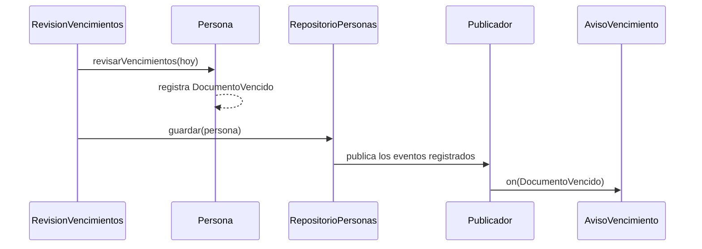
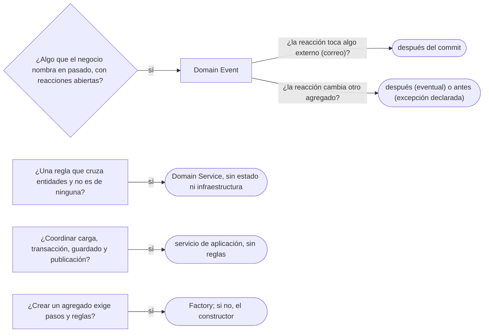

# 02 — Eventos, servicios y fábricas de dominio

> Decidir **cuándo una regla va en un servicio de dominio** y no en una entidad ni en la capa de aplicación, **publicar
> eventos de dominio** sin acoplar el modelo a quien reacciona, y crear un agregado entero con una **fábrica de dominio**.
> **Niveles:** Domain Event A · Domain Service A · Factory B. **Lenguajes:** Java; C++ no aporta en este capítulo (§5.2
> de la guía). Asume leído [`01` — Entidad, valor y agregado](01-entidad-valor-y-agregado.md) y
> [`06/03` — Observer](../06-comportamiento/03-observer.md).
>
> **Vigencia:** 2026-10-03.
>
> **Versiones ejecutadas:** JDK 21.0.12, 17.0.20 y 25.0.4 · Spring Boot 4.1.1 (Spring Framework 7.0.9, Hibernate 7.4.5, H2 2.4.240) · .NET 10.0.12 (C# 14) · mermaid-cli 11.17.0 (2026-10-04).

---

## 1. 🎯 El problema

Tres situaciones del mismo sistema, y en las tres el código busca dónde ponerse:

```java
@Service
public class ServicioDocumentos {
    public void revisarVencimientos(LocalDate hoy) {
        for (Persona p : repositorioPersonas.todas()) {
            for (Documento d : p.documentos()) {
                if (d.vencimiento() != null && d.vencimiento().isBefore(hoy)) {
                    correo.enviar(p.email(), "Tu " + d.tipo().codigo() + " venció");      // 1. avisar
                    if (p.esMenor(hoy)) cuentas.bloquearDe(p.id());                         // 2. bloquear su cuenta
                    auditoria.registrar("vencido " + d.numero());                           // 3. auditar
                }
            }
        }
    }
}
```

- **Lo que pasa** —un documento venció— y **lo que se hace por eso** —avisar, bloquear, auditar— están en el mismo
  método. Cada reacción nueva (avisar al tutor de Luis, recalcular el riesgo) es una línea más aquí, y el método que
  detecta el vencimiento acaba conociendo el correo, las cuentas y la auditoría.
- La transferencia de `CTA-0001` a `CTA-0003` tiene el problema contrario: la regla (misma moneda, saldo suficiente,
  las dos abiertas) no es de ninguna de las dos cuentas, y acaba en un `@Service` de doscientas líneas que mezcla reglas,
  transacción y repositorios.
- Y crear a Luis con su tarjeta de identidad y su tutora exige resolver tipos, generar la identidad y comprobar reglas
  antes de que exista el agregado: ¿quién lo arma?

Evans nombra dos de las respuestas en *Domain-Driven Design*: el **servicio** (cap. 5) y la **fábrica** (cap. 6). La
tercera, el **evento de dominio**, llegó después del libro; la *DDD Reference* de 2015 la marca como término nuevo.

---

## 2. 🧱 Domain Event

**Problema.** Algo pasa en el dominio —un documento vence, una cuenta se bloquea— y otras partes tienen que reaccionar.
Si quien detecta el hecho llama a cada reacción, se acopla a todas y crece con cada una.

**Estructura.** Un **evento de dominio** es un objeto que representa **algo que ya pasó** y que le importa al negocio:
`DocumentoVencido`, `CuentaBloqueada`. Es inmutable, se nombra en pasado, y lleva cuándo ocurrió y las identidades de lo
involucrado. El agregado lo **registra**; alguien fuera del modelo lo **publica** cuando el cambio se guarda; los
manejadores **reaccionan**, cada uno en su sitio.



**Código.** El evento es un `record`; el agregado lo acumula en una lista que no se guarda:

```java
public record DocumentoVencido(PersonaId persona, String tipo, String numero, LocalDate vencio) { }

public final class Persona extends AbstractAggregateRoot<Persona> {     // Spring Data: registerEvent y la publicación
    public void revisarVencimientos(LocalDate hoy) {
        for (Documento d : documentos) {
            if (d.vencimiento() != null && d.vencimiento().isBefore(hoy) && avisados.add(d.tipo().codigo()))
                registerEvent(new DocumentoVencido(id, d.tipo().codigo(), d.numero(), d.vencimiento()));
        }
    }
}
```

- `avisados` es un `Set<String>` de la persona con los tipos ya notificados: sin él, la revisión de cada noche volvería a
  registrar el mismo vencimiento. Que un evento no se repita es responsabilidad del agregado, no del manejador.
- `AbstractAggregateRoot` es la clase base de Spring Data que guarda los eventos registrados y los entrega al publicador
  de eventos de Spring cuando se llama a `save` o `delete` del repositorio. La documentación avisa de que `deleteById`
  **no** publica, porque puede borrar sin cargar el agregado.
- El modelo no importa nada de correo ni de cuentas: solo conoce el evento.

Las reacciones, en la capa de aplicación:

```java
@Component
class AvisoVencimiento {
    @TransactionalEventListener                                // por defecto, AFTER_COMMIT
    void on(DocumentoVencido e) { correo.enviarA(e.persona(), "Tu " + e.tipo() + " venció el " + e.vencio()); }
}

@Component
class BloqueoCuentasDeMenores {
    @TransactionalEventListener(phase = TransactionPhase.BEFORE_COMMIT)
    void on(DocumentoVencido e) { bloqueoCuentas.siEsMenor(e.persona()); }   // otro agregado, misma transacción
}
```

- El correo va **después** del *commit*: si la transacción se deshace, nadie recibe un aviso de algo que no pasó.
- El bloqueo de la cuenta de Luis va **antes** del *commit*, en la misma transacción. Es una decisión: o un agregado por
  transacción y el bloqueo después (coherencia eventual, con su ventana), o los dos juntos como excepción declarada
  ([`01` §6](01-entidad-valor-y-agregado.md#6--un-agregado-por-transacción-y-su-tamaño)).

> 📝 **En C#:** la guía de arquitectura de .NET describe la misma forma con otro nombre, el enfoque diferido: la entidad
> añade el evento a una lista, y el `DbContext` lo despacha justo **antes** de `SaveChanges` (efectos en la misma
> transacción, la opción que usa su aplicación de referencia con MediatR) o justo **después** (transacciones separadas y
> coherencia eventual). La decisión de antes o después es la misma que en Spring.

**Con qué se confunde.** Con el Observer de [`06/03`](../06-comportamiento/03-observer.md): el mecanismo de entrega es un
Observer, pero el evento de dominio es un **concepto del negocio** con nombre del lenguaje del negocio, no un "algo
cambió" técnico. Y con el **evento de integración**, el mensaje que sale del proceso hacia otros sistemas por un *broker*:
ese se publica solo si la transacción se confirmó y es asíncrono siempre; su diseño (bandeja de salida, entrega al menos
una vez) es de arquitectura y queda fuera de este corpus.

**Dónde aparece.** `AbstractAggregateRoot`, `@DomainEvents` y `@AfterDomainEventPublication` en Spring Data;
`ApplicationEventPublisher` y `@TransactionalEventListener` en Spring.

**Cuándo no.** Cuando hay **una** reacción, fija y esencial para la operación: llamarla directamente se lee mejor que
seguir un evento hasta su manejador. Y nunca para devolver un resultado: un evento no tiene respuesta.

> **Veredicto:** evento de dominio cuando algo que el negocio nombra en pasado dispara reacciones abiertas en número; el
> agregado lo registra, la infraestructura lo publica al guardar, y cada reacción decide si va antes o después del
> *commit*. "Un evento de dominio es un mensaje de Kafka" confunde el concepto con un transporte.

---

## 3. 🧱 Domain Service

**Problema.** Algunas reglas no son de ninguna entidad. Transferir no es responsabilidad de la cuenta origen ni de la
destino: ponerlo en `Cuenta.transferirA(otra, monto)` obliga a una cuenta a modificar otra, y repartirlo en las dos pierde
la regla de conjunto.

**Estructura.** Un **servicio de dominio** es una operación del modelo que no encaja de forma natural en una entidad ni en
un valor. Evans pide tres cosas: que la operación sea un concepto del dominio, que su interfaz se exprese con objetos del
modelo, y que el servicio **no tenga estado**. Su nombre es un verbo del negocio.

```text
Servicio de aplicación   → carga, abre la transacción, llama, guarda, publica. Sin reglas del negocio.
Servicio de dominio      → la regla que cruza entidades. Sin repositorios, sin transacción, sin HTTP.
Entidad / valor          → la regla que es de un solo objeto.
```

**Código.** El servicio de dominio recibe las dos cuentas ya cargadas y aplica la regla de conjunto:

```java
public final class ServicioTransferencias {                  // dominio: sin Spring, sin repositorios
    public Transferencia transferir(Cuenta origen, Cuenta destino, Dinero monto, Instant cuando) {
        if (origen.equals(destino)) throw new IllegalArgumentException("misma cuenta");
        if (!origen.moneda().equals(destino.moneda())) throw new IllegalArgumentException("monedas distintas");
        Movimiento salida = origen.retirar(monto, cuando);         // cada cuenta protege su invariante
        Movimiento entrada = destino.depositar(monto, cuando);
        return new Transferencia(origen.id(), destino.id(), monto, salida, entrada);
    }
}
```

Y el servicio de aplicación, que es lo que en Spring lleva `@Service` y `@Transactional`:

```java
@Service
public class TransferirFondos {
    @Transactional
    public TransferenciaId ejecutar(CuentaId origenId, CuentaId destinoId, Dinero monto) {
        Cuenta origen = cuentas.cargarParaActualizar(origenId);   // las dos raíces, en orden fijo de id
        Cuenta destino = cuentas.cargarParaActualizar(destinoId);
        Transferencia t = servicio.transferir(origen, destino, monto, reloj.instant());
        cuentas.guardar(origen);
        cuentas.guardar(destino);
        return transferencias.guardar(t);
    }
}
```

- El servicio de dominio se prueba sin base ni Spring: dos `Cuenta` en memoria, un monto, y la comprobación del
  resultado. Las reglas de cada cuenta (estado, saldo) siguen en `Cuenta.retirar`, de
  [`01` §6](01-entidad-valor-y-agregado.md#6--un-agregado-por-transacción-y-su-tamaño); el servicio solo añade las de
  conjunto.
- `cargarParaActualizar` toma las cuentas en orden de identificador para que dos transferencias cruzadas no se
  interbloqueen. La transferencia que cambia dos agregados es la excepción declarada en `01`.
- El servicio de aplicación es la Service Layer de Fowler ([`07/01`](../07-fowler-dominio-y-datos/01-logica-de-dominio.md)):
  delgado, sin un solo `if` de negocio.

**Con qué se confunde.** Con **cualquier `@Service`**. La anotación de Spring marca un *bean*, casi siempre un servicio de
aplicación; que una clase la lleve no la hace servicio de dominio, y un servicio de dominio no la necesita. Y con el
**servicio de infraestructura** (enviar un correo, consultar el verificador de identidad), que es técnico y vive fuera
del modelo detrás de una interfaz.

**Dónde aparece.** Sin anclaje en una librería: es una decisión de modelado. Lo que sí se ve en todas partes es el
síntoma de no tenerlo: reglas de negocio dentro de un servicio de aplicación junto a los repositorios.

**Cuándo no.** Cuando la regla es de un objeto: `retirar` con su saldo es de `Cuenta`, y sacarlo a un servicio vacía la
entidad. Un modelo con todas las reglas en servicios y entidades con solo *getters* es el modelo anémico, el antipatrón
que [`12/03` §3](../12-antipatrones/03-antipatrones-de-diseno-oo.md#3-️-anemic-domain-model) trata entero.

> **Veredicto:** servicio de dominio para la regla que cruza entidades y no es de ninguna, sin estado y sin
> infraestructura; servicio de aplicación para coordinar, sin reglas. "Un servicio de dominio es cualquier `@Service`"
> mezcla las dos capas y acaba con las reglas junto al `@Transactional`.

---

## 4. 🧱 Factory

**Problema.** Crear a Luis no es un `new`: hay que resolver `TI` a su `TipoDocumento`, generar `PersonaId`, comprobar
que la tutora existe y es mayor, y agregar el documento. Si el cliente hace todo eso, conoce el interior del agregado; si
lo hace el constructor de `Persona`, el constructor necesita repositorios.

**Mecanismo.** Una **fábrica de dominio** crea un agregado **entero y coherente**, de una pieza, haciendo cumplir sus
invariantes. La *DDD Reference* la pide cuando la creación es compleja o revela demasiado de la estructura interna. Puede
ser un método estático de la raíz, un método de otro agregado o una clase aparte. No es el Factory Method del GoF ([`04/01`](../04-creacionales/01-factory-method.md)): el Factory
Method deja que una subclase decida **qué clase** se crea; la fábrica de DDD casi nunca elige clase, **arma** un agregado
y garantiza que nace válido. Comparten nombre e intención general —encapsular la creación— y nada más.

**Código.**

```java
public final class FabricaPersonas {
    private final CatalogoTipos tipos;                 // datos de referencia, por interfaz del dominio

    public Persona menorConTutor(String nombre, LocalDate nacimiento, Persona tutora,
                                 String codigoTipo, String numero, LocalDate hoy) {
        if (tutora.esMenor(hoy)) throw new IllegalArgumentException("la tutora debe ser mayor de edad");
        Persona p = new Persona(new PersonaId(UUID.randomUUID()), nombre, nacimiento);
        p.asignarTutor(tutora.id());
        TipoDocumento tipo = tipos.porCodigo(codigoTipo);
        p.agregarDocumento(tipo, numero, hoy, nacimiento.plusYears(18));     // la TI vence a los 18
        return p;                                                             // sale completo o no sale
    }
}

Persona luis = fabrica.menorConTutor("Luis Rojas Paz", LocalDate.of(2013, 9, 2), ana, "TI", "1098765432", hoy);
```

- La fábrica recibe la tutora cargada (otro agregado) solo para comprobar la regla; dentro de Luis queda su `PersonaId`.
- No guarda nada: crear y persistir son responsabilidades distintas, y el repositorio guarda después.

**Cuándo sí y cuándo no.** Sí cuando crear el agregado exige pasos, datos de referencia o reglas que no caben en un
constructor. No cuando el constructor basta: `new Persona(id, nombre, nacimiento)` no necesita fábrica, y una
`FabricaPersonas` con un solo `return new Persona(...)` es ceremonia.

> **Veredicto:** fábrica de dominio cuando crear el agregado es una operación con reglas; si basta un constructor, el
> constructor. "La fábrica de DDD es un Factory Method" confunde elegir la clase con armar el agregado.

---

## 5. 🧭 Cómo se elige



**La frase en voz alta:** *"La regla de la transferencia va en un servicio de dominio porque no es de ninguna de las dos
cuentas; el `@Service` con `@Transactional` solo carga, llama y guarda. Y cuando un documento vence, la persona registra
`DocumentoVencido`: el aviso va después del commit y nadie en el modelo sabe que existe el correo."*

---

## ⚠️ Errores frecuentes

| Se dice | Lo preciso |
|---|---|
| "Un servicio de dominio es cualquier `@Service`" | `@Service` marca un *bean*, casi siempre de aplicación; el de dominio es una regla del modelo sin infraestructura |
| "Las reglas van en los servicios y las entidades guardan datos" | Es el modelo anémico; al servicio va solo la regla que no es de ningún objeto |
| "Un evento de dominio es un mensaje de Kafka" | Es un concepto del modelo; el transporte, si sale del proceso, es un evento de integración |
| "El agregado publica sus eventos" | Los registra; los publica la infraestructura al guardar |
| "Los eventos se publican siempre después del commit" | Depende de la reacción: las externas, después; las que cambian otro agregado, se decide y se declara |
| "La fábrica de DDD es el Factory Method" | El Factory Method elige la clase; la fábrica de DDD arma un agregado válido |
| "Toda entidad necesita su fábrica" | Solo cuando crearla tiene pasos o reglas; si no, el constructor |

---

## 📚 Para profundizar

- **Libro** — Evans, *Domain-Driven Design* (Addison-Wesley, 2003), cap. 5, "A Model Expressed in Software" (Services),
  y cap. 6, "The Life Cycle of a Domain Object" (Factories). **El que destaca.**
- **Libro** — Vernon, *Implementing Domain-Driven Design* (Addison-Wesley, 2013), cap. 7, "Services", cap. 8, "Domain
  Events", y cap. 11, "Factories".
- [Domain Language — *DDD Reference* (2015, PDF)](https://www.domainlanguage.com/wp-content/uploads/2016/05/DDD_Reference_2015-03.pdf):
  los resúmenes de Evans, con Domain Events como término nuevo.
- [Spring Data — *Publishing Events from Aggregate Roots*](https://docs.spring.io/spring-data/commons/reference/repositories/core-domain-events.html):
  `@DomainEvents`, qué métodos publican y por qué `deleteById` no.
- [Spring Framework — *Transaction-bound Events*](https://docs.spring.io/spring-framework/reference/data-access/transaction/event.html):
  `@TransactionalEventListener` y sus fases.
- [.NET — *Domain events: Design and implementation*](https://learn.microsoft.com/en-us/dotnet/architecture/microservices/microservice-ddd-cqrs-patterns/domain-events-design-implementation):
  el despacho diferido, antes o después de guardar, y la diferencia con los eventos de integración.

---

## 🧠 Preguntas

Sin respuestas aquí. Todas, con enunciado literal y respuesta en tres capas, en
[`05` — Respuestas](05-respuestas.md#02--eventos-servicios-y-fábricas-de-dominio).

1. ¿Qué es un evento de dominio? 🟢
2. ¿Qué es un servicio de dominio, y cuáles son sus tres características según Evans? 🟢
3. ¿Qué es una fábrica de dominio? 🟢
4. ¿Por qué un evento de dominio se nombra en pasado y es inmutable? 🟢
5. ¿Qué diferencia hay entre un servicio de dominio y un servicio de aplicación? 🟡
6. ¿Qué diferencia hay entre un evento de dominio y un evento de integración? 🟡
7. ¿Qué diferencia hay entre una fábrica de dominio y un Factory Method? 🟡
8. ¿Qué diferencia hay entre publicar los eventos de dominio en Spring Data y despacharlos en .NET con el enfoque
    diferido? 🟡
9. ¿Por qué el agregado registra los eventos y no los publica él mismo? 🟠
10. ¿Por qué el aviso por correo va después del *commit*? 🟠
11. ¿Cuándo una reacción a un evento debe ir en la misma transacción, y qué se pierde? 🟠
12. ¿Por qué la regla de la transferencia no va en `Cuenta`? 🟠
13. ¿Cuándo una fábrica de dominio es ceremonia? 🟠
14. Escribe `Persona.revisarVencimientos` registrando `DocumentoVencido` sin repetir avisos. 🔴
15. Separa en servicio de dominio y servicio de aplicación esta transferencia: un `@Service` con `@Transactional`
    que carga las dos cuentas, comprueba moneda, estado y saldo con `if`, modifica los saldos y guarda. 🔴
16. Revisa este código y di qué falla: un `@EventListener` que envía el correo de `DocumentoVencido` y una transacción que
    después se deshace. 🔴

---

**Anterior:** [`01` — Entidad, valor y agregado](01-entidad-valor-y-agregado.md) ·
**Siguiente:** [`03` — Specification, Null Object y Type Object](03-specification-null-object-y-type-object.md) ·
**Relacionado:** [`06/03` — Observer](../06-comportamiento/03-observer.md)
