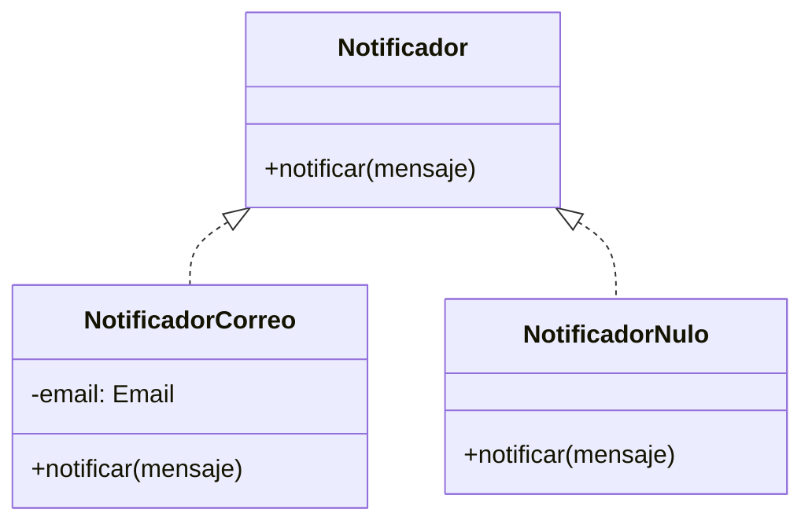
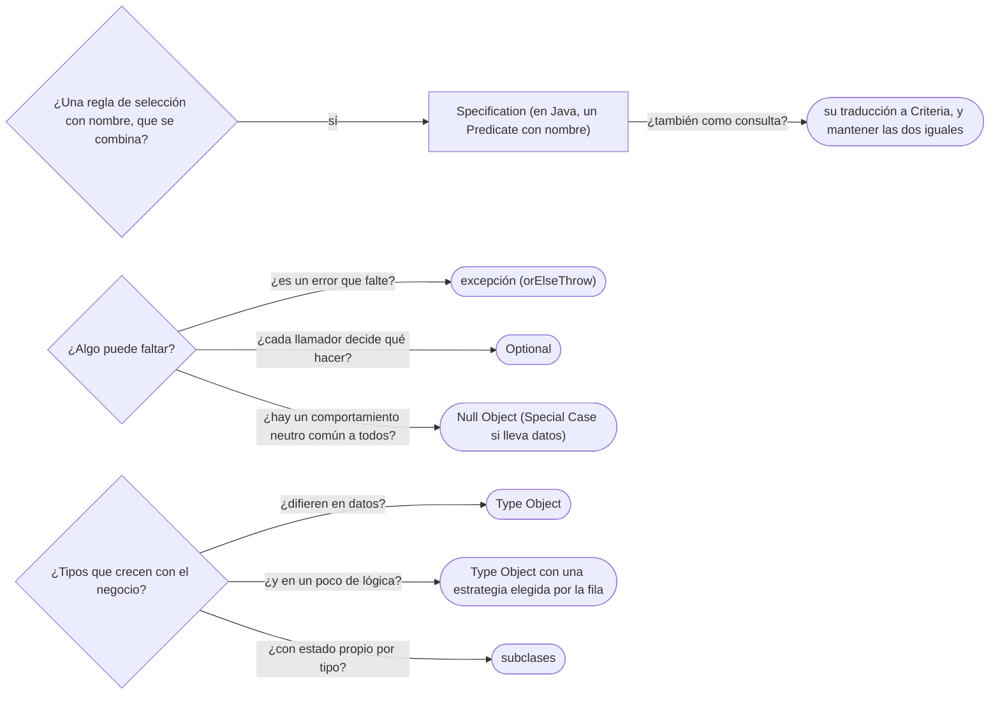

# 03 — Specification, Null Object y Type Object

> Reconocer y escribir tres patrones que no son del GoF y resuelven problemas de todos los días: la regla de negocio
> **combinable** (Specification), la **ausencia con comportamiento** (Null Object) y el **tipo que es un dato** (Type
> Object). **Niveles:** Specification B · Null Object A · Type Object B. **Es el dueño de Null Object y de Type Object**:
> cierra los adelantos de [`01/08` §4](../01-modelo-de-objetos/08-la-ausencia-y-el-error.md#4--null-object-como-adelanto)
> y [`02/06` §7](../02-modelado-oo/06-entidades-valores-y-primitivos.md#7--el-tipo-como-objeto-tipodocumento-contra-subclases).
> **Lenguajes:** Java; C++ en Null Object, donde aporta. Asume leído
> [`01` — Entidad, valor y agregado](01-entidad-valor-y-agregado.md).
>
> **Vigencia:** 2026-10-03.
>
> **Versiones ejecutadas:** GCC 14.4 (C++23) · JDK 21.0.12, 17.0.20 y 25.0.4 · mermaid-cli 11.17.0 (2026-10-04).

---

## 1. 🎯 El problema

Tres fragmentos del mismo sistema, cada uno con su dolor:

```java
// 1. La misma regla, escrita cinco veces con cinco variaciones
boolean puedeAbrir = d.vencimiento() == null || d.vencimiento().isAfter(hoy)
        && d.tipo().pais().equals(colombia);                  // ¿precedencia de && y ||? nadie la revisó

// 2. El null que todos comprueban, y cada uno a su manera
if (luis.tutor() != null) correo.enviar(luis.tutor().email(), aviso);

// 3. Un país nuevo acepta la licencia de conducción: ¿LicenciaConduccionCo extends Documento, y otro despliegue?
```

- En el primero, la regla "documento vigente y colombiano" no tiene nombre, y la quinta copia ya tiene un error de
  precedencia: `||` se evalúa después de `&&`, así que un documento que no vence pasa aunque sea mexicano.
- En el segundo, la ausencia de tutor es normal (Ana es adulta) y tiene un comportamiento evidente —no avisar a
  nadie—, pero cada llamador la decide de nuevo.
- En el tercero, los tipos de documento crecen con el negocio y no con el código.

Ninguno es del GoF, y los tres tienen nombre: Specification (Evans y Fowler), Null Object (Woolf) y Type Object.

---

## 2. 🧱 Specification

**Problema.** Las reglas de selección —"vigente", "colombiano", "vence en treinta días"— se repiten, se combinan de
formas distintas en cada sitio y se escriben como expresiones booleanas sin nombre.

**Mecanismo.** Un objeto que responde **si un candidato cumple una regla**, con un nombre del dominio, y que se
**combina** con `y`, `o` y `no`. El artículo de Evans y Fowler lo resume como separar la regla de cómo casa un
candidato del candidato mismo, y le da tres usos: **validar** (¿este documento sirve?), **seleccionar** (dame los que
sirven) y **construir a pedido** (crea algo que cumpla esto).

**Código.**

```java
@FunctionalInterface
public interface Especificacion<T> {
    boolean esSatisfechaPor(T candidato);

    default Especificacion<T> y(Especificacion<T> otra) { return c -> esSatisfechaPor(c) && otra.esSatisfechaPor(c); }
    default Especificacion<T> o(Especificacion<T> otra) { return c -> esSatisfechaPor(c) || otra.esSatisfechaPor(c); }
    default Especificacion<T> no() { return c -> !esSatisfechaPor(c); }
}

public final class EspecificacionesDocumento {
    public static Especificacion<Documento> vigenteEn(LocalDate fecha) {
        return d -> d.vencimiento() == null || !d.vencimiento().isBefore(fecha);
    }
    public static Especificacion<Documento> emitidoPor(Pais pais) {
        return d -> d.tipo().pais().equals(pais);
    }
}

Especificacion<Documento> valeParaAbrirCuenta = vigenteEn(hoy).y(emitidoPor(colombia));
boolean anaPuede = ana.documentos().stream().anyMatch(valeParaAbrirCuenta::esSatisfechaPor);   // → true, por la CC
```

- La regla compuesta tiene **nombre** y se escribe una vez. El error de precedencia del §1 no puede ocurrir: la
  composición es explícita.
- Es un Composite de reglas ([`05/05`](../05-estructurales/05-composite.md)) y, dicho con el vocabulario de
  [`06/09`](../06-comportamiento/09-memento-e-interpreter.md#3--interpreter), el Interpreter de una gramática de tres
  operadores con nombres del dominio.
- `Predicate<Documento>` del JDK ya tiene `and`, `or` y `negate`: en Java, una Specification **es** un `Predicate` con
  nombre de negocio. Escribir la interfaz propia solo se justifica si añade algo (una explicación del rechazo, o la
  traducción a consulta).

**Cuándo sí y cuándo no.** Sí cuando la misma regla aparece en varios sitios o se combina de varias formas, y cuando el
negocio la nombra ("documento válido para abrir cuenta"). No para una condición que se usa una vez: un `if` legible es
mejor que una clase. Y el precio que nadie dice: la versión **en memoria** y la versión **en consulta** (la `Specification`
de Spring Data de [`07/05`](../07-fowler-dominio-y-datos/05-metadatos-y-consultas.md), que produce un predicado de
Criteria) son dos implementaciones de la misma regla, y hay que mantenerlas iguales.

> **Veredicto:** Specification cuando una regla de selección tiene nombre en el negocio y se combina; en Java, un
> `Predicate` con nombre ya lo es. "Specification es un patrón de Spring Data" confunde una de sus traducciones (a
> consulta) con el patrón.

---

## 3. 🧱 Null Object

**Problema.** La ausencia de algo es un caso **normal** con un comportamiento obvio —un adulto no tiene tutor al que
avisar—, y aun así cada llamador comprueba `null` y decide qué hacer. El día que alguien olvida el `if`, salta un
`NullPointerException`.

**Estructura.** Un objeto con la **misma interfaz** que el real y comportamiento **neutro**: no hace nada, devuelve
cero o una colección vacía. Se devuelve en lugar de `null`, y el llamador no comprueba nada porque siempre hay un
objeto. Bobby Woolf lo publicó como patrón en *Pattern Languages of Program Design 3* (1998); Fowler lo generaliza como
Special Case ([`08/05` §4](../08-fowler-presentacion-distribucion-y-base/05-patrones-base.md#4--special-case)), y en
*Refactoring* la refactorización se llama *Introduce Special Case*, con *Introduce Null Object* como alias.



**Código.** Java, con el objeto nulo como constante de un `enum` porque no tiene estado:

```java
public interface Notificador { void notificar(String mensaje); }

public enum NotificadorNulo implements Notificador {
    INSTANCIA;
    @Override public void notificar(String mensaje) { }          // no hay tutor: no hay a quién avisar
}

public Notificador notificadorDelTutor(Persona p) {
    return p.tutor().map(id -> (Notificador) new NotificadorCorreo(contactos.emailDe(id)))
            .orElse(NotificadorNulo.INSTANCIA);
}

notificadorDelTutor(luis).notificar("La TI de Luis venció");    // avisa a Ana
notificadorDelTutor(ana).notificar("El pasaporte de Ana vence pronto");   // no hace nada, sin if
```

- La decisión "si no hay tutor, no se avisa" se toma **una vez**, en `notificadorDelTutor`. Los llamadores no la ven.
- `Optional` aparece **dentro**, en el `tutor()` que puede faltar; el Null Object está **fuera**, para quien no debería
  tener que decidir nada.

C++, donde el objeto nulo permite usar una **referencia**, que no puede ser nula, en lugar de un puntero:

```cpp
class Notificador {
public:
    virtual ~Notificador() = default;
    virtual void notificar(const std::string& mensaje) = 0;
};

class NotificadorNulo final : public Notificador {
public:
    void notificar(const std::string&) override {}                // neutro, a propósito
    static NotificadorNulo& instancia() { static NotificadorNulo n; return n; }
};

void avisarVencimiento(Notificador& tutor, const std::string& mensaje) {
    tutor.notificar(mensaje);                                     // sin comprobar nada: una referencia nunca es nula
}
```

- La firma con `Notificador&` dice "siempre hay alguien"; la de `Notificador*` diría "puede no haber", y obligaría a
  comprobar. El objeto nulo es estático y sin estado: compartirlo es seguro.

**Con qué se confunde.** Con `Optional`: `Optional` **obliga al llamador a decidir** qué hacer si falta; el Null Object
**decide por él**. Y con el Special Case, del que es el caso particular "no hay nada" (un Special Case puede tener datos,
como la cuenta desconocida con su número).

**Dónde aparece.** `Collections.emptyList()`, que es el Null Object de las listas; `OutputStream.nullOutputStream()`
(desde Java 11), que descarta todo lo que recibe; el `NOPLogger` de SLF4J.

**Cuándo no.** Cuando la ausencia es un **error**. Ahí el Null Object no evita el fallo: lo esconde.

```java
Cuenta destino = cuentas.porId(destinoId).orElse(CuentaNula.INSTANCIA);   // depositar() no hace nada
servicio.transferir(origen, destino, monto, ahora);                       // se retira de CTA-0001 y no llega a nadie
```

- El `NullPointerException` habría detenido la transferencia; el Null Object la completa a medias, y el dinero
  desaparece sin una línea en el registro. Una cuenta destino inexistente es un error: `orElseThrow`.

> **Veredicto:** Null Object cuando la ausencia es normal y su comportamiento neutro es el mismo para todos los
> llamadores; `Optional` cuando cada llamador decide; excepción cuando falta algo que debía estar. "Null Object esconde
> errores" es cierto exactamente cuando la ausencia era un error, y falso cuando era un caso normal.

---

## 4. 🧱 Type Object

**Problema.** `TipoDocumento` empezó en [`02/06` §7](../02-modelado-oo/06-entidades-valores-y-primitivos.md#7--el-tipo-como-objeto-tipodocumento-contra-subclases)
con la pregunta: ¿una subclase por tipo de documento, o un objeto por tipo? Cada país nuevo trae tipos nuevos, y con
subclases cada uno es una clase, una compilación y un despliegue.

**Mecanismo.** Una clase cuyas **instancias son tipos**. Nystrom lo resume así: permitir crear "clases" nuevas de forma
flexible con una sola clase, cada una de cuyas instancias representa un tipo distinto. Cada objeto del dominio
(`Documento`) apunta a su objeto tipo (`TipoDocumento`), que guarda lo común a todos los de su tipo: formato, país, si
vence.

**Código.** Los tipos son datos, cargados de una tabla; el comportamiento que difiere se expresa con datos, y el que no
cabe en datos, con una estrategia que el tipo elige:

```java
public final class TipoDocumento {
    private final String codigo;               // "PAS-CO"
    private final Pais pais;
    private final Pattern formato;             // [A-Z]{2}\d{6}
    private final PoliticaVencimiento vencimiento;

    public boolean admite(String numero) { return formato.matcher(numero).matches(); }
    public LocalDate venceEl(LocalDate emision, LocalDate nacimiento) { return vencimiento.calcular(emision, nacimiento); }
}

public sealed interface PoliticaVencimiento permits NoVence, AniosDesdeEmision, HastaMayoriaDeEdad {
    LocalDate calcular(LocalDate emision, LocalDate nacimiento);       // null: no vence
}
public record NoVence() implements PoliticaVencimiento {
    public LocalDate calcular(LocalDate e, LocalDate n) { return null; }
}
public record AniosDesdeEmision(int anios) implements PoliticaVencimiento {
    public LocalDate calcular(LocalDate e, LocalDate n) { return e.plusYears(anios).minusDays(1); }
}
public record HastaMayoriaDeEdad() implements PoliticaVencimiento {
    public LocalDate calcular(LocalDate e, LocalDate n) { return n.plusYears(18); }
}
```

- `CC` lleva `NoVence`; `PAS-CO`, `AniosDesdeEmision(10)` (emitido el 2021-06-01, vence el 2031-05-31); `TI`,
  `HastaMayoriaDeEdad`. Un pasaporte de otro país con otra vigencia es **una fila**, no una clase.
- Las tres políticas son el comportamiento que **no** cabe en un dato: un catálogo pequeño y cerrado de estrategias
  ([`06/01`](../06-comportamiento/01-strategy.md)), que la fila elige por nombre. Es la forma madura del patrón: datos para
  lo que varía mucho, una estrategia para lo que varía poco.
- Es la misma regla de vencimiento que [`04/01`](../04-creacionales/01-factory-method.md) puso en la creación; aquí vive
  en el tipo.

**Cuándo sí y cuándo no.** Sí cuando los tipos **difieren en datos** y crecen sin aviso: tipos de documento, de cuenta,
de producto. No cuando cada tipo tiene **estado propio** (los visados de un pasaporte, que la cédula no tiene): eso pide
una subclase o una composición. El precio, que Nystrom pone primero: los tipos ya no los comprueba el compilador —un
`Documento` con un tipo inexistente compila— y hay que cargarlos, cachearlos y validarlos a mano. Y el comportamiento por
tipo cuesta más que sobrescribir un método.

> **Veredicto:** Type Object cuando la diferencia entre tipos cabe en una fila, con una estrategia para la poca lógica
> que no cabe; subclase cuando el tipo trae estado o comportamiento propio. "Cada tipo de documento merece su subclase"
> funciona con tres tipos y se rompe con el país número veinte.

---

## 5. 🧭 Cómo se elige



**La frase en voz alta:** *"Si no tener tutor es normal y la respuesta es no avisar a nadie, devuelvo un notificador nulo
y nadie comprueba nada; pero si falta la cuenta destino de una transferencia, eso es un error y lanzo, porque un Null
Object ahí haría desaparecer el dinero."*

---

## ⚠️ Errores frecuentes

| Se dice | Lo preciso |
|---|---|
| "Null Object esconde errores" | Solo cuando la ausencia era un error; cuando es normal, quita `if` repetidos sin esconder nada |
| "Null Object y `Optional` son lo mismo" | `Optional` obliga a decidir al llamador; el Null Object decide por él |
| "Specification es un patrón de Spring Data" | Es de Evans y Fowler; la `Specification` de Spring Data es su traducción a consulta |
| "Para combinar reglas hace falta una interfaz propia" | En Java, `Predicate` ya combina; la interfaz propia se justifica si añade algo |
| "Cada tipo de documento merece su subclase" | Si difieren solo en datos, es un Type Object; subclase cuando hay estado propio |
| "Con Type Object no hay comportamiento por tipo" | Lo hay: datos para lo que varía mucho y una estrategia elegida por el tipo para lo poco que no cabe |
| "El Null Object tiene que ser un Singleton" | Si no tiene estado, compartirlo es cómodo; si tiene datos, es un Special Case con instancias |

---

## 📚 Para profundizar

- **Libro** — Evans, *Domain-Driven Design* (Addison-Wesley, 2003), cap. 9, "Making Implicit Concepts Explicit"
  (Specification), y cap. 10, "Supple Design" (la Specification declarativa y combinable). **El que destaca.**
- **Libro** — Nystrom, *Game Programming Patterns* (2014), cap. "Type Object": el patrón con sus costos, libre en línea.
- **Libro** — Fowler, *Refactoring*, 2.ª ed. (Addison-Wesley, 2018), cap. 10, *Introduce Special Case*.
- [martinfowler.com — Evans y Fowler, *Specifications* (PDF)](https://martinfowler.com/apsupp/spec.pdf): el artículo
  original, con la validación, la selección, la construcción a pedido y la Composite Specification.
- [Game Programming Patterns — *Type Object*](https://gameprogrammingpatterns.com/type-object.html)
- [refactoring.com — *Introduce Special Case*](https://refactoring.com/catalog/introduceSpecialCase.html): con su alias
  *Introduce Null Object*.
- [Java 21 API — `OutputStream.nullOutputStream()`](https://docs.oracle.com/en/java/javase/21/docs/api/java.base/java/io/OutputStream.html#nullOutputStream()):
  un Null Object del JDK.

---

## 🧠 Preguntas

Sin respuestas aquí. Todas, con enunciado literal y respuesta en tres capas, en
[`05` — Respuestas](05-respuestas.md#03--specification-null-object-y-type-object).

1. ¿Qué es una Specification? 🟢
2. ¿Qué es un Null Object? 🟢
3. ¿Qué es un Type Object? 🟢
4. ¿Cuáles son los tres usos de una Specification según Evans y Fowler? 🟢
5. ¿Dónde aparece el Null Object en el JDK? 🟢
6. ¿Qué diferencia hay entre un Null Object y `Optional`? 🟡
7. ¿Qué diferencia hay entre una Specification y un `Predicate` de Java? 🟡
8. ¿Qué diferencia hay entre Type Object y una subclase por tipo? 🟡
9. ¿Qué gana un Null Object en C++ frente a un puntero nulo, y qué hace Java en su lugar? 🟡
10. ¿Cuándo un Null Object esconde un error? 🟠
11. ¿Qué cuesta tener una Specification en memoria y otra en consulta? 🟠
12. ¿Qué pierdes al pasar de subclases a Type Object? 🟠
13. ¿Cómo se expresa en un Type Object el comportamiento que no cabe en un dato? 🟠
14. ¿Por qué el Null Object sin estado se puede compartir, y cuándo no? 🟠
15. Escribe las especificaciones `vigenteEn` y `emitidoPor` y combínalas para "documento válido para abrir cuenta". 🔴
16. Escribe un Null Object para el notificador del tutor, en Java y en C++. 🔴
17. Modela `TipoDocumento` como Type Object con la política de vencimiento de `CC`, `TI` y `PAS-CO`. 🔴
18. Revisa este código y di qué falla: `cuentas.porId(destinoId).orElse(CuentaNula.INSTANCIA)` antes de una
    transferencia. 🔴

---

**Anterior:** [`02` — Eventos, servicios y fábricas de dominio](02-eventos-servicios-y-fabricas.md) ·
**Siguiente:** [`04` — Simulación de entrevista](04-simulacion-de-entrevista.md) ·
**Relacionado:** [`08/05` — Patrones base](../08-fowler-presentacion-distribucion-y-base/05-patrones-base.md)
