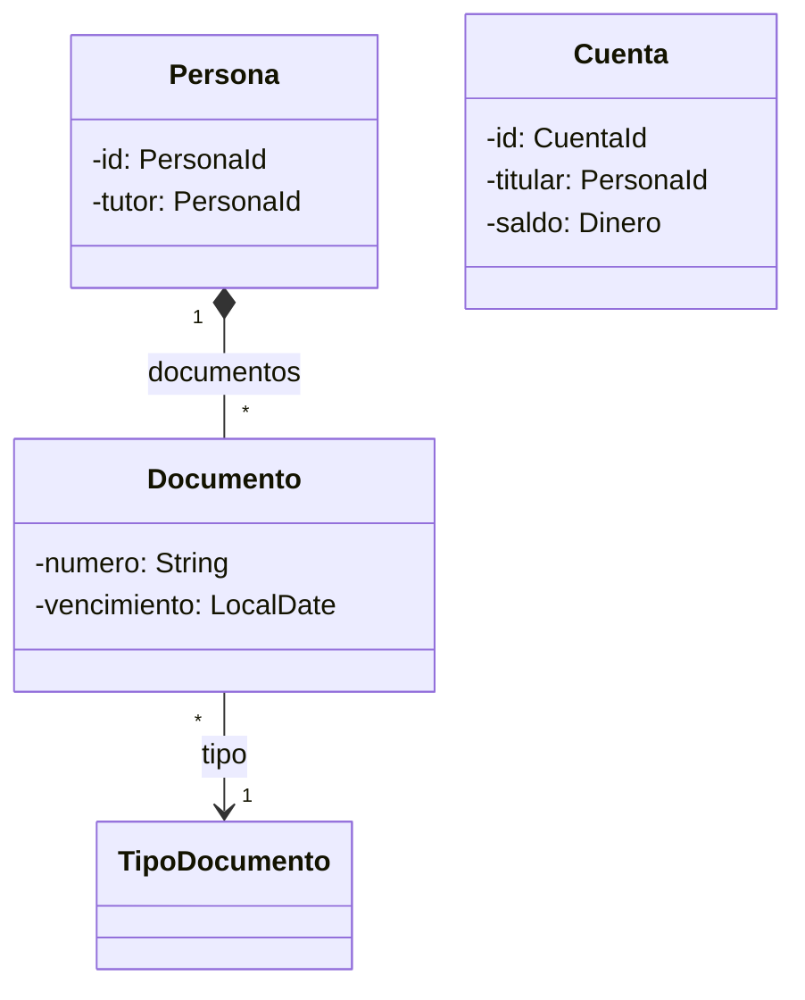
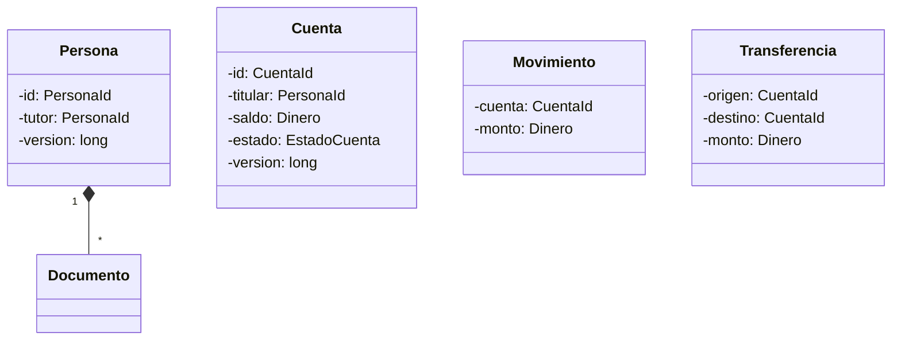

# 05 — Respuestas

> Solucionario del bloque `09-ddd-tactico-y-otros`: DDD táctico y otros. Cada respuesta en tres capas:
> **⏱️ 30 segundos** (lo que dices primero, sin que te lo pidan), **🗣️ 2 minutos** (lo que
> añades cuando dicen "cuéntame más") y **🔬 El detalle** (para estudiar, no para decir en voz
> alta). Los enunciados están copiados literalmente de su capítulo.
>
> **Vigencia:** 2026-10-03.
>
> **Versiones ejecutadas:** GCC 14.4 (C++23) · JDK 21.0.12, 17.0.20 y 25.0.4 · Spring Boot 4.1.1 (Spring Framework 7.0.9, Hibernate 7.4.5, H2 2.4.240) · mermaid-cli 11.17.0 (2026-10-04).

**Salto rápido:** [01](#01--entidad-valor-y-agregado) · [02](#02--eventos-servicios-y-fábricas-de-dominio) · [03](#03--specification-null-object-y-type-object) · [04](#04--simulación-de-entrevista)

---

# 01 — Entidad, valor y agregado

**01 → 1. ¿Qué es una entidad en DDD? 🟢**

⏱️ Un objeto definido por una identidad que se mantiene en el tiempo, no por sus atributos: Ana sigue siendo Ana aunque
cambie de nombre y de documentos.
🗣️ La identidad se asigna al crear (`PersonaId` con un `UUID`), no cambia nunca, y `equals` y `hashCode` comparan solo
esa identidad. Evans la llama *Entity* o *reference object* en el cap. 5.
🔬 Generar la identidad al crear, y no esperar la secuencia de la base, permite que el objeto sea igual a sí mismo antes y
después de guardarse, y que se pueda poner en un `HashSet` desde el primer momento.

**01 → 2. ¿Qué es un agregado, y qué es su raíz? 🟢**

⏱️ Un grupo de objetos que se trata como una unidad para cambiar datos, con una entidad raíz que es la única puerta: desde
fuera solo se referencia la raíz.
🗣️ `Persona` con sus `Documento`: la regla "un documento por tipo" mira toda la colección, así que todos los cambios
pasan por `Persona.agregarDocumento`. Se carga y se guarda entero, con un repositorio por raíz.
🔬 Fowler lo resume en su bliki: las referencias desde fuera solo van a la raíz y las transacciones no cruzan la frontera.

**01 → 3. ¿Qué significa referenciar otro agregado por identificador? 🟢**

⏱️ Que un agregado guarda el id del otro, no la referencia al objeto: `Cuenta` tiene un `PersonaId titular`, no una
`Persona`.
🗣️ Así cargar una cuenta no arrastra a la persona con sus documentos, y el código de la cuenta no puede cambiar a la
persona. Quien necesita a la persona la pide a su repositorio.
🔬 Es la regla "Reference Other Aggregates By Identity" de Vernon, en la segunda parte de *Effective Aggregate Design*.

**01 → 4. ¿Qué es la identidad local de un objeto dentro de un agregado? 🟢**

⏱️ Una identidad que solo distingue al objeto dentro de su agregado: el pasaporte de Ana se distingue de los demás
documentos de Ana, no de todos los documentos del sistema.
🗣️ Como nadie de fuera referencia lo interno, no necesita una identidad global. En el capítulo, `Documento` se distingue
por su tipo dentro de la persona.
🔬 En la base puede tener una clave técnica, pero el modelo no la expone: ningún servicio busca un documento por su id sin
pasar por la persona.

**01 → 5. ¿Qué diferencia hay entre una entidad de DDD y una clase con `@Entity`? 🟡**

⏱️ La entidad de DDD es un concepto del modelo —algo que el negocio sigue en el tiempo—; `@Entity` es una anotación de
mapeo que dice que la clase se guarda en una tabla.
🗣️ Se anotan con `@Entity` cosas que en el dominio no son entidades —un movimiento inmutable que nadie sigue—, y hay
entidades que no se guardan con JPA.
🔬 Para mapear un valor dentro de una entidad, JPA tiene `@Embeddable` ([`07/04`](../07-fowler-dominio-y-datos/04-estructura-objeto-relacional.md)),
que no tiene identidad propia.

**01 → 6. ¿Qué diferencia hay entre un agregado y una composición de UML? 🟡**

⏱️ La composición dice quién vive y muere con quién; el agregado dice además quién es la única puerta para cambiarlo y
dónde termina la transacción.
🗣️ `Persona` compone sus documentos (si se borra la persona, se borran) y además es la raíz: ningún documento se cambia sin
ella, y la invariante "uno por tipo" se comprueba en ella.
🔬 Un agregado puede contener objetos que en UML serían asociaciones simples, si una invariante los obliga a cambiar
juntos; y una composición no tiene por qué ser frontera de transacción.

**01 → 7. ¿Qué diferencia hay entre un agregado y "una entidad con sus hijos"? 🟡**

⏱️ Lo que define al agregado es la invariante que protege, no la relación de padre e hijo: Ana *tiene* cuentas y sus
cuentas no están en su agregado.
🗣️ Si la frontera la trazara la propiedad, la persona contendría sus cuentas, sus movimientos y sus empleos, y cada
operación cargaría y bloquearía todo. Entra solo lo que una regla obliga a cambiar a la vez.
🔬 La pregunta útil es "¿qué tiene que ser coherente al terminar esta operación?", no "¿de quién es esto?".

**01 → 8. ¿Qué diferencia hay entre un Repository por agregado y uno por tabla? 🟡**

⏱️ Uno por agregado carga y guarda el agregado entero a través de su raíz; uno por tabla permite cambiar las partes sin la
raíz y saltarse sus reglas.
🗣️ Con `RepositorioPersonas` y sin `RepositorioDocumentos`, la única forma de guardar un documento es pasar por
`Persona.agregarDocumento`. Un repositorio de documentos es la tercera puerta del problema del capítulo.
🔬 Es la regla de Evans, cap. 6, y la que siguió [`07/05`](../07-fowler-dominio-y-datos/05-metadatos-y-consultas.md). Las
consultas de lectura que cruzan agregados pueden ir por otro camino (una proyección), porque no cambian nada.

**01 → 9. ¿Qué da EF Core para el interior de un agregado, y qué pasa en JPA en su lugar? 🟡**

⏱️ EF Core tiene tipos *owned* (`OwnsMany`): solo existen como parte de su dueño, se cargan con él y no admiten un `DbSet`
propio. En JPA no hay nada equivalente que lo impida.
🗣️ En JPA la disciplina es convención: `cascade = ALL` y `orphanRemoval = true` en la colección de la raíz, y no escribir
un repositorio para las partes. Nada en el ORM impide un `DocumentoRepository`.
🔬 La documentación de EF Core los presenta como conceptualmente parecidos a los agregados, y recomienda tipos complejos
para los objetos de valor. Una regla de arquitectura comprobada en los tests (ArchUnit) puede suplir la convención en Java.

**01 → 10. ¿Por qué las cuentas de Ana no están en el agregado de `Persona`? 🟠**

⏱️ Porque ninguna regla obliga a cambiar a la vez una cuenta y los documentos de Ana: no hay invariante compartida, así
que no hay razón para una frontera común.
🗣️ Meterlas costaría cargar todas las cuentas para agregar un documento, y que un retiro en `CTA-0001` chocara con la
corrección del pasaporte de Ana. `Cuenta` es su propio agregado, con su invariante de saldo, y guarda `PersonaId`.
🔬 Si algún día aparece una regla que cruza los dos ("una persona con documentos vencidos no puede retirar"), se comprueba
al operar, leyendo el otro agregado, o se reacciona a un evento; no se fusionan los agregados.

**01 → 11. ¿Por qué la `version` va en la raíz del agregado y no en cada objeto? 🟠**

⏱️ Porque el agregado se protege entero: dos cambios en documentos distintos de Ana no chocan en ninguna fila, y aun así
pueden romper juntos una regla del agregado.
🗣️ Con la versión en la raíz, cada cambio sube la versión de `Persona` y el segundo guardado concurrente falla. Es el
Coarse-Grained Lock de Fowler, que en JPA se fuerza con `OPTIMISTIC_FORCE_INCREMENT` cuando no cambia ningún campo de la
raíz.
🔬 Versiones en cada documento detectarían solo los choques sobre el mismo documento, no los que violan "uno por tipo"
añadiendo dos documentos distintos.

**01 → 12. ¿Por qué se recomienda modificar un solo agregado por transacción, y cuándo se rompe la regla? 🟠**

⏱️ Porque cada agregado garantiza sus invariantes solo; cambiar varios a la vez agranda la transacción, la contención y el
acoplamiento. Lo que sigue en otros agregados va después, con coherencia eventual.
🗣️ Es la regla práctica de Vernon. Se rompe con motivo: la transferencia entre dos cuentas en la misma base se hace en una
transacción, bloqueando las dos raíces en un orden fijo, y se declara como excepción.
🔬 Vernon mismo enumera razones para romperla (conveniencia de la interfaz, falta de infraestructura de mensajería,
transacciones globales exigidas). Repartir la transferencia en pasos con compensaciones es un *Saga*, fuera de este
corpus.

**01 → 13. ¿Cómo se garantiza "el tutor es mayor de edad" si el tutor es otro agregado? 🟠**

⏱️ Se comprueba al asignar el tutor, cargándolo por su repositorio; y como la edad solo crece, una vez cumplida la regla ya
no se puede romper.
🗣️ `Persona` guarda `PersonaId tutor`, así que la comprobación necesita la fecha de nacimiento del tutor: se la pasa quien
coordina la operación, o un servicio de dominio que lee los dos agregados.
🔬 Una regla que cruza agregados y que sí puede romperse después (por ejemplo, "el tutor no puede tener los documentos
vencidos") necesita un evento y una reacción, o aceptar que se comprueba solo en ciertos momentos.

**01 → 14. ¿Por qué `Cuenta` no debería cargar todos sus movimientos? 🟠**

⏱️ Porque su invariante —el saldo no queda negativo— solo necesita el saldo, y cargar miles de movimientos para un retiro
cuesta memoria, tiempo y contención.
🗣️ La cuenta guarda el `saldo` como redundancia controlada y cada operación devuelve un movimiento inmutable que solo se
inserta. No hay ninguna regla entre movimientos que exija tenerlos cargados.
🔬 El saldo cacheado tiene que mantenerse en la misma operación que crea el movimiento, en la misma transacción
([`02/05`](../02-modelado-oo/05-redundancia-controlada.md)); el extracto se lee por otro camino, paginado.

**01 → 15. Escribe la raíz `Persona` con `agregarDocumento` y la invariante de un documento por tipo. 🔴**

⏱️ La raíz crea el documento, comprueba el formato y que no haya otro del mismo tipo, y solo deja salir una copia
inmodificable de documentos inmutables.
🗣️

```java
public final class Persona {
    private final PersonaId id;
    private final Set<Documento> documentos = new LinkedHashSet<>();
    private long version;

    public Persona(PersonaId id) { this.id = Objects.requireNonNull(id); }

    public void agregarDocumento(TipoDocumento tipo, String numero, LocalDate emision, LocalDate vencimiento) {
        if (!tipo.admite(numero)) throw new IllegalArgumentException("formato de " + tipo.codigo());
        if (documentos.stream().anyMatch(d -> d.tipo().equals(tipo)))
            throw new IllegalStateException("ya tiene un " + tipo.codigo());
        documentos.add(new Documento(tipo, numero, emision, vencimiento));
    }
    public List<Documento> documentos() { return List.copyOf(documentos); }
}
public record Documento(TipoDocumento tipo, String numero, LocalDate emision, LocalDate vencimiento) { }
```

🔬 Lo que preguntará después: por qué `Documento` es inmutable (para que la copia de la lista baste), cómo se renueva un
pasaporte (retirar y agregar, por la raíz), y dónde va la `version` (en `Persona`).

**01 → 16. Dibuja en Mermaid los agregados de personas, documentos y cuentas, y di qué referencias son identificadores. 🔴**

⏱️ Dos agregados: `Persona` con sus documentos, y `Cuenta`. Entre ellos, solo identificadores: el titular de la cuenta y el
tutor de la persona.
🗣️



🔬 No hay flecha entre `Persona` y `Cuenta`: la relación es el atributo `titular: PersonaId`, y la frontera la dice el
texto, porque Mermaid no la dibuja. `TipoDocumento` es dato de referencia compartido, fuera de los dos agregados.

**01 → 17. Revisa este código y di qué rompe el agregado: `ana.documentos().add(new Documento(pasCo, "AQ482916", hoy, vence))` con `documentos()` devolviendo el `ArrayList` interno. 🔴**

⏱️ Abre una segunda puerta: el documento entra sin pasar por `agregarDocumento`, así que no se comprueba ni el formato ni
que Ana ya tenga un `PAS-CO`. Ana queda con dos pasaportes colombianos.
🗣️ La corrección es que `documentos()` devuelva `List.copyOf(documentos)`: el `add` lanza `UnsupportedOperationException`
y la única forma de agregar es el método de la raíz.
🔬 Si `Documento` fuera mutable, la copia no bastaría: se podría cambiar el tipo de un documento a través de la lista.
Por eso lo interno del agregado se hace inmutable o no se expone.

**01 → 18. Escribe `Cuenta.retirar` de forma que la invariante "el saldo no queda negativo" no necesite cargar los movimientos. 🔴**

⏱️ La cuenta guarda el saldo, lo comprueba y lo actualiza, y devuelve el movimiento para que se inserte.
🗣️

```java
public Movimiento retirar(Dinero monto, Instant cuando) {
    if (estado != EstadoCuenta.ABIERTA) throw new IllegalStateException("cuenta " + estado);
    Dinero nuevo = saldo.menos(monto);
    if (nuevo.esNegativo()) throw new IllegalStateException("saldo insuficiente");
    saldo = nuevo;
    return new Retiro(id, monto, cuando);
}
```

🔬 Lo que preguntará después: cómo se evita que dos retiros concurrentes dejen el saldo negativo (la `version` de la
cuenta, o un `UPDATE` condicionado), y qué pasa si el movimiento se inserta y la cuenta no se guarda (van en la misma
transacción).

# 02 — Eventos, servicios y fábricas de dominio

**02 → 1. ¿Qué es un evento de dominio? 🟢**

⏱️ Un objeto que representa algo que ya pasó y que le importa al negocio —`DocumentoVencido`, `CuentaBloqueada`—, para
que otras partes reaccionen sin que quien lo detecta las conozca.
🗣️ El agregado lo registra cuando ocurre; la infraestructura lo publica al guardar; los manejadores reaccionan en la capa
de aplicación. Lleva cuándo pasó y las identidades de lo involucrado.
🔬 No está en el libro de Evans de 2003: la *DDD Reference* de 2015 lo marca como término nuevo. Evans lo describe como
parte de pleno derecho del modelo, distinto de los eventos técnicos del sistema.

**02 → 2. ¿Qué es un servicio de dominio, y cuáles son sus tres características según Evans? 🟢**

⏱️ Una operación del modelo que no encaja en ninguna entidad ni valor. Evans pide que sea un concepto del dominio, que su
interfaz use objetos del modelo y que no tenga estado.
🗣️ `ServicioTransferencias.transferir(origen, destino, monto)`: la regla de conjunto no es de ninguna de las dos cuentas.
Su nombre es un verbo del negocio y no conoce repositorios, transacciones ni HTTP.
🔬 Evans lo justifica con "a veces, simplemente no es una cosa": forzar la operación en una entidad deforma la entidad o
inventa objetos artificiales.

**02 → 3. ¿Qué es una fábrica de dominio? 🟢**

⏱️ Lo que crea un agregado entero y coherente de una pieza, haciendo cumplir sus invariantes, cuando crearlo es más que un
constructor.
🗣️ `FabricaPersonas.menorConTutor` resuelve el tipo de documento, genera la identidad, comprueba la tutora y agrega la
tarjeta de identidad: Luis sale completo o no sale.
🔬 Puede ser un método estático de la raíz, un método de otro agregado o una clase. Crea, no guarda: la persistencia es
del repositorio.

**02 → 4. ¿Por qué un evento de dominio se nombra en pasado y es inmutable? 🟢**

⏱️ Porque es un hecho: ya ocurrió, y nadie puede cambiar lo que ocurrió. El pasado en el nombre lo dice; la inmutabilidad
lo garantiza.
🗣️ `DocumentoVencido`, no `VencerDocumento`: un nombre en imperativo sería una orden (un Command), que alguien puede
rechazar. Al evento solo se reacciona. Un `record` lo hace inmutable sin esfuerzo.
🔬 Si varios manejadores reciben el mismo evento, la inmutabilidad evita que uno cambie lo que ve el siguiente.

**02 → 5. ¿Qué diferencia hay entre un servicio de dominio y un servicio de aplicación? 🟡**

⏱️ El de dominio contiene una regla del negocio que cruza entidades; el de aplicación coordina —carga, abre la
transacción, llama, guarda, publica— y no contiene ninguna regla.
🗣️ `TransferirFondos` (aplicación, con `@Service` y `@Transactional`) carga las dos cuentas y llama a
`ServicioTransferencias.transferir` (dominio, sin Spring), que comprueba la moneda y mueve el dinero.
🔬 La prueba sencilla: si el servicio necesita un repositorio o una transacción, es de aplicación; si se puede probar
con objetos en memoria y sin Spring, es de dominio. El de aplicación es la Service Layer de Fowler.

**02 → 6. ¿Qué diferencia hay entre un evento de dominio y un evento de integración? 🟡**

⏱️ El de dominio vive dentro del proceso y del modelo, y sus reacciones pueden ir en la misma transacción; el de
integración sale del proceso hacia otros sistemas, solo si la transacción se confirmó, y siempre asíncrono.
🗣️ `DocumentoVencido` dispara el aviso y el bloqueo dentro de la aplicación; si otro sistema necesita saberlo, un
manejador publica un evento de integración en el *broker*.
🔬 La guía de arquitectura de .NET hace esta distinción explícita. Cómo se publica de forma fiable el de integración
(bandeja de salida, entrega al menos una vez) es arquitectura y queda fuera de este corpus.

**02 → 7. ¿Qué diferencia hay entre una fábrica de dominio y un Factory Method? 🟡**

⏱️ El Factory Method deja que una subclase decida qué clase se crea; la fábrica de dominio arma un agregado entero y
garantiza que nace válido, casi siempre sin elegir clase.
🗣️ `FabricaPersonas` crea siempre una `Persona`: lo que encapsula son los pasos y las reglas, no la elección de tipo.
Comparten la intención general de encapsular la creación y nada más.
🔬 Una fábrica de dominio puede usar por dentro un Factory Method o un Builder si el agregado lo pide; son niveles
distintos.

**02 → 8. ¿Qué diferencia hay entre publicar los eventos de dominio en Spring Data y despacharlos en .NET con el enfoque diferido? 🟡**

⏱️ En los dos, la entidad acumula los eventos en una lista y se despachan al guardar. En Spring Data los publica el
repositorio en `save`; en .NET, el `DbContext` antes o después de `SaveChanges`.
🗣️ En Spring, la fase la elige cada manejador con `@TransactionalEventListener`; en la guía de .NET, el despacho se pone
antes de `SaveChanges` (efectos en la misma transacción, con MediatR) o después (transacciones separadas).
🔬 La decisión de fondo es la misma: qué reacciones forman parte de la transacción y cuáles aceptan coherencia eventual.

**02 → 9. ¿Por qué el agregado registra los eventos y no los publica él mismo? 🟠**

⏱️ Porque publicar es infraestructura y depende de la transacción: si el agregado publicara al instante, una reacción
podría ejecutarse por un cambio que después se deshace.
🗣️ Registrar es añadir a una lista en memoria; la infraestructura los entrega al guardar, cuando se sabe que el cambio va
a la base. Además el modelo no depende de Spring ni de ningún publicador.
🔬 La guía de .NET cuenta la evolución: los primeros diseños usaban una clase estática que despachaba al momento, y se
abandonaron porque complicaban las pruebas y la depuración.

**02 → 10. ¿Por qué el aviso por correo va después del *commit*? 🟠**

⏱️ Porque un correo no se puede deshacer: si se envía antes y la transacción falla, Ana recibe un aviso de algo que no
quedó registrado.
🗣️ `@TransactionalEventListener` con su fase por defecto, `AFTER_COMMIT`, ejecuta el manejador solo si la transacción
se confirmó.
🔬 El precio es que si el envío falla después del *commit*, el aviso se pierde: si importa, el aviso se guarda
sin enviar en la misma transacción y otro proceso lo envía y reintenta.

**02 → 11. ¿Cuándo una reacción a un evento debe ir en la misma transacción, y qué se pierde? 🟠**

⏱️ Cuando el negocio no acepta ni un instante de incoherencia entre los dos agregados: bloquear la cuenta de Luis a la vez
que se registra el vencimiento. Se pierde la regla de un agregado por transacción.
🗣️ Con `BEFORE_COMMIT`, el manejador corre dentro de la transacción y todo se confirma o se deshace junto. A cambio, la
transacción toca dos agregados, bloquea más filas y acopla su éxito.
🔬 La alternativa es coherencia eventual: confirmar el vencimiento y bloquear después, aceptando la ventana y
reintentando si falla. Qué opción es correcta lo dice el negocio, y se declara.

**02 → 12. ¿Por qué la regla de la transferencia no va en `Cuenta`? 🟠**

⏱️ Porque es una regla de conjunto: ponerla en `Cuenta.transferirA(otra)` obliga a una cuenta a modificar otra, es decir,
a cambiar un agregado desde otro.
🗣️ Cada cuenta protege lo suyo (`retirar` comprueba estado y saldo; `depositar`, estado); lo que es de las dos —misma
moneda, no a sí misma— va en el servicio de dominio que recibe ambas.
🔬 Si la operación devuelve un `Transferencia` con los dos movimientos, ese objeto puede ser su propio agregado, que se
guarda en la misma transacción.

**02 → 13. ¿Cuándo una fábrica de dominio es ceremonia? 🟠**

⏱️ Cuando crear el agregado no tiene pasos ni reglas que no quepan en el constructor: una `FabricaPersonas` con un solo
`return new Persona(...)` añade una clase y una indirección por nada.
🗣️ Se justifica cuando hacen falta datos de referencia, otro agregado para comprobar una regla, o varios pasos que deben
ocurrir juntos. Si no, constructor o método estático en la raíz.
🔬 Una pista: si la fábrica no tiene dependencias ni lanza nada que el constructor no lance, sobra.

**02 → 14. Escribe `Persona.revisarVencimientos` registrando `DocumentoVencido` sin repetir avisos. 🔴**

⏱️ Recorrer los documentos, registrar un evento por cada uno vencido y recordar en el agregado qué tipos ya se avisaron.
🗣️

```java
public void revisarVencimientos(LocalDate hoy) {
    for (Documento d : documentos) {
        boolean vencido = d.vencimiento() != null && d.vencimiento().isBefore(hoy);
        if (vencido && avisados.add(d.tipo().codigo()))
            registerEvent(new DocumentoVencido(id, d.tipo().codigo(), d.numero(), d.vencimiento()));
    }
}
```

🔬 Lo que preguntará después: dónde vive `avisados` (un campo de la persona, persistido, que se limpia al retirar o
renovar el documento); quién llama a `revisarVencimientos` (una tarea programada de la capa de aplicación, que carga y
guarda cada persona); y por qué no se revisan todas las personas en una transacción (una por agregado).

**02 → 15. Separa en servicio de dominio y servicio de aplicación esta transferencia: un `@Service` con `@Transactional` que carga las dos cuentas, comprueba moneda, estado y saldo con `if`, modifica los saldos y guarda. 🔴**

⏱️ Las reglas de cada cuenta van a `Cuenta.retirar` y `Cuenta.depositar`; las de conjunto, a un servicio de dominio sin
Spring; y el `@Service` queda con cargar, llamar y guardar.
🗣️

```java
public final class ServicioTransferencias {
    public Transferencia transferir(Cuenta origen, Cuenta destino, Dinero monto, Instant cuando) {
        if (!origen.moneda().equals(destino.moneda())) throw new IllegalArgumentException("monedas distintas");
        return new Transferencia(origen.id(), destino.id(), monto,
                origen.retirar(monto, cuando), destino.depositar(monto, cuando));
    }
}

@Service
public class TransferirFondos {
    @Transactional
    public TransferenciaId ejecutar(CuentaId o, CuentaId d, Dinero monto) {
        Cuenta origen = cuentas.cargarParaActualizar(o), destino = cuentas.cargarParaActualizar(d);
        Transferencia t = servicio.transferir(origen, destino, monto, reloj.instant());
        cuentas.guardar(origen);
        cuentas.guardar(destino);
        return transferencias.guardar(t);
    }
}
```

🔬 Lo que preguntará después: el orden de carga para evitar interbloqueos (por id), cómo se prueba el servicio de dominio
(dos cuentas en memoria) y si esto rompe "un agregado por transacción" (sí, y se declara como excepción).

**02 → 16. Revisa este código y di qué falla: un `@EventListener` que envía el correo de `DocumentoVencido` y una transacción que después se deshace. 🔴**

⏱️ `@EventListener` reacciona en cuanto se publica el evento, dentro de la transacción: el correo sale, la transacción se
deshace, y Ana recibe un aviso de un vencimiento que no quedó registrado.
🗣️ La corrección es `@TransactionalEventListener`, cuya fase por defecto es `AFTER_COMMIT`: el manejador solo corre si
la transacción se confirmó.
🔬 Lo que preguntará después: qué pasa si el envío falla después del *commit* (se pierde; si importa, el aviso se guarda
sin enviar en la misma transacción y se envía aparte), y qué pasa si se publica sin transacción activa (el manejador
transaccional no se ejecuta, salvo con `fallbackExecution = true`).

# 03 — Specification, Null Object y Type Object

**03 → 1. ¿Qué es una Specification? 🟢**

⏱️ Un objeto que dice si un candidato cumple una regla de negocio con nombre, y que se combina con `y`, `o` y `no`:
"vigente en esta fecha" y "emitido por Colombia" dan "válido para abrir cuenta".
🗣️ Separa la regla del objeto al que se aplica, así que la regla se escribe una vez, con nombre, y se reutiliza en la
validación, en los filtros y en las búsquedas.
🔬 Viene del artículo de Evans y Fowler y del cap. 9 de *Domain-Driven Design*. Por dentro es un Composite de reglas, o el
Interpreter de una gramática de tres operadores.

**03 → 2. ¿Qué es un Null Object? 🟢**

⏱️ Un objeto con la misma interfaz que el real y comportamiento neutro —no hacer nada, cero, vacío—, que se devuelve en
lugar de `null` para que nadie tenga que comprobar.
🗣️ `NotificadorNulo` para las personas sin tutor: `notificar` no hace nada, y quien avisa del vencimiento llama sin un
solo `if`. La decisión de qué hacer cuando falta se toma una vez.
🔬 Lo publicó Bobby Woolf en *Pattern Languages of Program Design 3*; en *Refactoring* es *Introduce Special Case*, con
*Introduce Null Object* como alias.

**03 → 3. ¿Qué es un Type Object? 🟢**

⏱️ Una clase cuyas instancias son tipos: `TipoDocumento` tiene un objeto por tipo (`CC`, `TI`, `PAS-CO`), y un tipo nuevo
es un dato, no una clase.
🗣️ Cada `Documento` apunta a su tipo, que guarda lo común: formato, país, cómo vence. Los tipos se cargan de una tabla y
el negocio añade los suyos sin desplegar.
🔬 Nystrom lo define como permitir crear "clases" nuevas de forma flexible con una sola clase, cada una de cuyas
instancias representa un tipo.

**03 → 4. ¿Cuáles son los tres usos de una Specification según Evans y Fowler? 🟢**

⏱️ Validar (¿este documento cumple?), seleccionar (dame los que cumplen) y construir a pedido (crea algo que cumpla).
🗣️ La misma `valeParaAbrirCuenta` sirve para rechazar una solicitud, para filtrar los documentos de una persona y, en
teoría, para guiar la creación de un objeto que la satisfaga.
🔬 El artículo añade la subsunción: comparar especificaciones para saber si cumplir una implica cumplir otra. Es raro
necesitarla fuera de dominios con muchas reglas declaradas.

**03 → 5. ¿Dónde aparece el Null Object en el JDK? 🟢**

⏱️ `Collections.emptyList()` es el Null Object de las listas, y `OutputStream.nullOutputStream()`, desde Java 11, un
flujo que descarta todo lo que recibe.
🗣️ También `Writer.nullWriter()` y `InputStream.nullInputStream()`. Fuera del JDK, el `NOPLogger` de SLF4J, que se usa
cuando no hay implementación de registro.
🔬 Devolver una lista vacía en lugar de `null` es el Null Object que todo el mundo usa sin nombrarlo.

**03 → 6. ¿Qué diferencia hay entre un Null Object y `Optional`? 🟡**

⏱️ `Optional` obliga al llamador a decidir qué hacer si falta; el Null Object decide por él, con un comportamiento neutro
igual para todos.
🗣️ `p.tutor()` devuelve `Optional<PersonaId>` porque cada uso puede querer otra cosa; `notificadorDelTutor(p)` devuelve un
`Notificador` que puede ser nulo porque, para avisar, la respuesta siempre es "no avisar".
🔬 Se combinan bien: el `Optional` dentro, donde se toma la decisión una vez, y el Null Object fuera, para los llamadores.

**03 → 7. ¿Qué diferencia hay entre una Specification y un `Predicate` de Java? 🟡**

⏱️ En Java casi ninguna: `Predicate` ya tiene `and`, `or` y `negate`. La Specification es el patrón —la regla con nombre
del negocio—, y `Predicate` es un mecanismo que lo implementa.
🗣️ Una interfaz propia se justifica si añade algo: explicar por qué se rechazó un candidato, o traducirse a una consulta.
Si no, un método estático que devuelve `Predicate<Documento>` con buen nombre basta.
🔬 Evans escribió el patrón cuando Java no tenía lambdas; parte de su ceremonia la absorbió el lenguaje.

**03 → 8. ¿Qué diferencia hay entre Type Object y una subclase por tipo? 🟡**

⏱️ Con subclases, un tipo nuevo es una clase y un despliegue; con Type Object, es un dato. Las subclases ganan cuando cada
tipo tiene estado o comportamiento propio; Type Object, cuando difieren en datos.
🗣️ Los tipos de documento difieren en formato, país y vigencia: datos. Un pasaporte con visados tiene estado que la
cédula no tiene: eso pediría composición o subclase.
🔬 Con subclases, el compilador comprueba los tipos y el `switch` sellado es exhaustivo; con Type Object, un tipo
inexistente es un error de ejecución.

**03 → 9. ¿Qué gana un Null Object en C++ frente a un puntero nulo, y qué hace Java en su lugar? 🟡**

⏱️ En C++ permite usar una referencia, que no puede ser nula, en lugar de un puntero: la firma `Notificador&` dice
"siempre hay alguien" y nadie comprueba nada. Java no tiene referencias no nulas, y lo dice con el Null Object o con
`Optional`.
🗣️ El objeto nulo de C++ es una estática local sin estado, segura de compartir. En Java, una constante de `enum` hace el
mismo papel.
🔬 En C++ la alternativa de "puede faltar" es `std::optional<std::reference_wrapper<Notificador>>` o un puntero; el Null
Object evita las dos cuando la ausencia tiene un comportamiento neutro.

**03 → 10. ¿Cuándo un Null Object esconde un error? 🟠**

⏱️ Cuando la ausencia es un error y no un caso normal: una cuenta destino inexistente convertida en `CuentaNula` hace que
la transferencia retire de origen y no deposite en ningún sitio.
🗣️ El `NullPointerException` habría detenido la operación; el Null Object la completa a medias y en silencio. Si falta
algo que debía estar, se lanza: `orElseThrow`.
🔬 La prueba: si quien llama necesitaría saber que faltaba para actuar distinto, no es un Null Object, es un `Optional` o
una excepción.

**03 → 11. ¿Qué cuesta tener una Specification en memoria y otra en consulta? 🟠**

⏱️ Dos implementaciones de la misma regla que hay que mantener iguales: el lambda que evalúa objetos y el predicado de
Criteria que filtra en la base.
🗣️ Si "vigente" cambia (los documentos vencen el último día incluido o excluido) y solo se corrige una, la pantalla y el
informe dan resultados distintos. Un test que compare las dos sobre los mismos datos lo detecta.
🔬 Algunas librerías generan las dos desde una expresión; con la `Specification` de Spring Data, la de consulta se escribe
a mano.

**03 → 12. ¿Qué pierdes al pasar de subclases a Type Object? 🟠**

⏱️ La comprobación del compilador: un tipo inexistente compila, y el `switch` exhaustivo ya no existe. Y el comportamiento
por tipo cuesta más que sobrescribir un método.
🗣️ Hay que cargar los tipos, cachearlos, validar que cada `Documento` apunte a uno que existe, y expresar las diferencias
como datos o como una estrategia elegida por el tipo.
🔬 Nystrom pone esos dos costos primero: los tipos hay que rastrearlos a mano, y es más difícil definir comportamiento por
tipo.

**03 → 13. ¿Cómo se expresa en un Type Object el comportamiento que no cabe en un dato? 🟠**

⏱️ Con una estrategia que el tipo elige: un catálogo pequeño y cerrado de políticas, y la fila del tipo dice cuál usa.
🗣️ `PoliticaVencimiento` con `NoVence`, `AniosDesdeEmision(n)` y `HastaMayoriaDeEdad`: `CC` lleva la primera, `PAS-CO` la
segunda con diez años, `TI` la tercera. Un pasaporte nuevo con otra vigencia es una fila; una regla de vencimiento nueva
es una clase.
🔬 Es la forma madura del patrón: datos para lo que varía mucho, estrategias para lo que varía poco. Si casi todos los
tipos necesitan su propia estrategia, el Type Object está sobrando.

**03 → 14. ¿Por qué el Null Object sin estado se puede compartir, y cuándo no? 🟠**

⏱️ Porque no tiene nada que cambiar: una sola instancia sirve para todos, como la constante `NotificadorNulo.INSTANCIA`.
No se puede compartir cuando lleva datos propios del caso.
🗣️ Una `CuentaDesconocida` con el número que se buscó es un Special Case con estado: una instancia por caso. Compartir
uno con datos haría que todos vieran el último número.
🔬 Que se comparta no lo convierte en un Singleton del GoF: nadie lo pide a una clase global, se devuelve donde hace falta.

**03 → 15. Escribe las especificaciones `vigenteEn` y `emitidoPor` y combínalas para "documento válido para abrir cuenta". 🔴**

⏱️ Dos métodos estáticos que devuelven reglas, y una composición con nombre.
🗣️

```java
public static Especificacion<Documento> vigenteEn(LocalDate fecha) {
    return d -> d.vencimiento() == null || !d.vencimiento().isBefore(fecha);
}
public static Especificacion<Documento> emitidoPor(Pais pais) {
    return d -> d.tipo().pais().equals(pais);
}

Especificacion<Documento> valeParaAbrirCuenta = vigenteEn(hoy).y(emitidoPor(colombia));
boolean anaPuede = ana.documentos().stream().anyMatch(valeParaAbrirCuenta::esSatisfechaPor);   // → true
```

🔬 Lo que preguntará después: por qué no `Predicate` (se puede; la interfaz propia solo si añade algo), cómo se lleva la
misma regla a una consulta (la `Specification` de Spring Data, y mantener las dos iguales), y si `vencimiento` el mismo
día cuenta como vigente (con `!isBefore`, sí: es una decisión del negocio, y ahora tiene un sitio).

**03 → 16. Escribe un Null Object para el notificador del tutor, en Java y en C++. 🔴**

⏱️ La misma interfaz, una implementación que no hace nada, y un único sitio que decide cuál se devuelve.
🗣️

```java
public enum NotificadorNulo implements Notificador {
    INSTANCIA;
    @Override public void notificar(String mensaje) { }
}
public Notificador notificadorDelTutor(Persona p) {
    return p.tutor().map(id -> (Notificador) new NotificadorCorreo(contactos.emailDe(id)))
            .orElse(NotificadorNulo.INSTANCIA);
}
```

```cpp
class NotificadorNulo final : public Notificador {
public:
    void notificar(const std::string&) override {}
    static NotificadorNulo& instancia() { static NotificadorNulo n; return n; }
};
```

🔬 Lo que preguntará después: si esto esconde errores (no: no tener tutor es normal), por qué un `enum` (sin estado,
instancia única y serializable sin trucos), y por qué en C++ la firma recibe `Notificador&` (porque nunca falta).

**03 → 17. Modela `TipoDocumento` como Type Object con la política de vencimiento de `CC`, `TI` y `PAS-CO`. 🔴**

⏱️ Una clase con código, país, formato y una política de vencimiento elegida entre tres estrategias cerradas.
🗣️

```java
public final class TipoDocumento {
    private final String codigo;
    private final Pais pais;
    private final Pattern formato;
    private final PoliticaVencimiento vencimiento;
    public boolean admite(String numero) { return formato.matcher(numero).matches(); }
    public LocalDate venceEl(LocalDate emision, LocalDate nacimiento) { return vencimiento.calcular(emision, nacimiento); }
}
public sealed interface PoliticaVencimiento permits NoVence, AniosDesdeEmision, HastaMayoriaDeEdad {
    LocalDate calcular(LocalDate emision, LocalDate nacimiento);
}
// CC → new NoVence() · PAS-CO → new AniosDesdeEmision(10) · TI → new HastaMayoriaDeEdad()
```

🔬 Lo que preguntará después: cómo se guarda la política en la tabla (una columna con el nombre y otra con el parámetro,
traducidas al cargar), qué pasa con un tipo inexistente (error al cargar el documento, no al compilar), y cuándo pasarías
a subclases (si un tipo trae estado propio, como los visados).

**03 → 18. Revisa este código y di qué falla: `cuentas.porId(destinoId).orElse(CuentaNula.INSTANCIA)` antes de una transferencia. 🔴**

⏱️ Convierte un error en un caso normal: si el destino no existe, la transferencia retira de origen y `CuentaNula.depositar`
no hace nada. El dinero desaparece sin excepción y sin registro.
🗣️ La corrección es `orElseThrow(() -> new CuentaInexistenteException(destinoId))`: una cuenta destino que falta es un
error que tiene que detener la operación y deshacer la transacción.
🔬 Lo que preguntará después: dónde sí usarías un caso especial de cuenta (en un informe de movimientos de cuentas
borradas, como la `CuentaDesconocida` de Fowler) y cómo lo detectarías en una revisión (un Null Object cuyos métodos
tienen efectos que importan, como mover dinero).

# 04 — Simulación de entrevista

Las `S#` que ya son preguntas de capítulo remiten a su respuesta; las demás, en tres capas. Los
ejercicios, desarrollados al final.

**04 → S1. ¿Qué hace de `Persona` una entidad y de `Dinero` un objeto de valor? 🟢**

⏱️ A Ana el negocio la sigue en el tiempo aunque cambien todos sus datos: tiene identidad. Dos `Dinero` de 1 000 COP son
intercambiables: vale por su contenido.
🗣️ `Persona` compara por `PersonaId`, asignado al crear e inmutable; `Dinero` compara por monto y moneda, es inmutable y
sus operaciones devuelven uno nuevo.
🔬 Ver `01 → 1` y `01 → 5`; el patrón Value Object es de `08/05`.

**04 → S2. ¿Qué es un agregado, y qué es su raíz? 🟢**

Ver `01 → 2`.

**04 → S3. ¿Por qué un agregado no es "una entidad con sus hijos"? 🟡**

Ver `01 → 7`.

**04 → S4. ¿Por qué entre agregados se referencia por identificador? 🟠**

Ver `01 → 3` y `01 → 10`.

**04 → S5. ¿Por qué un repositorio por agregado y no por tabla? 🟡**

Ver `01 → 8`.

**04 → S6. ¿Qué pasa si un agregado expone su colección interna? 🟠**

Ver `01 → 17`.

**04 → S7. ¿Cómo decides si los movimientos entran en el agregado de `Cuenta`? 🟠**

Ver `01 → 14`.

**04 → S8. ¿Qué relación hay entre el agregado y el bloqueo optimista? 🟡**

Ver `01 → 11`.

**04 → S9. ¿Qué es un evento de dominio, y quién lo publica? 🟢**

Ver `02 → 1` y `02 → 9`.

**04 → S10. ¿Por qué el correo de aviso va después del *commit*? 🟠**

Ver `02 → 10`.

**04 → S11. ¿Qué diferencia hay entre un servicio de dominio y uno de aplicación? 🟡**

Ver `02 → 5`.

**04 → S12. ¿Dónde va la regla de una transferencia entre dos cuentas? 🟠**

Ver `02 → 12`.

**04 → S13. ¿Cómo pruebas un servicio de dominio? 🟡**

⏱️ Como cualquier objeto del modelo: en memoria, sin Spring ni base. Dos `Cuenta` construidas a mano, un monto, y se
comprueban los saldos y el `Transferencia` devuelto.
🗣️ Si para probarlo hace falta levantar el contexto o simular un repositorio, el servicio no es de dominio: tiene
infraestructura dentro. Los casos de error (monedas distintas, saldo insuficiente, cuenta bloqueada) se prueban igual.
🔬 El servicio de aplicación se prueba aparte, con una prueba de integración que sí usa la base y la transacción; cada
nivel prueba lo suyo.

**04 → S14. ¿Cuándo una fábrica de dominio sobra? 🟠**

Ver `02 → 13`.

**04 → S15. ¿Qué diferencia hay entre un evento de dominio y un Observer? 🟡**

⏱️ El Observer es el mecanismo de entrega —suscribirse y ser notificado—; el evento de dominio es un concepto del
negocio, con nombre en pasado, que viaja por ese mecanismo.
🗣️ `DocumentoVencido` lo entiende un experto del negocio; un `PropertyChangeEvent` no. Y el evento de dominio se publica
ligado a la transacción, cosa que un Observer genérico no sabe hacer.
🔬 En Spring, el publicador de eventos es el Observer ([`06/03`](../06-comportamiento/03-observer.md)); lo que el
bloque 09 añade es qué se publica, quién lo registra y en qué fase se reacciona.

**04 → S16. ¿Qué es una Specification, y por qué en Java se parece tanto a un `Predicate`? 🟡**

Ver `03 → 1` y `03 → 7`.

**04 → S17. ¿Cuándo usas un Null Object, cuándo `Optional` y cuándo una excepción? 🟠**

⏱️ Null Object cuando la ausencia es normal y la respuesta es la misma para todos; `Optional` cuando cada llamador decide;
excepción cuando falta algo que debía estar.
🗣️ El tutor de una persona adulta: Null Object para avisar, `Optional` para la ficha (que muestra "sin tutor" o el
nombre). La cuenta destino de una transferencia: excepción.
🔬 Ver `03 → 6` y `03 → 10`. El árbol completo está en `01/08` §9 y en el §5 de `03`.

**04 → S18. ¿Cuándo un Null Object esconde un error? 🟠**

Ver `03 → 10`.

**04 → S19. ¿Qué es un Type Object y qué le cuesta frente a las subclases? 🟡**

Ver `03 → 3` y `03 → 12`.

**04 → S20. ¿Cómo expresas en un Type Object una regla que no cabe en un dato? 🟠**

Ver `03 → 13`.

**04 → S21. ¿Qué relación hay entre Null Object y Special Case? 🟡**

⏱️ El Null Object es el Special Case de "no hay nada": comportamiento neutro y sin datos. Special Case es la idea general
de Fowler, que puede llevar datos.
🗣️ `NotificadorNulo` no hace nada y se comparte; `CuentaDesconocida` en un informe lleva el número que se buscó y responde
"Titular desconocido": una instancia por caso.
🔬 En *Refactoring* 2.ª ed. la refactorización se llama *Introduce Special Case*, con *Introduce Null Object* como alias.

**04 → S22. ¿Qué relación hay entre Specification, Composite e Interpreter? 🟠**

⏱️ Una Specification combinable es un Composite de reglas: las hojas son reglas simples y los nodos `y`, `o`, `no`. Visto
como lenguaje, es el Interpreter de una gramática de tres operadores.
🗣️ Lo que añade la Specification es el nombre del dominio y su uso: validar, seleccionar, construir a pedido. La
estructura es la de `05/05` y `06/09`.
🔬 Por eso en Java el patrón casi desaparece en `Predicate.and`: la composición la da el lenguaje con lambdas, y queda el
nombre de la regla.

**04 → S23. ¿Qué te da EF Core para un agregado que JPA no te da? 🟡**

Ver `01 → 9`.

**04 → S24. ¿Por qué el Null Object en C++ se lleva bien con las referencias? 🟡**

Ver `03 → 9`.

**04 → S25. "Hacemos DDD: todas nuestras clases tienen `@Entity` y los servicios tienen `@Service`." ¿Qué preguntas? 🔴**

⏱️ Dónde están las reglas. Si las entidades solo tienen *getters* y *setters* y las reglas están en los `@Service`, eso
es un Transaction Script con nombres de DDD, no un modelo de dominio.
🗣️ Preguntaría tres cosas: qué invariante protege cada agregado y quién es su raíz; si hay repositorios para objetos
internos; y si los servicios que se llaman de dominio usan repositorios o transacciones. Las respuestas dicen si hay
DDD táctico o solo vocabulario.
🔬 Las anotaciones son de mapeo y de inyección; DDD es una forma de modelar. Un sistema con `@Entity` y `@Service` puede
estar bien diseñado como Transaction Script, y eso es honesto si las reglas son pocas.

**04 → S26. "Pongamos a la persona, sus cuentas y sus movimientos en un solo agregado: así todo es coherente." ¿Qué respondes? 🔴**

⏱️ Que la coherencia que compra no la necesita nadie y la paga todo el mundo: ninguna regla cambia a la vez los
documentos de Ana y el saldo de su cuenta, y con un solo agregado cada retiro bloquea a la persona entera.
🗣️ El agregado se carga entero: miles de movimientos para agregar un pasaporte. Y dos operadores, uno con la ficha y otro
con un retiro, chocan en la versión. La frontera la trazan las invariantes; aquí hay tres agregados.
🔬 Si aparece una regla que cruza (una persona con documentos vencidos no puede retirar), se comprueba al operar leyendo
el otro agregado, o con un evento; no se fusionan.

**04 → S27. "Los eventos de dominio son para microservicios; nosotros somos un monolito." ¿Estás de acuerdo? 🔴**

⏱️ No: los eventos de dominio son de dentro del proceso. Sirven para separar el hecho de sus reacciones en un monolito
igual que en cualquier otro sitio.
🗣️ Lo que es de microservicios es el evento de integración, que sale por un *broker* a otro sistema. `DocumentoVencido`
con sus tres manejadores en el mismo proceso, publicado por Spring al guardar, es un monolito bien organizado.
🔬 Lo que sí se discute es si hacen falta: con una sola reacción fija, llamarla directamente es más legible.

**04 → S28. "Nunca modificamos dos agregados en una transacción." ¿Y la transferencia? 🔴**

⏱️ La transferencia en la misma base es la excepción clásica: se modifican las dos cuentas en una transacción,
bloqueadas en orden fijo de identificador, y se declara como excepción.
🗣️ La regla de Vernon es práctica, y él mismo da razones para romperla. La alternativa es repartir la transferencia en
pasos con eventos y compensaciones, que añade estados intermedios ("dinero en tránsito") y un patrón de arquitectura.
🔬 Si las cuentas estuvieran en bases distintas, la transacción única dejaría de ser posible y la pregunta cambiaría; ese
diseño (*Saga*) queda fuera de este corpus.

**04 → S29. "Prohibimos `null` en todo el código: Null Object en todas partes." ¿Qué riesgo ves? 🔴**

⏱️ Que los errores dejan de verse: una cuenta que no existe convertida en `CuentaNula` hace desaparecer dinero en
silencio, donde un `NullPointerException` habría parado la operación.
🗣️ Prohibir `null` está bien; la ausencia se expresa con tres herramientas, no con una: Null Object para lo normal con
respuesta común, `Optional` para lo que cada llamador decide, excepción para lo que debía estar.
🔬 En una revisión, el síntoma es un Null Object cuyos métodos tienen efectos que importan (mover dinero, aprobar algo):
"no hacer nada" ahí es una decisión de negocio escondida.

**04 → S30. El entrevistador te dice que DDD es "demasiado para un CRUD". ¿Qué le contestas? 🔴**

⏱️ Que tiene razón en un CRUD: sin reglas que crucen objetos, agregados y servicios de dominio no protegen nada, y un
Transaction Script es la elección honesta.
🗣️ DDD táctico paga cuando hay invariantes que cruzan objetos, reglas que se repiten entre operaciones y un negocio que
cambia. Lo que sí vale en cualquier tamaño es lo barato: identificadores tipados, objetos de valor, y no exponer
colecciones.
🔬 Decirlo antes de que te lo pregunten es una señal de criterio: elegir el patrón también incluye elegir no usarlo.

**04 → E1. Los agregados de personas, documentos y cuentas.**

**Enunciado.** Personas con documentos y tutor, cuentas con titulares, movimientos y transferencias, con cuatro reglas.

**El primer diseño que sale.** Un agregado `Persona` que contiene sus documentos, sus cuentas y los movimientos de cada
cuenta, porque "todo es de la persona".

**El bueno.** Tres agregados, cada uno alrededor de sus invariantes:



- **`Persona` + `Documento`**: protege "un documento por tipo". El tutor es otro agregado: `PersonaId`; la regla "tutor
  mayor" se comprueba al asignarlo y no se puede romper después.
- **`Cuenta`**: protege "saldo no negativo" y "bloqueada no admite retiros" con el `saldo` y el `estado` en la raíz. El
  titular, `PersonaId`.
- **`Movimiento`**: inmutable, solo se inserta; no hay regla entre movimientos que exija cargarlos.
- **`Transferencia`**: registro inmutable con dos `CuentaId`. Es la operación que cambia **dos** agregados (las dos
  cuentas): excepción declarada, en una transacción con las raíces bloqueadas en orden de id.

**Lo que cuesta.** Más cargas por identificador cuando hace falta navegar, y una excepción a la regla de un agregado por
transacción que hay que defender.

**Lo que preguntará después.** Qué pasa con una cuenta de varios titulares (una colección de `PersonaId` en `Cuenta`, con
porcentajes si los hay); cómo se muestra el extracto (una consulta de lectura paginada, fuera del agregado); y qué
versión protege qué (la de cada raíz).

**04 → E2. El documento de un país nuevo.**

**Enunciado.** `DNI-PE` (ocho dígitos, vence a los ocho años) y `CE-PE` (nueve alfanuméricos, vence con el permiso de
residencia, una fecha del propio documento).

**El primer diseño que sale.** `DniPeru extends Documento` y `CarneExtranjeriaPeru extends Documento`, cada una con su
validación y su cálculo de vencimiento.

**El bueno.** Type Object para los dos:

- `DNI-PE` es una fila: `\d{8}`, país `PE`, `AniosDesdeEmision(8)`. Cero clases nuevas.
- `CE-PE` trae una regla de forma nueva: el vencimiento viene impreso en el documento. La firma
  `calcular(emision, nacimiento)` no lo recibe, así que se amplía con los datos de emisión, y eso toca a las tres
  políticas existentes:

```java
public record DatosEmision(LocalDate emision, LocalDate nacimiento, LocalDate vencimientoInformado) { }

public sealed interface PoliticaVencimiento permits NoVence, AniosDesdeEmision, HastaMayoriaDeEdad, FechaInformada {
    LocalDate calcular(DatosEmision datos);
}
public record FechaInformada() implements PoliticaVencimiento {
    public LocalDate calcular(DatosEmision d) { return Objects.requireNonNull(d.vencimientoInformado()); }
}
```

- La fila de `CE-PE` elige `FechaInformada`, que sirve para cualquier documento futuro que traiga su vencimiento impreso.
  Se dice en voz alta: ampliar la firma es el precio del Type Object cuando aparece una regla de una forma nueva.

**Lo que cuesta.** Cambiar la firma de la política una vez; validar en la carga que cada tipo apunte a una política que
existe; perder el `switch` exhaustivo sobre tipos de documento.

**Lo que preguntará después.** Cuándo cambiarías a subclases (si el carné de extranjería necesitara estado propio, como
el número de permiso con sus propias reglas); y dónde se valida el formato (en `TipoDocumento.admite`, llamado por la
raíz `Persona` al agregar).

**04 → E3. El vencimiento que dispara tres cosas.**

**Enunciado.** Al vencer un documento: avisar a la persona, avisar al tutor si es menor, bloquear las cuentas de los
menores sin otro documento vigente, y auditar.

**El primer diseño que sale.** Un método nocturno que recorre todas las personas y hace las cuatro cosas en orden, en una
sola transacción.

**El bueno.**

- **El hecho**: `Persona.revisarVencimientos(hoy)` registra `DocumentoVencido(persona, tipo, numero, vencio)`, una vez por
  documento (el agregado recuerda los avisados).
- **La tarea nocturna** (aplicación) carga y guarda **cada persona en su transacción**; al guardar, Spring Data publica los
  eventos registrados.
- **Los manejadores**: aviso a la persona y aviso al tutor con `@TransactionalEventListener` (`AFTER_COMMIT`, porque el
  correo no se deshace), usando el notificador del tutor que puede ser nulo; auditoría en `BEFORE_COMMIT`, porque tiene
  que quedar con el cambio o no quedar; bloqueo de cuentas, en `AFTER_COMMIT` y en su propia transacción (coherencia
  eventual: otro agregado), o en `BEFORE_COMMIT` si el negocio no acepta la ventana, declarado.

**Lo que cuesta.** Cuatro clases pequeñas en lugar de un método, y seguir un evento hasta sus manejadores al depurar. A
cambio, una reacción nueva es un manejador nuevo, sin tocar los demás.

**Lo que preguntará después.** Qué pasa si el bloqueo falla después del *commit* (se reintenta, o la tarea de la noche
siguiente vuelve a comprobar); cómo se evita avisar dos veces (el agregado guarda los avisados); y qué pasa si la tarea se
cae a mitad (cada persona fue su propia transacción: se retoma).

**04 → E4. "Documento vigente" en un solo sitio.**

**Enunciado.** Marcar en rojo los documentos vencidos en la ficha; es el único sitio que lo necesita.

**El primer diseño que sale.** `Especificacion<Documento>` con combinadores, un Composite y una fábrica de
especificaciones.

**El bueno.** Un método en `Documento`, sin patrón:

```java
public record Documento(TipoDocumento tipo, String numero, LocalDate emision, LocalDate vencimiento) {
    public boolean vigenteEn(LocalDate fecha) { return vencimiento == null || !vencimiento.isBefore(fecha); }
}
```

- La regla tiene nombre y vive donde están los datos. Si mañana aparece un segundo uso o una combinación, convertirla en
  Specification es una refactorización de minutos.

**Lo que cuesta.** Nada que valga la pena discutir: una línea.

**Lo que preguntará después.** Cuándo pasarías a Specification (cuando la regla se combine con otras en varios sitios o
haya que traducirla a consulta); y por qué `!isBefore` (el último día cuenta como vigente: decisión del negocio, que ahora
está escrita en un solo sitio).

**04 → E5. El servicio que se llama de dominio.**

**Enunciado.** Un `@Service` llamado `ServicioDominioCuentas` con repositorio, correo, transacción, `CuentaNula` y
*setters*.

**El primer diseño que sale.** Aprobarlo porque "funciona" y cambiar el nombre.

**El bueno.** Los defectos, por prioridad:

1. **`orElse(new CuentaNula())`**: una cuenta inexistente se procesa como si existiera y se guarda. Es un error que debe
   detener la operación: `orElseThrow`.
2. **El correo dentro de la transacción**: sale aunque la transacción se deshaga. Va a un manejador `AFTER_COMMIT` de un
   evento `CuentaBloqueada`.
3. **La regla fuera del modelo**: el `if` de la edad y `setEstado("BLOQUEADA")` dejan a `Cuenta` sin defensa (cualquiera
   puede poner cualquier texto). La cuenta tiene `bloquear(motivo)`, con su `EstadoCuenta`, y registra el evento.
4. **El agregado ajeno**: `c.getTitular().getFechaNacimiento()` navega de la cuenta a la persona por referencia. Con
   referencias por identificador, la edad del titular se pide al repositorio de personas.
5. **El nombre**: con repositorio, correo y transacción, es un servicio de **aplicación**. `LocalDate.now()` sin reloj
   inyectado, además, impide probarlo.

El primer paso, el de mayor riesgo y menor costo: `orElseThrow`. Después, mover la regla a `Cuenta.bloquear` y el correo a
un manejador.

**Lo que cuesta.** Un evento, un manejador y un método en `Cuenta`. El servicio queda en cinco líneas.

**Lo que preguntará después.** Dónde vive entonces la regla "bloquear si es menor" (en un servicio de dominio que recibe
la persona y la cuenta, o en la reacción a un evento de vencimiento); y cómo se prueba (la regla, en memoria; la
coordinación, con integración).
