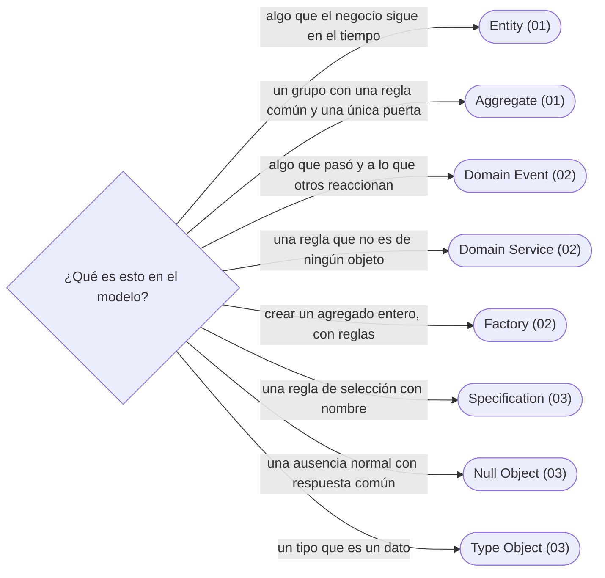

# 09 — DDD táctico y otros

> Los bloques de construcción de DDD escritos en código —entidad, agregado, evento de dominio, servicio de dominio, fábrica— y tres patrones sueltos que siguen vivos: Specification, Null Object y Type Object.
>
> **Vigencia:** 2026-10-03.

---

## 1. 🗺️ Índice

| | Documento | Tipo |
|---|---|---|
| [`01`](01-entidad-valor-y-agregado.md) | Entidad, valor y agregado | Capítulo |
| [`02`](02-eventos-servicios-y-fabricas.md) | Eventos, servicios y fábricas de dominio | Capítulo |
| [`03`](03-specification-null-object-y-type-object.md) | Specification, Null Object y Type Object | Capítulo |
| [`04`](04-simulacion-de-entrevista.md) | Simulación de entrevista | Simulación |
| [`05`](05-respuestas.md) | Respuestas | Solucionario |

**Orden de lectura.** En orden numérico. `01` traza los agregados que usan los otros dos. Al terminar los capítulos, la simulación con cronómetro, y solo después el solucionario.

---

## 2. 🧠 Mapa mental



---

## 3. 🏷️ Niveles de los patrones

A: se escribe y se defiende en la entrevista · B: se reconoce y se explica · C: ficha corta, con lo que lo reemplazó.

| Capítulo | Patrones y nivel |
|---|---|
| [`01`](01-entidad-valor-y-agregado.md) | Entity A · Aggregate A · Value Object (recordatorio: el patrón es de [`08/05`](../08-fowler-presentacion-distribucion-y-base/05-patrones-base.md#2--value-object)). **Lenguajes:** Java; C++ no aporta en este capítulo, porque el ecosistema de DDD es Java y .NET (§5.2 de la guía). Asume leído [`02/06` — Entidades, valores y primitivos](../02-modelado-oo/06-entidades-valores-y-primitivos.md) y [`02/05` — Redundancia controlada](../02-modelado-oo/05-redundancia-controlada.md). > **Vigencia:** 2026-10-03. > **Versiones ejecutadas:** JDK 21.0.12, 17.0.20 y 25.0.4 · Spring Boot 4.1.1 (Spring Framework 7.0.9, Hibernate 7.4.5, H2 2.4.240) · .NET 10.0.12 (C# 14) · mermaid-cli 11.17.0 (2026-10-04).

---

## 1. 🎯 El problema

Ana no puede tener dos pasaportes colombianos vigentes. La regla está en `Persona.agregarDocumento`, como manda un Domain
Model. Y aun así, un día aparecen dos en la base:

```java
Persona ana = repositorioPersonas.cargar(idAna);
Documento pasaporte = ana.documentos().get(1);           // la lista viva, no una copia
pasaporte.setTipo(tipos.porCodigo("PAS-CO"));            // un setter público en Documento
repositorioDocumentos.guardar(nuevoPasaporte(idAna));    // un repositorio de documentos, sin pasar por Persona
```

- La regla existe, pero hay **tres puertas** para cambiar los documentos de Ana: el método de `Persona`, el *setter* de
  `Documento` y un repositorio que guarda documentos sueltos. Solo la primera comprueba algo.
- Y la regla "un menor necesita un tutor mayor de edad" tiene un problema distinto: el tutor es **otra persona**, que
  se carga, se bloquea y se guarda por su cuenta. ¿Quién la garantiza?

Evans dedica el cap. 6 de *Domain-Driven Design* a este problema y le pone nombre: el **agregado**, la frontera dentro de
la cual un solo objeto garantiza las reglas. Este capítulo lo escribe, junto con la entidad, que es su pieza.

---

## 2. 🧱 Entity

**Problema |
| [`02`](02-eventos-servicios-y-fabricas.md) | Domain Event A · Domain Service A · Factory B |
| [`03`](03-specification-null-object-y-type-object.md) | Specification B · Null Object A · Type Object B |

---

## 4. 🚫 Qué NO está aquí

El DDD estratégico (contextos delimitados, mapas de contexto) y los patrones de arquitectura (CQRS, Event Sourcing, Saga).

---

**Versiones ejecutadas:** JDK 21.0.12, 17.0.20 y 25.0.4 · Spring Boot 4.1.1 (Spring Framework 7.0.9, Hibernate 7.4.5, H2 2.4.240) · .NET 10.0.12 (C# 14) · mermaid-cli 11.17.0 · GCC 14.4 (C++23) (2026-10-04).

---

**Anterior:** [`08` — Fowler: presentación, distribución y base](../08-fowler-presentacion-distribucion-y-base/README.md) ·
**Corpus:** [README](../README.md) ·
**Siguiente:** [`10` — Concurrencia](../10-concurrencia/README.md)
