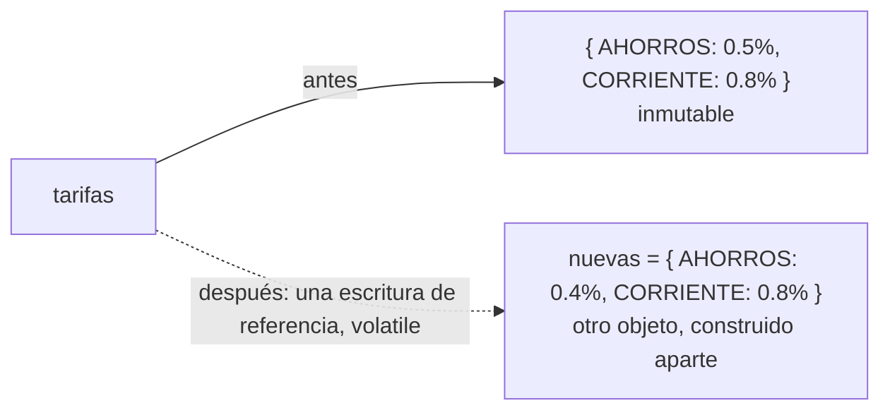
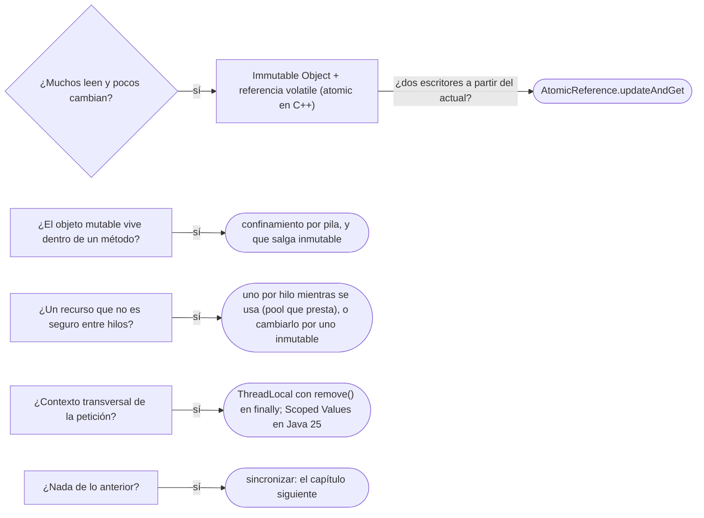

# 01 — Inmutabilidad y confinamiento

> Evitar la sincronización **haciendo que no haga falta**: estado que no cambia (Immutable Object), estado que solo ve un
> hilo (Thread Confinement) y estado que cada hilo tiene por separado (Thread-Specific Storage). **Niveles:** Immutable
> Object A · Thread Confinement B · Thread-Specific Storage B. **Lenguajes:** C++ y Java, completos. Asume leído
> [`01/03` — Inmutabilidad y objetos especiales](../01-modelo-de-objetos/03-inmutabilidad-y-objetos-especiales.md); el
> bloque solo trata patrones, y el JDK y la STL aparecen como "dónde aparece de verdad", no como temario.
>
> **Vigencia:** 2026-10-03.
>
> **Versiones ejecutadas:** GCC 14.4 (C++23) · JDK 21.0.12, 17.0.20 y 25.0.4 (2026-10-04).

---

## 1. 🎯 El problema

Cada transferencia cobra una comisión según una tabla de tarifas que el área de riesgo cambia dos veces al día. Cien
hilos leen la tabla; uno la actualiza:

```java
public class Tarifas {
    private final Map<TipoCuenta, BigDecimal> porcentaje = new HashMap<>();

    public BigDecimal de(TipoCuenta tipo) { return porcentaje.get(tipo); }                 // cien hilos leen
    public void actualizar(Map<TipoCuenta, BigDecimal> nuevas) {                           // uno escribe
        porcentaje.clear();
        porcentaje.putAll(nuevas);
    }
}
```

- Entre `clear` y `putAll`, un lector ve la tabla **vacía** y `de(AHORROS)` devuelve `null`. Y un `HashMap` escrito
  mientras otro hilo lo lee no tiene ninguna garantía: el lector puede ver la tabla a medias o una versión vieja, para
  siempre.
- La reacción habitual es `synchronized` en los dos métodos, y cien hilos que solo leen se ponen en fila detrás de una
  escritura que ocurre dos veces al día.

Este capítulo trata la otra salida: **que no haya estado mutable compartido**. Si el estado no cambia, o si no se comparte,
no hay nada que sincronizar.

---

## 2. 🧱 Immutable Object

**Problema.** Estado que muchos hilos leen y pocos cambian, protegido con candados que todos los lectores pagan.

**Estructura.** Un objeto que **no cambia después de construirse** se puede compartir entre hilos sin sincronizar. El
cambio no modifica el objeto: **construye otro** y reemplaza la referencia de una sola vez. Lo que hay que sincronizar se
reduce a una cosa: que los lectores vean la referencia nueva.



**Código.** Java, con el objeto inmutable y la referencia `volatile`:

```java
public record TablaTarifas(Map<TipoCuenta, BigDecimal> porcentaje) {
    public TablaTarifas { porcentaje = Map.copyOf(porcentaje); }                  // copia inmodificable
    public BigDecimal de(TipoCuenta tipo) { return porcentaje.get(tipo); }
}

public class Tarifas {
    private volatile TablaTarifas actual = new TablaTarifas(Map.of());

    public BigDecimal de(TipoCuenta tipo) { return actual.de(tipo); }            // sin candado
    public void actualizar(Map<TipoCuenta, BigDecimal> nuevas) {
        actual = new TablaTarifas(nuevas);                                        // se construye entera y se publica
    }
}
```

- Un lector ve la tabla vieja o la nueva, **nunca una mezcla**: la nueva se construye completa antes de publicarse.
- `volatile` garantiza que la escritura de la referencia se ve en los demás hilos, con todo lo que se escribió antes.
  Los campos `final` de un objeto inmutable tienen además una garantía propia, la de la JLS §17.5: quien ve la referencia
  **después** de que terminó el constructor ve los campos `final` bien inicializados, aunque la referencia le llegue sin
  sincronizar. Sin `volatile`, el lector podría seguir viendo la tabla vieja indefinidamente, pero nunca una a medias.
- Si dos hilos actualizan a la vez a partir de la tabla actual (subir un 0,1 % todas las tarifas), la lectura y la
  escritura de la referencia necesitan ser atómicas juntas: `AtomicReference.updateAndGet`.

C++, donde no hay garantía de campos `final` y **toda** publicación necesita sincronización:

```cpp
struct TablaTarifas {
    std::map<TipoCuenta, double> porcentaje;           // const después de construirse: nadie la modifica
};

class Tarifas {
    std::atomic<std::shared_ptr<const TablaTarifas>> actual_{std::make_shared<const TablaTarifas>()};
public:
    double de(TipoCuenta tipo) const {
        auto t = actual_.load();                       // copia del shared_ptr: la tabla vive mientras la usemos
        auto it = t->porcentaje.find(tipo);
        return it == t->porcentaje.end() ? 0.0 : it->second;
    }
    void actualizar(std::map<TipoCuenta, double> nuevas) {
        actual_.store(std::make_shared<const TablaTarifas>(TablaTarifas{std::move(nuevas)}));
    }
};
```

- `std::atomic<std::shared_ptr<T>>` es de C++20. El `shared_ptr` resuelve además lo que en Java hace el recolector: la
  tabla vieja se destruye cuando el último lector suelta su copia, no cuando se publica la nueva.
- En C++ una carrera de datos es comportamiento indefinido, no "un valor viejo": sin el `atomic`, el programa no tiene
  significado. El `double` para porcentajes es solo del ejemplo; el dinero sigue siendo `Dinero`.

**Con qué se confunde.** Con "tiene campos `final`". Un `final List` mutable no es inmutable
([`01/03` §3](../01-modelo-de-objetos/03-inmutabilidad-y-objetos-especiales.md#3--final-no-hace-inmutable-al-objeto)), y
un objeto inmutable cuyo constructor **deja escapar `this`** pierde la garantía: la JLS pide no escribir la referencia al
objeto en construcción donde otro hilo pueda verla antes de que el constructor termine.

**Dónde aparece.** `String`, `BigDecimal`, `LocalDate`, `DateTimeFormatter` ("immutable and thread-safe", dice su
Javadoc), `List.of`; `CopyOnWriteArrayList` es esta misma idea aplicada a una lista: cada escritura copia el arreglo
entero. En C++, cualquier objeto `const` compartido después de una publicación sincronizada.

**Cuándo no.** Cuando el estado cambia mucho y es grande: copiar una tabla de un millón de entradas por cada cambio cuesta
memoria y presión al recolector. Y cuando varios cambios tienen que verse juntos en objetos distintos: la referencia
única no coordina dos objetos.

> **Veredicto:** inmutable más una referencia publicada con `volatile` (o `atomic` en C++) para el estado que se lee mucho
> y cambia poco; el cambio construye un objeto nuevo entero. "Lo inmutable es seguro entre hilos aunque escape `this` en el
> constructor" es falso: la garantía de los campos `final` exige que nadie vea el objeto antes de que termine de
> construirse.

---

## 3. 🩺 Autopsia: el `this` que escapa

**El código que escribe todo el mundo.** La cuenta se suscribe a los cambios de tarifa en su propio constructor:

```java
public final class CalculadoraComision implements OyenteTarifas {
    private final TipoCuenta tipo;
    private final BigDecimal minimo;

    public CalculadoraComision(TipoCuenta tipo, BigDecimal minimo, BusTarifas bus) {
        this.tipo = tipo;
        bus.suscribir(this);                      // this escapa antes de terminar el constructor
        this.minimo = minimo;
    }
    @Override public void tarifasCambiaron(TablaTarifas t) { recalcular(t.de(tipo).max(minimo)); }
}
```

**Por qué parece correcto.** Todos los campos son `final`, la clase es inmutable, y en las pruebas de un solo hilo
`tarifasCambiaron` nunca se llama durante la construcción.

**La secuencia que lo rompe.** El hilo de riesgo publica tarifas nuevas justo después de `bus.suscribir(this)` y antes de
`this.minimo = minimo`. Llama a `tarifasCambiaron` con un objeto a medio construir: `minimo` es `null`, y `max(null)` lanza
`NullPointerException` en el hilo de riesgo. Peor: aunque el orden de las líneas fuera el contrario, la garantía de §17.5
no aplica, porque el otro hilo obtuvo la referencia **antes** de que terminara el constructor.

**El código correcto.** Construir primero y suscribir después, desde fuera:

```java
CalculadoraComision c = new CalculadoraComision(AHORROS, new BigDecimal("1000"));   // termina el constructor
bus.suscribir(c);                                                                    // la línea que cambió de sitio
```

**La generalización.** Es el mismo error que llamar a un método sobrescribible desde el constructor
([`01/04`](../01-modelo-de-objetos/04-copia-ciclo-de-vida-y-recursos.md)): dejar que alguien vea un objeto antes de que
exista del todo. Aparece al registrar oyentes, al arrancar un hilo desde el constructor y al guardar `this` en un mapa
estático.

---

## 4. 🧱 Thread Confinement

**Problema.** `SimpleDateFormat` no es seguro entre hilos —su Javadoc recomienda una instancia por hilo— y una
`Connection` de JDBC tampoco. Sincronizarlos convierte cada formato de fecha en un cuello de botella.

**Mecanismo.** Si un objeto mutable **solo lo ve un hilo**, no necesita sincronización. Se confina de tres formas:

```text
Por pila          → el objeto es una variable local y nunca sale del método
Por hilo          → el objeto pertenece a un hilo durante su uso (la Connection prestada por el pool)
Por diseño        → un único hilo toca ese estado, y los demás le piden cosas (la cola de un Active Object)
```

**Código.** Confinamiento por pila, en Java y en C++:

```java
public String extracto(Cuenta c, List<Movimiento> movimientos) {
    StringBuilder sb = new StringBuilder();              // local: ningún otro hilo puede verlo
    for (Movimiento m : movimientos) sb.append(m.descripcion()).append('\n');
    return sb.toString();                                // sale un String inmutable, no el StringBuilder
}
```

```cpp
std::string extracto(const std::vector<Movimiento>& movimientos) {
    std::string texto;                                   // en la pila del hilo que llama
    for (const auto& m : movimientos) texto += m.descripcion() + '\n';
    return texto;                                        // se devuelve por valor (movido): nadie lo comparte
}
```

- El confinamiento no lo comprueba el compilador: es una disciplina. Basta con guardar el `StringBuilder` en un campo
  para romperla. Lo que sale del método es inmutable o una copia.

**Cuándo sí y cuándo no.** Sí siempre que se pueda: es gratis. No cuando el objeto tiene que vivir más que la llamada y
compartirse; ahí, inmutable o sincronizado. Y la mejor salida para `SimpleDateFormat` no es confinarlo, es cambiarlo
por `DateTimeFormatter`, que es inmutable.

> **Veredicto:** lo mutable, en la pila o en un solo hilo; lo que sale de ahí, inmutable. El confinamiento es la forma más
> barata de seguridad entre hilos, y la más frágil: un campo de más la rompe sin que nada avise.

---

## 5. 🧱 Thread-Specific Storage

**Problema.** Un dato que muchas capas necesitan —el usuario de la petición, el identificador de correlación para el
registro— sin pasarlo como parámetro por veinte métodos, y sin compartirlo entre hilos.

**Mecanismo.** Una variable con **un valor por hilo**: cada hilo lee y escribe su copia, y ninguno ve la de otro. POSA2 lo
llama *Thread-Specific Storage*; Java lo da con `ThreadLocal` y C++ con `thread_local`.

**Código.**

```java
public final class ContextoPeticion {
    private static final ThreadLocal<PersonaId> USUARIO = new ThreadLocal<>();

    public static void ejecutarComo(PersonaId usuario, Runnable tarea) {
        USUARIO.set(usuario);
        try { tarea.run(); }
        finally { USUARIO.remove(); }                     // sin esto, el hilo del pool se queda con el usuario
    }
    public static PersonaId usuario() { return USUARIO.get(); }
}
```

```cpp
thread_local std::optional<PersonaId> usuario_actual;   // una por hilo, destruida al terminar el hilo
```

- El `finally` con `remove()` es **la** línea. En un *pool*, el hilo no muere al terminar la petición: si no se limpia, la
  petición siguiente que caiga en ese hilo ve al usuario de la anterior. Es una fuga de datos, no solo de memoria.
- Así funciona el `SecurityContextHolder` de Spring Security por defecto: un `ThreadLocal`, que su documentación llama
  seguro "si se limpia el hilo" al terminar la petición, cosa que hace su cadena de filtros.

> 📝 **En Java 25:** los Scoped Values (JEP 506, final en Java 25) reemplazan este uso de `ThreadLocal`:
> `ScopedValue.where(USUARIO, ana).run(tarea)` liga un valor **inmutable** durante la ejecución de `tarea` y lo desliga
> solo al salir, sin `remove()` que olvidar. La JEP los presenta como más fáciles de razonar y más baratos que los
> `ThreadLocal`, sobre todo con *virtual threads*, donde un `ThreadLocal` por cada uno de millones de hilos es mucha
> memoria. **En Java 17 y 21** no hay alternativa final: `ThreadLocal` con `try`/`finally` (en 21 están en *preview*).

**Cuándo sí y cuándo no.** Sí para contexto transversal de la petición (seguridad, correlación, transacción) que la
infraestructura pone y quita. No como forma de pasar parámetros de negocio: un método que lee un `ThreadLocal` tiene
una dependencia oculta, y no funciona cuando el trabajo salta a otro hilo (un `CompletableFuture`, un hilo del *pool*
asíncrono), donde el valor no viaja.

> **Veredicto:** Thread-Specific Storage para el contexto que pone y quita la infraestructura, siempre con `remove()` en un
> `finally`; en Java 25, Scoped Values. Para datos de negocio, un parámetro: lo que se ve en la firma no se olvida limpiar.

---

## 6. 🧭 Cómo se elige



**La frase en voz alta:** *"Antes de poner un candado, pregunto si el estado tiene que ser mutable y compartido. La tabla
de tarifas la hago inmutable y publico la nueva con una referencia `volatile`; el `StringBuilder` lo dejo en la pila; y el
usuario de la petición va en un `ThreadLocal` que se limpia en un `finally`."*

---

## ⚠️ Errores frecuentes

| Se dice | Lo preciso |
|---|---|
| "Lo inmutable es seguro aunque escape `this` en el constructor" | La garantía de los `final` exige que nadie vea la referencia antes de que termine el constructor |
| "Con campos `final` la clase es segura entre hilos" | Solo si lo referenciado también es inmutable; un `final List` mutable no lo es |
| "Sin `volatile`, el lector ve una tabla a medias" | Con campos `final`, a medias no; vieja, posiblemente para siempre. En C++, es comportamiento indefinido |
| "`ThreadLocal` se limpia solo al terminar la petición" | El hilo del *pool* sobrevive; sin `remove()`, la petición siguiente ve el valor anterior |
| "`ThreadLocal` sirve para pasar datos a una tarea asíncrona" | El valor no viaja a otro hilo; hay que pasarlo explícitamente |
| "`SimpleDateFormat` se arregla sincronizándolo" | Se arregla con `DateTimeFormatter`, que es inmutable |
| "Copiar el objeto en cada cambio es siempre barato" | Con estado grande que cambia mucho, la copia y el recolector cuestan más que un candado |

---

## 📚 Para profundizar

- **Libro** — Goetz y otros, *Java Concurrency in Practice* (Addison-Wesley, 2006), cap. 3, "Sharing Objects" (3.2
  publicación y escape, 3.3 confinamiento, 3.4 inmutabilidad, 3.5 publicación segura), y cap. 16, "The Java Memory
  Model" (16.3 seguridad de la inicialización). **El que destaca.**
- **Libro** — Schmidt, Stal, Rohnert y Buschmann, *Pattern-Oriented Software Architecture, vol. 2* (Wiley, 2000), cap. 5,
  "Concurrency Patterns": Thread-Specific Storage.
- [JLS 21 §17.5 — *final Field Semantics*](https://docs.oracle.com/javase/specs/jls/se21/html/jls-17.html#jls-17.5): la
  garantía de los campos `final` y la condición de no dejar escapar la referencia.
- [JEP 506 — *Scoped Values*](https://openjdk.org/jeps/506): final en Java 25.
- [Java 21 API — `ThreadLocal`](https://docs.oracle.com/en/java/javase/21/docs/api/java.base/java/lang/ThreadLocal.html)
- [cppreference — `std::atomic<std::shared_ptr>`](https://en.cppreference.com/cpp/memory/shared_ptr/atomic2): la
  publicación atómica de un objeto compartido, desde C++20.
- [cppreference — `thread_local`](https://en.cppreference.com/cpp/keyword/thread_local)

---

## 🧠 Preguntas

Sin respuestas aquí. Todas, con enunciado literal y respuesta en tres capas, en
[`08` — Respuestas](08-respuestas.md#01--inmutabilidad-y-confinamiento).

1. ¿Qué es un objeto inmutable, y por qué se puede compartir entre hilos sin sincronizar? 🟢
2. ¿Qué es el confinamiento de un objeto a un hilo, y cuáles son sus tres formas? 🟢
3. ¿Qué es Thread-Specific Storage? 🟢
4. ¿Qué garantiza la JLS sobre los campos `final`? 🟢
5. ¿Qué diferencia hay entre un objeto inmutable y uno con todos sus campos `final`? 🟡
6. ¿Qué diferencia hay entre `ThreadLocal` y un Scoped Value de Java 25? 🟡
7. ¿Qué diferencia hay entre publicar un objeto inmutable en Java y en C++? 🟡
8. ¿Qué diferencia hay entre confinar `SimpleDateFormat` y usar `DateTimeFormatter`? 🟡
9. ¿Por qué la tabla de tarifas se reemplaza entera en lugar de modificarse? 🟠
10. ¿Para qué hace falta `volatile` si la tabla ya es inmutable? 🟠
11. ¿Por qué un `ThreadLocal` sin `remove()` es una fuga de datos en un *pool*? 🟠
12. ¿Cuándo es mala idea la copia completa en cada cambio? 🟠
13. ¿Por qué un `ThreadLocal` no sirve para pasar datos de negocio? 🟠
14. Escribe la tabla de tarifas inmutable con su referencia publicada, en Java y en C++. 🔴
15. Revisa este constructor y di qué falla: `this.tipo = tipo; bus.suscribir(this); this.minimo = minimo;` en una clase
    con todos sus campos `final`. 🔴
16. Escribe el contexto de la petición con `ThreadLocal` de forma que no se fugue en un *pool*. 🔴

---

**Anterior:** [`09/04` — Simulación de entrevista](../09-ddd-tactico-y-otros/04-simulacion-de-entrevista.md) ·
**Siguiente:** [`02` — Esperar y coordinar](02-esperar-y-coordinar.md) ·
**Relacionado:** [`01/03` — Inmutabilidad y objetos especiales](../01-modelo-de-objetos/03-inmutabilidad-y-objetos-especiales.md)
