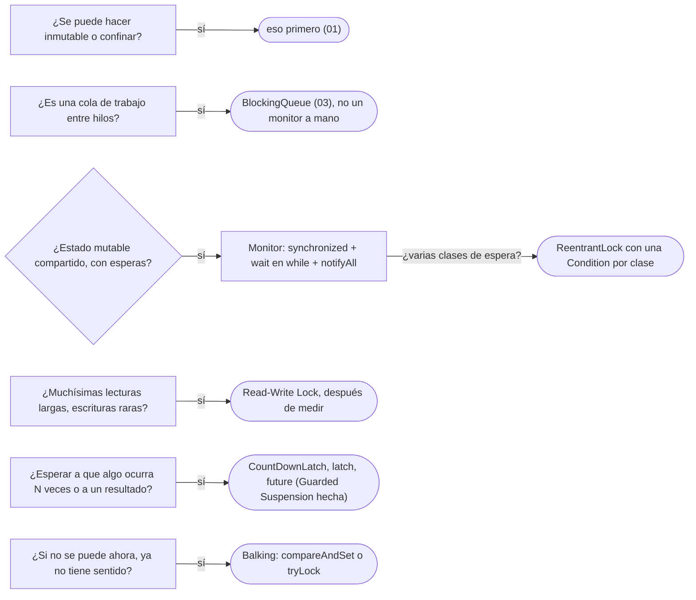

# 02 — Esperar y coordinar

> Proteger estado compartido que **sí** cambia y esperar a que se cumpla una condición **sin espera activa**: el
> **monitor**, el **read-write lock** y dos fichas que todo el mundo usa sin nombrarlas. **Niveles:** Monitor B ·
> Read-Write Lock B · Guarded Suspension C · Balking C. **Lenguajes:** C++ y Java, completos. Asume leído
> [`01` — Inmutabilidad y confinamiento](01-inmutabilidad-y-confinamiento.md), que es lo que se intenta primero.
>
> **Vigencia:** 2026-10-03.
>
> **Versiones ejecutadas:** GCC 14.4 (C++23) · JDK 21.0.12, 17.0.20 y 25.0.4 (2026-10-04).

---

## 1. 🎯 El problema

Una cuenta queda **bloqueada** mientras el área de cumplimiento revisa un movimiento sospechoso, y el lote nocturno de
débitos automáticos tiene que esperar a que se desbloquee. La primera versión:

```java
public void retirarCuandoSePueda(Dinero monto) throws InterruptedException {
    while (cuenta.estado() == EstadoCuenta.BLOQUEADA) {
        Thread.sleep(100);                    // pregunta diez veces por segundo, toda la noche
    }
    cuenta.retirar(monto);                    // y entre la pregunta y el retiro, otro hilo pudo bloquearla
}
```

- Es **espera activa**: el hilo se despierta diez veces por segundo para nada, y aun así reacciona tarde, hasta cien
  milisegundos después del desbloqueo.
- Y es una **carrera**: entre comprobar el estado y retirar, el área de cumplimiento puede volver a bloquearla. La
  comprobación y la acción tienen que ser atómicas juntas.

El estado de la cuenta cambia, se comparte y hay que esperar a que cumpla una condición: no se puede hacer inmutable ni
confinar. Este capítulo trata las herramientas para cuando hay que sincronizar de verdad.

---

## 2. 🧱 Monitor

**Problema.** Varios hilos operan sobre el mismo objeto mutable, y algunos tienen que **esperar** a que el estado cumpla
una condición antes de actuar.

**Mecanismo.** Un **monitor** es un objeto cuyos métodos se ejecutan **de a uno** (exclusión mutua) y que permite a un
método **esperar una condición** soltando el candado mientras espera, y ser despertado cuando otro método la cambia. POSA2
lo llama *Monitor Object*. Java lo trae en cada objeto (`synchronized`, `wait`, `notifyAll`); C++ lo arma con
`std::mutex` y `std::condition_variable`.

**Código.** Java, con el monitor implícito del objeto:

```java
public final class CuentaCompartida {
    private EstadoCuenta estado = EstadoCuenta.ABIERTA;
    private Dinero saldo;

    public synchronized void retirarCuandoSePueda(Dinero monto) throws InterruptedException {
        while (estado == EstadoCuenta.BLOQUEADA) {
            wait();                                   // suelta el candado y duerme hasta un notify
        }
        // aquí el estado es ABIERTA y nadie puede cambiarlo: tenemos el candado
        Dinero nuevo = saldo.menos(monto);
        if (nuevo.esNegativo()) throw new IllegalStateException("saldo insuficiente");
        saldo = nuevo;
    }

    public synchronized void bloquear()    { estado = EstadoCuenta.BLOQUEADA; }
    public synchronized void desbloquear() { estado = EstadoCuenta.ABIERTA; notifyAll(); }
}
```

- La comprobación y el retiro ocurren con el mismo candado: la carrera del §1 desaparece.
- `wait()` va **siempre dentro de un `while`**, nunca de un `if`. La Javadoc de `Object` lo exige: un hilo puede
  despertarse sin que nadie lo haya notificado (*despertar espurio*), y además, entre el `notifyAll` y el momento en que
  el hilo recupera el candado, otro pudo volver a bloquear la cuenta. Al despertar, se vuelve a preguntar.
- `notifyAll` y no `notify`: lo explica el §3.

C++, con el candado y la variable de condición explícitos:

```cpp
class CuentaCompartida {
    std::mutex m_;
    std::condition_variable desbloqueada_;
    EstadoCuenta estado_ = EstadoCuenta::abierta;
    Dinero saldo_;
public:
    void retirarCuandoSePueda(const Dinero& monto) {
        std::unique_lock lock{m_};
        desbloqueada_.wait(lock, [this] { return estado_ != EstadoCuenta::bloqueada; });   // el while, dentro
        Dinero nuevo = saldo_.menos(monto);
        if (nuevo.esNegativo()) throw std::domain_error{"saldo insuficiente"};
        saldo_ = nuevo;                                       // con el candado tomado, como en Java
    }
    void desbloquear() {
        { std::lock_guard lock{m_}; estado_ = EstadoCuenta::abierta; }
        desbloqueada_.notify_all();                           // se puede notificar sin el candado
    }
};
```

- La sobrecarga de `wait` con predicado es exactamente el `while` de Java: comprueba, espera, y vuelve a comprobar al
  despertar.
- `std::unique_lock` y `std::lock_guard` son el *Scoped Locking* de POSA2: el candado se suelta al salir del bloque,
  también si se lanza. En Java, `synchronized` lo hace por construcción; con `ReentrantLock`, lo hace el `finally`.

> 📝 **En Java 25:** con *virtual threads*, un `wait()` o un bloqueo dentro de `synchronized` dejaba al hilo virtual
> **anclado** (*pinned*) a su hilo de plataforma en Java 21, y la recomendación era cambiar a `ReentrantLock`. La JEP 491,
> entregada en Java 24, elimina casi todos esos casos: en Java 25, `synchronized` ya no es motivo para reescribir código.
> **En Java 21** el consejo sigue vigente para secciones que bloquean mucho tiempo; **en Java 17** no hay *virtual threads*.

**Cuándo sí y cuándo no.** Sí cuando hay estado mutable compartido con condiciones de espera y las secciones críticas
son cortas. No como primer recurso: antes, inmutable o confinado ([`01`](01-inmutabilidad-y-confinamiento.md)); y no
para coordinar productores y consumidores, que ya tienen su estructura hecha ([`03`](03-producer-consumer-y-thread-pool.md)).
El precio: un hilo a la vez, y la responsabilidad de no llamar a código ajeno con el candado tomado, que es la receta del
interbloqueo.

> **Veredicto:** monitor para estado mutable compartido con esperas, con `wait` en un `while` y `notifyAll`; en C++,
> `condition_variable::wait` con predicado. Si el problema es una cola, no se escribe un monitor: se usa la del JDK.

---

## 3. 🩺 Por qué `notify` no basta

**El código que escribe todo el mundo.** El mismo monitor con dos clases de espera —débitos que esperan el desbloqueo, y
una conciliación que espera a que el saldo supere un umbral— y `notify` "porque es más eficiente":

```java
public synchronized void depositar(Dinero monto) { saldo = saldo.mas(monto); notify(); }
public synchronized void desbloquear()           { estado = EstadoCuenta.ABIERTA; notify(); }
```

**Por qué parece correcto.** Con un solo hilo esperando, `notify` y `notifyAll` hacen lo mismo, y es lo que hay en las
pruebas.

**La secuencia que lo rompe.** Esperan dos hilos: el débito (espera el desbloqueo) y la conciliación (espera saldo). Se
desbloquea la cuenta; `notify` despierta **a uno cualquiera** —la Javadoc dice que la elección es arbitraria— y despierta a
la conciliación. Su condición no se cumple, vuelve a dormir, y el débito, cuya condición **sí** se cumple, sigue dormido.
Nadie más va a notificar: el débito no se ejecuta esta noche.

**El código correcto.** `notifyAll()` en los dos métodos (la línea que cambia): todos despiertan, cada uno vuelve a
comprobar su condición en su `while`, y los que no pueden seguir vuelven a dormir. O, con `ReentrantLock`, una `Condition`
por clase de espera, y `signal` en la que corresponde.

**La generalización.** `notify` solo es correcto cuando **todos** los que esperan esperan lo mismo y **cualquiera** puede
avanzar con una notificación. Es una optimización con condiciones; `notifyAll` es lo correcto por defecto, y su costo
—despertar hilos que vuelven a dormir— rara vez se nota.

---

## 4. 🧱 Read-Write Lock

**Problema.** Un catálogo en memoria —los tipos de documento, las tarifas— que cien hilos consultan y que alguien cambia
de vez en cuando, y que es grande para copiarlo entero en cada cambio. Con un candado exclusivo, los lectores se esperan
entre sí sin necesidad.

**Mecanismo.** Un candado con dos modos: **lectura**, que pueden tener muchos hilos a la vez, y **escritura**, exclusivo
y que excluye también a los lectores.

**Código.**

```java
public final class CatalogoTipos {
    private final Map<String, TipoDocumento> tipos = new HashMap<>();
    private final ReentrantReadWriteLock rw = new ReentrantReadWriteLock();

    public TipoDocumento porCodigo(String codigo) {
        rw.readLock().lock();
        try { return tipos.get(codigo); } finally { rw.readLock().unlock(); }
    }
    public void registrar(TipoDocumento t) {
        rw.writeLock().lock();
        try { tipos.put(t.codigo(), t); } finally { rw.writeLock().unlock(); }
    }
}
```

```cpp
class CatalogoTipos {
    mutable std::shared_mutex m_;
    std::map<std::string, TipoDocumento> tipos_;
public:
    std::optional<TipoDocumento> porCodigo(const std::string& codigo) const {
        std::shared_lock lock{m_};                              // lectura: compartida
        auto it = tipos_.find(codigo);
        return it == tipos_.end() ? std::nullopt : std::optional{it->second};
    }
    void registrar(TipoDocumento t) {
        std::string codigo = t.codigo();                         // la clave, antes de mover t
        std::unique_lock lock{m_};                              // escritura: exclusiva
        tipos_.insert_or_assign(std::move(codigo), std::move(t));
    }
};
```

- En C++ la lectura devuelve una **copia**: devolver una referencia al elemento la dejaría usarse después de soltar el
  candado, mientras otro hilo escribe.

**Cuándo sí y cuándo no.** La Javadoc de `ReadWriteLock` lo dice sin rodeos: que mejore o no sobre un candado exclusivo
depende de la proporción de lecturas, de cuánto duran y de la contención; si las lecturas son muy cortas, el costo del
propio candado —que es más complejo que uno exclusivo— puede dominar, y si las escrituras son frecuentes, el candado pasa
casi todo el tiempo en modo exclusivo. Solo medir lo decide. Si el catálogo cabe en memoria y cambia poco, el
inmutable con referencia `volatile` de [`01`](01-inmutabilidad-y-confinamiento.md#2--immutable-object) suele ganar: los
lectores no tocan ningún candado.

> **Veredicto:** read-write lock para estructuras grandes, de lecturas largas y frecuentes y escrituras raras, y solo
> después de medir. "Un read-write lock siempre es más rápido que un `synchronized`" es falso: con lecturas cortas o
> escrituras frecuentes, es más lento.

---

## 5. 🧱 Guarded Suspension y Balking

**Guarded Suspension** (C). **Intención:** que un método que no puede ejecutarse todavía **espere** a que se cumpla su
condición de guarda, en lugar de fallar. **Ejemplo mínimo:** el `retirarCuandoSePueda` del §2: la guarda es "la cuenta no
está bloqueada", y el método se suspende con `wait` hasta que se cumpla. **Por qué hoy es raro escribirlo:** las esperas
habituales ya vienen hechas en el JDK y en la STL. **Qué lo reemplazó:** `BlockingQueue.take` (espera a que haya un
elemento), `CountDownLatch.await` y `std::latch` (esperan a que ocurran N cosas), y `CompletableFuture.get` y
`std::future::get` (esperan un resultado).

**Balking** (C). **Intención:** que un método que no puede ejecutarse **ahora** **desista** de inmediato en lugar de
esperar, porque la operación ya no tiene sentido. **Ejemplo mínimo:** el cierre de una cuenta ya cerrada no hace nada:

```java
private final AtomicBoolean cerrada = new AtomicBoolean(false);
public void cerrar() {
    if (!cerrada.compareAndSet(false, true)) return;     // ya cerrada: desiste
    liberarRecursos();
}
```

**Por qué hoy es raro escribirlo:** la comprobación y el cambio atómicos los da una sola instrucción. **Qué lo reemplazó:**
`compareAndSet` de las clases `Atomic*`, `Lock.tryLock` (intenta y desiste si está tomado) y `std::atomic::compare_exchange_strong`.

---

## 6. 🧭 Cómo se elige



**La frase en voz alta:** *"Si tengo que esperar una condición, uso `wait` dentro de un `while` con `notifyAll`, porque los
despertares espurios existen y `notify` despierta a uno arbitrario; y no pongo un read-write lock sin medir, porque con
lecturas cortas cuesta más que un candado normal."*

---

## ⚠️ Errores frecuentes

| Se dice | Lo preciso |
|---|---|
| "`notify` basta y es más eficiente" | Despierta a uno arbitrario; con esperas distintas, puede despertar al equivocado y dejar dormido al que podía seguir |
| "`wait` va en un `if`" | Va en un `while`: despertares espurios y condiciones que vuelven a cambiar antes de recuperar el candado |
| "Un read-write lock siempre es más rápido" | Depende de la proporción y la duración de las lecturas; con lecturas cortas o escrituras frecuentes, es más lento |
| "`Thread.sleep` en un bucle es una forma de esperar" | Es espera activa: gasta CPU, reacciona tarde y no hace atómica la comprobación con la acción |
| "Con *virtual threads* hay que quitar todos los `synchronized`" | Fue el consejo en Java 21; desde la JEP 491 (Java 24) casi ya no ancla el hilo |
| "En C++ basta con comprobar la condición antes de `wait`" | `wait` con predicado vuelve a comprobarla al despertar; sin predicado, hace falta el bucle |

---

## 📚 Para profundizar

- **Libro** — Goetz y otros, *Java Concurrency in Practice* (Addison-Wesley, 2006), cap. 14, "Building Custom
  Synchronizers" (14.2, colas de condición; 14.3, objetos `Condition`), y cap. 13, "Explicit Locks" (13.5, read-write
  locks). **El que destaca.**
- **Libro** — Schmidt y otros, *Pattern-Oriented Software Architecture, vol. 2* (Wiley, 2000), cap. 4, "Synchronization
  Patterns" (Scoped Locking), y cap. 5, "Concurrency Patterns" (Monitor Object).
- [Java 21 API — `Object.wait()`](https://docs.oracle.com/en/java/javase/21/docs/api/java.base/java/lang/Object.html#wait()):
  los despertares espurios y el bucle obligatorio.
- [Java 21 API — `ReadWriteLock`](https://docs.oracle.com/en/java/javase/21/docs/api/java.base/java/util/concurrent/locks/ReadWriteLock.html):
  cuándo mejora y cuándo no.
- [JEP 491 — *Synchronize Virtual Threads without Pinning*](https://openjdk.org/jeps/491)
- [cppreference — `std::condition_variable`](https://en.cppreference.com/cpp/thread/condition_variable)
- [cppreference — `std::shared_mutex`](https://en.cppreference.com/cpp/thread/shared_mutex)

---

## 🧠 Preguntas

Sin respuestas aquí. Todas, con enunciado literal y respuesta en tres capas, en
[`08` — Respuestas](08-respuestas.md#02--esperar-y-coordinar).

1. ¿Qué es un monitor? 🟢
2. ¿Qué es un despertar espurio? 🟢
3. ¿Qué es un read-write lock? 🟢
4. ¿Qué son Guarded Suspension y Balking? 🟢
5. ¿Qué diferencia hay entre `notify` y `notifyAll`? 🟡
6. ¿Qué diferencia hay entre esperar con `Thread.sleep` en un bucle y con `wait`? 🟡
7. ¿Qué diferencia hay entre el monitor de Java y el de C++? 🟡
8. ¿Qué diferencia hay entre Guarded Suspension y Balking? 🟡
9. ¿Qué diferencia hay entre un read-write lock y la referencia `volatile` a un objeto inmutable? 🟡
10. ¿Por qué `wait` va dentro de un `while`? 🟠
11. ¿Cuándo un read-write lock es más lento que un candado exclusivo? 🟠
12. ¿Por qué cambió el consejo sobre `synchronized` y *virtual threads* entre Java 21 y Java 25? 🟠
13. ¿Por qué en el `CatalogoTipos` de C++ la lectura devuelve una copia? 🟠
14. Escribe en Java un monitor para una cuenta que espera a ser desbloqueada antes de retirar. 🔴
15. Revisa este código y di qué falla: un monitor con dos clases de espera que usa `notify()` al desbloquear y al
    depositar. 🔴
16. Escribe en C++ la misma espera con `std::condition_variable` y di qué hace la sobrecarga con predicado. 🔴

---

**Anterior:** [`01` — Inmutabilidad y confinamiento](01-inmutabilidad-y-confinamiento.md) ·
**Siguiente:** [`03` — Producer-Consumer y Thread Pool](03-producer-consumer-y-thread-pool.md) ·
**Relacionado:** [`08/03` — Concurrencia offline](../08-fowler-presentacion-distribucion-y-base/03-concurrencia-offline.md)
