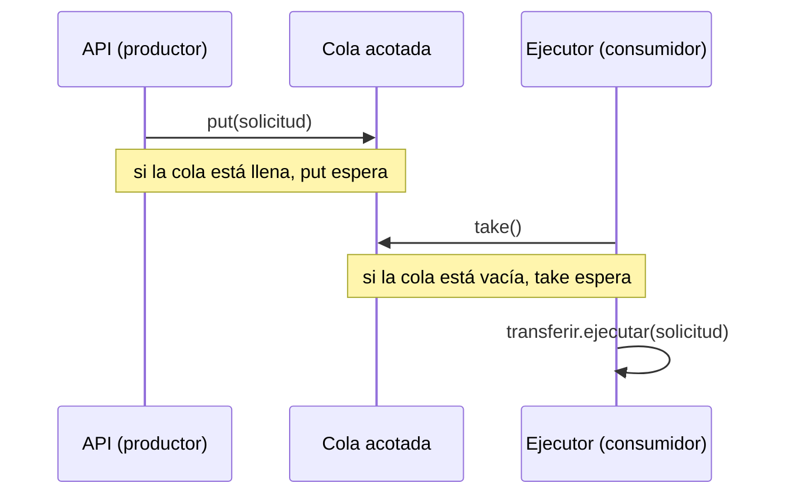
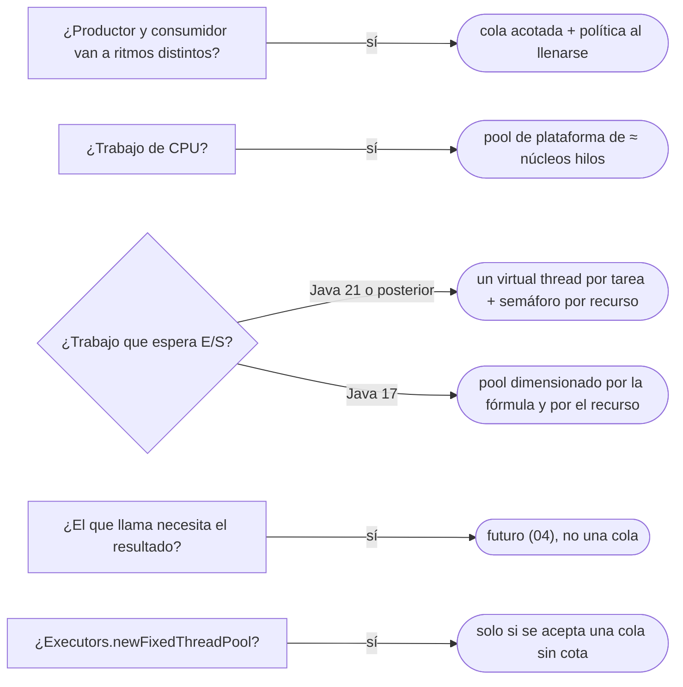

# 03 — Producer-Consumer y Thread Pool

> Desacoplar a quien **produce** trabajo de quien lo **consume** con una cola que frena al productor cuando hace falta, y
> dimensionar un **pool de hilos** —o no tenerlo, con *virtual threads*—. **Niveles:** Producer-Consumer A · Thread Pool
> A. **Lenguajes:** C++ y Java, completos. Asume leído [`02` — Esperar y coordinar](02-esperar-y-coordinar.md).
>
> **Vigencia:** 2026-10-03.
>
> **Versiones ejecutadas:** GCC 14.4 (C++23) · JDK 21.0.12, 17.0.20 y 25.0.4 · mermaid-cli 11.17.0 (2026-10-04).

---

## 1. 🎯 El problema

El API recibe solicitudes de transferencia y cada una tarda unos 200 ms en ejecutarse contra la base y el sistema de
pagos. La primera versión crea un hilo por solicitud:

```java
@PostMapping("/transferencias")
public ResponseEntity<Void> solicitar(@RequestBody SolicitudTransferencia s) {
    new Thread(() -> transferir.ejecutar(s)).start();      // un hilo de plataforma por solicitud
    return ResponseEntity.accepted().build();
}
```

- A las nueve de la mañana llegan tres mil solicitudes en un minuto. Tres mil hilos de plataforma, cada uno con su pila
  reservada, compitiendo por diez conexiones a la base: la máquina pasa más tiempo cambiando de hilo que trabajando, y si
  el sistema de pagos se pone lento, los hilos se acumulan hasta agotar la memoria.
- Y nadie puede responder dos preguntas: cuántas transferencias hay en curso y qué pasa con las que no caben.

Producir trabajo y consumirlo van a ritmos distintos. Este capítulo trata la cola que los separa y el pool que limita
cuántos consumen.

---

## 2. 🧱 Producer-Consumer

**Problema.** El que genera trabajo (el API, un lote, un lector de archivos) y el que lo procesa van a ritmos distintos;
si se llaman directamente, el lento frena al rápido o el rápido ahoga al lento.

**Estructura.** Una **cola compartida** entre productores y consumidores. El productor pone y sigue; el consumidor saca
cuando puede. Si la cola es **acotada**, el productor que encuentra la cola llena **espera**: esa espera es la
**contrapresión** (*backpressure*), la señal que frena al rápido.



**Código.** Java, con la cola del JDK, que es un monitor ya escrito:

```java
BlockingQueue<SolicitudTransferencia> cola = new ArrayBlockingQueue<>(500);   // acotada: 500 en espera como mucho

// productor
boolean aceptada = cola.offer(solicitud, 2, TimeUnit.SECONDS);   // espera hasta 2 s; si sigue llena, false
if (!aceptada) return ResponseEntity.status(503).build();          // la contrapresión llega al cliente

// consumidor, en su propio hilo
while (!Thread.currentThread().isInterrupted()) {
    SolicitudTransferencia s = cola.take();                        // espera si está vacía
    transferir.ejecutar(s);
}
```

- `ArrayBlockingQueue` es un monitor con dos condiciones (no llena, no vacía) que nadie tiene que escribir: el
  `retirarCuandoSePueda` de [`02`](02-esperar-y-coordinar.md) generalizado y probado.
- `offer` con plazo convierte la cola llena en una respuesta: el `503` le dice al cliente que reintente después. Con
  `put`, el hilo del API esperaría sin límite; con una cola sin cota, la espera no existiría y la memoria pagaría.

C++, donde la STL no trae una cola bloqueante y se escribe con lo de `02`:

```cpp
template <typename T>
class ColaAcotada {
    std::mutex m_;
    std::condition_variable noLlena_, noVacia_;
    std::deque<T> elementos_;
    std::size_t capacidad_;
public:
    explicit ColaAcotada(std::size_t capacidad) : capacidad_{capacidad} {}

    void poner(T valor) {
        std::unique_lock lock{m_};
        noLlena_.wait(lock, [this] { return elementos_.size() < capacidad_; });   // contrapresión
        elementos_.push_back(std::move(valor));
        lock.unlock();
        noVacia_.notify_one();
    }
    T sacar() {
        std::unique_lock lock{m_};
        noVacia_.wait(lock, [this] { return !elementos_.empty(); });
        T valor = std::move(elementos_.front());
        elementos_.pop_front();
        lock.unlock();
        noLlena_.notify_one();
        return valor;
    }
};
```

- Dos condiciones, una por clase de espera: por eso aquí `notify_one` es correcto. Cada productor espera lo mismo ("hay
  sitio") y cualquiera puede avanzar con un hueco; es la excepción que [`02` §3](02-esperar-y-coordinar.md#3--por-qué-notify-no-basta)
  describe.

**Con qué se confunde.** Con el Observer ([`06/03`](../06-comportamiento/03-observer.md)): el Observer llama a los
suscriptores en el hilo del que publica y no tiene cola; Producer-Consumer **separa los hilos** y absorbe la diferencia de
ritmo. Y con una cola de mensajería entre procesos (un *broker*): misma idea, con persistencia y red, y fuera de este
corpus.

**Dónde aparece.** `BlockingQueue` y sus implementaciones (`ArrayBlockingQueue`, `LinkedBlockingQueue`); la cola interna de
todo `ThreadPoolExecutor`; los *channels* de Go, que tienen su sitio en [`11/01`](../11-los-diferentes/01-go.md).

**Cuándo no.** Cuando el que llama necesita el resultado para seguir: una cola entre medio solo añade latencia y un hilo.
Ahí se llama directamente, o se usa un futuro ([`04`](04-future-y-active-object.md)).

> **Veredicto:** Producer-Consumer con una cola **acotada** para absorber ritmos distintos, y una política explícita para
> cuando se llena: esperar con plazo, rechazar o frenar al productor. Una cola sin cota no es desacoplamiento: es un
> `OutOfMemoryError` con retraso.

---

## 3. 🧱 Thread Pool

**Problema.** Crear un hilo de plataforma por tarea cuesta memoria y tiempo, y no pone límite: con tráfico alto se crean
más de los que la máquina sostiene.

**Estructura.** Un número **fijo o acotado** de hilos que se reutilizan, y una cola de tareas de donde los toman. Es un
Producer-Consumer donde los consumidores son los hilos del pool y lo que se encola son tareas. En Java, `ExecutorService`
separa **qué** se ejecuta (la tarea) de **cómo** (cuántos hilos, qué cola, qué pasa al rechazar).

**Código.** Java, con el `ThreadPoolExecutor` configurado entero en lugar de la fábrica de conveniencia:

```java
ExecutorService transferencias = new ThreadPoolExecutor(
        10, 10,                                         // diez hilos: tantos como conexiones a la base
        0, TimeUnit.SECONDS,
        new ArrayBlockingQueue<>(500),                  // cola acotada
        new ThreadPoolExecutor.CallerRunsPolicy());     // si se llena, la ejecuta quien la envió: lo frena

transferencias.submit(() -> transferir.ejecutar(solicitud));
```

- Diez hilos porque el recurso escaso son las diez conexiones de la base: un hilo número once solo esperaría una conexión.
- `CallerRunsPolicy`: cuando la cola está llena, la tarea se ejecuta en el hilo que llamó a `submit`, que mientras tanto
  no produce más. La Javadoc lo describe como un mecanismo simple de control que frena el ritmo de envío.

**Cuántos hilos.** *Java Concurrency in Practice* (8.2) da la regla: para trabajo de **CPU**, tantos como núcleos (más
uno); para trabajo que **espera** E/S, más, en proporción al tiempo que pasan esperando frente al que pasan calculando:

```text
hilos ≈ núcleos × uso de CPU deseado × (1 + tiempo de espera / tiempo de cálculo)
8 núcleos, 100 %, una transferencia que espera 190 ms y calcula 10 ms  →  8 × 1 × (1 + 19) = 160
```

- Y un tope que la fórmula no ve: **el recurso que se comparte**. Si hay diez conexiones, 160 hilos son 150 esperando una.

C++, donde la STL no trae un pool: se arma con la cola anterior y `std::jthread`, que pide la parada y se une al
destruirse:

```cpp
class PoolTransferencias {
    ColaAcotada<std::function<void()>> tareas_{500};
    std::vector<std::jthread> hilos_;
public:
    explicit PoolTransferencias(std::size_t n) {
        for (std::size_t i = 0; i < n; ++i)
            hilos_.emplace_back([this] {
                for (;;) {
                    auto tarea = tareas_.sacar();
                    if (!tarea) return;                        // tarea vacía: la "píldora" de parada
                    tarea();
                }
            });
    }
    void enviar(std::function<void()> t) { tareas_.poner(std::move(t)); }
    ~PoolTransferencias() {
        for (std::size_t i = 0; i < hilos_.size(); ++i) tareas_.poner({});   // una píldora por hilo
    }                                                                         // y los jthread se unen solos
};
```

- La parada con una tarea vacía por hilo (*poison pill*) deja terminar lo encolado antes; `std::jthread` hace el `join` en
  su destructor, así que el pool no se destruye con hilos vivos.

**Con qué se confunde.** Con limitar la concurrencia. Un pool limita cuántos **hilos** hay; si lo que hay que limitar es
cuántas operaciones tocan un recurso (las conexiones, el proveedor externo), la herramienta es un semáforo o el propio pool
de conexiones. Con *virtual threads* esta diferencia lo es todo.

**Dónde aparece.** `ThreadPoolExecutor`, `ForkJoinPool` (el de los *streams* paralelos y de `CompletableFuture` por
defecto), los pools de hilos de Tomcat y de Spring (`@Async` con su `TaskExecutor`).

**Cuándo no.** Para tareas que pasan casi todo su tiempo esperando E/S, en Java 21: ahí, un hilo virtual por tarea.

> **Veredicto:** pool de plataforma, con cola acotada y política de rechazo explícita, para trabajo de CPU o cuando el
> número de hilos es el límite que se quiere; dimensionado por la fórmula **y** por el recurso compartido.
> `Executors.newFixedThreadPool` no es eso: su cola no tiene cota.

---

## 4. 🧱 *Virtual threads*: un hilo por tarea, sin pool

En Java 21 (JEP 444), un **hilo virtual** es un hilo barato que la JVM monta sobre unos pocos hilos de plataforma y
desmonta cuando bloquea en E/S. Cambia la respuesta del §3 para el trabajo de E/S:

```java
try (ExecutorService porTarea = Executors.newVirtualThreadPerTaskExecutor()) {
    Semaphore conexiones = new Semaphore(10);                 // lo que se limita es el recurso, no los hilos
    for (SolicitudTransferencia s : solicitudes) {
        porTarea.submit(() -> {
            conexiones.acquire();
            try { return transferir.ejecutar(s); } finally { conexiones.release(); }
        });
    }
}                                                              // close() espera a que terminen todas
```

- La JEP lo dice sin matices: los hilos virtuales son baratos y abundantes, y **nunca deben ir en un pool**; uno nuevo por
  tarea. Y para limitar la concurrencia, no un pool de hilos virtuales sino una construcción hecha para eso, como un
  semáforo.
- Lo que **no** cambia: el recurso compartido sigue siendo de diez conexiones, la cola de entrada sigue necesitando cota
  y contrapresión, y los datos compartidos siguen necesitando todo lo de [`01`](01-inmutabilidad-y-confinamiento.md) y
  [`02`](02-esperar-y-coordinar.md). "Con *virtual threads* ya no hace falta pensar en concurrencia" es falso: hace falta
  pensar en lo mismo, menos en cuántos hilos.

> 📝 **En Java 17:** no hay *virtual threads*: para el trabajo de E/S, el pool de plataforma del §3, dimensionado por la
> fórmula y por el recurso. El pool de plataforma sigue siendo lo correcto para trabajo de CPU en cualquier versión.

---

## 5. 🩺 Autopsia: el pool que se comió la memoria

**El código que escribe todo el mundo.** `Executors.newFixedThreadPool(10)` para las transferencias, "porque limita a diez".

**Por qué parece correcto.** Hay diez hilos, nunca más, y en las pruebas de carga con el sistema de pagos sano todo va bien.

**La secuencia que lo rompe.** El sistema de pagos pasa de 200 ms a 20 s por llamada. Los diez hilos se quedan esperando,
y las solicitudes siguen llegando a 50 por segundo. La Javadoc de `newFixedThreadPool` lo avisa: los hilos operan sobre una
cola **compartida sin cota**. En una hora hay 180 000 tareas encoladas, cada una con su solicitud; el montículo se llena,
el recolector trabaja sin parar y el servicio entero cae, también lo que no tenía que ver con pagos.

**El código correcto.** El `ThreadPoolExecutor` del §3, con `new ArrayBlockingQueue<>(500)` (la línea que cambia) y una
política de rechazo: la solicitud 501 recibe un `503` o frena a quien la envía.

**La generalización.** Toda cola sin cota entre dos ritmos distintos es una fuga de memoria esperando a que el consumidor
se ponga lento. Pasa con `LinkedBlockingQueue()` sin capacidad, con `Executors.newCachedThreadPool` (que en su lugar crea
hilos sin límite) y con los *buffers* de cualquier flujo asíncrono.

---

## 6. 🧭 Cómo se elige



**La frase en voz alta:** *"Pongo una cola acotada entre el API y quien ejecuta, con un `503` cuando se llena; dimensiono
el pool por el recurso escaso —las conexiones—, y en Java 21 uso un hilo virtual por tarea con un semáforo, porque los
hilos virtuales no se ponen en un pool."*

---

## ⚠️ Errores frecuentes

| Se dice | Lo preciso |
|---|---|
| "Con *virtual threads* ya no hace falta pensar en concurrencia" | Siguen las carreras, los recursos escasos y la contrapresión; lo que desaparece es dimensionar hilos |
| "Los *virtual threads* se ponen en un pool para limitar la concurrencia" | La JEP 444 lo prohíbe: uno por tarea, y un semáforo para limitar |
| "`newFixedThreadPool(10)` limita la carga" | Limita los hilos; su cola no tiene cota y acumula tareas hasta agotar la memoria |
| "Más hilos, más rendimiento" | Por encima de los núcleos (CPU) o del recurso compartido (E/S), solo más cambios de contexto y espera |
| "Una cola desacopla, así que nunca se llena" | Si el consumidor es más lento, se llena siempre: hay que decidir qué pasa entonces |
| "El pool se dimensiona por la fórmula" | Por la fórmula **y** por el recurso que comparten las tareas |
| "En C++ hay `std::thread_pool`" | La STL de C++23 no trae pool ni cola bloqueante; se escriben, o se usa una librería |

---

## 📚 Para profundizar

- **Libro** — Goetz y otros, *Java Concurrency in Practice* (Addison-Wesley, 2006), cap. 5, "Building Blocks" (5.3, colas
  bloqueantes y el patrón productor-consumidor), cap. 6, "Task Execution", y cap. 8, "Applying Thread Pools" (8.2, cómo
  dimensionar). **El que destaca.**
- **Libro** — Stroustrup, *A Tour of C++*, 3.ª ed. (Addison-Wesley, 2022), cap. 18, "Concurrency": hilos, `mutex`,
  `condition_variable` y tareas, del lado de C++.
- [JEP 444 — *Virtual Threads*](https://openjdk.org/jeps/444): por qué no se ponen en un pool y cómo limitar con semáforos.
- [Java 21 — *Virtual Threads* (guía)](https://docs.oracle.com/en/java/javase/21/core/virtual-threads.html)
- [Java 21 API — `ThreadPoolExecutor`](https://docs.oracle.com/en/java/javase/21/docs/api/java.base/java/util/concurrent/ThreadPoolExecutor.html):
  colas, políticas de rechazo y `CallerRunsPolicy`.
- [Java 21 API — `Executors`](https://docs.oracle.com/en/java/javase/21/docs/api/java.base/java/util/concurrent/Executors.html):
  la cola sin cota de `newFixedThreadPool`.
- [cppreference — `std::jthread`](https://en.cppreference.com/cpp/thread/jthread)

---

## 🧠 Preguntas

Sin respuestas aquí. Todas, con enunciado literal y respuesta en tres capas, en
[`08` — Respuestas](08-respuestas.md#03--producer-consumer-y-thread-pool).

1. ¿Qué es el patrón Producer-Consumer? 🟢
2. ¿Qué es la contrapresión? 🟢
3. ¿Qué es un pool de hilos? 🟢
4. ¿Qué es un *virtual thread*? 🟢
5. ¿Qué diferencia hay entre una cola acotada y una sin cota? 🟡
6. ¿Qué diferencia hay entre Producer-Consumer y Observer? 🟡
7. ¿Qué diferencia hay entre limitar hilos y limitar el acceso a un recurso? 🟡
8. ¿Qué diferencia hay entre el pool de Java y el que se escribe en C++? 🟡
9. ¿Cómo se dimensiona un pool para trabajo de CPU y para trabajo de E/S? 🟠
10. ¿Por qué los *virtual threads* no se ponen en un pool? 🟠
11. ¿Qué hace `CallerRunsPolicy` y por qué frena al productor? 🟠
12. ¿Por qué "con *virtual threads* ya no hace falta pensar en concurrencia" es falso? 🟠
13. ¿Por qué en la cola acotada de C++ `notify_one` es correcto? 🟠
14. Escribe en Java la cola de transferencias con contrapresión que responda `503` cuando se llena. 🔴
15. Revisa este código y di qué falla: `Executors.newFixedThreadPool(10)` para llamar a un sistema de pagos que a veces
    tarda veinte segundos. 🔴
16. Escribe en Java 21 la ejecución de las transferencias con un hilo virtual por tarea, limitada a diez conexiones. 🔴

---

**Anterior:** [`02` — Esperar y coordinar](02-esperar-y-coordinar.md) ·
**Siguiente:** [`04` — Future/Promise y Active Object](04-future-y-active-object.md) ·
**Relacionado:** [`06/03` — Observer](../06-comportamiento/03-observer.md)
