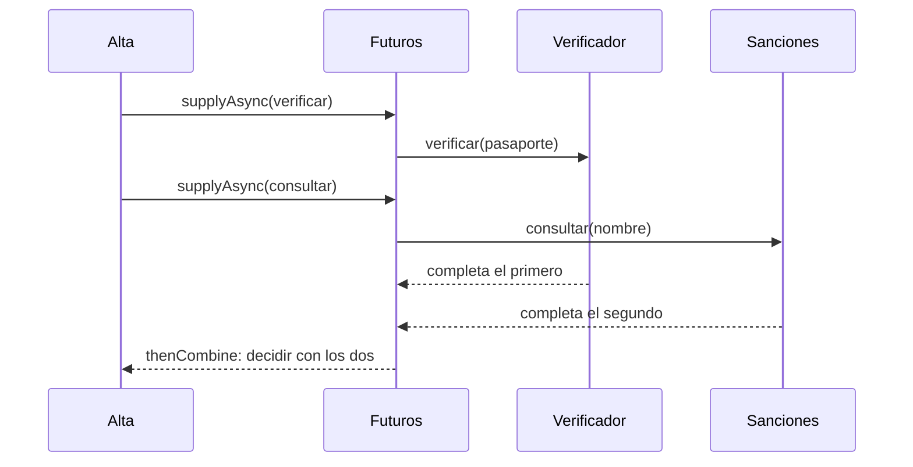
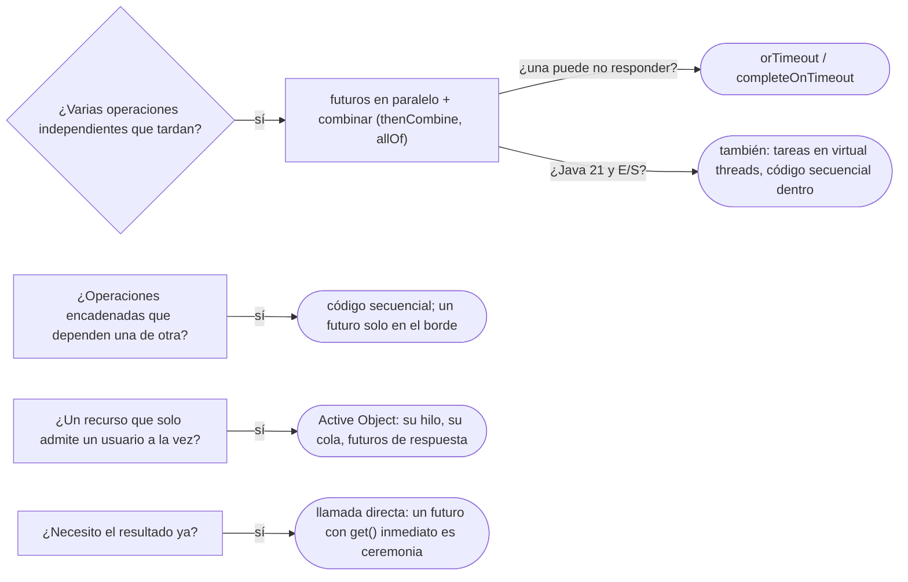

# 04 — Future/Promise y Active Object

> Componer resultados que **todavía no existen** sin bloquear el hilo que los pide (Future/Promise), y reconocer el
> objeto que **tiene su propio hilo** y recibe las llamadas como mensajes en una cola (Active Object). **Niveles:**
> Future/Promise A · Active Object B. **Lenguajes:** C++ y Java, completos. Asume leído
> [`03` — Producer-Consumer y Thread Pool](03-producer-consumer-y-thread-pool.md).
>
> **Vigencia:** 2026-10-03.
>
> **Versiones ejecutadas:** GCC 14.4 (C++23) · JDK 21.0.12, 17.0.20 y 25.0.4 · mermaid-cli 11.17.0 (2026-10-04).

---

## 1. 🎯 El problema

El alta de Carmen consulta tres servicios externos que no dependen entre sí: el verificador de identidad, la lista de
personas sancionadas y el puntaje de riesgo. Cada uno tarda unos 300 ms:

```java
ResultadoVerificacion v = verificador.verificar(pasaporte);      // 300 ms
boolean sancionada = sanciones.consultar(carmen.nombre());        // 300 ms, esperando a que termine el anterior
int riesgo = riesgos.puntaje(carmen.id());                        // 300 ms más
return decidir(v, sancionada, riesgo);                            // 900 ms en total
```

- Las tres consultas son independientes y se hacen **en fila**: 900 ms donde bastarían 300.
- La primera reacción —lanzar tres hilos y esperar a que terminen con `join`— funciona, pero deja sin resolver dos cosas:
  cómo se devuelve el **resultado** de cada hilo y qué pasa si uno **falla** o **no responde**.

Un futuro es el objeto que representa un resultado que llegará después, y que se puede combinar antes de que llegue.

---

## 2. 🧱 Future/Promise

**Problema.** Un cálculo o una llamada que tarda se ejecuta en otro hilo, y el que la pidió necesita su resultado —o su
error— más adelante, sin quedarse esperando mientras tanto.

**Estructura.** Dos caras del mismo resultado pendiente:

```text
Promise  → el lado que ESCRIBE: quien hace el trabajo deposita el valor o el error, una sola vez
Future   → el lado que LEE: quien lo pidió consulta, espera, o encadena qué hacer cuando llegue
```



**Código.** Java, con `CompletableFuture`, que es a la vez el futuro y la promesa:

```java
CompletableFuture<ResultadoVerificacion> fv =
        CompletableFuture.supplyAsync(() -> verificador.verificar(pasaporte), ejecutor);
CompletableFuture<Boolean> fs =
        CompletableFuture.supplyAsync(() -> sanciones.consultar(carmen.nombre()), ejecutor);
CompletableFuture<Integer> fr =
        CompletableFuture.supplyAsync(() -> riesgos.puntaje(carmen.id()), ejecutor)
                .completeOnTimeout(RIESGO_POR_DEFECTO, 500, TimeUnit.MILLISECONDS);   // si tarda, un valor por defecto

CompletableFuture<Decision> decision = fv.thenCombine(fs, Parcial::new)
        .thenCombine(fr, (p, riesgo) -> decidir(p.verificacion(), p.sancionada(), riesgo))
        .orTimeout(2, TimeUnit.SECONDS)                                               // el total, con plazo
        .exceptionally(error -> Decision.revisionManual(error));                     // cualquier fallo, un camino
```

- Las tres consultas arrancan a la vez: el total es el de la más lenta, unos 300 ms.
- `thenCombine` dice **qué hacer cuando lleguen los dos**, sin bloquear a nadie (`Parcial` es un `record` con los dos
  primeros resultados). Nada en este bloque espera: devuelve otro futuro, y quien lo recibe decide si lo encadena o lo
  espera.
- Para encadenar en serie hay dos verbos: `thenApply` transforma el valor cuando llega (`fv.thenApply(v -> v.aprobada())`);
  `thenCompose` encadena **otra operación asíncrona** que también devuelve un futuro (`fv.thenCompose(v ->
  riesgos.puntajeAsync(v))`). Con `thenApply` ahí, el resultado sería un futuro de un futuro.
- El `ejecutor` se pasa explícito. Sin él, `supplyAsync` usa el `ForkJoinPool` común, que es para cálculo y no para
  llamadas que esperan E/S.
- Fallo y plazo tienen sitio propio: `completeOnTimeout` y `orTimeout` (desde Java 9) y `exceptionally`. Un error en
  cualquier eslabón salta hasta el `exceptionally`.

`get()` es lo único que **bloquea**: la Javadoc de `Future` lo dice, espera si hace falta a que el cálculo termine. Un
futuro que se crea y se espera enseguida con `get()` es una llamada síncrona con un hilo de más.

C++, con `std::async` y el par `std::promise`/`std::future`:

```cpp
auto fv = std::async(std::launch::async, [&] { return verificador.verificar(pasaporte); });
auto fs = std::async(std::launch::async, [&] { return sanciones.consultar(carmen.nombre()); });
Decision d = decidir(fv.get(), fs.get());          // get() espera; si la tarea lanzó, relanza aquí

std::promise<int> promesa;                          // la cara que escribe, en manos de quien hace el trabajo
std::future<int> riesgo = promesa.get_future();     // la cara que lee
std::jthread trabajador{[p = std::move(promesa), &riesgos, id = carmen.id()]() mutable {
    try { p.set_value(riesgos.puntaje(id)); }
    catch (...) { p.set_exception(std::current_exception()); }      // el error viaja por el mismo canal
}};
```

- `std::launch::async` obliga a un hilo nuevo; sin la política, la implementación puede diferir la tarea hasta el `get()`.
- `std::future` de C++23 **no se encadena**: no hay `then`. Para componer sin bloquear hace falta una librería o las
  corrutinas; lo estándar es esperar con `get()`.
- La trampa propia de C++: el `std::future` que devuelve `std::async`, si no se guarda, **bloquea en su destructor** hasta
  que la tarea termine. `std::async(std::launch::async, enviarAviso);` en una línea suelta es una llamada síncrona.

> 📝 **En Java 17:** `CompletableFuture` con `orTimeout` y `completeOnTimeout` está disponible desde Java 9: todo el
> código del capítulo compila en 17. Lo que no hay en 17 son *virtual threads*, así que la composición con futuros sobre
> un ejecutor acotado es la forma de paralelizar llamadas sin un hilo bloqueado por cada una.

**Con qué se confunde.** Con "asíncrono": crear un futuro y llamar a `get()` en la línea siguiente es síncrono con un hilo
de más. Y con el *callback*: el *callback* dice qué hacer al terminar, pero no se puede combinar ni pasar de mano en
mano; el futuro sí, porque es un valor.

**Dónde aparece.** `CompletableFuture`; `@Async` de Spring cuando el método devuelve un `CompletableFuture`; `Mono` y
`Flux` de Reactor en Spring WebFlux, que son la misma idea con flujo; `std::future`. En JavaScript, la `Promise` y
`async`/`await` son el patrón en el lenguaje, y tienen su sitio en
[`11/02`](../11-los-diferentes/02-javascript-y-typescript.md).

**Cuándo no.** Cuando las operaciones dependen una de otra y se ejecutan en orden: un futuro por paso solo añade
ceremonia. Y en Java 21, para llamadas que esperan E/S, a menudo basta con código **secuencial y bloqueante** dentro de un
*virtual thread* por tarea ([`03` §4](03-producer-consumer-y-thread-pool.md#4--virtual-threads-un-hilo-por-tarea-sin-pool)):
el paralelismo de las tres consultas sigue necesitando tres tareas, pero cada una se lee de arriba abajo.

> **Veredicto:** futuro para lanzar en paralelo lo independiente y **combinar** sin bloquear, con ejecutor explícito, plazo
> y un camino para el error; `get()` solo en el borde, donde de verdad hay que esperar. "`future.get()` es asíncrono" es
> falso: es exactamente el punto donde se deja de serlo.

---

## 3. 🧱 Active Object

**Problema.** Un objeto con estado que muchos hilos usan —el registro de auditoría que escribe en un archivo, el cliente
de un dispositivo que solo admite una conexión— y que no es seguro entre hilos. Ponerle candados obliga a cada llamador a
esperar a que termine la escritura del anterior.

**Mecanismo.** Un objeto que **tiene su propio hilo**. Sus métodos no ejecutan nada: convierten la llamada en un mensaje,
lo encolan y devuelven enseguida un futuro. El hilo del objeto saca los mensajes de a uno y los ejecuta. POSA2 lo describe
como desacoplar la ejecución de un método de su invocación. Es un Producer-Consumer con un solo consumidor, más un
futuro por llamada.

**Código.** Java, con un ejecutor de un solo hilo como planificador y cola:

```java
public final class AuditoriaActiva implements AutoCloseable {
    private final ExecutorService hilo = Executors.newSingleThreadExecutor();   // su hilo y su cola
    private final BufferedWriter archivo;                                       // confinado a ese hilo

    public AuditoriaActiva(Path ruta) throws IOException {
        this.archivo = Files.newBufferedWriter(ruta, StandardOpenOption.CREATE, StandardOpenOption.APPEND);
    }

    public CompletableFuture<Void> registrar(String evento) {                  // vuelve enseguida
        return CompletableFuture.runAsync(() -> escribir(evento), hilo);
    }

    private void escribir(String evento) {                                      // solo lo ejecuta su hilo
        try { archivo.write(evento); archivo.newLine(); archivo.flush(); }
        catch (IOException e) { throw new UncheckedIOException(e); }
    }

    @Override public void close() throws IOException {
        hilo.shutdown();                                                         // termina lo encolado
        try { hilo.awaitTermination(10, TimeUnit.SECONDS); }
        catch (InterruptedException e) { Thread.currentThread().interrupt(); }
        archivo.close();
    }
}
```

- El `BufferedWriter` no es seguro entre hilos y no necesita serlo: está **confinado** al hilo del objeto
  ([`01` §4](01-inmutabilidad-y-confinamiento.md#4--thread-confinement)). Ni un candado en todo el código.
- `newSingleThreadExecutor` usa una cola **sin cota**, como su pariente de [`03` §5](03-producer-consumer-y-thread-pool.md#5--autopsia-el-pool-que-se-comió-la-memoria):
  si la auditoría se queda atrás, se acumula. En producción, un `ThreadPoolExecutor(1, 1, …)` con cola acotada.
- En C++ es lo mismo con un `std::jthread`, la `ColaAcotada` de `03` y un `std::promise` por mensaje.

**Cuándo sí y cuándo no.** Sí para un recurso que solo admite un usuario a la vez y que no debe frenar a quien lo usa
(auditoría, un dispositivo, un cliente con estado). No cuando el llamador necesita el resultado enseguida (espera igual,
con más piezas), ni cuando el orden global importa entre varios objetos activos: cada uno ordena solo sus mensajes. El
precio: un hilo por objeto, una cola que vigilar, y una pila de llamadas que en la depuración empieza en la cola y no en
quien llamó.

> **Veredicto:** Active Object para serializar el acceso a un recurso sin candados y sin frenar a los llamadores; hoy se
> escribe con un ejecutor de un hilo y una cola acotada. Es el modelo de los actores, en pequeño.

---

## 4. 🧭 Cómo se elige



**La frase en voz alta:** *"Lanzo las tres consultas en paralelo con `supplyAsync` sobre un ejecutor para E/S, las combino
con `thenCombine`, pongo un plazo con `orTimeout` y un camino de error con `exceptionally`; el `get()` solo en el borde,
porque `get()` bloquea."*

---

## ⚠️ Errores frecuentes

| Se dice | Lo preciso |
|---|---|
| "`future.get()` es asíncrono" | Bloquea hasta que hay resultado; es el punto donde se deja de ser asíncrono |
| "`supplyAsync` sin ejecutor está bien para llamadas remotas" | Usa el `ForkJoinPool` común, pensado para cálculo; las esperas de E/S lo ocupan |
| "Un futuro sin plazo terminará algún día" | Si el servicio no responde, nunca; `orTimeout` o `completeOnTimeout` |
| "`std::async` siempre es asíncrono" | Sin `std::launch::async` puede diferirse; y su futuro descartado bloquea en el destructor |
| "`std::future` se encadena como `CompletableFuture`" | En C++23 no tiene `then`; se espera con `get()` o se usa otra herramienta |
| "Active Object es un objeto con `synchronized`" | No tiene candados: tiene su propio hilo y una cola de mensajes |

---

## 📚 Para profundizar

- **Libro** — Schmidt y otros, *Pattern-Oriented Software Architecture, vol. 2* (Wiley, 2000), cap. 5, "Concurrency
  Patterns": Active Object, con el *future* como pieza de su respuesta. **El que destaca** para el Active Object.
- **Libro** — Goetz y otros, *Java Concurrency in Practice* (Addison-Wesley, 2006), cap. 6, "Task Execution" (tareas
  con resultado y `Future`).
- [Java 21 API — `CompletableFuture`](https://docs.oracle.com/en/java/javase/21/docs/api/java.base/java/util/concurrent/CompletableFuture.html):
  composición, plazos y el ejecutor por defecto.
- [Java 21 API — `Future`](https://docs.oracle.com/en/java/javase/21/docs/api/java.base/java/util/concurrent/Future.html):
  `get` espera.
- [cppreference — `std::async`](https://en.cppreference.com/cpp/thread/async): las políticas de lanzamiento y el
  destructor que bloquea.
- [cppreference — `std::promise`](https://en.cppreference.com/cpp/thread/promise)

---

## 🧠 Preguntas

Sin respuestas aquí. Todas, con enunciado literal y respuesta en tres capas, en
[`08` — Respuestas](08-respuestas.md#04--futurepromise-y-active-object).

1. ¿Qué es un Future, y qué es una Promise? 🟢
2. ¿Qué es un Active Object? 🟢
3. ¿Qué hace `thenCombine`? 🟢
4. ¿Qué diferencia hay entre un futuro y un *callback*? 🟡
5. ¿Qué diferencia hay entre `CompletableFuture` y `std::future`? 🟡
6. ¿Qué diferencia hay entre un Active Object y un objeto con métodos `synchronized`? 🟡
7. ¿Qué diferencia hay entre `thenApply` y `thenCompose`? 🟡
8. ¿Por qué `future.get()` no es asíncrono? 🟠
9. ¿Por qué hay que pasar un ejecutor a `supplyAsync` cuando la tarea llama a un servicio remoto? 🟠
10. ¿Por qué una línea suelta con `std::async` puede ser síncrona? 🟠
11. ¿Cuándo un *virtual thread* con código secuencial reemplaza a la composición de futuros? 🟠
12. Escribe en Java las tres consultas del alta en paralelo, con plazo y un camino de error. 🔴
13. Escribe un Active Object para el registro de auditoría y di qué cambiarías para producción. 🔴
14. Revisa este código y di qué falla: `CompletableFuture.supplyAsync(() -> sanciones.consultar(nombre)).get()` dentro de
    un bucle sobre mil personas. 🔴

---

**Anterior:** [`03` — Producer-Consumer y Thread Pool](03-producer-consumer-y-thread-pool.md) ·
**Siguiente:** [`05` — Reactor y Proactor](05-reactor-y-proactor.md) ·
**Relacionado:** [`06/04` — Command](../06-comportamiento/04-command.md)
