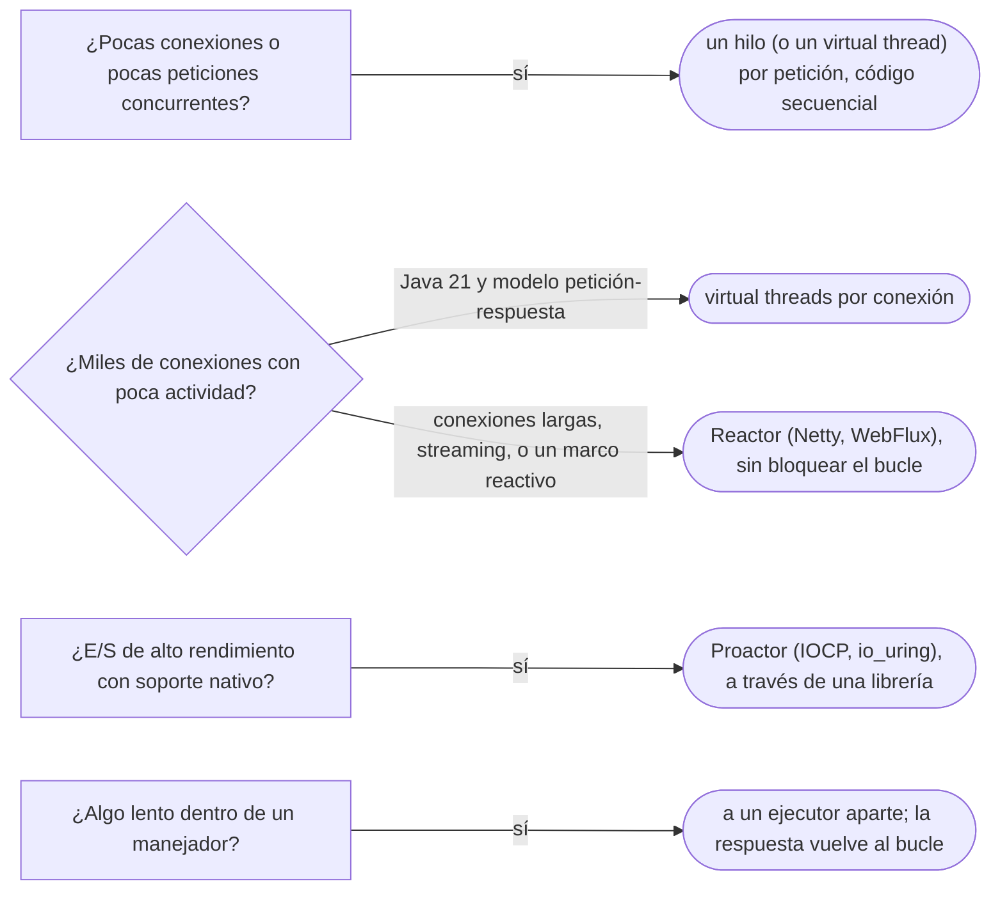

# 05 — Reactor y Proactor

> Explicar el **bucle de eventos**: por qué un servidor atiende miles de conexiones con pocos hilos, qué cambia entre que
> el sistema avise de que **se puede leer** (Reactor) y que avise de que **ya leyó** (Proactor), y por qué bloquear el bucle
> lo detiene todo. **Niveles:** Reactor B · Proactor B. **Lenguajes:** Java (NIO) y C++ mínimo, sobre la API del sistema.
> Asume leído [`03` — Producer-Consumer y Thread Pool](03-producer-consumer-y-thread-pool.md) y
> [`06/03` — Observer](../06-comportamiento/03-observer.md).
>
> **Vigencia:** 2026-10-03.
>
> **Versiones ejecutadas:** GCC 14.4 (C++23) · JDK 21.0.12, 17.0.20 y 25.0.4 · Netty 4.2.18 (2026-10-04).

---

## 1. 🎯 El problema

El banco tiene diez mil terminales de corresponsales que mantienen una conexión abierta con el servidor y mandan, cada
tanto, una consulta de saldo. La versión clásica es un hilo por conexión:

```java
try (ServerSocket servidor = new ServerSocket(9000)) {
    while (true) {
        Socket conexion = servidor.accept();
        new Thread(() -> atender(conexion)).start();   // el hilo pasa casi todo el tiempo bloqueado en read()
    }
}
```

- Diez mil hilos de plataforma, cada uno con su pila, **casi todos dormidos** en un `read()` esperando una consulta que
  llega cada varios minutos. La memoria se va en pilas y el planificador del sistema, en cambiar entre hilos que no hacen
  nada.
- La pregunta es otra: en lugar de un hilo esperando en cada conexión, **un hilo que espera en todas a la vez** y atiende
  la que tenga algo.

Ese hilo es un bucle de eventos. Hay dos formas de escribirlo, según lo que el sistema operativo avise.

---

## 2. 🧱 Reactor

**Problema.** Muchas conexiones, cada una con actividad esporádica, y un hilo por conexión que pasa su vida bloqueado.

**Mecanismo.** Un **demultiplexor** del sistema operativo (`select`, `epoll` en Linux, `kqueue` en BSD) vigila muchos
canales a la vez y devuelve los que están **listos** para leer o escribir sin bloquear. Un único bucle —el *event loop*—
le pregunta, y por cada canal listo **despacha** a su manejador, que hace la lectura (que ya no bloquea) y vuelve. POSA2 lo
describe en su capítulo de manejo de eventos: el Reactor despacha, el manejador procesa.

```text
         ┌──────────────── event loop (un hilo) ─────────────────┐
         │  listos = demultiplexor.esperar()    ← duerme aquí    │
         │  para cada canal listo:                                │
         │      manejador[canal].alEstarListo()  ← debe volver ya │
         └────────────────────────────────────────────────────────┘
```

**Código.** Java, con el `Selector` de NIO, que es el demultiplexor con interfaz Java:

```java
Selector selector = Selector.open();
ServerSocketChannel servidor = ServerSocketChannel.open();
servidor.bind(new InetSocketAddress(9000));
servidor.configureBlocking(false);
servidor.register(selector, SelectionKey.OP_ACCEPT);

while (true) {
    selector.select();                                         // espera a que algún canal esté listo
    Iterator<SelectionKey> listos = selector.selectedKeys().iterator();
    while (listos.hasNext()) {
        SelectionKey k = listos.next();
        listos.remove();
        if (k.isAcceptable()) {
            SocketChannel c = servidor.accept();               // no bloquea: el selector dijo que hay una
            c.configureBlocking(false);
            c.register(selector, SelectionKey.OP_READ, ByteBuffer.allocate(1024));
        } else if (k.isReadable()) {
            SocketChannel c = (SocketChannel) k.channel();
            ByteBuffer buf = (ByteBuffer) k.attachment();
            if (c.read(buf) < 0) { k.cancel(); c.close(); continue; }    // el cliente cerró
            consultas.alRecibir(c, buf);                       // debe volver enseguida
        }
    }
}
```

- Un hilo atiende las diez mil conexiones: cada vuelta del bucle procesa solo las que tienen datos.
- `consultas.alRecibir` corre **en el hilo del bucle**. Si consulta el saldo en la base con una llamada bloqueante de 50 ms,
  las otras 9 999 conexiones esperan esos 50 ms. El trabajo lento sale del bucle a un pool
  ([`03`](03-producer-consumer-y-thread-pool.md)), y la respuesta vuelve al bucle para escribirse.

C++, mínimo, sobre `epoll`, que es lo que hay debajo en Linux:

```cpp
int ep = epoll_create1(0);
epoll_event ev{};
ev.events = EPOLLIN;
ev.data.fd = servidor;                                         // el socket que escucha
epoll_ctl(ep, EPOLL_CTL_ADD, servidor, &ev);

std::array<epoll_event, 64> listos{};
for (;;) {
    int n = epoll_wait(ep, listos.data(), static_cast<int>(listos.size()), -1);   // el demultiplexor
    for (int i = 0; i < n; ++i) despachar(listos[i].data.fd);                        // su manejador, y volver
}
```

- `epoll_wait` es el `select()` del `Selector`: duerme hasta que haya descriptores listos y los devuelve. Lo demás es
  despacho. Es la API de C del sistema; C++23 no trae red en la biblioteca estándar.

**Dónde aparece.** El *event loop* de Node.js, que tiene su sitio en
[`11/02`](../11-los-diferentes/02-javascript-y-typescript.md); Netty, cuyo `EventLoop` atiende todas las operaciones de E/S de los canales
que tiene registrados, con un bucle por núcleo; Spring WebFlux, que Spring Boot arranca sobre Netty por defecto y que, dice
su documentación, escala con un número pequeño y fijo de hilos; nginx; el conector NIO de Tomcat.

**Cuándo sí y cuándo no.** Sí para muchas conexiones con poca actividad cada una: servidores, *gateways*, *proxies*. No
cuando cada petición hace trabajo de CPU o llamadas bloqueantes, porque bloquean el bucle; y en Java 21, para un servidor
de peticiones y respuestas, un *virtual thread* por conexión con código bloqueante normal da casi la misma escalabilidad
con código mucho más fácil de leer y depurar. El precio del Reactor: el código se parte en manejadores y *callbacks*, el
estado de cada conexión vive en adjuntos, y una pila de llamadas en la depuración empieza siempre en el bucle.

> **Veredicto:** Reactor para miles de conexiones con poca actividad, con una regla que no se negocia: **nunca bloquear el
> bucle**, y sacar a un pool lo que tarda. Si el problema es solo "muchas peticiones que esperan E/S" y hay Java 21, los
> *virtual threads* resuelven lo mismo con código secuencial.

---

## 3. 🧱 Proactor

**Problema.** En el Reactor, el sistema avisa de que **se puede** leer, y la lectura la hace todavía el manejador, en el
hilo del bucle. Con discos o redes rápidas, hasta esa copia cuenta.

**Mecanismo.** La aplicación **inicia** la operación (lee hasta 1 024 bytes en este búfer) y sigue; el sistema operativo
la **completa** por su cuenta y avisa cuando **ya terminó**, con los datos ya en el búfer. Un despachador de finalizaciones
llama entonces al manejador de completado. POSA2 lo llama *Proactor*: el Reactor reacciona a la disponibilidad; el
Proactor, a la finalización.

```text
Reactor   →  "el canal 17 tiene datos"   → el manejador llama a read() y procesa
Proactor  →  "terminé de leer 312 bytes del canal 17 en tu búfer" → el manejador solo procesa
```

**Código.** Java ofrece la interfaz Proactor con los canales asíncronos de NIO.2:

```java
ByteBuffer buf = ByteBuffer.allocate(1024);
canal.read(buf, buf, new CompletionHandler<Integer, ByteBuffer>() {
    @Override public void completed(Integer leidos, ByteBuffer b) {
        consultas.alRecibir(canal, b);                         // los datos ya están en el búfer
    }
    @Override public void failed(Throwable error, ByteBuffer b) {
        cerrar(canal);
    }
});
// read() volvió enseguida: la lectura la completa el sistema
```

- `canal` es un `AsynchronousSocketChannel`. La interfaz es la del Proactor; cómo la implementa el JDK por debajo depende
  del sistema operativo.
- En Windows, el mecanismo nativo son los *I/O Completion Ports*; en Linux, `io_uring`, una API de E/S asíncrona con una cola
  de envíos y otra de finalizaciones compartidas con el núcleo.

**Cuándo sí y cuándo no.** Sí cuando el sistema lo ofrece de forma nativa y el rendimiento de la E/S manda: servidores de
alto rendimiento, bases de datos, almacenamiento. No por defecto en aplicaciones de negocio: el código de completado es más
difícil de seguir que el del Reactor, y el del Reactor que el secuencial. El búfer, además, pertenece al sistema hasta que
la operación termina: tocarlo antes es un error que no avisa.

> **Veredicto:** Proactor cuando el sistema completa la E/S por ti y cada copia cuenta; en una aplicación de negocio, se usa
> a través de una librería, no se escribe. La diferencia que se pregunta: el Reactor avisa de que **se puede**; el Proactor,
> de que **ya está**.

---

## 4. 🩺 Por qué bloquear el bucle lo detiene todo

**El código que escribe todo el mundo.** Un manejador de Netty (o un controlador de WebFlux) que consulta el saldo con
JDBC:

```java
@Override public void channelRead(ChannelHandlerContext ctx, Object msg) {
    Dinero saldo = jdbcTemplate.queryForObject(SQL_SALDO, mapeador, cuentaDe(msg));   // bloquea ~50 ms
    ctx.writeAndFlush(respuesta(saldo));
}
```

**Por qué parece correcto.** Con diez terminales de prueba, cada consulta responde en 50 ms y nadie nota nada.

**La secuencia que lo rompe.** Un bucle de eventos atiende miles de conexiones. Si cien de ellas consultan a la vez, el
bucle hace las cien consultas **una detrás de otra**: la última espera cinco segundos, y durante esos cinco segundos ninguna
otra conexión del bucle —tampoco las que solo mandaban un latido— recibe atención. Con pocos bucles (uno por núcleo), basta
una consulta lenta para congelar una parte entera del servidor.

**El código correcto.** Mandar el trabajo bloqueante a un ejecutor aparte y escribir la respuesta cuando termine:

```java
@Override public void channelRead(ChannelHandlerContext ctx, Object msg) {
    CompletableFuture.supplyAsync(() -> consultarSaldo(cuentaDe(msg)), ejecutorBloqueante)   // la línea que cambió
            .thenAccept(saldo -> ctx.writeAndFlush(respuesta(saldo)));
}
```

**La generalización.** En cualquier bucle de eventos —Node, Netty, WebFlux, la interfaz de una aplicación de escritorio—, lo
que bloquea el bucle bloquea a todos los que dependen de él. La documentación de Node lo dice como regla: no bloquear el
*event loop*. Y aplica al trabajo de CPU igual que a la E/S: un cálculo de dos segundos en el bucle es un servidor parado dos
segundos.

---

## 5. 🧭 Cómo se elige



**La frase en voz alta:** *"Un servidor atiende diez mil conexiones con un hilo porque el sistema le dice cuáles tienen
datos y el bucle solo atiende esas; la regla es no bloquear nunca el bucle. El Reactor avisa de que se puede leer; el
Proactor, de que ya se leyó."*

---

## ⚠️ Errores frecuentes

| Se dice | Lo preciso |
|---|---|
| "Node es multihilo para el código del usuario" | El JavaScript del usuario corre en un solo hilo, el del *event loop*; la librería tiene un pool de trabajadores para ciertas operaciones |
| "Asíncrono significa más rápido" | Significa menos hilos esperando; cada petición no va más rápido, y el código cuesta más de seguir |
| "En WebFlux se puede llamar a JDBC normalmente" | JDBC bloquea; en el bucle, congela a todas las conexiones que atiende |
| "Reactor y Proactor son lo mismo" | El Reactor avisa de que se puede leer y lee el manejador; el Proactor avisa de que ya leyó |
| "Con un bucle de eventos no hay concurrencia que cuidar" | El trabajo que sale a un pool vuelve con sus carreras; y el estado compartido entre bucles necesita sincronización |
| "Los *virtual threads* y el Reactor son lo mismo" | Los dos evitan un hilo de plataforma bloqueado por conexión; con *virtual threads* el código es secuencial |

---

## 📚 Para profundizar

- **Libro** — Schmidt y otros, *Pattern-Oriented Software Architecture, vol. 2* (Wiley, 2000), cap. 3, "Event Handling
  Patterns": Reactor, Proactor, Asynchronous Completion Token y Acceptor-Connector. **El que destaca.**
- [Java 21 API — `Selector`](https://docs.oracle.com/en/java/javase/21/docs/api/java.base/java/nio/channels/Selector.html):
  el demultiplexor de NIO.
- [Java 21 API — `AsynchronousSocketChannel`](https://docs.oracle.com/en/java/javase/21/docs/api/java.base/java/nio/channels/AsynchronousSocketChannel.html):
  la interfaz Proactor de NIO.2.
- [Linux — `epoll(7)`](https://man7.org/linux/man-pages/man7/epoll.7.html) y [`io_uring(7)`](https://man7.org/linux/man-pages/man7/io_uring.7.html)
- [Node.js — *Don't Block the Event Loop*](https://nodejs.org/learn/asynchronous-work/dont-block-the-event-loop): el
  hilo del bucle y el pool de trabajadores.
- [Spring — WebFlux, *Overview*](https://docs.spring.io/spring-framework/reference/web/webflux/new-framework.html): el
  modelo de pocos hilos y Netty por defecto en Spring Boot.
- [Microsoft — *I/O Completion Ports*](https://learn.microsoft.com/en-us/windows/win32/fileio/i-o-completion-ports)

---

## 🧠 Preguntas

Sin respuestas aquí. Todas, con enunciado literal y respuesta en tres capas, en
[`08` — Respuestas](08-respuestas.md#05--reactor-y-proactor).

1. ¿Qué es un *event loop*? 🟢
2. ¿Qué es el patrón Reactor? 🟢
3. ¿Qué es el patrón Proactor? 🟢
4. ¿Qué hace un demultiplexor como `epoll` o el `Selector` de NIO? 🟢
5. ¿Qué diferencia hay entre Reactor y Proactor? 🟡
6. ¿Qué diferencia hay entre un hilo por conexión y un bucle de eventos? 🟡
7. ¿Qué diferencia hay entre el Reactor de Java (NIO) y el de C++ sobre `epoll`? 🟡
8. ¿Qué diferencia hay entre un bucle de eventos y los *virtual threads* para atender muchas conexiones? 🟡
9. ¿Por qué bloquear el bucle lo detiene todo? 🟠
10. ¿Por qué "Node es multihilo para el código del usuario" es falso? 🟠
11. ¿Cuándo prefieres *virtual threads* a un servidor reactivo en Java 21? 🟠
12. ¿Qué cuesta el Reactor en legibilidad y depuración? 🟠
13. Revisa este manejador de Netty y di qué falla: consulta el saldo con `jdbcTemplate.queryForObject` y escribe la
    respuesta. 🔴
14. Escribe el bucle de un Reactor con el `Selector` de Java que acepte conexiones y despache las lecturas. 🔴

---

**Anterior:** [`04` — Future/Promise y Active Object](04-future-y-active-object.md) ·
**Siguiente:** [`06` — Inicialización perezosa segura](06-inicializacion-perezosa-segura.md) ·
**Relacionado:** [`06/03` — Observer](../06-comportamiento/03-observer.md)
