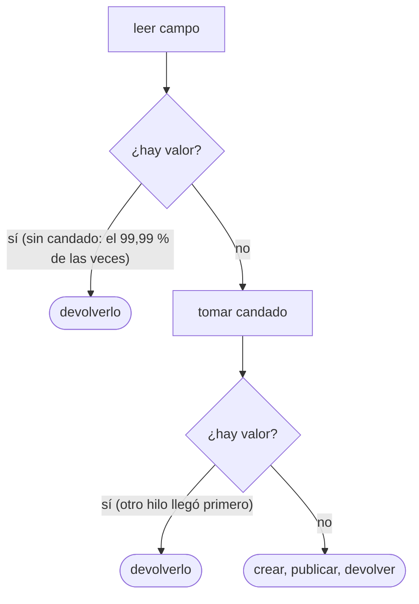
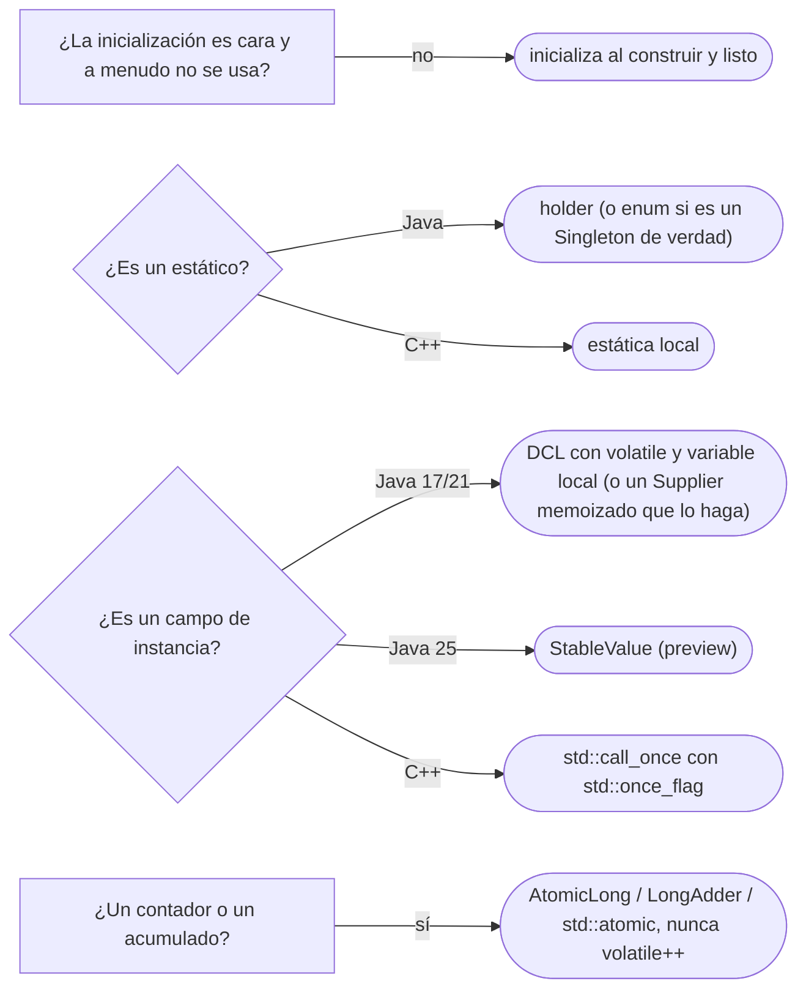

# 06 — Inicialización perezosa segura

> Escribir una inicialización perezosa que sea segura entre hilos, y explicar **por qué el *double-checked locking* sin
> `volatile` está roto**. **Niveles:** Double-Checked Locking A · Holder idiom B · `std::call_once` y estáticas locales B.
> **Es el dueño del DCL**: [`04/05`](../04-creacionales/05-singleton.md) y [`04/07`](../04-creacionales/07-mas-alla-del-gof.md)
> lo nombran y remiten aquí. **Lenguajes:** C++ y Java, completos. Asume leído
> [`01` — Inmutabilidad y confinamiento](01-inmutabilidad-y-confinamiento.md).
>
> **Vigencia:** 2026-10-03.
>
> **Versiones ejecutadas:** GCC 14.4 (C++23) · JDK 21.0.12, 17.0.20 y 25.0.4 (2026-10-04).

---

## 1. 🎯 El problema

El catálogo de plantillas de avisos tarda dos segundos en cargarse y la mitad de los procesos no lo usa, así que se carga la
primera vez que se pide. La primera versión segura es esta:

```java
private CatalogoPlantillas plantillas;

public synchronized CatalogoPlantillas plantillas() {          // cada llamada toma el candado
    if (plantillas == null) plantillas = CatalogoPlantillas.cargar(fuente);
    return plantillas;
}
```

- Es correcta, y **cada** llamada paga el candado, aunque solo la primera lo necesite. En un servicio que pide el catálogo
  en cada aviso, cien hilos hacen fila para leer una referencia que no va a cambiar nunca más.
- La "optimización" que alguien propone en la revisión es comprobar antes de sincronizar, y volver a comprobar dentro. Se
  llama *double-checked locking*, se publicó durante años como la solución, y en Java está **roto** si se escribe como se
  escribía.

---

## 2. 🧱 Double-Checked Locking

**Problema.** Inicializar una sola vez, entre varios hilos, sin pagar un candado en cada lectura posterior.

**Estructura.** Tres pasos: comprobar sin candado (el camino rápido, casi siempre); si falta, tomar el candado y
**volver a comprobar** (otro hilo pudo inicializarlo mientras se esperaba); si sigue faltando, inicializar. POSA2 lo
recoge como *Double-Checked Locking Optimization* en sus patrones de sincronización.



**Código.** Java, **con `volatile`**, que es lo que lo hace correcto:

```java
private volatile CatalogoPlantillas plantillas;                // volatile: sin esto, está roto

public CatalogoPlantillas plantillas() {
    CatalogoPlantillas p = plantillas;                         // una sola lectura volatile en el camino rápido
    if (p == null) {
        synchronized (this) {
            p = plantillas;                                    // la segunda comprobación
            if (p == null) plantillas = p = CatalogoPlantillas.cargar(fuente);
        }
    }
    return p;
}
```

- La variable local `p` evita leer el campo `volatile` dos veces en el camino rápido; es la forma de *Effective Java*
  (ítem 83) y la del `Perezoso<T>` de [`04/07` §4](../04-creacionales/07-mas-alla-del-gof.md#4--lazy-initialization).
- Lo que garantiza `volatile`, dicho por la JLS (§17.4.5): una escritura en un campo `volatile` *ocurre antes* que toda
  lectura posterior de ese campo. Quien lee la referencia ve también todo lo que el constructor escribió antes de
  publicarla.

C++, con un atómico y el orden de memoria explícito:

```cpp
class ServicioAvisos {
    mutable std::atomic<const CatalogoPlantillas*> plantillas_{nullptr};
    mutable std::mutex m_;
    mutable std::unique_ptr<const CatalogoPlantillas> dueno_;     // quien posee el catálogo
public:
    const CatalogoPlantillas& plantillas() const {
        const CatalogoPlantillas* p = plantillas_.load(std::memory_order_acquire);
        if (p == nullptr) {
            std::lock_guard lock{m_};
            p = plantillas_.load(std::memory_order_relaxed);         // bajo el candado basta relaxed
            if (p == nullptr) {
                dueno_ = std::make_unique<const CatalogoPlantillas>(CatalogoPlantillas::cargar(fuente_));
                p = dueno_.get();
                plantillas_.store(p, std::memory_order_release);    // publica: lo construido se ve antes que el puntero
            }
        }
        return *p;
    }
};
```

- `release` al publicar y `acquire` al leer son el par que en Java da `volatile`: quien ve el puntero ve el objeto
  construido. Con el puntero sin `atomic`, es una carrera de datos y comportamiento indefinido.
- Es el código que nadie debería escribir en C++: el §5 da lo mismo en una línea.

**Con qué se confunde.** Con el holder idiom: los dos son perezosos y seguros, pero el holder solo sirve para estáticos y
no necesita `volatile` ni candado visible. Y con un antipatrón: "el DCL es un antipatrón y punto" es la respuesta de
quien leyó la declaración de que estaba roto y no siguió leyendo. Sin `volatile` estaba roto; desde el modelo de memoria de Java 5,
con `volatile`, es correcto, y es la forma estándar para **campos de instancia** perezosos.

**Dónde aparece.** El `Perezoso<T>` de [`04/07`](../04-creacionales/07-mas-alla-del-gof.md); los `Supplier` memoizados de
las librerías; Bloch lo recomienda en *Effective Java* (ítem 83) para campos de instancia que necesitan inicialización
perezosa por rendimiento.

**Cuándo no.** Para un estático: el holder lo hace sin riesgo. En C++: `std::call_once` o una estática local. Y siempre que
la inicialización no sea cara: Bloch empieza el ítem 83 diciendo que, en la mayoría de los casos, la inicialización normal
es preferible a la perezosa.

> **Veredicto:** DCL con `volatile` y variable local para un campo de instancia perezoso y caro; holder para un estático;
> `call_once` o estática local en C++. "El DCL es un antipatrón y punto" confunde la versión rota con el patrón: lo roto es
> el DCL sin `volatile`.

---

## 3. 🩺 Autopsia: el DCL sin `volatile`

**El código que escribe todo el mundo.** El de §2 sin la palabra `volatile`:

```java
private CatalogoPlantillas plantillas;                         // sin volatile

public CatalogoPlantillas plantillas() {
    if (plantillas == null) {
        synchronized (this) {
            if (plantillas == null) plantillas = CatalogoPlantillas.cargar(fuente);
        }
    }
    return plantillas;
}
```

**Por qué parece correcto.** La escritura está dentro del `synchronized`, la doble comprobación evita crear dos catálogos,
y en las pruebas —en una máquina x86, con pocos hilos— nunca falla.

**La secuencia que lo rompe.** `plantillas = CatalogoPlantillas.cargar(fuente)` no es un paso: es reservar memoria,
ejecutar el constructor, que escribe los campos, y escribir la referencia. El compilador y el procesador pueden reordenar
esas escrituras, siempre que **el hilo que las hace** no note la diferencia. El hilo B entra por el camino rápido, **sin
candado**, y no tiene ninguna relación de *ocurre antes* con el hilo A:

```text
hilo A (dentro del candado)               hilo B (camino rápido, sin candado)
  reserva memoria del catálogo
  escribe la referencia en plantillas ──▶   lee plantillas: no es null
                                            devuelve el catálogo y lee su mapa de plantillas: vacío (null)
  ejecuta el constructor: llena el mapa
```

B recibe un catálogo **a medio construir**: un `NullPointerException` al buscar la plantilla de `DocumentoVencido`, o
peor, un aviso con una plantilla vacía. Ocurre una vez cada muchos millones de llamadas, en producción, con muchos núcleos.

**El código correcto.** El de §2: `private volatile CatalogoPlantillas plantillas;` es la línea que cambia. Si todos los
campos de `CatalogoPlantillas` fueran `final` y nada escapara en su constructor, la garantía de §17.5
([`01` §2](01-inmutabilidad-y-confinamiento.md#2--immutable-object)) impediría ver los campos a medias; aun así, sin
`volatile` otro hilo podría no ver nunca la referencia nueva y repetir la carga. La regla corta: `volatile`, siempre.

**La generalización.** Es una publicación sin sincronización, el mismo error de fondo que
[`01`](01-inmutabilidad-y-confinamiento.md): leer, sin una relación de *ocurre antes*, una referencia que otro hilo
escribió. La declaración *"Double-Checked Locking is Broken"*, firmada por Bloch, Lea, Pugh y otros, lo documentó
para el modelo de memoria anterior a Java 5.

---

## 4. 🧱 `volatile`: lo que da y lo que no

**Lo que da.** Visibilidad y orden: lo escrito antes de una escritura `volatile` se ve después de leer ese campo. Es lo
que el DCL necesita, porque la operación es **una escritura** de referencia, hecha una vez.

**Lo que no da: atomicidad de lecturas y escrituras combinadas.**

```java
private volatile long transferenciasDelDia;

public void registrar() { transferenciasDelDia++; }             // no es atómico, aunque sea volatile
```

- `++` es leer, sumar y escribir. Dos hilos leen 41, los dos escriben 42, y se perdió una transferencia en el contador.
  `volatile` hace que cada lectura vea la última escritura, no que nadie escriba entre la lectura y la escritura.
- La salida es `AtomicLong.incrementAndGet()` (una instrucción atómica), o `LongAdder` si muchos hilos incrementan y pocos
  leen. En C++, `std::atomic<long>` con `++`, que sí es atómico.

> **Veredicto:** `volatile` para **publicar** un valor que otros leen (una referencia, una bandera); `Atomic*` para leer y
> modificar. "`volatile` hace atómico el incremento" es falso: hace visible cada escritura, no indivisible la operación.

---

## 5. 🧱 Holder idiom

**Problema.** Un **estático** perezoso —el catálogo compartido por todo el proceso— sin candado ni `volatile` a la vista.

**Mecanismo.** La instancia vive en una clase anidada que la JVM solo inicializa cuando alguien la usa por primera vez. La
inicialización de clases (JLS §12.4.2) ya está sincronizada por la JVM: el primer hilo la ejecuta y los demás esperan, y
después nadie paga nada.

**Código.** El holder completo está en [`04/05` §5](../04-creacionales/05-singleton.md#5--java); su núcleo:

```java
private static final class Portador {
    static final CatalogoTipos INSTANCIA = new CatalogoTipos();   // se ejecuta en la primera llamada a instancia()
}
public static CatalogoTipos instancia() { return Portador.INSTANCIA; }
```

> 📝 **En Java 25:** `StableValue` (JEP 502, en *preview*) da la inicialización perezosa con la optimización de un `final`, y
> sirve también para campos de instancia: `private final Supplier<CatalogoPlantillas> plantillas =
> StableValue.supplier(() -> CatalogoPlantillas.cargar(fuente));`, usado con `plantillas.get()`. Reemplaza al DCL escrito a
> mano. En JDK 26 la API se rediseñó como `LazyConstant` (JEP 526, segunda *preview*). **En Java 17 y 21**: holder para
> estáticos y DCL con `volatile` para instancias.

**Cuándo sí y cuándo no.** Sí para estáticos perezosos, siempre: es la forma más simple y no se puede escribir mal. No sirve
para campos de instancia (la clase anidada es una por clase, no por objeto), y si la inicialización lanza, la clase queda
marcada como fallida y cada uso posterior lanza `NoClassDefFoundError`: no hay reintento.

> **Veredicto:** holder para estáticos perezosos en Java 17 y 21; la JVM hace la sincronización y no queda nada que
> olvidar. Si la carga puede fallar y debe reintentarse, DCL con `volatile`.

---

## 6. 🧱 `std::call_once` y estáticas locales

**Problema.** Lo mismo en C++, donde además hay que decidir quién **posee** el objeto inicializado.

**Mecanismo.** Desde C++11, una **variable estática local** se inicializa exactamente una vez aunque varios hilos lleguen a
la vez: cppreference lo dice así, y añade que el mismo comportamiento se obtiene para funciones arbitrarias con
`std::call_once`. La estática local es el holder de C++; `call_once` con un `std::once_flag`, el DCL de un miembro.

**Código.**

```cpp
const CatalogoTipos& catalogoTipos() {
    static const CatalogoTipos catalogo = CatalogoTipos::cargar();   // una vez, segura entre hilos, perezosa
    return catalogo;
}

class ServicioAvisos {
    mutable std::once_flag cargadas_;
    mutable std::optional<CatalogoPlantillas> plantillas_;
public:
    const CatalogoPlantillas& plantillas() const {
        std::call_once(cargadas_, [this] { plantillas_ = CatalogoPlantillas::cargar(fuente_); });
        return *plantillas_;
    }
};
```

- Si la función de `call_once` lanza, la bandera no queda marcada y la llamada siguiente **lo reintenta**; con la estática
  local pasa lo mismo. Es lo que el holder de Java no hace.
- La estática local se destruye al terminar el programa, en orden inverso de construcción: si otro estático la usa en su
  destructor, puede encontrarla ya destruida.

**Cuándo sí y cuándo no.** Siempre que en C++ haga falta inicialización perezosa única: la estática local para un valor
global, `call_once` para un miembro. El DCL con atómicos del §2 solo si medir demuestra que `call_once` cuesta demasiado,
que es raro.

> **Veredicto:** en C++ no se escribe el DCL: estática local o `std::call_once`, que la biblioteca ya hace bien y que
> reintentan si la inicialización lanza.

---

## 7. 🧭 Cómo se elige



**La frase en voz alta:** *"Para un estático uso el holder, porque la JVM ya sincroniza la inicialización de clases; para un
campo de instancia, DCL con `volatile`, que sin él está roto porque otro hilo puede ver la referencia antes que el objeto
construido; y en C++, `call_once` o una estática local."*

---

## ⚠️ Errores frecuentes

| Se dice | Lo preciso |
|---|---|
| "El DCL es un antipatrón y punto" | Sin `volatile` está roto; con `volatile`, desde Java 5, es correcto y es la forma para campos de instancia |
| "`volatile` hace atómico el incremento" | Hace visible cada escritura; `++` sigue siendo leer, sumar y escribir |
| "El DCL sin `volatile` solo falla en teoría" | Falla de forma intermitente en producción, con muchos núcleos y reordenamientos reales |
| "El holder sirve para campos de instancia" | La clase anidada es una por clase; para instancias, DCL o `StableValue` |
| "Si la carga del holder falla, se reintenta" | La clase queda en estado de error y cada uso lanza `NoClassDefFoundError` |
| "En C++ hay que escribir el DCL con atómicos" | Estática local o `std::call_once`, que reintentan si se lanza una excepción |
| "La inicialización perezosa siempre ahorra" | Mueve el costo a la primera petición y los errores a mitad del trabajo |

---

## 📚 Para profundizar

- **Libro** — Goetz y otros, *Java Concurrency in Practice* (Addison-Wesley, 2006), cap. 16, "The Java Memory Model"
  (16.2, publicación, con el DCL; 16.3, seguridad de la inicialización). **El que destaca.**
- **Libro** — Bloch, *Effective Java*, 3.ª ed. (Addison-Wesley, 2018), ítem 83, "Use lazy initialization judiciously".
- **Libro** — Schmidt y otros, *Pattern-Oriented Software Architecture, vol. 2* (Wiley, 2000), cap. 4, "Synchronization
  Patterns": Double-Checked Locking Optimization.
- [*The "Double-Checked Locking is Broken" Declaration*](https://www.cs.umd.edu/~pugh/java/memoryModel/DoubleCheckedLocking.html):
  por qué estaba roto antes de Java 5, y con `volatile` después.
- [JLS 21 §17.4.5 — *Happens-before Order*](https://docs.oracle.com/javase/specs/jls/se21/html/jls-17.html#jls-17.4.5)
- [JLS 21 §12.4.2 — *Detailed Initialization Procedure*](https://docs.oracle.com/javase/specs/jls/se21/html/jls-12.html#jls-12.4.2):
  por qué el holder es seguro.
- [cppreference — `std::call_once`](https://en.cppreference.com/cpp/thread/call_once)
- [JEP 502 — *Stable Values (Preview)*](https://openjdk.org/jeps/502)

---

## 🧠 Preguntas

Sin respuestas aquí. Todas, con enunciado literal y respuesta en tres capas, en
[`08` — Respuestas](08-respuestas.md#06--inicialización-perezosa-segura).

1. ¿Qué es el *double-checked locking*? 🟢
2. ¿Qué es el holder idiom? 🟢
3. ¿Qué garantiza `volatile` en Java? 🟢
4. ¿Qué diferencia hay entre el DCL y el holder idiom? 🟡
5. ¿Qué diferencia hay entre `volatile` y `AtomicLong`? 🟡
6. ¿Qué diferencia hay entre la inicialización perezosa en Java y en C++? 🟡
7. ¿Qué diferencia hay entre el holder y `std::call_once` cuando la inicialización lanza? 🟡
8. ¿Por qué el DCL sin `volatile` está roto? 🟠
9. ¿Por qué "el DCL es un antipatrón y punto" es una respuesta incompleta? 🟠
10. ¿Por qué en el DCL se lee el campo en una variable local? 🟠
11. ¿Cuándo no vale la pena la inicialización perezosa? 🟠
12. ¿Qué cambia `StableValue` de Java 25 en este capítulo? 🟠
13. Escribe en Java un DCL correcto para un campo de instancia. 🔴
14. Revisa este código y di qué falla: un DCL sobre `private CatalogoPlantillas plantillas;` sin `volatile`. 🔴
15. Revisa este código y di qué falla: `private volatile long transferenciasDelDia;` incrementado con `++` desde varios
    hilos. 🔴
16. Escribe en C++ la inicialización perezosa de un catálogo global y la de un miembro. 🔴

---

**Anterior:** [`05` — Reactor y Proactor](05-reactor-y-proactor.md) ·
**Siguiente:** [`07` — Simulación de entrevista](07-simulacion-de-entrevista.md) ·
**Relacionado:** [`04/05` — Singleton, y por qué casi nunca](../04-creacionales/05-singleton.md)
