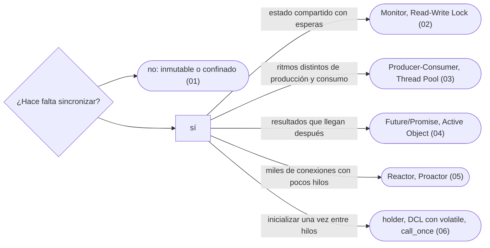

# 10 — Concurrencia

> Los patrones de concurrencia de *POSA2* y de *Java Concurrency in Practice* que siguen vivos, en C++ y en Java, con los *virtual threads* de Java 21 y lo que cambian.
>
> **Vigencia:** 2026-10-03.

---

## 1. 🗺️ Índice

| | Documento | Tipo |
|---|---|---|
| [`01`](01-inmutabilidad-y-confinamiento.md) | Inmutabilidad y confinamiento | Capítulo |
| [`02`](02-esperar-y-coordinar.md) | Esperar y coordinar | Capítulo |
| [`03`](03-producer-consumer-y-thread-pool.md) | Producer-Consumer y Thread Pool | Capítulo |
| [`04`](04-future-y-active-object.md) | Future/Promise y Active Object | Capítulo |
| [`05`](05-reactor-y-proactor.md) | Reactor y Proactor | Capítulo |
| [`06`](06-inicializacion-perezosa-segura.md) | Inicialización perezosa segura | Capítulo |
| [`07`](07-simulacion-de-entrevista.md) | Simulación de entrevista | Simulación |
| [`08`](08-respuestas.md) | Respuestas | Solucionario |

**Orden de lectura.** En orden numérico. Empieza siempre por `01`: la mejor sincronización es la que no hace falta. `06` es el dueño del DCL. Al terminar los capítulos, la simulación con cronómetro, y solo después el solucionario.

---

## 2. 🧠 Mapa mental

---

## 3. 🏷️ Niveles de los patrones

A: se escribe y se defiende en la entrevista · B: se reconoce y se explica · C: ficha corta, con lo que lo reemplazó.

| Capítulo | Patrones y nivel |
|---|---|
| [`01`](01-inmutabilidad-y-confinamiento.md) | Immutable Object A · Thread Confinement B · Thread-Specific Storage B |
| [`02`](02-esperar-y-coordinar.md) | Monitor B · Read-Write Lock B · Guarded Suspension C · Balking C |
| [`03`](03-producer-consumer-y-thread-pool.md) | Producer-Consumer A · Thread Pool A |
| [`04`](04-future-y-active-object.md) | Future/Promise A · Active Object B |
| [`05`](05-reactor-y-proactor.md) | Reactor B · Proactor B |
| [`06`](06-inicializacion-perezosa-segura.md) | Double-Checked Locking A · Holder idiom B · `std::call_once` y estáticas locales B. **Es el dueño del DCL**: [`04/05`](../04-creacionales/05-singleton.md) y [`04/07`](../04-creacionales/07-mas-alla-del-gof.md) lo nombran y remiten aquí |

---

## 4. 🚫 Qué NO está aquí

La teoría general de la concurrencia y el modelo de memoria completo: el bloque toma de ellos solo lo que cada patrón necesita.

---

**Versiones ejecutadas:** GCC 14.4 (C++23) · JDK 21.0.12, 17.0.20 y 25.0.4 · mermaid-cli 11.17.0 (2026-10-04).

---

**Anterior:** [`09` — DDD táctico y otros](../09-ddd-tactico-y-otros/README.md) ·
**Corpus:** [README](../README.md) ·
**Siguiente:** [`11` — Los diferentes](../11-los-diferentes/README.md)
