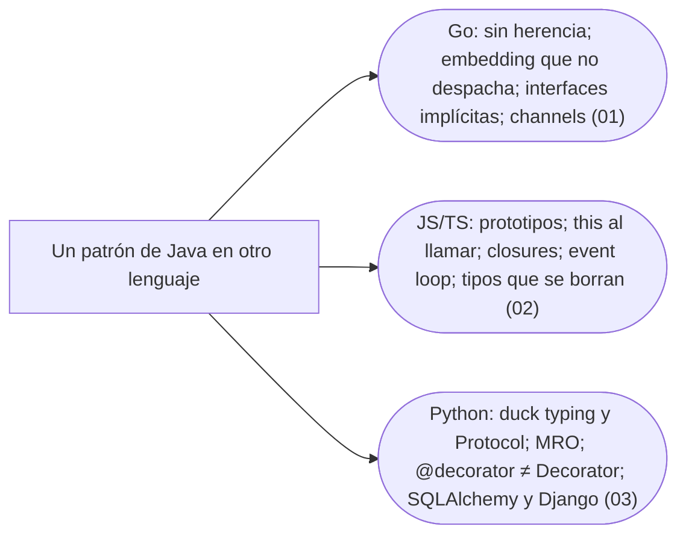

# 11 — Los diferentes

> Qué le pasa al modelo de objetos y a los patrones en Go, en JavaScript y TypeScript, y en Python: qué trae cada lenguaje, qué cambia de forma, qué desaparece, y las trampas de quien escribe Java en ellos.
>
> **Vigencia:** 2026-10-03.

---

## 1. 🗺️ Índice

| | Documento | Tipo |
|---|---|---|
| [`01`](01-go.md) | Go | Capítulo |
| [`02`](02-javascript-y-typescript.md) | JavaScript y TypeScript | Capítulo |
| [`03`](03-python.md) | Python | Capítulo |
| [`04`](04-simulacion-de-entrevista.md) | Simulación de entrevista | Simulación |
| [`05`](05-respuestas.md) | Respuestas | Solucionario |

**Orden de lectura.** En cualquier orden: los tres capítulos son independientes entre sí. Al terminar los capítulos, la simulación con cronómetro, y solo después el solucionario.

---

## 2. 🧠 Mapa mental

---

## 3. 🚫 Qué NO está aquí

Los patrones de poco uso en cada lenguaje, que no aparecen; C# va como inserto dentro de cada patrón, no como capítulo.

---

**Versiones ejecutadas:** Go 1.27.1 · Node.js 24.21.0 · TypeScript 7.0.2 · Python 3.14.8 (SQLAlchemy 2.1.3, Django 6.1.1) (2026-10-04).

---

**Anterior:** [`10` — Concurrencia](../10-concurrencia/README.md) ·
**Corpus:** [README](../README.md) ·
**Siguiente:** [`12` — Antipatrones](../12-antipatrones/README.md)
