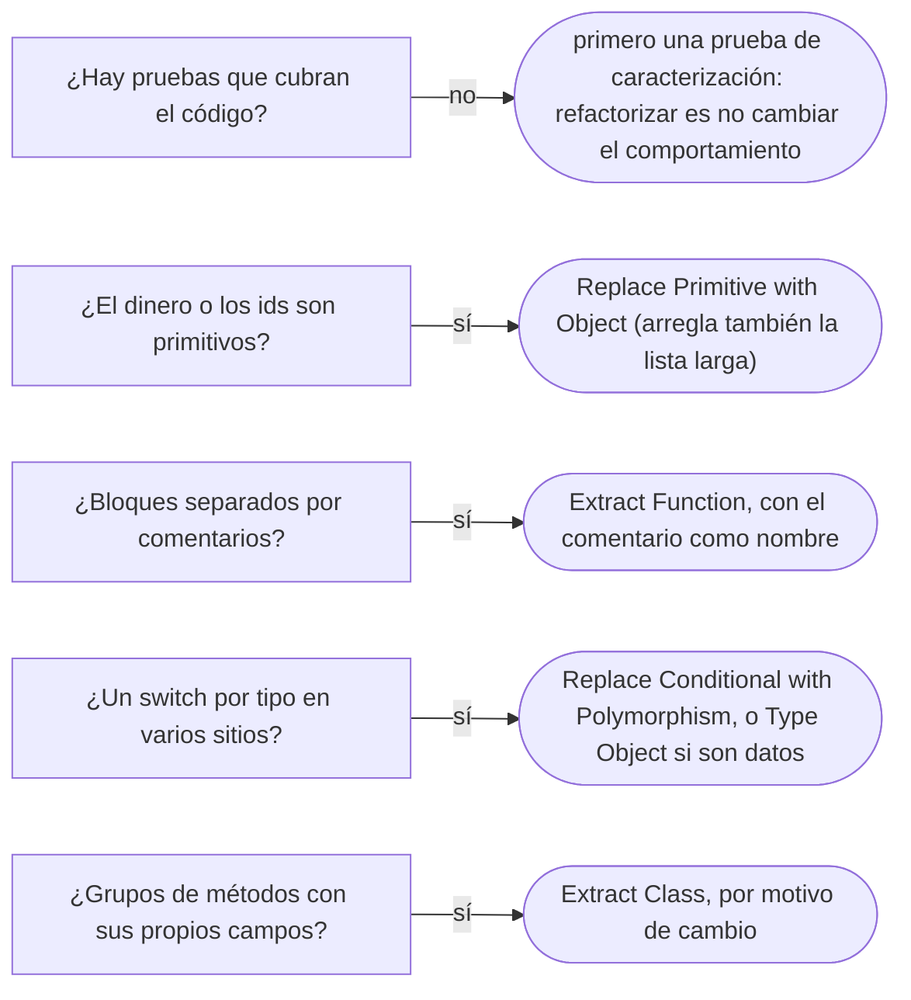

# 01 — Code smells dentro de una clase

> Nombrar los *code smells* (señales de que algo huele mal en el código) que se ven **dentro de una clase** y la
> refactorización que los quita, con el nombre del catálogo de *Refactoring*. Es el capítulo más ligero del bloque: cada
> *smell* lleva síntoma, por qué importa y la refactorización, no la plantilla completa de antipatrón. **Lenguaje:** Java
> (§5.2 de la guía). Los nombres son los de *Refactoring*, 2.ª ed.; cuando la 1.ª usaba otro, se da entre paréntesis.
> **Este bloque es el dueño de los nombres de *smells* y antipatrones** del corpus. Asume leído
> [`02/06` — Entidades, valores y primitivos](../02-modelado-oo/06-entidades-valores-y-primitivos.md).
>
> **Vigencia:** 2026-10-03.
>
> **Versiones ejecutadas:** JDK 21.0.12, 17.0.20 y 25.0.4 (2026-10-04).

---

## 1. 🎯 El problema

Este método pasó la revisión hace dos años. Hoy nadie quiere tocarlo:

```java
// procesa la transferencia
public String procesar(String origen, String destino, double monto, String moneda,
                       String tipoCuenta, boolean urgente, String emailAviso) {
    // validar
    if (monto <= 0) return "ERROR: monto";
    Cuenta o = repo.buscar(origen);
    Cuenta d = repo.buscar(destino);
    if (!o.getMoneda().equals(moneda) || !d.getMoneda().equals(moneda)) return "ERROR: moneda";
    // calcular comisión
    double comision;
    switch (tipoCuenta) {
        case "AHORROS" -> comision = monto * 0.005;
        case "CORRIENTE" -> comision = monto * 0.008;
        default -> comision = 0;
    }
    if (urgente) comision += 2000;                       // cargo por urgencia
    // mover el dinero
    o.setSaldo(o.getSaldo() - monto - comision);
    d.setSaldo(d.getSaldo() + monto);
    repo.guardar(o); repo.guardar(d);
    // avisar
    if (emailAviso != null) correo.enviar(emailAviso, "Transferencia de " + monto + " " + moneda);
    return "OK";
}
```

- Funciona, y cada cambio cuesta más que el anterior: la comisión empresarial añade un caso al `switch` (y al de los otros
  tres sitios que calculan comisiones), y nadie sabe si `"CORRIENTE"` se escribe igual en todos.
- No hay un error, hay **señales**: un método que hace cuatro cosas separadas por comentarios, siete parámetros, el dinero
  en `double`, un `switch` por tipo, y un resultado que es un `String` con un prefijo. Fowler define el *code smell* como un
  indicio superficial que suele corresponder a un problema más profundo; el término es de Kent Beck. Cada señal tiene nombre
  y una refactorización que la quita.

---

## 2. 🏚️ Long Function (Long Method en la 1.ª ed.)

**Síntoma.** Un método que hay que leer entero para saber qué hace, con bloques separados por comentarios (`// validar`,
`// calcular comisión`) o por líneas en blanco.

**Por qué importa.** Lo que cuesta no es el número de líneas: es la distancia entre **qué** hace el método y **cómo** lo
hace. Cada bloque comentado es una función sin nombre, que no se puede probar ni reutilizar por separado.

**Refactorización.** *Extract Function*: cada bloque pasa a una función cuyo nombre dice lo que el comentario decía.

```java
public ResultadoTransferencia procesar(SolicitudTransferencia s) {
    validar(s);
    Dinero comision = comisiones.para(s);
    moverFondos(s, comision);
    avisar(s);
    return ResultadoTransferencia.ok();
}
```

- Un método largo **pero lineal**, sin anidamiento, con un solo nivel de abstracción —un mapeo de cuarenta campos de un DTO,
  una tabla de configuración— no es un problema: partirlo solo reparte la lectura en diez saltos. "Un método largo siempre es
  malo" es falso; un método que mezcla niveles de abstracción sí lo es, aunque tenga quince líneas.

---

## 3. 🏚️ Large Class

**Síntoma.** Una clase con muchos campos, muchos métodos y grupos de métodos que solo usan una parte de los campos:
`ServicioCuentas` con transferencias, comisiones, extractos, avisos y bloqueos.

**Por qué importa.** Cambia por muchos motivos y la cambian muchas personas: es la puerta del God Object de
[`03` — Antipatrones de diseño OO](03-antipatrones-de-diseno-oo.md).

**Refactorización.** *Extract Class*: cada grupo de campos y métodos que van juntos pasa a su clase (`CalculadoraComisiones`,
`GeneradorExtractos`). El criterio para agrupar es el motivo de cambio, el SRP de
[`03/02`](../03-principios-de-diseno/02-solid-sin-catecismo.md).

---

## 4. 🏚️ Long Parameter List

**Síntoma.** Siete parámetros, varios del mismo tipo, y llamadas como `procesar("CTA-0001", "CTA-0003", 250000, "COP",
"AHORROS", false, null)`, donde intercambiar dos `String` compila.

**Por qué importa.** Cada llamada es un acertijo, y añadir un parámetro rompe a todos los llamadores.

**Refactorización.** *Introduce Parameter Object* cuando varios parámetros viajan juntos (`SolicitudTransferencia`); *Preserve
Whole Object* cuando se pasan campos sueltos de un objeto que ya existe (pasar la `Cuenta` y no su moneda y su tipo); y
*Remove Flag Argument* para el `boolean urgente`, que esconde dos operaciones en una.

```java
public record SolicitudTransferencia(CuentaId origen, CuentaId destino, Dinero monto, Prioridad prioridad) { }
```

- `CuentaId` y `Dinero` ya no se confunden con un `String` ni con un `double`: la lista larga y la obsesión por los
  primitivos se curan juntas.

---

## 5. 🏚️ Primitive Obsession

**Síntoma.** Conceptos del dominio como primitivos: el dinero en `double`, la moneda y el tipo de cuenta en `String`, el
número de cuenta en `String`.

**Por qué importa.** El `double` pierde centavos ([`02/06` §5](../02-modelado-oo/06-entidades-valores-y-primitivos.md#5--dinero-por-qué-no-double)),
`"Ahorros"` y `"AHORROS"` son tipos distintos para el compilador e iguales para el negocio, y cada regla del concepto se
repite en cada sitio que lo usa.

**Refactorización.** *Replace Primitive with Object*: `Dinero`, `CuentaId`, `TipoCuenta` como `enum`. Es el objeto de valor de
`02/06`, y su patrón es el Value Object de [`08/05`](../08-fowler-presentacion-distribucion-y-base/05-patrones-base.md#2--value-object).

---

## 6. 🏚️ Data Clumps

**Síntoma.** Los mismos datos aparecen juntos en varios sitios: `monto` y `moneda` en parámetros, en campos y en columnas;
`desde` y `hasta` en cada consulta de extracto.

**Por qué importa.** Si siempre van juntos, son un concepto sin nombre, y sus reglas (la moneda del monto, el `desde` antes
del `hasta`) se comprueban en cada sitio, o en ninguno.

**Refactorización.** *Extract Class* o *Introduce Parameter Object*: `Dinero(monto, moneda)`, `RangoFechas(desde, hasta)`. La
prueba de Fowler para reconocerlos: si se borra uno de los datos, ¿los demás siguen teniendo sentido? Si no, son un grupo.

---

## 7. 🏚️ Repeated Switches (Switch Statements en la 1.ª ed.)

**Síntoma.** El mismo `switch` sobre el tipo de cuenta aparece en el cálculo de comisiones, en el extracto, en los límites y
en los avisos.

**Por qué importa.** Un tipo nuevo obliga a encontrar y cambiar todos los `switch`; el que se olvida es un error de negocio.
La 2.ª ed. cambió el nombre a propósito: el problema es el `switch` **repetido**, no el `switch`.

**Refactorización.** *Replace Conditional with Polymorphism*: el comportamiento por tipo se mueve al tipo. En Java, un `enum`
con comportamiento o una Strategy ([`06/01`](../06-comportamiento/01-strategy.md)); con datos que cambian, un Type Object
([`09/03`](../09-ddd-tactico-y-otros/03-specification-null-object-y-type-object.md#4--type-object)). Un único `switch`
exhaustivo sobre una interfaz sellada, en un solo sitio, **no** es este *smell*.

> 📝 **En Java 17:** sin el `switch` de patrones (Java 21), el `switch` sobre un `enum` sigue siendo exhaustivo en las
> expresiones `switch` con flecha, que existen desde Java 14; lo que no hay es la comprobación sobre interfaces selladas.

---

## 8. 🏚️ Temporary Field

**Síntoma.** Un campo que solo tiene valor durante una operación y vale `null` el resto del tiempo: `private Dinero
comisionCalculada;` que `procesar` llena y `avisar` lee.

**Por qué importa.** Quien lee la clase supone que el campo siempre tiene sentido; y si dos hilos usan el mismo objeto, se
pisan el valor.

**Refactorización.** *Extract Class* para el cálculo que lo necesita, o pasar el valor como parámetro o variable local. Si el
campo existe por un caso especial, *Introduce Special Case* ([`09/03`](../09-ddd-tactico-y-otros/03-specification-null-object-y-type-object.md#3--null-object)).

---

## 9. 🏚️ Comments

**Síntoma.** Comentarios que explican **qué** hace el código: `// validar`, `// calcular comisión`, `// cargo por urgencia`
junto a un `2000` suelto.

**Por qué importa.** Fowler los llama desodorante: suelen estar ahí porque el código no se explica solo. Y envejecen: el
comentario dice "0,5 %" y el código ya cobra 0,6.

**Refactorización.** *Extract Function* con el nombre del comentario; *Extract Variable* para una expresión que necesita
explicación; una constante con nombre (`CARGO_URGENCIA`) para el número. "Los comentarios son documentación" es la
simplificación: el comentario que dice **por qué** —la regla del negocio, la decisión rara, el error del proveedor que se
rodea— es documentación y se queda; el que dice **qué**, se convierte en nombre.

---

## 10. 🏚️ Mysterious Name

**Síntoma.** `procesar`, `datos`, `o`, `d`, `flag`, `manejarCosas`, `Util`.

**Por qué importa.** Fowler lo pone primero en la lista de la 2.ª ed.: nombrar es lo más difícil, y un mal nombre obliga a
leer la implementación cada vez. Cuando no se encuentra un buen nombre, suele ser porque la cosa hace demasiado.

**Refactorización.** *Change Function Declaration*, *Rename Variable*, *Rename Field*. Si el nombre honesto es largo
(`validarYCobrarYAvisar`), el problema es otro: Long Function.

---

## 11. 🧭 Por dónde empezar



**La frase en voz alta:** *"No digo que el método sea largo: digo que mezcla validación, cálculo, persistencia y aviso, que
usa `double` para el dinero y que repite el `switch` de comisiones en cuatro sitios. Empiezo por `Dinero` y por extraer las
cuatro funciones, con una prueba de caracterización delante."*

---

## ⚠️ Errores frecuentes

| Se dice | Lo preciso |
|---|---|
| "Un método largo siempre es malo" | Lo malo es mezclar niveles de abstracción; un método largo y lineal puede leerse mejor que diez saltos |
| "Los comentarios son documentación" | Los que explican **por qué** lo son; los que explican **qué**, piden un nombre |
| "Todo `switch` es un *smell*" | El *smell* es el `switch` **repetido** por tipo; uno exhaustivo en un solo sitio está bien |
| "Un *code smell* es un error" | Es un indicio de un problema más profundo; a veces no lo hay |
| "Refactorizar es reescribir mejor" | Es cambiar la estructura sin cambiar el comportamiento, en pasos pequeños y con pruebas |
| "El dinero en `double` es un detalle" | Es Primitive Obsession con un error de redondeo dentro |
| "Un objeto de parámetros es un DTO más" | Es un concepto que viaja junto, y suele ganar reglas y volverse un objeto de valor |

---

## 📚 Para profundizar

- **Libro** — Fowler, *Refactoring*, 2.ª ed. (Addison-Wesley, 2018), cap. 3, "Bad Smells in Code", y caps. 6–7 para
  *Extract Function*, *Introduce Parameter Object*, *Extract Class* y *Replace Primitive with Object*. **El que destaca.**
- **Libro** — Ousterhout, *A Philosophy of Software Design*, 2.ª ed. (Yaknyam Press, 2021), cap. 12, "Why Write Comments?
  The Four Excuses", y cap. 13, sobre los comentarios que describen lo que no es obvio.
- [martinfowler.com — *CodeSmell*](https://martinfowler.com/bliki/CodeSmell.html): la definición y su origen.
- [refactoring.com — catálogo](https://refactoring.com/catalog/): las refactorizaciones de la 2.ª ed., con su nombre.
- [refactoring.com — *Replace Conditional with Polymorphism*](https://refactoring.com/catalog/replaceConditionalWithPolymorphism.html)
- **Tutorial** — Refactoring Guru, [catálogo de *code smells*](https://refactoring.guru/refactoring/smells): con ejemplos en
  varios lenguajes, y con algunos nombres de la 1.ª ed.

---

## 🧠 Preguntas

Sin respuestas aquí. Todas, con enunciado literal y respuesta en tres capas, en
[`07` — Respuestas](07-respuestas.md#01--code-smells-dentro-de-una-clase).

1. ¿Qué es un *code smell*? 🟢
2. ¿Qué es Primitive Obsession? 🟢
3. ¿Qué es Data Clumps, y cómo se reconoce? 🟢
4. ¿Qué es Temporary Field? 🟢
5. ¿Qué refactorización quita una Long Function? 🟢
6. ¿Qué diferencia hay entre Repeated Switches y un `switch` exhaustivo sobre una interfaz sellada? 🟡
7. ¿Qué diferencia hay entre *Introduce Parameter Object* y *Preserve Whole Object*? 🟡
8. ¿Qué diferencia hay entre un comentario que es desodorante y uno que es documentación? 🟡
9. ¿Qué diferencia hay entre Large Class y God Object? 🟡
10. ¿Por qué "un método largo siempre es malo" es falso? 🟠
11. ¿Por qué la 2.ª ed. de *Refactoring* cambió *Switch Statements* por *Repeated Switches*? 🟠
12. ¿Por qué no se refactoriza sin pruebas, y qué haces si no las hay? 🟠
13. ¿Por qué Java 17 y Java 21 cambian la respuesta a un `switch` por tipo? 🟠
14. Refactoriza la firma `procesar(String, String, double, String, String, boolean, String)` y di qué *smells* quitas. 🔴
15. Revisa este método y nombra todos los *smells* que ves, en orden de prioridad: el `procesar` del §1. 🔴
16. Extrae las cuatro funciones del `procesar` del §1 y escribe el método que queda. 🔴

---

**Anterior:** [`11/04` — Simulación de entrevista](../11-los-diferentes/04-simulacion-de-entrevista.md) ·
**Siguiente:** [`02` — Code smells entre clases](02-code-smells-entre-clases.md) ·
**Relacionado:** [`02/06` — Entidades, valores y primitivos](../02-modelado-oo/06-entidades-valores-y-primitivos.md)
