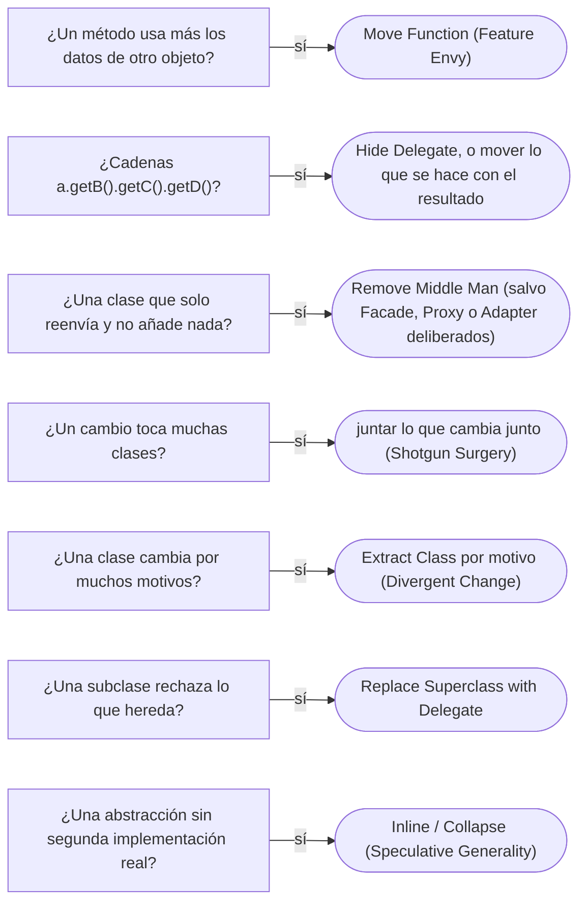

# 02 — Code smells entre clases

> Nombrar los *code smells* de **relación**: los que no están en una clase sino entre varias —quién usa los datos de quién,
> quién sabe demasiado de quién, qué cambio obliga a tocar diez archivos— y la refactorización que los quita. Mismo formato
> ligero que [`01`](01-code-smells-dentro-de-una-clase.md): síntoma, por qué importa, refactorización. **Lenguaje:** Java.
> Nombres de *Refactoring*, 2.ª ed., con el de la 1.ª entre paréntesis cuando cambió. Asume leído
> [`03/01` — Encapsulación de verdad](../03-principios-de-diseno/01-encapsulacion-de-verdad.md) y
> [`03/02` — SOLID sin catecismo](../03-principios-de-diseno/02-solid-sin-catecismo.md).
>
> **Vigencia:** 2026-10-03.
>
> **Versiones ejecutadas:** JDK 21.0.12, 17.0.20 y 25.0.4 (2026-10-04).

---

## 1. 🎯 El problema

El extracto mensual de una cuenta se arma así:

```java
public class GeneradorExtracto {
    public String encabezado(Cuenta c) {
        String ciudad = c.getTitular().getDireccionPrincipal().getCiudad().getNombre();   // cuatro saltos
        BigDecimal interes = c.getSaldo().multiply(c.getTasa())
                .divide(BigDecimal.valueOf(12), 2, RoundingMode.HALF_EVEN);              // un cálculo de la cuenta
        return c.getTitular().getNombre() + " · " + ciudad + " · interés: " + interes;
    }
}
```

- El generador navega cuatro objetos para llegar a una ciudad: si mañana la dirección principal cambia de forma, el extracto
  se rompe, y con él cada clase que hace el mismo recorrido.
- Calcula el interés mensual con los datos de la cuenta, fuera de la cuenta: cuando la regla cambie, nadie buscará en el
  generador de extractos.
- Ninguna de las clases es mala por sí sola. El problema está en **cómo se usan entre ellas**, y eso es lo que nombra este
  capítulo.

---

## 2. 🏚️ Feature Envy

**Síntoma.** Un método que usa más los datos de otra clase que los de la suya: el cálculo del interés en `GeneradorExtracto`,
hecho con `getSaldo()` y `getTasa()` de la cuenta.

**Por qué importa.** La regla vive lejos de sus datos: se duplica en cada sitio que la necesita, y cambia sin que la clase
dueña se entere. Es lo contrario del Information Expert de [`03/03`](../03-principios-de-diseno/03-grasp.md).

**Refactorización.** *Move Function*: el método va a la clase de los datos que envidia.

```java
public Dinero interesMensual() {                       // en Cuenta, donde están el saldo y la tasa
    return saldo.por(tasa).dividido(12);
}
```

- Si el método usa datos de varias clases, va a la que tiene la mayoría, o se parte con *Extract Function* y cada parte se
  mueve a su sitio. Las excepciones son deliberadas: un Visitor o una Strategy envidian a propósito, para separar una
  operación de los datos.

---

## 3. 🏚️ Message Chains

**Síntoma.** `c.getTitular().getDireccionPrincipal().getCiudad().getNombre()`: una cadena de llamadas que recorre la
estructura de varios objetos.

**Por qué importa.** El que llama depende de toda la cadena: cualquier cambio en la forma de cualquier eslabón lo rompe. Es lo
que la ley de Demeter desaconseja —hablar solo con los vecinos inmediatos—, y el acoplamiento que crea es el de
[`03/04`](../03-principios-de-diseno/04-acoplamiento-cohesion-y-dependencias.md).

**Refactorización.** *Hide Delegate*: el primer objeto ofrece lo que se pide (`c.ciudadDelTitular()`), y la navegación queda
dentro. Mejor aún, preguntarse qué hace el llamador con el resultado y mover **eso** (*Extract Function* y *Move Function*).

- Una cadena sobre **valores inmutables** o una API fluida (`stream().filter().map()`) no es este *smell*: no recorre la
  estructura interna de nadie.

---

## 4. 🏚️ Middle Man

**Síntoma.** Una clase cuyos métodos solo delegan en otra, sin añadir nada: `ServicioCuentas.saldo(id)` que es
`repositorio.porId(id).saldo()`, y así veinte métodos.

**Por qué importa.** Es una capa que hay que atravesar para depurar y que hay que mantener en paralelo a la clase real.

**Refactorización.** *Remove Middle Man*: el cliente llama directamente al delegado; o *Inline Function* para los pocos métodos
que sobran. Es la refactorización opuesta a *Hide Delegate*: entre Message Chains y Middle Man hay un punto de equilibrio, y
cada refactorización empuja hacia uno de los dos lados.

- "Middle Man es siempre malo" es falso. Un Facade ([`05/04`](../05-estructurales/04-facade.md)) que delega es deliberado si
  esconde un subsistema; un Proxy ([`05/03`](../05-estructurales/03-proxy.md)) delega y añade control de acceso; un Adapter
  delega y traduce. El *smell* es el intermediario que **no añade nada**.

---

## 5. 🏚️ Insider Trading (Inappropriate Intimacy en la 1.ª ed.)

**Síntoma.** Dos clases que se conocen las tripas: `Cuenta` lee la lista interna de movimientos de `Extracto`, y `Extracto`
modifica el saldo de `Cuenta`.

**Por qué importa.** No se puede cambiar una sin la otra, y las reglas de cada una se rompen desde fuera. Es la encapsulación
rota de [`03/01`](../03-principios-de-diseno/01-encapsulacion-de-verdad.md).

**Refactorización.** *Move Function* y *Move Field* para que cada dato viva con quien lo usa; *Hide Delegate* para reducir lo
que una sabe de la otra; y, si las dos comparten mucho, *Extract Class* con lo común.

---

## 6. 🏚️ Divergent Change y Shotgun Surgery

Son el mismo problema visto desde los dos lados, y por eso van juntos:

| *Smell* | Síntoma | Refactorización |
|---|---|---|
| **Divergent Change** | **Una** clase cambia por **muchos** motivos: `ServicioCuentas` se toca por comisiones, por extractos, por avisos y por bloqueos | *Extract Class* por motivo de cambio; *Split Phase* si son etapas |
| **Shotgun Surgery** | **Un** motivo de cambio toca **muchas** clases: añadir `EMPRESARIAL` obliga a tocar comisiones, límites, extractos y avisos | *Move Function* y *Move Field* para juntar lo que cambia junto; *Combine Functions into Class* |

**Por qué importan.** El primero es el SRP de [`03/02`](../03-principios-de-diseno/02-solid-sin-catecismo.md) violado: un
actor pide un cambio y otro sufre el riesgo. El segundo es la regla de negocio repartida: el cambio que se olvida en un sitio
es el error. La salida de los dos es la misma idea: **lo que cambia junto, vive junto**.

---

## 7. 🏚️ Refused Bequest

**Síntoma.** Una subclase que hereda métodos que no quiere, y los ignora, los deja sin hacer nada o lanza
`UnsupportedOperationException`.

**Por qué importa.** La subclase no es lo que la base promete, y se rompe el principio de sustitución de Liskov
([`01/06`](../01-modelo-de-objetos/06-herencia-vertical-y-horizontal.md)). El JDK tiene los ejemplos clásicos: `Stack` hereda de
`Vector`, y su propia Javadoc recomienda usar `Deque` en su lugar; `Properties` hereda de `Hashtable`, y su Javadoc desaconseja
con fuerza `put` y `putAll`, porque permiten guardar claves que no son `String`.

**Refactorización.** *Replace Subclass with Delegate* o *Replace Superclass with Delegate*: la herencia se vuelve composición.
Si solo sobran unos métodos, *Push Down Method* para que la base deje de prometerlos.

---

## 8. 🏚️ Parallel Inheritance Hierarchies (solo en la 1.ª ed.)

**Síntoma.** Cada vez que se crea una subclase en una jerarquía, hay que crear otra en una segunda: `CuentaAhorros` exige
`ExtractoAhorros` y `ComisionAhorros`.

**Por qué importa.** Es un caso de Shotgun Surgery con forma de jerarquía. La 2.ª ed. de *Refactoring* ya no lo lista aparte,
y se reconoce como Shotgun Surgery.

**Refactorización.** *Move Function* para que una jerarquía absorba a la otra, o reemplazar una de las dos por un Type Object
([`09/03`](../09-ddd-tactico-y-otros/03-specification-null-object-y-type-object.md#4--type-object)) o una Strategy elegida por el
tipo.

---

## 9. 🏚️ Lazy Element, Data Class y Speculative Generality

Tres *smells* de clases que sobran o que están vacías:

| *Smell* | Síntoma | Refactorización |
|---|---|---|
| **Lazy Element** (Lazy Class en la 1.ª ed.) | Una clase o función que no hace lo suficiente para justificar su existencia: un `ValidadorMontoPositivo` con una línea | *Inline Function*, *Inline Class*, *Collapse Hierarchy* |
| **Data Class** | Una clase con campos, *getters* y *setters*, y sin comportamiento; las reglas que deberían estar en ella están en otras | *Encapsulate Record*, *Remove Setting Method*, *Move Function* hacia ella |
| **Speculative Generality** | Abstracciones para un futuro que no llega: una interfaz con una sola implementación "por si acaso", un parámetro que nadie usa, una fábrica de una clase | *Collapse Hierarchy*, *Inline Function*, *Inline Class*, *Change Function Declaration* |

- **Data Class** es el *smell* de clase; su versión de sistema es el **modelo anémico**, el antipatrón de
  [`03` §3](03-antipatrones-de-diseno-oo.md#3-️-anemic-domain-model). Un DTO o un `record` de transporte son clases de datos
  **a propósito**: no es el *smell*.
- **Speculative Generality** es el Factory Method o el Abstract Factory puestos para una variación que no existe
  ([`04/01`](../04-creacionales/01-factory-method.md), [`04/02`](../04-creacionales/02-abstract-factory.md)). Una interfaz
  con una implementación se justifica si hay una segunda real —el doble de pruebas cuenta— o una frontera que proteger.

---

## 10. 🧭 Por dónde empezar



**La frase en voz alta:** *"El extracto envidia a la cuenta: calcula el interés con sus datos, así que el cálculo va a
`Cuenta`. Y la cadena de cuatro `get` hasta la ciudad la escondo detrás de la cuenta, o mejor muevo lo que se hace con ella.
No quito el `ServicioCuentas` que delega si es la fachada del módulo: un intermediario deliberado no es un *smell*."*

---

## ⚠️ Errores frecuentes

| Se dice | Lo preciso |
|---|---|
| "Middle Man es siempre malo" | Un Facade, un Proxy o un Adapter delegan a propósito; el *smell* es el que no añade nada |
| "Toda cadena de llamadas es Message Chains" | Una API fluida o una cadena sobre valores inmutables no recorre la estructura de nadie |
| "Toda clase sin comportamiento es Data Class" | Un DTO o un `record` de transporte son datos a propósito |
| "Divergent Change y Shotgun Surgery son lo mismo" | Son opuestos: una clase con muchos motivos, o un motivo en muchas clases |
| "Una interfaz con una implementación es Speculative Generality" | No si hay una segunda real, como el doble de pruebas, o una frontera que proteger |
| "Heredar de `Vector` para tener una pila es reutilizar" | Es Refused Bequest: la pila hereda operaciones que rompen su contrato |
| "Feature Envy se arregla siempre moviendo el método" | Visitor y Strategy envidian a propósito, para separar la operación de los datos |

---

## 📚 Para profundizar

- **Libro** — Fowler, *Refactoring*, 2.ª ed. (Addison-Wesley, 2018), cap. 3, "Bad Smells in Code"; cap. 7, "Encapsulation"
  (*Hide Delegate*, *Remove Middle Man*); cap. 8, "Moving Features"; y cap. 12, "Dealing with Inheritance" (*Replace
  Superclass with Delegate*). **El que destaca.**
- **Libro** — Fowler, *Refactoring* (Addison-Wesley, 1999), cap. 3: los nombres de la 1.ª ed. (Inappropriate Intimacy,
  Parallel Inheritance Hierarchies), que se siguen oyendo.
- [refactoring.com — *Hide Delegate*](https://refactoring.com/catalog/hideDelegate.html) y
  [*Remove Middle Man*](https://refactoring.com/catalog/removeMiddleMan.html): las dos direcciones del mismo equilibrio.
- [refactoring.com — *Replace Superclass with Delegate*](https://refactoring.com/catalog/replaceSuperclassWithDelegate.html)
- [Java 21 API — `Stack`](https://docs.oracle.com/en/java/javase/21/docs/api/java.base/java/util/Stack.html): la propia
  Javadoc recomienda `Deque`.
- [martinfowler.com — *TellDontAsk*](https://martinfowler.com/bliki/TellDontAsk.html): pedir que el objeto haga, en lugar de
  sacarle los datos.
- **Tutorial** — Refactoring Guru, [*Inappropriate Intimacy*](https://refactoring.guru/smells/inappropriate-intimacy) y
  [*Parallel Inheritance Hierarchies*](https://refactoring.guru/smells/parallel-inheritance-hierarchies), con los nombres de la
  1.ª ed.

---

## 🧠 Preguntas

Sin respuestas aquí. Todas, con enunciado literal y respuesta en tres capas, en
[`07` — Respuestas](07-respuestas.md#02--code-smells-entre-clases).

1. ¿Qué es Feature Envy? 🟢
2. ¿Qué es Message Chains? 🟢
3. ¿Qué es Refused Bequest? 🟢
4. ¿Qué es Speculative Generality? 🟢
5. ¿Qué diferencia hay entre Divergent Change y Shotgun Surgery? 🟡
6. ¿Qué diferencia hay entre *Hide Delegate* y *Remove Middle Man*? 🟡
7. ¿Qué diferencia hay entre un Middle Man y un Facade? 🟡
8. ¿Qué diferencia hay entre Data Class y un DTO? 🟡
9. ¿Qué diferencia hay entre los nombres de los *smells* de la 1.ª y la 2.ª ed. de *Refactoring*? 🟡
10. ¿Por qué "Middle Man es siempre malo" es falso? 🟠
11. ¿Por qué `Stack extends Vector` es un ejemplo de Refused Bequest? 🟠
12. ¿Cuándo una interfaz con una sola implementación no es Speculative Generality? 🟠
13. ¿Por qué Feature Envy a veces es deliberado? 🟠
14. Refactoriza el `encabezado` del §1 y di qué *smells* quitas. 🔴
15. Revisa este cambio y di qué *smell* revela: añadir el tipo de cuenta `EMPRESARIAL` obligó a tocar siete clases. 🔴
16. Revisa este código y di qué falla: `class ListaDocumentos extends ArrayList<Documento>` con `add` sobrescrito para
    lanzar si el documento está vencido. 🔴

---

**Anterior:** [`01` — Code smells dentro de una clase](01-code-smells-dentro-de-una-clase.md) ·
**Siguiente:** [`03` — Antipatrones de diseño OO](03-antipatrones-de-diseno-oo.md) ·
**Relacionado:** [`03/04` — Acoplamiento, cohesión y dependencias](../03-principios-de-diseno/04-acoplamiento-cohesion-y-dependencias.md)
