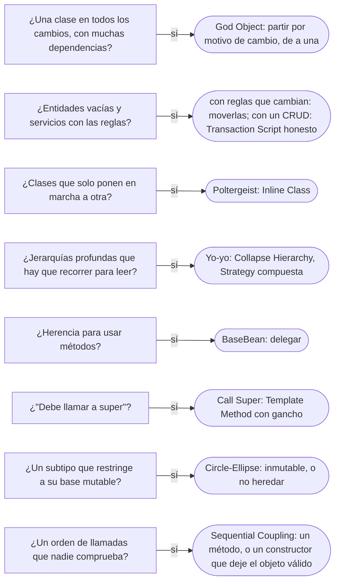

# 03 — Antipatrones de diseño OO

> Reconocer los antipatrones del diseño de objetos en una revisión de código y **planificar la salida**, en pasos pequeños.
> El God Object va con su salida completa; los demás, con su síntoma, su costo y el primer paso. Cada antipatrón sigue la
> plantilla de §6.5 de la guía: síntoma, por qué aparece, qué cuesta, cómo se detecta, salida y veredicto. **Lenguaje:**
> Java. **Ruta corta**: se lee solo. Lo que asume, en una línea: un *code smell* es un indicio y un antipatrón es una
> solución que parecía buena y cuesta más de lo que resolvió; el criterio para partir una clase es el **motivo de cambio**
> (quién pide que cambie); y la sustitución de Liskov exige que una subclase cumpla todo lo que su base promete. Más en
> [`01`](01-code-smells-dentro-de-una-clase.md), [`02`](02-code-smells-entre-clases.md),
> [`03/02`](../03-principios-de-diseno/02-solid-sin-catecismo.md) y
> [`01/06`](../01-modelo-de-objetos/06-herencia-vertical-y-horizontal.md).
>
> **Vigencia:** 2026-10-03.
>
> **Versiones ejecutadas:** JDK 21.0.12, 17.0.20 y 25.0.4 (2026-10-04).

**Salto rápido:** [1](#1--el-problema) · [2](#2-️-god-object) · [3](#3-️-anemic-domain-model) · [4](#4-️-poltergeist) · [5](#5-️-yo-yo-problem) · [6](#6-️-basebean) · [7](#7-️-call-super) · [8](#8-️-circle-ellipse) · [9](#9-️-constant-interface) · [10](#10-️-sequential-coupling) · [11](#11-️-object-orgy) · [12](#12--cómo-se-elige-la-salida)

---

## 1. 🎯 El problema

`ServicioCuentas` tiene 3 400 líneas, 41 dependencias inyectadas y 120 métodos públicos. Abre cuentas, transfiere, calcula
comisiones, genera extractos, bloquea por cumplimiento, envía avisos y exporta a contabilidad. Todo el equipo lo toca cada
semana, y cada *pull request* tiene conflictos en él.

```java
// no compila: esquema de la clase, sin parámetros ni cuerpos
@Service
public class ServicioCuentas {
    // 41 dependencias: repositorios, correo, SMS, contabilidad, riesgo, plantillas, reloj, ...
    public void abrir(...)               { /* 80 líneas */ }
    public void transferir(...)          { /* 140 líneas, con el cálculo de comisión dentro */ }
    public BigDecimal comision(...)      { /* 60 líneas, un switch por tipo de cuenta */ }
    public byte[] extractoPdf(...)       { /* 200 líneas */ }
    public void bloquearPorRiesgo(...)   { /* 90 líneas */ }
    // ... 115 métodos más
}
```

Nadie lo diseñó así. Empezó con tres métodos, y cada requisito nuevo encontró en él el sitio más cómodo. Es el antipatrón
más común del diseño orientado a objetos, y el que mejor ilustra la definición: **una solución que parecía correcta cuando se
tomó y que con el tiempo cuesta más de lo que resolvió**.

---

## 2. 🏚️ God Object

**Síntoma.** Una clase que sabe y hace demasiado: muchas dependencias, muchos métodos que no se usan entre sí, y presencia en
casi todos los cambios. El libro *AntiPatterns* lo llama *The Blob*: un objeto con la mayoría de las responsabilidades,
rodeado de objetos que solo guardan datos.

**Por qué aparece.** Por comodidad y por plazo: añadir un método a la clase que ya tiene todas las dependencias es más rápido
que diseñar dónde va. Y por miedo: partir una clase que funciona parece más arriesgado que hacerla crecer.

**Qué cuesta.**

```text
Acoplamiento   → 41 dependencias: probarla obliga a simular el sistema entero
Legibilidad    → nadie la conoce entera; cada cambio exige leer lo que no se toca
Equipo         → todos la tocan: conflictos de fusión en cada pull request
Riesgo         → un cambio en comisiones puede romper extractos, porque comparten estado y métodos privados
```

**Cómo se detecta.** En la revisión: la clase aparece en la mayoría de los *pull requests*, su constructor tiene más de diez
dependencias, y sus métodos se agrupan en islas que no se llaman entre sí. Con métricas: falta de cohesión (grupos de métodos
que usan grupos disjuntos de campos) y el historial de cambios (la clase con más *commits* y más autores).

**Salida.** Partir **por motivo de cambio**, en pasos que dejan el sistema funcionando en cada uno:

1. **Fijar el comportamiento.** Pruebas de caracterización sobre la fachada pública: lo que hace hoy, incluido lo raro.
2. **Mapear las responsabilidades por actor.** No por tamaño ni por orden alfabético: ¿quién pide cambios en cada grupo de
   métodos? Riesgo pide cambios en comisiones; cumplimiento, en bloqueos; operaciones, en extractos; comunicaciones, en avisos.
3. **Extraer una responsabilidad por vez**, la que más cambia primero, a su clase, y dejar en `ServicioCuentas` un método que
   delega. Los llamadores no cambian todavía.
4. **Mover las reglas a donde están los datos.** El cálculo de saldo y de bloqueo vuelve a `Cuenta` (Feature Envy, de
   [`02`](02-code-smells-entre-clases.md)); la comisión, a una estrategia por tipo.
5. **Migrar a los llamadores** a las clases nuevas, uno por uno, y borrar los métodos que delegan cuando no quede nadie.

```java
// no compila: esquema del resultado, sin cuerpos
// después: cada clase con un motivo de cambio y pocas dependencias
public class CalculadoraComisiones { public Dinero para(Cuenta c, Dinero monto) { ... } }      // riesgo
public class TransferirFondos      { public TransferenciaId ejecutar(SolicitudTransferencia s) { ... } }
public class GeneradorExtractos    { public Extracto mensual(CuentaId id, YearMonth mes) { ... } }   // operaciones
public class BloqueoPorRiesgo      { public void evaluar(CuentaId id) { ... } }                       // cumplimiento
// y en Cuenta: retirar, depositar, bloquear, con sus invariantes
```

- El paso 3 deja temporalmente a `ServicioCuentas` como una fachada que delega: un Facade ([`05/04`](../05-estructurales/04-facade.md))
  a propósito, que desaparece al final del paso 5.
- "Un God Object se arregla partiéndolo en clases del mismo tamaño" es la salida equivocada: partir por líneas o por orden
  alfabético produce cuatro clases que se llaman entre sí para todo, cuatro God Objects pequeños con el acoplamiento intacto.
  Lo que separa es el motivo de cambio, y las clases resultantes pueden tener tamaños muy distintos.

> **Veredicto:** el God Object se desarma por motivo de cambio, una responsabilidad por vez, con pruebas delante y la clase
> original como fachada temporal. Lo que no se hace es reescribirlo de una vez ni partirlo por tamaño.

---

## 3. 🏚️ Anemic Domain Model

**Síntoma.** Clases de dominio con nombre de negocio —`Cuenta`, `Persona`— que solo tienen campos, *getters* y *setters*, y
servicios que contienen todas las reglas: `servicio.retirar(cuenta, monto)` hace `cuenta.setSaldo(cuenta.getSaldo() - monto)`.
Fowler describe el síntoma así: a primera vista parece un modelo de dominio de verdad, con objetos que llevan los nombres del
negocio y sus relaciones.

**Por qué aparece.** Por los marcos que generan clases desde las tablas, por la costumbre de "las entidades son datos", y porque
al principio es más simple.

**Qué cuesta.** Lo que Fowler llama su horror fundamental: va contra la idea básica del diseño orientado a objetos, juntar datos y
comportamiento. Las reglas se duplican en cada servicio que toca la entidad, y nada impide que alguien haga `setSaldo(-500)`.

**Cómo se detecta.** Entidades sin un solo método que no sea *getter* o *setter*; servicios llenos de `get` de otras clases
(Feature Envy); *setters* públicos para todos los campos.

**Salida.** *Move Function* de cada regla al objeto cuyos datos usa, y *Remove Setting Method* para los campos que solo deben
cambiar por una operación:

```java
// antes: en el servicio
cuenta.setSaldo(cuenta.getSaldo().menos(monto));
// después: en Cuenta, con la regla
public void retirar(Dinero monto) {
    if (estado != EstadoCuenta.ABIERTA) throw new IllegalStateException("cuenta " + estado);
    Dinero nuevo = saldo.menos(monto);
    if (nuevo.esNegativo()) throw new IllegalStateException("saldo insuficiente");
    saldo = nuevo;
}
```

- "El modelo anémico es un antipatrón siempre" es falso. Para un CRUD con pocas reglas, entidades de datos con un Transaction
  Script ([`07/01`](../07-fowler-dominio-y-datos/01-logica-de-dominio.md)) es la elección honesta. El antipatrón es **creer que
  se tiene un modelo de dominio** y tener uno anémico: pagar el costo del mapeo de objetos sin recibir la ventaja.

> **Veredicto:** con reglas que se repiten y cambian, las reglas van a las entidades; con un CRUD, un Transaction Script sin
> fingir un modelo. Lo que no se hace es tener las dos cosas: clases de dominio vacías y reglas repartidas en servicios.

---

## 4. 🏚️ Poltergeist

**Síntoma.** Clases de vida corta y papel mínimo, que aparecen solo para poner en marcha a otra: `IniciadorTransferencia`, creado
para llamar a `TransferirFondos.ejecutar()` y desaparecer. *AntiPatterns* las describe como clases con roles muy limitados y
ciclos de vida efectivos cortos.

**Por qué aparece.** Por creer que más clases es más diseño, o por un "controlador" que alguien intercaló "por si acaso".

**Qué cuesta.** Una indirección por cada una, sin ninguna responsabilidad que la justifique.

**Cómo se detecta.** Clases sin estado cuyo único método llama a otro objeto, creadas y descartadas en la misma línea.

**Salida.** *Inline Class*: el llamador invoca directamente a quien hace el trabajo.

> **Veredicto:** una clase que no tiene ni estado ni decisión propia, sobra. Es la versión de clase de Speculative Generality.

---

## 5. 🏚️ Yo-yo Problem

**Síntoma.** Para entender qué hace una llamada hay que subir y bajar por una jerarquía de seis niveles: `CuentaNominaEmpresarial`
sobrescribe un gancho de `CuentaNomina`, que llama al de `CuentaCorriente`, que usa un método de `CuentaBase`.

**Por qué aparece.** Por usar la herencia para reutilizar código, nivel a nivel, durante años
([`01/06`](../01-modelo-de-objetos/06-herencia-vertical-y-horizontal.md)).

**Qué cuesta.** Legibilidad: cada lectura es un recorrido por la jerarquía; y fragilidad: un cambio en un nivel intermedio cambia
a todos los de abajo.

**Cómo se detecta.** Jerarquías de más de tres niveles con métodos sobrescritos en varios niveles y llamadas a `super` en cadena.

**Salida.** *Collapse Hierarchy* para los niveles que no aportan, y *Replace Superclass with Delegate* para convertir el
comportamiento variable en una Strategy compuesta ([`06/01`](../06-comportamiento/01-strategy.md)).

> **Veredicto:** jerarquías cortas, y lo que varía, compuesto. Si para leer un método hay que abrir cinco archivos, la herencia ya
> no está ahorrando nada.

---

## 6. 🏚️ BaseBean

**Síntoma.** Heredar de una clase de utilidades para usar sus métodos: `class Cuenta extends AccesoBaseDatos`, o
`extends UtilidadesFecha`.

**Por qué aparece.** Porque heredar da acceso a los métodos sin escribir el objeto ni la llamada.

**Qué cuesta.** La entidad "es un" acceso a base de datos: hereda una interfaz pública que no le corresponde, queda atada a esa
clase y no puede heredar de otra.

**Cómo se detecta.** Una base sin relación de tipo con la subclase (la frase "una cuenta es un acceso a base de datos" no tiene
sentido).

**Salida.** *Replace Superclass with Delegate*: la utilidad se recibe como dependencia o se llama como función estática.

> **Veredicto:** se hereda para ser un subtipo, no para usar métodos. Lo que se usa, se compone.

---

## 7. 🏚️ Call Super

**Síntoma.** Una base que exige, en su documentación, que la subclase llame a `super.metodo()` dentro de su sobrescritura para que
todo funcione: `super.alAbrir(cuenta)` en cada subclase de `TipoApertura`. Fowler lo describe en su bliki como un *smell* menor
que aparece en los marcos orientados a objetos.

**Por qué aparece.** Porque es la forma rápida de dejar que una subclase añada algo a un comportamiento de la base.

**Qué cuesta.** La regla vive en un comentario: la subclase que olvida la llamada compila y rompe en silencio.

**Cómo se detecta.** Documentación con "debe llamar a `super`", o sobrescrituras que empiezan siempre con la misma línea.

**Salida.** Template Method con un gancho ([`06/02`](../06-comportamiento/02-template-method.md)): la base hace su parte y llama a
un método vacío que la subclase redefine, sin tener que acordarse de nada.

```java
public final void alAbrir(Cuenta c) { registrar(c); personalizar(c); }   // la base controla el orden
protected void personalizar(Cuenta c) { }                                // el gancho: nada que llamar
```

> **Veredicto:** si la subclase tiene que acordarse de algo, la base no está haciendo su trabajo. Gancho, no `super`.

---

## 8. 🏚️ Circle-Ellipse

**Síntoma.** Un subtipo que **restringe** lo que su base mutable permite. Es el cuadrado y el rectángulo de
[`01/06`](../01-modelo-de-objetos/06-herencia-vertical-y-horizontal.md), en el dominio: `RangoDeUnDia extends RangoFechas`, donde
`RangoFechas` tiene `setHasta`; cambiar el `hasta` de un rango de un día lo rompe.

**Por qué aparece.** Porque en el lenguaje del negocio "un rango de un día **es un** rango de fechas", y eso parece justificar la
herencia.

**Qué cuesta.** Viola la sustitución de Liskov: un método que recibe un `RangoFechas` y amplía su `hasta` funciona con todos menos
con uno.

**Cómo se detecta.** Sobrescrituras que lanzan o que ignoran lo pedido, y comprobaciones de tipo (`instanceof RangoDeUnDia`) en
quien usa la base.

**Salida.** Hacer el tipo **inmutable** (si nadie puede cambiar el `hasta`, la restricción no se rompe), o no heredar: dos tipos, y
un método `esDeUnDia()` en `RangoFechas`.

> **Veredicto:** "es un" en el negocio no basta; la subclase tiene que cumplir todo lo que la base promete, también lo que se puede
> cambiar. Con valores inmutables, el problema casi desaparece.

---

## 9. 🏚️ Constant Interface

**Síntoma.** Una interfaz que solo tiene constantes, implementada por las clases para usarlas sin prefijo:
`class Transferencia implements ConstantesBanco` para escribir `TASA_USURA` en lugar de `ConstantesBanco.TASA_USURA`.

**Por qué aparece.** Por comodidad, antes de que existiera la importación estática.

**Qué cuesta.** Bloch lo llama un mal uso de las interfaces (*Effective Java*, ítem 22): las constantes pasan a ser parte de la API
pública de la clase, y todas sus subclases arrastran el espacio de nombres.

**Cómo se detecta.** Interfaces sin métodos y con campos.

**Salida.** Una clase `final` con constructor privado, o un `enum` si las constantes son un conjunto, y `import static`.

> **Veredicto:** una interfaz define un tipo; las constantes van en una clase de utilidad o en un `enum`.

---

## 10. 🏚️ Sequential Coupling

**Síntoma.** Un objeto que exige que sus métodos se llamen en un orden:
`t.validar(); t.calcularComision(); t.ejecutar();`, y que se rompe si alguien llama a `ejecutar` primero.

**Por qué aparece.** Porque cada paso se escribió como método público para poder probarlo, y el orden quedó en la cabeza del autor.

**Qué cuesta.** El orden no lo comprueba nadie: un llamador nuevo ejecuta sin validar.

**Cómo se detecta.** Campos que un método llena y otro lee (Temporary Field), métodos que lanzan "no se llamó a X antes".

**Salida.** Un único método público que hace los pasos en orden (los pasos, privados), o que el constructor deje el objeto ya
válido, de modo que el estado inválido no se pueda representar. Si el orden tiene que ser visible, un Builder por pasos
([`04/03`](../04-creacionales/03-builder.md)) que solo ofrece el paso siguiente.

> **Veredicto:** si el orden importa, lo impone el objeto, no la documentación.

---

## 11. 🏚️ Object Orgy

**Síntoma.** Objetos sin encapsulación: campos públicos o *getters* y *setters* para todo, y cualquier clase modifica el estado de
cualquier otra.

**Por qué aparece.** Por generadores de código y por la idea de que los *getters* y *setters* "encapsulan".

**Qué cuesta.** Ninguna invariante se puede garantizar, porque cualquiera puede romperla; es el terreno donde crecen el modelo
anémico y el God Object.

**Cómo se detecta.** *Setters* públicos llamados desde muchas clases; colecciones devueltas tal cual y modificadas fuera.

**Salida.** La encapsulación de verdad de [`03/01`](../03-principios-de-diseno/01-encapsulacion-de-verdad.md): *Remove Setting
Method*, *Encapsulate Collection* y operaciones con nombre de negocio.

> **Veredicto:** un objeto que cualquiera puede cambiar no protege nada. La encapsulación no son los *getters*: es que nadie pueda
> dejar al objeto en un estado inválido.

---

## 12. 🧭 Cómo se elige la salida



**La frase en voz alta:** *"Al God Object no lo parto por tamaño: le pongo pruebas de caracterización, agrupo sus métodos por quién
pide los cambios, extraigo primero lo que más cambia y lo dejo delegando como fachada hasta que migren los llamadores. Y el modelo
anémico no siempre es un error: en un CRUD es lo honesto."*

---

## ⚠️ Errores frecuentes

| Se dice | Lo preciso |
|---|---|
| "Un God Object se arregla partiéndolo en clases del mismo tamaño" | Se parte por motivo de cambio; partir por tamaño deja varios dioses pequeños acoplados |
| "El modelo anémico es un antipatrón siempre" | Lo es cuando se cree tener un modelo de dominio; en un CRUD, un Transaction Script es honesto |
| "Hay que reescribir el God Object desde cero" | Se desarma en pasos, con pruebas y la clase original como fachada temporal |
| "Los *getters* y *setters* encapsulan" | Exponen el estado; encapsular es que nadie pueda dejar el objeto inválido |
| "Si el negocio dice que es un, se hereda" | La subclase tiene que cumplir lo que la base promete; si no, Circle-Ellipse |
| "Más clases es mejor diseño" | Una clase sin estado ni decisión propia es un Poltergeist |
| "Llamar a `super` es la forma de extender" | Si la subclase tiene que acordarse, la base debe usar un gancho |

---

## 📚 Para profundizar

- **Libro** — Brown, Malveau, McCormick y Mowbray, *AntiPatterns* (Wiley, 1998), cap. 5, "Software Development AntiPatterns":
  The Blob, Poltergeists, Lava Flow, Golden Hammer. **El que destaca.**
- **Libro** — Fowler, *Refactoring*, 2.ª ed. (Addison-Wesley, 2018), cap. 7, *Extract Class*, y cap. 12, "Dealing with
  Inheritance" (*Collapse Hierarchy*, *Replace Superclass with Delegate*).
- **Libro** — Bloch, *Effective Java*, 3.ª ed. (Addison-Wesley, 2018), ítem 22, "Use interfaces only to define types" (la
  interfaz de constantes), e ítem 18, "Favor composition over inheritance".
- [martinfowler.com — *AnemicDomainModel*](https://martinfowler.com/bliki/AnemicDomainModel.html)
- [martinfowler.com — *CallSuper*](https://martinfowler.com/bliki/CallSuper.html)
- [refactoring.com — *Extract Class*](https://refactoring.com/catalog/extractClass.html)

---

## 🧠 Preguntas

Sin respuestas aquí. Todas, con enunciado literal y respuesta en tres capas, en
[`07` — Respuestas](07-respuestas.md#03--antipatrones-de-diseño-oo).

1. ¿Qué es un antipatrón, y en qué se diferencia de un error? 🟢
2. ¿Qué es un God Object? 🟢
3. ¿Qué es el modelo anémico? 🟢
4. ¿Qué es Call Super? 🟢
5. ¿Qué es Sequential Coupling? 🟢
6. ¿Qué diferencia hay entre un God Object y una clase grande? 🟡
7. ¿Qué diferencia hay entre un modelo anémico y un Transaction Script? 🟡
8. ¿Qué diferencia hay entre BaseBean y Refused Bequest? 🟡
9. ¿Qué diferencia hay entre Circle-Ellipse y el cuadrado y el rectángulo de LSP? 🟡
10. ¿Qué diferencia hay entre Object Orgy y una clase con *getters* y *setters*? 🟡
11. ¿Por qué un God Object no se arregla partiéndolo en clases del mismo tamaño? 🟠
12. ¿Por qué el modelo anémico no es un antipatrón siempre? 🟠
13. ¿Por qué la clase original queda como fachada durante la salida de un God Object? 🟠
14. ¿Por qué la inmutabilidad casi elimina el problema de Circle-Ellipse? 🟠
15. ¿Por qué un Template Method con gancho reemplaza a Call Super? 🟠
16. ¿Cómo se detecta un God Object con el historial de cambios? 🟠
17. Planifica la salida del `ServicioCuentas` del §1 en pasos que dejen el sistema funcionando en cada uno. 🔴
18. Mueve la regla de retiro de un servicio anémico a `Cuenta` y di qué *setter* desaparece. 🔴
19. Revisa este código y di qué antipatrón hay y el primer paso para salir: `class Cuenta extends AccesoBaseDatos`. 🔴
20. Revisa este código y di qué antipatrón hay: `interface ConstantesBanco { BigDecimal TASA_USURA = new BigDecimal("0.0275"); }`
    implementada por `Transferencia`. 🔴

---

**Anterior:** [`02` — Code smells entre clases](02-code-smells-entre-clases.md) ·
**Siguiente:** [`04` — El patrón mal usado](04-el-patron-mal-usado.md) ·
**Relacionado:** [`07/01` — Organizar la lógica de dominio](../07-fowler-dominio-y-datos/01-logica-de-dominio.md)
