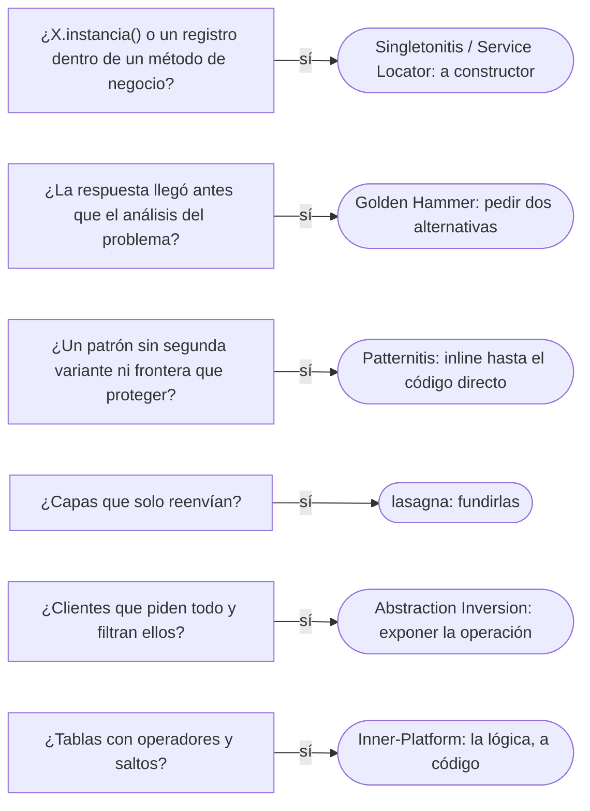

# 04 — El patrón mal usado

> Reconocer cuándo **el problema es el patrón**: el que se pone por costumbre, por currículum o por miedo al cambio, y el
> que resuelve una tensión que el código no tiene. Cada antipatrón con la plantilla de §6.5 de la guía: síntoma, por qué
> aparece, qué cuesta, cómo se detecta, salida y veredicto. **Lenguaje:** Java. Asume leído
> [`04/05` — Singleton, y por qué casi nunca](../04-creacionales/05-singleton.md) y
> [`04/06` — Contenedores de inyección e IoC](../04-creacionales/06-inyeccion-de-dependencias-e-ioc.md).
>
> **Vigencia:** 2026-10-03.
>
> **Versiones ejecutadas:** JDK 21.0.12, 17.0.20 y 25.0.4 (2026-10-04).

---

## 1. 🎯 El problema

La validación del formato de un número de documento, después de una revisión de diseño entusiasta:

```java
// no compila: esquema, con los cuerpos resumidos en comentarios
public interface ValidadorFormatoStrategy { boolean validar(Documento d); }
public class ValidadorFormatoRegex implements ValidadorFormatoStrategy { /* una línea con matches */ }
public interface ValidadorFormatoFactory { ValidadorFormatoStrategy crear(TipoDocumento t); }
public class ValidadorFormatoFactoryImpl implements ValidadorFormatoFactory { /* siempre devuelve Regex */ }
public class ValidadorFormatoFactoryProvider {                          // un Singleton que da la fábrica
    private static final ValidadorFormatoFactoryProvider INSTANCIA = new ValidadorFormatoFactoryProvider();
    public static ValidadorFormatoFactoryProvider instancia() { return INSTANCIA; }
    public ValidadorFormatoFactory fabrica() { return new ValidadorFormatoFactoryImpl(); }
}

boolean ok = ValidadorFormatoFactoryProvider.instancia().fabrica().crear(tipo).validar(documento);
```

- Cinco tipos y tres patrones —Strategy, Abstract Factory, Singleton— para lo que `TipoDocumento` ya hacía en una línea:
  `tipo.admite(numero)`, el Type Object de [`09/03`](../09-ddd-tactico-y-otros/03-specification-null-object-y-type-object.md#4--type-object).
  No hay una segunda estrategia, ni una segunda fábrica, ni una razón para que haya una sola instancia de nada.
- Cada patrón, por separado, es correcto. Juntos y sin una tensión que resolver, son el antipatrón de este capítulo:
  **más patrones no es mejor diseño**.

---

## 2. 🏚️ Singletonitis

**Síntoma.** Singletons por todas partes: `CatalogoTipos.instancia()`, `Configuracion.instancia()`,
`RegistroAuditoria.instancia()`, llamados desde el interior de los métodos.

**Por qué aparece.** Porque el Singleton es el patrón más fácil de entender y da acceso global sin pensar en dependencias. Es
el primero que se aprende y el último que se olvida.

**Qué cuesta.** Lo que [`04/05` §9](../04-creacionales/05-singleton.md#9-️-lo-que-cuesta-y-cuándo-no) detalla: acoplamiento
oculto (las dependencias no están en la firma), pruebas que no pueden sustituir la instancia y que dependen del orden, estado
global mutable y un ciclo de vida atado al cargador de clases.

**Cómo se detecta.** Llamadas a `X.instancia()` dentro de métodos de negocio; pruebas que necesitan reiniciar estado estático;
clases que no se pueden probar sin la base de datos porque un Singleton la abre.

**Salida.** Separar las dos promesas del Singleton: **una instancia, sí; acceso global, no**. Paso a paso: añadir el
parámetro al constructor de quien lo usa, con el Singleton como valor por defecto en un constructor de conveniencia; migrar a
los llamadores para que lo pasen; quitar el constructor de conveniencia y el acceso estático. El contenedor crea una sola
instancia y la inyecta.

> **Veredicto:** el Singleton es para la unicidad que el dominio exige, no para el acceso cómodo. Cada `instancia()` dentro de
> un método de negocio es una dependencia escondida.

---

## 3. 🏚️ Service Locator

**Síntoma.** Un registro global al que las clases **piden** sus dependencias: `LocalizadorServicios.obtener(RepositorioCuentas.class)`
dentro de los métodos.

**Por qué aparece.** Porque desacopla de las implementaciones concretas sin cambiar las firmas, y parece inyección de
dependencias. Fowler los presentó en 2004 como dos alternativas para el mismo problema, y en su artículo dice que la elección
entre ellos importa menos que separar la configuración del uso.

**Qué cuesta.** Las dependencias desaparecen de la firma: para saber qué necesita una clase hay que leer todo su código. Un test
tiene que llenar un registro global antes de cada prueba, y una dependencia que falta se descubre al ejecutar, no al construir.
Seemann y van Deursen lo catalogan como antipatrón por eso: es un Singleton con un mapa dentro.

**Cómo se detecta.** Llamadas al registro (`obtener`, `getBean`, `resolve`) fuera de la raíz de composición; en Spring, un
`ApplicationContext` inyectado en un servicio para pedirle *beans*.

**Salida.** Cada llamada al registro se convierte en un parámetro del constructor, y el registro solo se usa en un sitio: la
raíz de composición ([`03/04`](../03-principios-de-diseno/04-acoplamiento-cohesion-y-dependencias.md)), o el contenedor.

```java
// no compila: esquema del antes y el después
// antes
public void transferir(...) { var cuentas = LocalizadorServicios.obtener(RepositorioCuentas.class); ... }
// después
public ServicioTransferencias(RepositorioCuentas cuentas, Clock reloj) { this.cuentas = cuentas; this.reloj = reloj; }
```

- "Service Locator es inyección de dependencias" es la confusión de fondo: en los dos se desacopla de la implementación, pero
  con inyección la clase **recibe** lo que necesita y no conoce ningún registro; con el localizador, **pide**, y depende del
  registro y de todo lo que contiene.

> **Veredicto:** el registro, solo en la raíz de composición; en el resto del código, dependencias por constructor. Un
> `getBean` dentro de un servicio de negocio es un Service Locator aunque lo provea Spring.

---

## 4. 🏚️ Golden Hammer

**Síntoma.** La misma herramienta o el mismo patrón para todo: todo es un evento, todo es un microservicio, todo se resuelve con
un Strategy y una fábrica, o todo va en el ORM aunque sea un informe de cien mil filas.

**Por qué aparece.** Porque funcionó una vez y el equipo lo domina. *AntiPatterns* lo describe como una tecnología o un concepto
familiar aplicado de forma obsesiva a muchos problemas.

**Qué cuesta.** Soluciones que encajan mal: un informe de cien mil filas cargado en entidades JPA en lugar de una consulta
SQL directa, eventos asíncronos donde bastaba una llamada, y la pérdida de la capacidad de elegir.

**Cómo se detecta.** En la revisión de diseño, la respuesta llega antes que el análisis del problema; nadie puede nombrar una
alternativa que se haya descartado y por qué.

**Salida.** Para cada decisión, exigir dos alternativas y su precio en las cuatro monedas. Aprender una herramienta nueva por
problema que la pida, no por moda.

> **Veredicto:** si la respuesta llega antes que la pregunta, es un martillo dorado. La pregunta útil es "¿qué otra cosa
> descartamos, y por qué?".

---

## 5. 🏚️ *Patternitis*

**Síntoma.** Patrones puestos por currículum o por anticipación: el §1, con una Strategy sin segunda estrategia, una Abstract
Factory sin segunda familia y un Singleton sin unicidad que proteger.

**Por qué aparece.** Porque los patrones se estudian antes que las tensiones que resuelven, y aplicarlos parece señal de
diseño. Es la versión de patrón de la Speculative Generality de [`02` §9](02-code-smells-entre-clases.md#9-️-lazy-element-data-class-y-speculative-generality).

**Qué cuesta.** Indirección sin beneficio: cinco tipos que leer para una línea de lógica, y un IDE que no lleva a la
implementación en un clic. La moneda que más se olvida es la legibilidad para quien llega después.

**Cómo se detecta.** Interfaces con una sola implementación sin frontera que proteger; nombres que son patrones y no conceptos
(`ValidadorFormatoFactoryProvider`); patrones que no saben responder "¿qué variación protegen?".

**Salida.** *Inline Class* e *Inline Function* hasta llegar al código directo, y volver a introducir el patrón el día que
aparezca la segunda variante. El camino inverso, del código al patrón cuando hace falta, es el de
[`13/03`](../13-patrones-en-la-practica/03-refactorizar-hacia-patrones.md).

```java
boolean ok = documento.tipo().admite(documento.numero());     // lo que hacían los cinco tipos del §1
```

> **Veredicto:** un patrón se justifica por la tensión que resuelve hoy, no por la que podría aparecer. "Más patrones, mejor
> diseño" es falso: el mejor diseño es el más simple que resuelve las variaciones reales.

---

## 6. 🏚️ Capas de más (*lasagna code*)

**Síntoma.** Cada petición atraviesa controlador, fachada, servicio de aplicación, servicio de dominio, adaptador, repositorio y
DAO, y la mitad de esas capas solo reenvía la llamada a la siguiente.

**Por qué aparece.** Por una plantilla de arquitectura aplicada a todos los casos, sin preguntar qué hace cada capa en ese caso.

**Qué cuesta.** Cada cambio de un campo toca siete archivos; depurar es saltar por siete clases; y las capas que reenvían son
Middle Men ([`02` §4](02-code-smells-entre-clases.md#4-️-middle-man)) que hay que mantener.

**Cómo se detecta.** Métodos cuyo cuerpo es una sola llamada a la capa siguiente con los mismos parámetros; DTO idénticos
mapeados entre capas.

**Salida.** Medir qué capa tiene lógica en cada caso de uso, y fundir las que solo reenvían (*Remove Middle Man*, *Inline
Class*). Las capas que protegen una frontera real —el dominio de la infraestructura, el API del modelo interno— se quedan.

> **Veredicto:** cada capa tiene que poder decir qué decide o qué protege. Una capa que solo reenvía es un costo sin beneficio,
> por mucho que aparezca en el diagrama de arquitectura.

---

## 7. 🏚️ Abstraction Inversion

**Síntoma.** Una abstracción de alto nivel que esconde lo que los clientes necesitan, y que obliga a reconstruirlo encima, peor:
un repositorio que solo ofrece `todas()`, y un servicio que filtra en memoria los documentos vencidos de un millón de personas.

**Por qué aparece.** Por diseñar la abstracción sin preguntar a sus clientes, o por una regla de "el repositorio solo tiene
CRUD".

**Qué cuesta.** Rendimiento y duplicación: lo que la capa de abajo hacía bien (filtrar con un índice) se reimplementa arriba
(un bucle sobre todo).

**Cómo se detecta.** Clientes que piden todo y filtran, ordenan o agregan ellos; código de bajo nivel escrito encima de una
abstracción que lo escondía.

**Salida.** Exponer la operación que los clientes necesitan, en el idioma de la abstracción: `documentosVencidosAl(fecha)` en el
repositorio, con su consulta, o una Specification traducida a consulta ([`07/05`](../07-fowler-dominio-y-datos/05-metadatos-y-consultas.md)).

> **Veredicto:** una abstracción que obliga a reconstruir debajo de ella lo que escondía está al revés. Se diseña desde lo que
> piden sus clientes.

---

## 8. 🏚️ Inner-Platform Effect

**Síntoma.** Un sistema tan configurable que reimplementa, peor, la plataforma sobre la que corre: un motor de reglas propio en
una tabla `REGLA(campo, operador, valor, siguiente)`, con su propio lenguaje de expresiones, para reglas que cambian dos veces al
año.

**Por qué aparece.** Por querer que "el negocio cambie las reglas sin programar", sin medir cuántas veces cambian ni quién las
cambiará de verdad.

**Qué cuesta.** Un lenguaje de programación sin compilador, sin pruebas, sin depurador y sin control de versiones; las reglas
acaban escribiéndolas los mismos programadores, ahora en filas. Es el Interpreter de [`06/09`](../06-comportamiento/09-memento-e-interpreter.md)
llevado hasta construir una plataforma.

**Cómo se detecta.** Tablas que describen lógica (operadores, saltos, condiciones); configuraciones que ya tienen bucles y
condicionales.

**Salida.** Volver a escribir las reglas en código, con pruebas y despliegue; si de verdad cambian a menudo, un formato acotado
(una tabla de **datos**, como las tarifas, o un Type Object) en lugar de un lenguaje.

> **Veredicto:** lo que es lógica, en código; lo que son datos, en datos. Una tabla que tiene bucles es un lenguaje de
> programación malo.

---

## 9. 🧭 Cómo se detecta en una revisión



**La frase en voz alta:** *"Antes de aprobar un patrón pregunto qué variación real protege hoy. Si no hay segunda estrategia, ni
segunda familia, ni unicidad del dominio, el patrón es ceremonia: lo quito y lo vuelvo a poner el día que aparezca la
variación."*

---

## ⚠️ Errores frecuentes

| Se dice | Lo preciso |
|---|---|
| "Más patrones, mejor diseño" | El mejor diseño es el más simple que resuelve las variaciones reales; un patrón sin tensión es indirección |
| "Service Locator es inyección de dependencias" | Con inyección la clase recibe; con el localizador pide, y depende del registro |
| "`getBean` en un servicio es inyección, porque es Spring" | Es un Service Locator; Spring solo es el registro |
| "Un Singleton es la forma de compartir una instancia" | Compartir la decide el contenedor; el Singleton añade acceso global, que es lo que cuesta |
| "Todas las capas de la arquitectura deben estar siempre" | Cada capa tiene que decidir o proteger algo en ese caso de uso |
| "Que el negocio configure las reglas ahorra programar" | Si la configuración tiene lógica, es un lenguaje sin herramientas, y lo terminan escribiendo programadores |
| "Si funcionó en el proyecto anterior, sirve aquí" | Es la definición del martillo dorado; se compara con alternativas cada vez |

---

## 📚 Para profundizar

- **Libro** — Seemann y van Deursen, *Dependency Injection Principles, Practices, and Patterns* (Manning, 2019), cap. 5,
  "DI anti-patterns": Service Locator y sus parientes. **El que destaca.**
- **Libro** — Brown, Malveau, McCormick y Mowbray, *AntiPatterns* (Wiley, 1998), cap. 5, "Software Development AntiPatterns":
  Golden Hammer.
- **Libro** — Ousterhout, *A Philosophy of Software Design*, 2.ª ed. (Yaknyam Press, 2021), cap. 4, "Modules Should Be Deep", y
  cap. 7, "Different Layer, Different Abstraction": los métodos que solo pasan la llamada a la capa siguiente.
- [martinfowler.com — *Inversion of Control Containers and the Dependency Injection pattern*](https://martinfowler.com/articles/injection.html):
  Service Locator frente a inyección, y separar la configuración del uso.
- [martinfowler.com — *Yagni*](https://martinfowler.com/bliki/Yagni.html): el costo de construir para un futuro que no llega.
- [Spring — *Dependency Injection*](https://docs.spring.io/spring-framework/reference/core/beans/dependencies/factory-collaborators.html)

---

## 🧠 Preguntas

Sin respuestas aquí. Todas, con enunciado literal y respuesta en tres capas, en
[`07` — Respuestas](07-respuestas.md#04--el-patrón-mal-usado).

1. ¿Qué es Singletonitis? 🟢
2. ¿Qué es un Service Locator? 🟢
3. ¿Qué es el Golden Hammer? 🟢
4. ¿Qué es el Inner-Platform Effect? 🟢
5. ¿Qué diferencia hay entre un Service Locator y la inyección de dependencias? 🟡
6. ¿Qué diferencia hay entre *patternitis* y Speculative Generality? 🟡
7. ¿Qué diferencia hay entre una capa que reenvía y un Facade? 🟡
8. ¿Qué diferencia hay entre el Singleton del contenedor y el Singleton del GoF? 🟡
9. ¿Por qué "más patrones, mejor diseño" es falso? 🟠
10. ¿Por qué un `getBean` dentro de un servicio es un Service Locator aunque lo provea Spring? 🟠
11. ¿Cómo sales de Singletonitis sin romper a los llamadores? 🟠
12. ¿Por qué un repositorio que solo ofrece `todas()` es una Abstraction Inversion? 🟠
13. ¿Cuándo una tabla de configuración se convierte en un Inner-Platform Effect? 🟠
14. Revisa el código del §1 y di qué quitas y qué queda. 🔴
15. Convierte un servicio que usa `LocalizadorServicios.obtener` en dos sitios en uno con inyección por constructor. 🔴
16. Revisa este diseño y di qué antipatrón hay: siete capas para cambiar el correo de una persona, cinco de ellas con un único
    método que llama a la siguiente. 🔴

---

**Anterior:** [`03` — Antipatrones de diseño OO](03-antipatrones-de-diseno-oo.md) ·
**Siguiente:** [`05` — Antipatrones de código y de proceso](05-antipatrones-de-codigo-y-de-proceso.md) ·
**Relacionado:** [`04/06` — Contenedores de inyección e IoC](../04-creacionales/06-inyeccion-de-dependencias-e-ioc.md)
