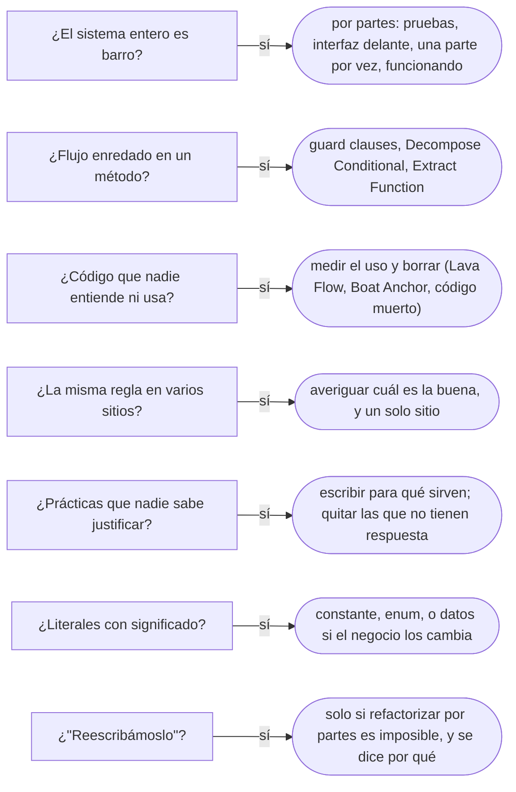

# 05 — Antipatrones de código y de proceso

> Reconocer los antipatrones que **no nacen de una decisión de diseño sino de cómo se trabaja**: el plazo, el miedo a borrar,
> copiar lo que funcionó, imitar sin entender. Y planificar la salida sin la tentación de reescribirlo todo. Plantilla de
> §6.5 de la guía. **Lenguaje:** Java. Asume leído [`03` — Antipatrones de diseño OO](03-antipatrones-de-diseno-oo.md).
>
> **Vigencia:** 2026-10-03.
>
> **Versiones ejecutadas:** JDK 21.0.12, 17.0.20 y 25.0.4 · Spring Boot 4.1.1 (Spring Framework 7.0.9, Hibernate 7.4.5, H2 2.4.240) (2026-10-04).

---

## 1. 🎯 El problema

El módulo de comisiones tiene ocho años. Nadie sabe qué hace `calcularV2`, si `calcularV3` la reemplazó, ni por qué hay un
`if (tipo.equals("X7"))` que nunca se cumple en los datos de producción. El cálculo de la comisión por transferencia aparece,
casi igual, en cinco clases, y en una de ellas el 0,005 es 0,0055. Hay una clase `ProcesadorBatchGenerico` que no usa nadie
"pero se va a necesitar".

Ninguna decisión de diseño produjo esto. Lo produjeron ocho años de plazos, de copias que "solo eran para esta vez" y de
código que nadie se atrevió a borrar. La propuesta del equipo es la de siempre: **reescribirlo**. Este capítulo trata de por
qué esa casi nunca es la salida.

---

## 2. 🏚️ Big Ball of Mud

**Síntoma.** Un sistema sin estructura reconocible. Foote y Yoder lo describen en su artículo de PLoP '97 como una jungla de código
espagueti, estructurada al azar, extensa y descuidada, remendada con cinta adhesiva y alambre, con información compartida
promiscuamente entre partes lejanas.

**Por qué aparece.** El mismo artículo lo explica sin moralina: por presión de plazos, por un equipo que rota, porque el dominio
se entendió tarde, y porque cada arreglo rápido funcionó. Lo llama la arquitectura más frecuente de todas.

**Qué cuesta.** Todo cambio es lento y arriesgado: no hay fronteras, así que no se sabe qué se rompe. El conocimiento vive en la
cabeza de quien lleva más tiempo.

**Cómo se detecta.** Cualquier clase depende de casi cualquier otra; los cambios pequeños tocan muchos módulos; las pruebas
automáticas son pocas o ninguna.

**Salida.** Crecimiento por partes, no reconstrucción. Foote y Yoder describen las formas de vivir con el barro y de salir de él
—*Piecemeal Growth*, *Keep It Working*, *Shearing Layers*, *Sweeping It Under the Rug*— y dejan *Reconstruction* (tirarlo y
empezar de nuevo) como último recurso. En pasos:

1. **Pruebas de caracterización** sobre los comportamientos que más se usan y más cambian.
2. **Esconder el barro** detrás de una interfaz pequeña (un Facade, [`05/04`](../05-estructurales/04-facade.md)): el código nuevo
   habla con la interfaz, no con el barro.
3. **Sacar una parte por vez**, empezando por la que más cambia, con sus reglas y sus pruebas, y redirigir la interfaz a ella.
4. **Mantenerlo funcionando en cada paso**: cada parte sale a producción antes de empezar la siguiente.

- "Un Big Ball of Mud se arregla reescribiendo" es la salida que más falla. La reescritura compite con un sistema que sigue
  cambiando, tarda más de lo previsto, y pierde las reglas que el barro tenía y nadie había escrito. La refactorización por
  partes entrega valor en cada paso y se puede detener en cualquiera.

> **Veredicto:** al barro se le sale por partes, con pruebas, detrás de una interfaz y sin dejar de funcionar. La reescritura
> completa es el último recurso, no el primero.

---

## 3. 🏚️ Spaghetti Code

**Síntoma.** Un flujo de control enredado: métodos de cientos de líneas con banderas, `if` anidados, `break` y `continue` que
saltan entre ramas, y estado compartido que cambia en cualquier parte.

**Por qué aparece.** Por añadir casos al código que ya estaba, siempre en el mismo método, porque es lo más rápido.

**Qué cuesta.** Nadie puede seguir el flujo sin depurarlo; cada caso nuevo rompe otro.

**Cómo se detecta.** Complejidad ciclomática alta, anidamiento profundo, variables bandera (`procesado`, `yaValidado`).

**Salida.** *Replace Nested Conditional with Guard Clauses*, *Decompose Conditional* y *Extract Function* para enderezar el flujo;
*Replace Conditional with Polymorphism* si los casos son tipos ([`01`](01-code-smells-dentro-de-una-clase.md#7-️-repeated-switches-switch-statements-en-la-1ª-ed)).

```java
// no compila: el antes es un esquema, con el cuerpo resumido
// antes
if (cuenta != null) { if (cuenta.abierta()) { if (!monto.esNegativo()) { /* 40 líneas */ } else { error = "monto"; } } }
// después
if (cuenta == null) throw new CuentaInexistenteException();
if (!cuenta.abierta()) throw new CuentaNoDisponibleException(cuenta.id());
if (monto.esNegativo()) throw new IllegalArgumentException("monto negativo");
transferir(cuenta, monto);                                   // el caso normal, sin anidar
```

> **Veredicto:** cláusulas de guarda para los casos que terminan, funciones con nombre para los bloques, y el caso normal al
> final y sin sangría.

---

## 4. 🏚️ Lava Flow

**Síntoma.** Código que nadie entiende ni se atreve a borrar, congelado en el sistema: `calcularV2`, clases experimentales que
quedaron, ramas para un cliente que ya no existe. *AntiPatterns* lo describe como código muerto e información de diseño olvidada,
solidificados en un diseño que sigue cambiando.

**Por qué aparece.** Por prototipos que pasaron a producción y por miedo: "si lo borro y algo lo usaba, la culpa es mía".

**Qué cuesta.** Cada lectura pasa por encima, cada refactorización lo arrastra, y el equipo nuevo lo estudia creyendo que importa.

**Cómo se detecta.** Código sin llamadores (el IDE lo marca), ramas que la cobertura de producción nunca ejecuta, comentarios
como `// no tocar`.

**Salida.** Medir si se usa —búsqueda de llamadores, cobertura en producción, registros— y borrarlo. El control de versiones lo
guarda si alguien lo necesita: borrar no es perderlo.

> **Veredicto:** lo que no se usa se borra; para eso está el historial. El miedo a borrar cuesta más que el riesgo de hacerlo con
> pruebas.

---

## 5. 🏚️ Boat Anchor y código muerto

**Boat Anchor.** **Síntoma:** una pieza que no sirve para nada pero se mantiene: `ProcesadorBatchGenerico`, "por si se
necesita", o una librería comprada que nadie usa. **Por qué aparece:** por haber invertido en ella. **Qué cuesta:** compilación,
dependencias que actualizar, lectura. **Cómo se detecta:** sin llamadores, o solo con llamadores en pruebas. **Salida:** borrarla.

**Código muerto.** **Síntoma:** código que nunca se ejecuta: ramas imposibles (`if (tipo.equals("X7"))`), métodos sin llamadores,
parámetros que nadie lee. **Por qué aparece:** porque el requisito que lo justificaba desapareció y nadie limpió. **Qué cuesta:**
lectura y falsas pistas al depurar. **Cómo se detecta:** el IDE, los analizadores estáticos, la cobertura. **Salida:** *Remove Dead
Code*, que *Refactoring* 2.ª ed. lista como refactorización propia.

> **Veredicto:** el código que no se ejecuta no es gratis: se lee, se mantiene y engaña. Se borra con el historial como red.

---

## 6. 🏚️ Copy-Paste Programming

**Síntoma.** El mismo cálculo, casi igual, en varios sitios: la comisión por transferencia en cinco clases, y en una el 0,005 es
0,0055.

**Por qué aparece.** Copiar lo que funciona es lo más rápido, y cada copia "solo era para esta vez".

**Qué cuesta.** Cada corrección hay que hacerla cinco veces, y la que se olvida es un error de negocio. Las copias divergen:
nadie sabe cuál es la buena.

**Cómo se detecta.** Herramientas de detección de duplicados; cambios que se repiten en varios archivos en el mismo *commit*
(Shotgun Surgery, de [`02`](02-code-smells-entre-clases.md#6-️-divergent-change-y-shotgun-surgery)).

**Salida.** Primero averiguar cuál de las copias es la correcta —la diferencia puede ser un error o una regla—; después *Extract
Function* y *Move Function* a un único sitio, y reemplazar las copias por llamadas.

> **Veredicto:** la duplicación de una **regla** se elimina siempre; la de dos fragmentos que se parecen por casualidad, no:
> juntarlos acopla dos cosas que cambiarán por motivos distintos.

---

## 7. 🏚️ Cargo Cult

**Síntoma.** Prácticas o estructuras copiadas sin entender para qué sirven: interfaces `IAlgo` para cada clase "porque así se
hace", `@Transactional` en cada método, capas que no protegen nada, un patrón que se repite en todo el código sin que nadie sepa
qué resolvía.

**Por qué aparece.** Porque se imita la forma de lo que funcionó en otro sitio sin la razón que lo justificaba.

**Qué cuesta.** El costo de la práctica sin su beneficio; y cuando la práctica es incorrecta en este contexto, el error se
reproduce en todo el código.

**Cómo se detecta.** Preguntar "¿para qué está esto?" y recibir "siempre se hizo así" o "lo vi en un tutorial".

**Salida.** Para cada práctica, escribir en una línea qué problema resuelve aquí; las que no tienen respuesta se quitan.

> **Veredicto:** se copia la razón, no la forma. Una práctica que nadie puede justificar en este código es una ceremonia.

---

## 8. 🏚️ Magic Numbers y Magic Strings

**Síntoma.** Literales con significado de negocio sueltos en el código: `0.005`, `2000`, `"AHORROS"`, `18`.

**Por qué aparece.** Porque es más rápido escribir el número que nombrarlo.

**Qué cuesta.** No se sabe qué significan, no se encuentran todos cuando cambian, y un `"Ahorros"` mal escrito compila.

**Cómo se detecta.** Literales repetidos o sin contexto; analizadores estáticos.

**Salida.** Una constante con nombre (`EDAD_MAYORIA = 18`) para los valores fijos; un `enum` (`TipoCuenta.AHORROS`) para los
conjuntos cerrados; y **configuración o datos** para lo que el negocio cambia (las tarifas no son constantes: van en la tabla de
tarifas de [`10/01`](../10-concurrencia/01-inmutabilidad-y-confinamiento.md#2--immutable-object)).

> **Veredicto:** un literal con significado de negocio tiene nombre; si el negocio lo cambia, además vive fuera del código.

---

## 9. 🧭 Cómo se elige la salida



**La frase en voz alta:** *"No propongo reescribir el módulo de comisiones: le pongo pruebas de caracterización, lo escondo detrás
de una interfaz y saco el cálculo a un solo sitio, averiguando primero cuál de las cinco copias es la correcta. Lo que no se usa
lo borro, que para eso está el historial."*

---

## ⚠️ Errores frecuentes

| Se dice | Lo preciso |
|---|---|
| "Un Big Ball of Mud se arregla reescribiendo" | Se sale por partes, con pruebas y sin dejar de funcionar; reescribir es el último recurso |
| "Si lo borro y alguien lo usaba, se rompe" | Se mide el uso antes; el historial guarda lo borrado |
| "Toda duplicación es mala" | La duplicación de una regla sí; dos fragmentos parecidos por casualidad pueden cambiar por motivos distintos |
| "Una constante resuelve el número mágico" | Si el negocio lo cambia, va en configuración o en datos, no en una constante |
| "Si en el otro proyecto funcionó, aquí también" | Es *cargo cult*: se copia la razón, no la forma |
| "El código muerto no molesta" | Se lee, se mantiene y despista al depurar |
| "Spaghetti es un problema de estilo" | Es un problema de flujo: nadie puede seguir el código sin depurarlo |

---

## 📚 Para profundizar

- **Libro** — Brown, Malveau, McCormick y Mowbray, *AntiPatterns* (Wiley, 1998), cap. 5, "Software Development AntiPatterns":
  Lava Flow, Boat Anchor, Spaghetti Code, Cut-and-Paste Programming. **El que destaca.**
- **Libro** — Fowler, *Refactoring*, 2.ª ed. (Addison-Wesley, 2018), cap. 8, *Remove Dead Code*, y cap. 10, "Simplifying
  Conditional Logic" (*Replace Nested Conditional with Guard Clauses*, *Decompose Conditional*).
- [Foote y Yoder — *Big Ball of Mud* (PLoP '97)](https://www.laputan.org/mud/mud.html): el artículo, con las formas de vivir con el
  barro y de salir de él.
- [martinfowler.com — *TechnicalDebt*](https://martinfowler.com/bliki/TechnicalDebt.html): el costo de los atajos, como intereses.
- [martinfowler.com — *Yagni*](https://martinfowler.com/bliki/Yagni.html): no construir lo que no se necesita todavía.

---

## 🧠 Preguntas

Sin respuestas aquí. Todas, con enunciado literal y respuesta en tres capas, en
[`07` — Respuestas](07-respuestas.md#05--antipatrones-de-código-y-de-proceso).

1. ¿Qué es un Big Ball of Mud? 🟢
2. ¿Qué es Lava Flow? 🟢
3. ¿Qué es un Boat Anchor? 🟢
4. ¿Qué es un número mágico, y qué lo reemplaza? 🟢
5. ¿Qué diferencia hay entre Lava Flow y código muerto? 🟡
6. ¿Qué diferencia hay entre Copy-Paste Programming y dos fragmentos que se parecen por casualidad? 🟡
7. ¿Qué diferencia hay entre una constante y un valor de configuración? 🟡
8. ¿Qué diferencia hay entre Spaghetti Code y un Big Ball of Mud? 🟡
9. ¿Por qué "un Big Ball of Mud se arregla reescribiendo" casi nunca funciona? 🟠
10. ¿Por qué antes de unir cinco copias de una regla hay que averiguar cuál es la buena? 🟠
11. ¿Cómo decides que un código se puede borrar? 🟠
12. ¿Cómo reconoces *cargo cult* en una revisión de código? 🟠
13. Planifica la salida del módulo de comisiones del §1 en pasos que no detengan las entregas. 🔴
14. Endereza este fragmento con cláusulas de guarda: tres `if` anidados que comprueban que la cuenta exista, esté abierta y el
    monto no sea negativo antes de transferir. 🔴

---

**Anterior:** [`04` — El patrón mal usado](04-el-patron-mal-usado.md) ·
**Siguiente:** [`06` — Simulación de entrevista](06-simulacion-de-entrevista.md) ·
**Relacionado:** [`13/03` — Refactorizar hacia patrones, y desde ellos](../13-patrones-en-la-practica/03-refactorizar-hacia-patrones.md)
