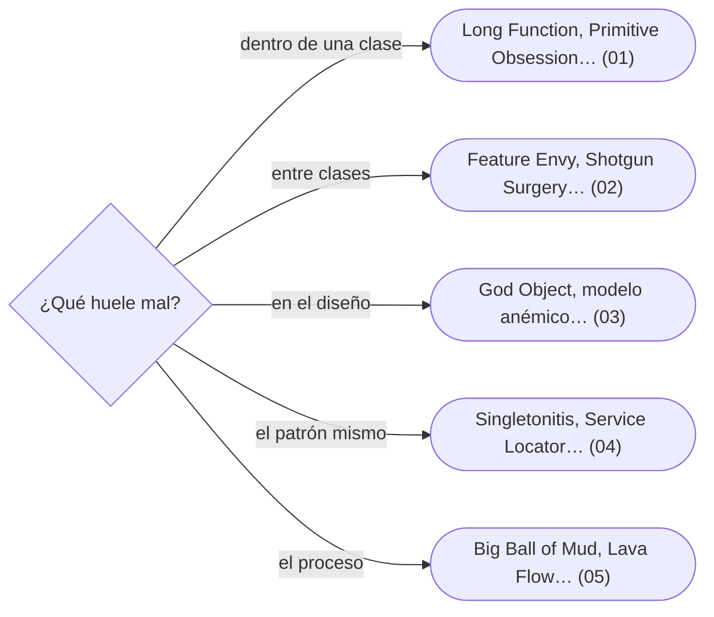

# 12 — Antipatrones

> Reconocer el diseño roto en una revisión de código y salir de él en pasos pequeños: *code smells* con su refactorización, antipatrones de diseño, el patrón mal usado y los antipatrones que nacen del proceso. Es el dueño de los nombres de *smells* y antipatrones del corpus.
>
> **Vigencia:** 2026-10-03.

---

## 1. 🗺️ Índice

| | Documento | Tipo |
|---|---|---|
| [`01`](01-code-smells-dentro-de-una-clase.md) | Code smells dentro de una clase | Capítulo |
| [`02`](02-code-smells-entre-clases.md) | Code smells entre clases | Capítulo |
| [`03`](03-antipatrones-de-diseno-oo.md) | Antipatrones de diseño OO | Capítulo |
| [`04`](04-el-patron-mal-usado.md) | El patrón mal usado | Capítulo |
| [`05`](05-antipatrones-de-codigo-y-de-proceso.md) | Antipatrones de código y de proceso | Capítulo |
| [`06`](06-simulacion-de-entrevista.md) | Simulación de entrevista | Simulación |
| [`07`](07-respuestas.md) | Respuestas | Solucionario |

**Orden de lectura.** En orden numérico. `03` está en la ruta "entrevista esta semana" y se lee solo. La simulación es una revisión de código en vivo. Al terminar los capítulos, la simulación con cronómetro, y solo después el solucionario.

---

## 2. 🧠 Mapa mental

---

## 3. 🚫 Qué NO está aquí

Los patrones a los que llevan las salidas, que tienen su propio capítulo; la refactorización hacia patrones está en `13/03`.

---

**Versiones ejecutadas:** JDK 21.0.12, 17.0.20 y 25.0.4 · Spring Boot 4.1.1 (Spring Framework 7.0.9, Hibernate 7.4.5, H2 2.4.240) (2026-10-04).

---

**Anterior:** [`11` — Los diferentes](../11-los-diferentes/README.md) ·
**Corpus:** [README](../README.md) ·
**Siguiente:** [`13` — Patrones en la práctica](../13-patrones-en-la-practica/README.md)
