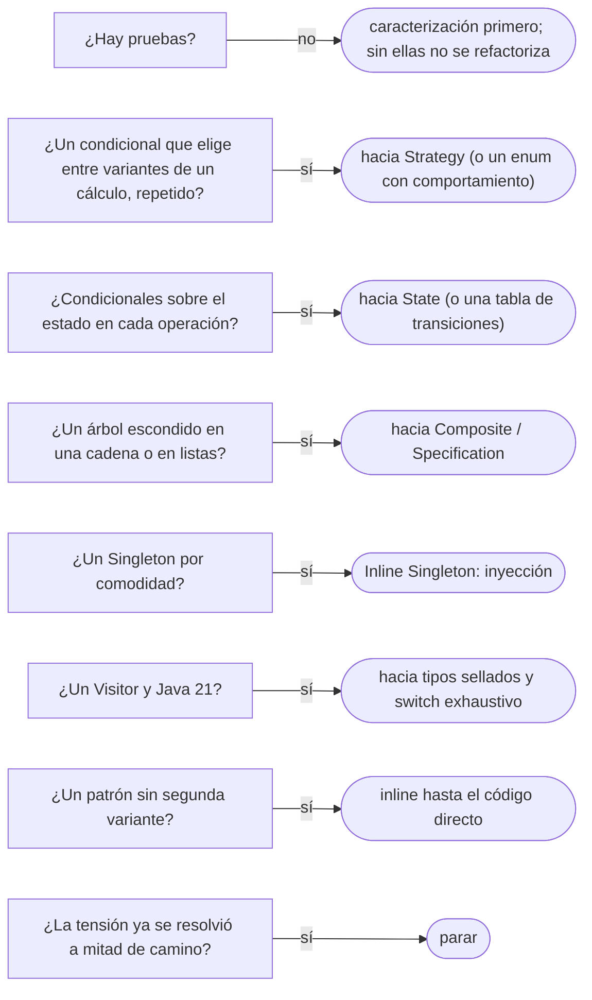

# 03 — Refactorizar hacia patrones, y desde ellos

> Llegar a un patrón **refactorizando**, cuando el código lo pide, y **quitar** uno que sobra. El patrón como destino de una
> serie de pasos pequeños, no como punto de partida del diseño. **Lenguaje:** Java. Asume leído
> [`12/01` — Code smells dentro de una clase](../12-antipatrones/01-code-smells-dentro-de-una-clase.md) y
> [`12/04` — El patrón mal usado](../12-antipatrones/04-el-patron-mal-usado.md).
>
> **Vigencia:** 2026-10-03.
>
> **Versiones ejecutadas:** JDK 21.0.12, 17.0.20 y 25.0.4 (2026-10-04).

---

## 1. 🎯 El problema

Dos equipos, dos errores opuestos. El primero diseñó la comisión con Strategy, Abstract Factory y Singleton antes de tener una
segunda regla, y tres años después sigue habiendo una sola: cinco clases para una línea ([`12/04` §1](../12-antipatrones/04-el-patron-mal-usado.md#1--el-problema)).
El segundo empezó con un `if` y lo dejó crecer:

```java
public Dinero comision(Cuenta c, Dinero monto) {
    if (c.tipo() == TipoCuenta.AHORROS) return monto.porcentaje(0.5);
    if (c.tipo() == TipoCuenta.CORRIENTE) return monto.porcentaje(0.8).mas(Dinero.cop(1500));
    if (c.tipo() == TipoCuenta.NOMINA && c.saldo().esMayorQue(Dinero.cop(5_000_000))) return Dinero.cero(c.moneda());
    if (c.tipo() == TipoCuenta.NOMINA) return monto.porcentaje(0.2);
    if (c.tipo() == TipoCuenta.EMPRESARIAL) return monto.porcentaje(0.3).max(Dinero.cop(5000));
    throw new IllegalStateException("tipo sin comisión: " + c.tipo());
}
```

- El primer equipo pagó el patrón antes de que existiera la tensión. El segundo tiene la tensión y no el patrón: cada tipo nuevo
  es otro `if`, y el mismo `if` aparece en los límites y en los extractos.
- Kerievsky escribió *Refactoring to Patterns* sobre esta idea: los patrones se alcanzan refactorizando —**hacia** ellos, **en
  dirección** a ellos, o **alejándose** de ellos— cuando el código muestra que hacen falta.

---

## 2. 🧱 El patrón como destino

**Qué es.** Diseñar lo más simple que funciona, dejar que la duplicación y los *smells* muestren dónde hay una tensión, y entonces
llegar al patrón **en pasos pequeños**, cada uno con las pruebas en verde.

**Cómo va.** La secuencia es siempre la misma:

```text
1. Prueba de caracterización: fijar lo que el código hace hoy
2. Nombrar el smell: Repeated Switches, Long Function, Shotgun Surgery...
3. Elegir el destino: el patrón que resuelve esa tensión, o ninguno
4. Pasos pequeños del catálogo, cada uno compilando y en verde
5. Parar cuando la tensión desaparece, aunque el patrón no esté "completo"
```

- El paso 5 es el que distingue refactorizar **en dirección** a un patrón de llegar a él: a veces basta con extraer una función y
  moverla al tipo, y el Strategy completo nunca hace falta.

**Qué cuesta.** Tiempo de refactorización, y disciplina para no saltar pasos. A cambio, el patrón llega cuando paga, con la forma
que el código necesita y no la del libro.

**Cuándo no.** Cuando la tensión es evidente desde el primer día —una API pública que se sabe que tendrá varias implementaciones, un
punto de extensión para terceros—: ahí diseñarlo de entrada es lo correcto, porque cambiar la API después cuesta más.

> **Veredicto:** el patrón se gana con la segunda variación real, no se paga por la primera. "Se diseña con patrones desde el
> principio" convierte el catálogo en una lista de requisitos; la excepción son las fronteras públicas, donde cambiar después cuesta
> más.

---

## 3. 🧱 Hacia Strategy

**El *smell*.** Kerievsky describe el problema de *Replace Conditional Logic with Strategy* así: una lógica condicional dentro de un
método decide cuál de varias variantes de un cálculo se ejecuta. Es el `comision` del §1.

**Los pasos.**

1. Prueba de caracterización con una cuenta de cada tipo, incluidas la nómina con saldo alto y el tipo sin comisión.
2. *Extract Function* de cada rama a un método con nombre (`comisionAhorros`, `comisionNomina`).
3. Introducir la interfaz `PoliticaComision` y una clase por rama, con el método extraído dentro.
4. Que el `enum` `TipoCuenta` sepa cuál es su política, y el método delegue:

```java
public enum TipoCuenta {
    AHORROS((c, m) -> m.porcentaje(0.5)),
    CORRIENTE((c, m) -> m.porcentaje(0.8).mas(Dinero.cop(1500))),
    EMPRESARIAL((c, m) -> m.porcentaje(0.3).max(Dinero.cop(5000))),
    NOMINA(new ComisionNomina());

    private final PoliticaComision politica;
    TipoCuenta(PoliticaComision politica) { this.politica = politica; }
    public PoliticaComision politica() { return politica; }
}

public Dinero comision(Cuenta c, Dinero monto) { return c.tipo().politica().comision(c, monto); }
```

- `PoliticaComision` es una interfaz funcional (`Dinero comision(Cuenta c, Dinero monto)`); las lambdas del `enum` ignoran la cuenta,
  y `ComisionNomina` la usa para el saldo. El `throw` final desapareció: el compilador ya no permite un tipo sin política.
- Las tres primeras políticas se quedaron en lambdas: el destino no exigía una clase por estrategia. Es refactorizar **en dirección**
  al Strategy y parar donde la tensión se resolvió.

> 📝 **En Java 17:** el `enum` con lambdas compila igual; lo que no existe es el `switch` de patrones sobre tipos sellados, que sería la
> alternativa si las políticas fueran un conjunto cerrado de *records*.

---

## 4. 🧱 Hacia State y hacia Composite

**Hacia State.** *Replace State-Altering Conditionals with State* se aplica cuando las condiciones que controlan las transiciones de
estado de un objeto son complejas: `Cuenta` con un `if (estado == ...)` en cada operación, y transiciones repartidas. Los pasos:
caracterizar cada operación en cada estado; extraer la decisión de cada operación a un método por estado; mover esos métodos a una clase
por estado; y que la cuenta delegue en su estado actual. El destino es el State de [`06/06`](../06-comportamiento/06-state.md), y con
tres estados y cuatro operaciones, una tabla de transiciones o un `enum` con comportamiento suele bastar.

**Hacia Composite.** *Replace Implicit Tree with Composite* se aplica cuando un árbol está escondido en una representación primitiva: las
reglas de aprobación de una transferencia guardadas como un `String` (`"MONTO>1000000 Y (PAIS=CO O VERIFICADO)"`) que se interpreta en
varios sitios. El destino es un árbol de objetos (`Todas`, `Alguna`, `MontoMayorQue`), el Composite de
[`05/05`](../05-estructurales/05-composite.md) y la Specification de [`09/03`](../09-ddd-tactico-y-otros/03-specification-null-object-y-type-object.md#2--specification).

---

## 5. 🧱 Desde un patrón: quitar lo que sobra

**Inline Singleton.** Kerievsky lo plantea para el código que necesita acceder a un objeto pero no necesita un punto de acceso global:
se mueve lo que el Singleton ofrece a una clase que guarda el objeto y da acceso a él, y se borra el Singleton. En Java hoy, ese "dueño"
es el contenedor:

```java
// antes: CatalogoTipos.instancia() dentro de los métodos
// después: el contenedor crea una instancia y la inyecta
@Service
public class AltaPersonas {
    private final CatalogoTipos catalogo;
    public AltaPersonas(CatalogoTipos catalogo) { this.catalogo = catalogo; }
}
```

- Los pasos, sin romper a nadie, son los de [`12/04` §2](../12-antipatrones/04-el-patron-mal-usado.md#2-️-singletonitis): constructor
  con el Singleton como valor por defecto, migrar llamadores, quitar el acceso estático.

**De Visitor a tipos sellados.** Un Visitor sobre una jerarquía de movimientos ([`06/07`](../06-comportamiento/07-visitor.md)) que en
Java 21 se puede reemplazar por un `switch` exhaustivo sobre una interfaz sellada. Los pasos: sellar la jerarquía (`sealed interface
Movimiento permits ...`); por cada visitante, escribir el `switch` equivalente como función y comprobar con las pruebas que da lo mismo;
cambiar los llamadores de `m.accept(visitante)` a la función; borrar `accept` y la interfaz `Visitor`.

```java
static Dinero signo(Movimiento m) {
    return switch (m) {
        case Deposito d -> d.monto();
        case Retiro r -> r.monto().negado();
        case TransferenciaEnviada t -> t.monto().negado();
        case TransferenciaRecibida t -> t.monto();
        case Comision c -> c.monto().negado();
    };                                                 // exhaustivo: un movimiento nuevo no compila sin su caso
}
```

**Otros que se quitan.** La fábrica de una sola clase (*Inline Class*), la Strategy sin segunda estrategia (*Inline Function* hasta el
código directo), las capas que solo reenvían (*Remove Middle Man*): la Speculative Generality de
[`12/02`](../12-antipatrones/02-code-smells-entre-clases.md#9-️-lazy-element-data-class-y-speculative-generality).

> **Veredicto:** quitar un patrón es tan legítimo como introducirlo, y con la misma disciplina: pruebas, pasos pequeños y parar cuando
> la tensión que quedaba se resolvió.

---

## 6. 🧭 Cómo se elige la dirección



**La frase en voz alta:** *"No empiezo con el Strategy: empiezo con el `if`, y cuando la misma decisión por tipo aparece en tres sitios,
caracterizo, extraigo cada rama y la muevo al `enum`. Y si mañana sobra, la quito igual: con pruebas y en pasos."*

---

## ⚠️ Errores frecuentes

| Se dice | Lo preciso |
|---|---|
| "Se diseña con patrones desde el principio" | Se llega a ellos refactorizando cuando aparece la tensión; la excepción son las APIs públicas |
| "Refactorizar hacia un patrón es implementarlo entero" | A menudo se va **en dirección** al patrón y se para cuando la tensión desaparece |
| "Quitar un patrón es dar marcha atrás" | Es otra refactorización legítima: Inline Singleton está en el catálogo de Kerievsky |
| "Se refactoriza y luego se prueba" | Se caracteriza primero; cada paso, con las pruebas en verde |
| "Un Visitor en Java 21 hay que dejarlo" | Con tipos sellados, un `switch` exhaustivo hace lo mismo con menos piezas |
| "Una Strategy necesita una clase por variante" | Las variantes de una línea son lambdas; una clase solo para la que tiene lógica o estado |
| "Refactorizar y añadir funcionalidad a la vez ahorra tiempo" | Mezclados, nadie distingue qué cambio era intencional; se separan |

---

## 📚 Para profundizar

- **Libro** — Kerievsky, *Refactoring to Patterns* (Addison-Wesley, 2004), caps. 6 a 11, el catálogo (creación, simplificación,
  generalización, protección, acumulación y utilidades): *Replace Conditional Logic with Strategy*, *Replace State-Altering
  Conditionals with State*, *Replace Implicit Tree with Composite*, *Inline Singleton*. **El que destaca.**
- **Libro** — Fowler, *Refactoring*, 2.ª ed. (Addison-Wesley, 2018), cap. 4, "Building Tests", y cap. 10, *Replace Conditional with
  Polymorphism*.
- [Industrial Logic — catálogo de *Refactoring to Patterns*](https://www.industriallogic.com/refactoring-to-patterns/catalog/)
- [Industrial Logic — *Replace Conditional Logic With Strategy*](https://www.industriallogic.com/refactoring-to-patterns/catalog/conditionalWithStrategy.html)
- [Industrial Logic — *Inline Singleton*](https://www.industriallogic.com/refactoring-to-patterns/catalog/inlineSingleton.html)
- [refactoring.com — *Replace Conditional with Polymorphism*](https://refactoring.com/catalog/replaceConditionalWithPolymorphism.html)

---

## 🧠 Preguntas

Sin respuestas aquí. Todas, con enunciado literal y respuesta en tres capas, en
[`06` — Respuestas](06-respuestas.md#03--refactorizar-hacia-patrones-y-desde-ellos).

1. ¿Qué significa refactorizar hacia un patrón? 🟢
2. ¿Qué es una prueba de caracterización? 🟢
3. ¿Qué es *Inline Singleton*? 🟢
4. ¿Qué diferencia hay entre refactorizar *hacia* un patrón y *en dirección* a él? 🟡
5. ¿Qué diferencia hay entre *Replace Conditional Logic with Strategy* y *Replace Conditional with Polymorphism*? 🟡
6. ¿Qué diferencia hay entre refactorizar hacia State y escribir una tabla de transiciones? 🟡
7. ¿Qué diferencia hay entre un Visitor y un `switch` sobre tipos sellados al añadir un tipo nuevo? 🟡
8. ¿Por qué "se diseña con patrones desde el principio" es una mala regla? 🟠
9. ¿Cuándo sí conviene diseñar un patrón desde el primer día? 🟠
10. ¿Por qué se para antes de completar el patrón? 🟠
11. ¿Por qué quitar un Visitor exige primero sellar la jerarquía? 🟠
12. Refactoriza el `comision` del §1 hacia un `enum` con su política, en pasos. 🔴
13. Escribe los pasos para quitar un Singleton `CatalogoTipos.instancia()` usado en veinte clases sin romper ninguna. 🔴
14. Reemplaza un Visitor de movimientos que calcula el signo por un `switch` sobre una interfaz sellada. 🔴

---

**Anterior:** [`02` — Patrones en el JDK y en la STL](02-patrones-en-el-jdk-y-la-stl.md) ·
**Siguiente:** [`04` — Cómo se elige](04-como-se-elige.md) ·
**Relacionado:** [`12/05` — Antipatrones de código y de proceso](../12-antipatrones/05-antipatrones-de-codigo-y-de-proceso.md)
